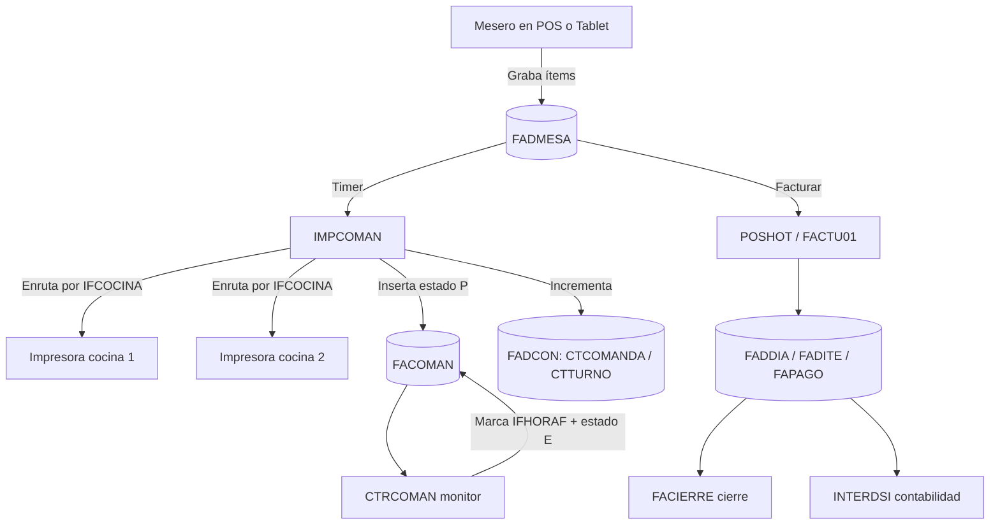

# 01 — Análisis del legado (`punto_c`)

## 1.1 Tecnología

| Aspecto | Hallazgo |
|---|---|
| Lenguaje | xHarbour (compatible Clipper) |
| Framework UI | FiveWin (Windows, MDI) |
| Compilador | Borland C++ BCC55 |
| Datos | DBF/CDX y **ADS** (`RDDSETDEFAULT("ADS")`, `ADSSETFILETYPE(3)`, `ADSSETSERVERTYPE(3)`) |
| Licencias | Sentinel (`spromeps.lib`, `Sentinel_xhb.lib`) |
| Extras | FileXLS (Excel), TChart/TChartX (gráficas), CAX/ActiveX |
| Impresión | `TPrinter` (Windows) + `TDOSPRN.PRG` (impresión DOS a LPT) |
| Estilo de código | Variables globales `PUBLIC`/`PRIVATE`/`STATIC`, macros `&`, bloqueos `RLOCK/FLOCK` |

## 1.2 Aplicaciones ejecutables

| Ejecutable | Fuentes principales | Rol |
|---|---|---|
| `PUNTO_C.EXE` | `POSHOT.PRG`, `DBFPOS`, `POSHOT2/3/4`, `PTOINDEX`, `POSINDEX`, `CNWINLIB` | POS principal (mesas, facturación) |
| `PTO_TAB.EXE` | `TABLET.PRG`, `TABLET3.PRG`, `DBFPOS`, `POSHOT2/4` | POS en tablet |
| `PUNTO.EXE` / `PUNTO2` | `POSHOT*` | Variante POS |
| `PUNTOP.EXE` | `PUNTOP.PRG`, `DBFPOSP.PRG` | POS de punto/caja |
| `CTRCOMAN.EXE` | `CTRCOMAN.PRG` | Monitor del estado de comandas |
| `IMPCOMAN.EXE` | `IMPCOMAN.PRG` | **Impresión de comandas a cocina por estación** |
| `HOTEL.EXE` | `HOTEL*`, `VISDBF`, `MONITORH`, `POSINDEX` | Módulo hotelero |
| `INTERDSI.EXE` | `INTERDSI.PRG`, `INTER.PRG` | Interfaz contable/inventario |
| `INIADT` / `INICIO` | `INIADT.PRG`, `INICIO.PRG`, `INICIO2.PRG` | Inicialización y creación de índices |
| `AUDITO.EXE` | `AUDITO.PRG` | Auditoría |
| `VTASMES.EXE` | `VTASMES.PRG` | Análisis de ventas mensuales |
| Librerías | `CNWINLIB.PRG`, `TDOSPRN.PRG`, `DSIVENCE.PRG` | Soporte |

## 1.3 Tablas relevantes (según uso en código, no DDL)

| Tabla | Rol | Campos observados |
|---|---|---|
| `FADCON` | Configuración global | `CTPUNTO`, `CTCIA`, `CTDIR`, `CTCOMANDA`, `CTTURNO`, `CTBORRACO`, `CTTIMECO`, `CTIMPCO`, `CTIMPFA`, `CTPORPRO`, `CTICONSUMO`, `CTNITCONT`, `CTRESOLU`, `CTFUERAL` |
| `FADMESA` | Comanda en curso por mesa | `IFMESA`, `IFARTIC`, `IFNOMBRE`, `IFCANT`, `IFCANT2`, `IFCOCINA`, `IFCOMANDA`, `IFOPER`, `IFOBSER`, `IFHORAI`, `IFHORAF`, `IFESTADO`, `IFCLIENTE`, `IFTREAL` |
| `FACOMAN` | Monitor de comandas | `IFMESA`, `IFFACTURA`, `IFARTIC`, `IFNOMBRE`, `IFCANT`, `IFHORAI`, `IFHORAF`, `IFESTADO`, `IFOPER`, `IFCLIENTE`, `IFOBSER1` |
| `FACOCINA` | Estaciones de preparación / impresoras | `IFCOCINA`, `NOMBRE`, `COLPT` |
| `FAESPERA` | Cuentas/mesas abiertas | `MESA`, `VENDED`, `NETO`, `PEDIDO`, `OBSER`, `NOMVEN`, `NOMBRE` |
| `FADCOMAN` | Consecutivos diarios de comanda | `CODIA`, `COINICIAL`, `COFINAL` |
| `FADITE`, `FADDIA`, `FAPAGO`, `FADLINEA`, `FACIERRE` | Facturación, pagos, cierre | `IFFACT`, `IFARTIC`, `IFFECHA`, `FPFACT`, `FPCODI`, `FAUSU`, `FAFECHA` |
| `VEDVEN` | Meseros/vendedores | `VNOMBRE` |
| `POSOPER` | Operadores/usuarios | `IINICIAL` |
| `POSMENU`, `POSRUTA`, `POSPAGO` | Menús, permisos por usuario, medios de pago | `OPCION`, `USUARIO`, `CODIGO` |
| `ITEMRAP` | Ítems rápidos/códigos | `INEAN14`, `NUMERO`, `INARTIC` |
| `ITEOBSER` | Observaciones predefinidas | `CODIGO` |
| `FADCLI`, `FADMECLI` | Clientes y relación mesa–cliente | `CNOMBRE`, `CTIPPAG`, `CLMESA`, `CLCLIENTE` |
| `EMPLE`, `PCOSTO` | Empleados y centros de costo | `CCODIGO`, `CNOMBRE` |
| `TIDTAB`, `TIDSAL`, `TIDTIPOS` | Inventario (tab, saldos, tipos) | `INARTIC`, `INNOMBRE`, `CTABCOD`… |

## 1.4 Flujo operativo actual (as-is)

## 1.5 Reglas de negocio reutilizables

Estas reglas son el activo más valioso del sistema actual y deben migrarse al nuevo producto:

1. **Enrutamiento a estaciones**: cada ítem lleva un código `IFCOCINA`; `FACOCINA` mapea ese
   código a un nombre y a un tipo/impresora (`COLPT`). Ítems con `IFCOCINA` vacío o `'99'`
   **no se imprimen** (van directo a cuenta).
2. **Control de impresión por ítem**: se imprime solo lo pendiente (`IFCOMANDA ≠ 'X'`).
   Al imprimir se marca `IFCOMANDA = 'X'` y se sella `IFHORAI = TIME()`.
3. **Doble registro comanda/monitor**: la impresión genera simultáneamente filas en `FACOMAN`
   (monitor) con estado `'P'`; el despacho marca `IFHORAF` y estado `'E'`.
4. **Número de comanda y turno**: consecutivos globales (`CTCOMANDA`) y turno (`CTTURNO`),
   con rango diario (`FADCOMAN`: inicio/fin).
5. **Copias configurables**: `CTIMPCO` (copias comanda), `CTIMPFA` (copias factura).
6. **Borrado automático de comanda** tras imprimir, si `CTBORRACO = .T.`.
7. **Observaciones por ítem**: campo `IFOBSER`, partido en bloques de 35 caracteres (hasta 3 líneas, ~105 caracteres).
8. **Venta por fracción/peso**: `IFCANT2` imprime como "N T" (tanda/kilos), típico de granel.
9. **Aviso sonoro de nueva comanda**: `CTRCOMAN` reproduce `CONFA.WAV` para ítems sin bandera de aviso.
10. **Propina configurable**: porcentaje `CTPORPRO` aplicado por el POS.
11. **Cajón de dinero**: secuencia ESC/POS documentada en `cajon.prg`
    (`27,112,0,64,240` para Epson; variantes Star).
12. **Menús y permisos por usuario**: `POSMENU` + `POSRUTA` (usuario × opción).
13. **Timer de refresco**: intervalo derivado de `CTTIMECO`.

## 1.6 Dolores y deuda técnica — lo que NO hay que repetir

| Dolor observado | Consecuencia | Regla para el nuevo producto |
|---|---|---|
| Estado global `PUBLIC`/`PRIVATE` entre módulos | Acoplamiento, bugs difíciles | Dominio encapsulado en servicios con estado explícito |
| Cada `.EXE` abre tablas DBF/ADS directamente | Concurrencia vía `RLOCK/FLOCK`, bloqueos | Única API dueña de los datos; sin acceso directo desde clientes |
| Impresión acoplada a Windows/DOS y `PRINTO.EXE` | Frágil, dependiente del PC | Print agent con cola y reintentos |
| Bugs recurrentes documentados en el propio código (IVA 19% vs 16%, tipo impuesto `'E'`, usuario truncado a 2 caracteres al cambiar medio de pago, auditoría de impuestos) | Inconsistencias contables | Modelo de impuestos y auditoría con pruebas automatizadas desde el día 1 |
| UI atada a recursos binarios `.RC`/`.BMP` | Difícil de versionar/diseñar | UI en código y assets versionados |
| Cálculo manual de fechas (ej. `DSIVENCE.PRG`, meses de 30 días) | Errores de vencimiento | Librería de fechas estándar |
| Sin API ni separación de capas | Web/móvil inviables sin permisos | API-first desde el inicio |

## 1.7 Inventario de archivos y recursos

| Grupo | Archivos | Observación |
|---|---|---|
| Fuentes del POS | `POSHOT.PRG`, `POSHOT2/3/4.PRG`, `PUNTOP.PRG`, `TABLET.PRG`, `TABLET3.PRG` | Lógica de venta y toma de pedido |
| Comandas | `CTRCOMAN.PRG`, `IMPCOMAN.PRG` | Toda la lógica de enrutamiento y monitor |
| Apertura de datos | `DBFPOS.PRG`, `DBFPOSP.PRG`, `VISDBF.PRG`, `CNWINLIB.PRG` | Patrón de acceso a DBF en red |
| Índices | `PTOINDEX.PRG`, `POSINDEX.PRG` | Definición real de claves (útil para migrar) |
| Impresión | `TDOSPRN.PRG`, `cajon.prg` | Impresión DOS y comandos de gaveta |
| Integración | `INTER.PRG`, `INTERDSI.PRG` | Contabilidad e inventario |
| Utilidades | `DSIVENCE.PRG`, `INICIO.PRG`, `INICIO2.PRG`, `INIADT.PRG` | Fechas, inicialización |
| Proyectos | `*.AJM` | Definen binarios, librerías e includes de cada `.EXE` |
| Recursos | `*.RC` | Diálogos, menús, bitmaps embebidos |
| Imágenes | `01/IMAGENES/`, `IMAGENES/`, `BMP/`, `BITMAPH*`, `FACTU.BMP`, `MESA00.BMP` | **Contenido no verificado**; por tamaño (80×53, 100×64, 48×62) parecen botones, íconos y posibles miniaturas de productos |

> Las imágenes no pudieron ser leídas como texto. Su revisión visual es un pendiente
> explícito (ver `16-riesgos-y-preguntas.md`).

## 1.8 Mapa legado → nuevo producto

| Legado | Nuevo módulo | Qué se reutiliza | Qué se descarta |
|---|---|---|---|
| `IMPCOMAN` | Enrutador de estaciones + Print agent | Reglas de enrutamiento y formato de comanda | Impresión DOS y `PRINTO.EXE` |
| `CTRCOMAN` | KDS | Concepto de monitor, aviso sonoro, marca de entrega | Lista `TListBox` y timer de sondeo |
| `POSHOT` / `PUNTOP` | APK meseros + backoffice de caja | Flujo de mesa, propina, medios de pago | UI de recursos binarios |
| `FADMESA` | `pedido_linea` | Campos y semántica operativa | Acceso directo por cada `.EXE` |
| `FACOMAN` | `comanda` | Estados `P`/`E` y trazabilidad de horas | Borrado físico tras imprimir |
| `FACOCINA` | `estacion` + `impresora` | Asignación de ítem a estación | Configuración en archivo plano |
| `FAESPERA` | `pedido` abierto | Cuenta abierta por mesa | Variables globales |
| `POSMENU`/`POSRUTA` | `rol`/`permiso` | Esquema de permisos por usuario | Menús binarios |
| `INTERDSI` | Fuera de alcance | Contabilidad ya resuelta | — |
| `HOTEL` | Fuera de alcance | — | — |

## 1.9 Qué datos del legado son candidatos a migrar

1. **Catálogo**: productos, categorías, precios, impuestos y estación por producto.
2. **Salón**: mesas y zonas.
3. **Personas**: meseros (`VEDVEN`), usuarios (`POSOPER`), clientes (`FADCLI`).
4. **Configuración**: propina, copias de impresión, datos de la empresa.
5. **Históricos**: ventas (`FADDIA`, `FADITE`, `FAPAGO`) solo como consulta, no como operación.

El detalle de mapeo, estrategia de convivencia y reconciliación está en
`14-migracion-del-legado.md`.
