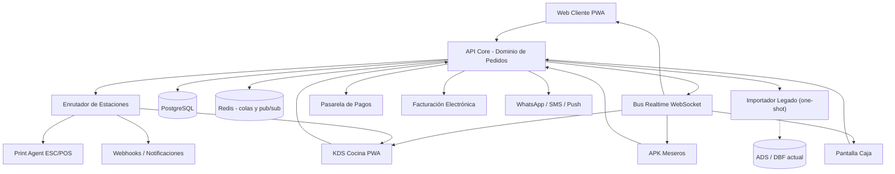

# 03 — Arquitectura

## 3.1 Estilo

**Monolito modular con API-first.** Un único backend (API REST + WebSocket) que es la
**fuente de verdad de pedidos**. Múltiples clientes consumen la misma API.

No microservicios en el MVP: el dominio es cohesionado y el equipo aún pequeño. Se separa por
módulos internos (catálogo, pedidos, estaciones, pagos, reservas) para poder extraer servicios
después si el volumen lo exige.

## 3.2 Stack sugerido por componente (a validar con el equipo)

| Componente | Recomendado | Alternativa |
|---|---|---|
| Backend | Node.js + NestJS + TypeScript | .NET 8 + ASP.NET Core; Python + FastAPI |
| Base de datos | PostgreSQL | MySQL / SQL Server |
| Caché y colas | Redis + BullMQ | RabbitMQ |
| Tiempo real | WebSocket (Socket.IO) | SignalR / SSE |
| Web cliente | Next.js (React) como PWA | Vue/Nuxt |
| APK meseros | Flutter + SQLite local | React Native |
| KDS | PWA React full-screen | App Flutter |
| Print Agent | Servicio local (Node/Go) que consume cola y habla ESC/POS | Integración directa IP/red |
| Infra | Docker + VPS/Cloud + CI/CD (GitHub Actions) | — |
| Observabilidad | Logs estructurados + métricas de tiempos de cocina | — |

> **Nota sobre el equipo:** el equipo actual es Harbour/FiveWin. Estas tecnologías implican
> capacitación o contratación. Es una decisión de negocio, no solo técnica; evaluarla temprano.

## 3.3 Tiempo real, impresión y offline (los tres puntos críticos)

- **Realtime**: cuando un mesero envía una comanda, el KDS debe recibirla en < 1 s por WebSocket.
  El monitor `CTRCOMAN` actual (con sonido) se reemplaza por notificaciones push.
- **Impresión**: un *print agent* corre en la red local del restaurante, escucha la cola por
  estación y envía ESC/POS. Reemplaza `IMPCOMAN` + `PRINTO.EXE` y desacopla del PC que imprime.
- **Offline (APK)**: base local SQLite + cola de envío idempotente. El mesero puede tomar pedidos
  sin red; al reconectar, sincroniza. Idempotencia por `client_order_id` para no duplicar.

## 3.4 Integraciones

| Integración | Necesidad | Nota |
|---|---|---|
| Facturación electrónica DIAN | Colombia | Definir proveedor (D3/D4) |
| Pasarela de pagos | Web y QR | Wompi/PayU/MercadoPago |
| WhatsApp / SMS / Push | Confirmación de reserva y pedido | Muy valorado en restaurantes |
| Impresoras térmicas ESC/POS | Comandas y facturas | Gaveta ya documentada en el legado |
| Contabilidad / inventario legado | Solo importación one-shot de datos (ADR-10) | Adaptador contable/inventario: roadmap futuro |
| Apps de domicilio de terceros | Fase futura | Rappi, etc. |
| Mapas/GPS | Seguimiento de domicilio | Fase domicilio |

## 3.5 Componentes

| Componente | Responsabilidad | Tecnología |
|---|---|---|
| API Core | Dominio de pedidos, catálogo, salón, pagos | NestJS |
| Bus realtime | Difusión de eventos a APK, KDS, web y caja | WebSocket |
| Enrutador de estaciones | Traduce pedido → comandas por estación | Servicio interno |
| Cola de impresión | Entrega trabajos al print agent con reintentos | Redis + BullMQ |
| Print agent | Habla ESC/POS con las impresoras locales | Servicio local |
| Importador legado | Lee ADS/DBF y traduce al modelo nuevo (one-shot, ADR-10) | Job por lote |
| Web cliente | Carta, carrito, checkout, reservas | Next.js PWA |
| APK meseros | Toma de pedido y operación de salón | Flutter + SQLite |
| KDS | Tablero de cocina por estación | React PWA |
| Backoffice | Administración y reportes | React |

## 3.6 Decisiones de arquitectura (ADR)

| ID | Decisión | Estado | Motivo |
|---|---|---|---|
| ADR-01 | Monolito modular en lugar de microservicios | Aceptada | Dominio cohesionado y equipo pequeño |
| ADR-02 | PostgreSQL como única fuente de verdad | Aceptada | Consistencia transaccional |
| ADR-03 | Modelo de pedido único multi-canal | Aceptada | Evita duplicar lógica por canal |
| ADR-04 | WebSocket para realtime | Aceptada | Latencia baja en cocina |
| ADR-05 | Print agent local en lugar de impresión desde el servidor | Aceptada | La impresora vive en la red del restaurante |
| ADR-06 | APK offline-first con SQLite y outbox | Aceptada | Redes de salón inestables |
| ADR-07 | Dinero en enteros, sin punto flotante | Aceptada | Evita errores de redondeo [SUPUESTO] |
| ADR-08 | Snapshot de nombre y precio en la línea de pedido | Aceptada | Los cambios de precio no alteran históricos |
| ADR-09 | `tenant_id` y `sucursal_id` desde el inicio | Aceptada | Habilita SaaS y multi-sede sin migración |
| ADR-10 | Integración con el legado por importación, no por acoplamiento | Pendiente (D1) | Depende de la decisión del cliente |
| ADR-11 | Proveedor de facturación electrónica externo | Pendiente (D3) | Depende de la decisión del cliente |

## 3.7 Eventos de dominio

Catálogo canónico de eventos de dominio. Los clientes los consumen por WebSocket con los
mismos nombres; el mapeo evento → canal está en `07`, §7.6.

| Evento | Emitido cuando | Consumidores |
|---|---|---|
| `pedido.creado` | Se crea un pedido en cualquier canal | Backoffice, analítica |
| `pedido.actualizado` | Cambia cualquier dato relevante del pedido | Salas de pedido, backoffice |
| `pedido.enviado` | El pedido pasa a `enviado` | Enrutador de estaciones, KDS |
| `pedido.en_camino` | El reparto inicia el trayecto (solo domicilio) | Cliente (seguimiento), caja |
| `pedido.entregado` | El pedido se entrega | Backoffice, métricas |
| `pedido.por_cobrar` | El pedido pasa a cobro | Caja, APK |
| `pedido.pagado` | Se registra el pago completo | Facturación, analítica |
| `pedido.cancelado` | Se cancela antes de tener pagos aprobados | Estaciones, caja, auditoría |
| `pago.aprobado` | Se aprueba un pago (pasarela o registro en caja) | Facturación, notificaciones, caja |
| `pago.rechazado` | Se rechaza un pago en línea (el pedido sigue `borrador`) | Caja, notificaciones, cliente |
| `comanda.en_preparacion` | La cocina inicia la preparación | Mesero, KDS |
| `comanda.lista` | La cocina termina | Mesero (push), KDS |
| `comanda.entregada` | El mesero entrega | KDS, métricas |
| `comanda.anulada` | Se anula una comanda (o todas sus líneas) | KDS, auditoría |
| `comanda.impresa` | El print agent confirma la impresión | KDS, auditoría |
| `alerta.sla` | Una comanda supera su SLA | KDS, backoffice |
| `item.agotado` | Se marca un producto agotado (RN-32) | Mesero, KDS |
| `reserva.solicitada` | Se crea una reserva | Backoffice, notificaciones |
| `reserva.actualizada` | Cambia el estado de la reserva (confirmada, sentada, `no_show`) | Notificaciones, salón |
| `reserva.cancelada` | Se cancela la reserva | Salón, notificaciones |
| `turno.cerrado` | Se cierra la caja | Reportes, auditoría |
| `dispositivo.revocado` | Se revoca un dispositivo | Dispositivo, seguridad |
| `sync.completado` | Termina un lote de sincronización offline | APK/KDS, observabilidad |

> La creación de comanda no es un evento de dominio propio: la estación recibe la comanda nueva
> con `pedido.enviado` y, tras un corte, con la resincronización (`07`, §7.6).

## 3.8 Ambientes

| Ambiente | Uso | Datos |
|---|---|---|
| Desarrollo | Trabajo diario del equipo | Semilla sintética |
| Staging | QA, UAT y demos | Copia anonimizada de un piloto |
| Producción | Restaurantes reales | Datos reales |

## 3.9 Escalabilidad

- El backend es sin estado; escala horizontalmente detrás de un balanceador.
- El bus realtime se escala con un adaptador compartido (Redis) para múltiples instancias.
- Las colas de impresión y notificaciones absorben picos y desacoplan latencia.
- Objetivo inicial de referencia: 200 pedidos por hora y 500 dispositivos por instancia,
  a validar con pruebas de carga (ver `13-qa-devops-operacion.md`).
- Postgres con réplica de lectura cuando los reportes compitan con la operación.
