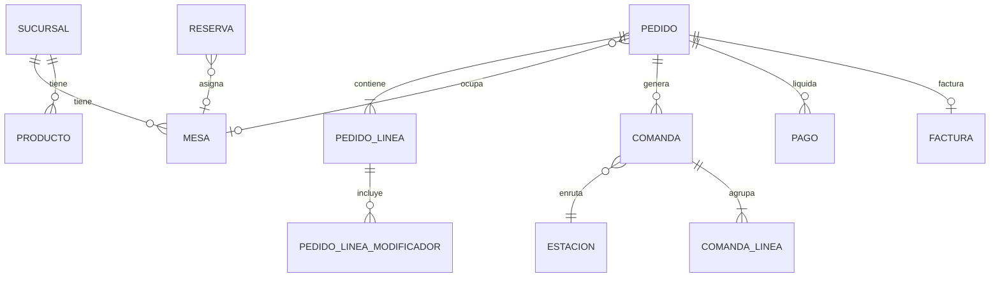

# 04 — Modelo de datos

## 4.1 Convenciones

- Motor: **PostgreSQL**.
- Tablas en `snake_case` plural; PK `id` (UUID v7); FK `<entidad>_id`.
- Toda entidad operativa lleva `sucursal_id`.
- Auditoría base: `created_at`, `updated_at`, `created_by`; borrado lógico con `deleted_at` donde aplique.
- Dinero: entero en la unidad mínima de la moneda (peso colombiano sin decimales) + campo `moneda`.
- Fechas: `timestamptz` en UTC; la zona horaria de la sucursal define el **día operativo**.
- Catálogo en pedidos: se guarda **snapshot** de nombre y precio en la línea, para que cambios
  posteriores de precio no alteren pedidos históricos.

## 4.2 Organización y acceso

| Tabla | Campos clave | Notas |
|---|---|---|
| `tenant` | `id`, `nombre`, `plan`, `estado` | Siempre presente (ADR-09); agrupa sucursales |
| `sucursal` | `id`, `tenant_id`, `nombre`, `zona_horaria`, `moneda`, `direccion`, `activa` | Raíz de toda la operación |
| `configuracion_sucursal` | `id`, `sucursal_id`, `propina_sugerida_pct`, `copias_comanda`, `copias_factura`, `borrado_comanda_impresa`, `comportamiento_offline` | Parámetros operativos (equivale a `FADCON`) |
| `usuario` | `id`, `tenant_id`, `email`, `password_hash`, `nombre`, `activo` | Login web/backoffice |
| `rol` | `id`, `tenant_id`, `nombre`, `es_sistema` | Administrador, cajero, mesero, cocina |
| `permiso` | `id`, `codigo`, `descripcion` | Ej. `pedido.anular`, `caja.cerrar` |
| `rol_permiso` | `rol_id`, `permiso_id` | Matriz RBAC |
| `usuario_rol` | `usuario_id`, `rol_id`, `sucursal_id` | Nulo = aplica a todas |
| `dispositivo` | `id`, `sucursal_id`, `tipo`, `nombre`, `token`, `pin_hash`, `pin_salt`, `estacion_id`, `ultima_conexion`, `version_app` | `tipo`: `apk`, `kds`, `print_agent`, `caja`; `estacion_id` para KDS/print agent |

## 4.3 Catálogo y estaciones

| Tabla | Campos clave | Notas |
|---|---|---|
| `categoria` | `id`, `sucursal_id`, `nombre`, `orden`, `activa`, `imagen_url` | Menú |
| `producto` | `id`, `sucursal_id`, `categoria_id`, `sku`, `codigo_barras`, `nombre`, `descripcion`, `precio`, `estacion_id`, `impuesto_id`, `agotado`, `visible_web`, `tiempo_objetivo_seg`, `imagen_url`, `activo` | `estacion_id` equivale a `IFCOCINA`; `codigo_barras` viene de `ITEMRAP` |
| `producto_variante` | `id`, `producto_id`, `nombre`, `precio_delta` | Tamaños/presentaciones |
| `grupo_modificador` | `id`, `tenant_id`, `nombre`, `min_seleccion`, `max_seleccion`, `obligatorio` | "Término", "Adiciones" |
| `modificador` | `id`, `grupo_id`, `nombre`, `precio_delta`, `activo` | |
| `producto_grupo_modificador` | `producto_id`, `grupo_id` | |
| `combo_componente` | `combo_id`, `producto_id`, `cantidad` | |
| `impuesto` | `id`, `tenant_id`, `nombre`, `tipo`, `porcentaje`, `incluido_en_precio` | `tipo`: `inc`, `iva`, `ninguno` |
| `estacion` | `id`, `sucursal_id`, `nombre`, `tipo`, `sla_seg`, `kds_activo` | `tipo`: `cocina`, `barra`, `parrilla`, `despacho` |
| `impresora` | `id`, `sucursal_id`, `estacion_id`, `nombre`, `tipo_conexion`, `direccion`, `ancho_mm`, `perfil`, `copias`, `activa` | `perfil`: `escpos`, `star` |

## 4.4 Salón

| Tabla | Campos clave | Notas |
|---|---|---|
| `zona` | `id`, `sucursal_id`, `nombre`, `orden` | Salón, terraza, barra |
| `mesa` | `id`, `zona_id`, `nombre`, `capacidad`, `estado`, `pos_x`, `pos_y` | `estado`: `libre`, `ocupada`, `por_cobrar`, `reservada`, `fuera_servicio` |
| `mesa_union` | `id`, `mesa_principal_id`, `mesa_secundaria_id`, `activa` | Unión temporal |

## 4.5 Pedidos y comandas

| Tabla | Campos clave | Notas |
|---|---|---|
| `cliente` | `id`, `tenant_id`, `nombre`, `telefono`, `email`, `notas`, `consentimiento_datos` | |
| `cliente_direccion` | `id`, `cliente_id`, `direccion`, `barrio`, `lat`, `lng`, `referencia` | |
| `pedido` | `id`, `sucursal_id`, `numero`, `codigo`, `canal`, `modalidad`, `mesa_id`, `cliente_id`, `mesero_id`, `estado`, `subtotal`, `impuestos`, `descuento`, `propina`, `total`, `zona_cobertura_id`, `direccion_entrega`, `repartidor_id`, `observaciones`, `programado_para`, `client_order_id`, `cerrado_en` | `numero` consecutivo por sucursal; `codigo` para seguimiento público |
| `pedido_linea` | `id`, `pedido_id`, `producto_id`, `variante_id`, `nombre_snapshot`, `precio_unitario`, `cantidad`, `es_fraccion`, `cantidad_fraccion`, `notas`, `estacion_id`, `estado`, `enviada_en`, `lista_en`, `entregada_en` | `es_fraccion` reemplaza `IFCANT2` |
| `pedido_linea_modificador` | `id`, `linea_id`, `modificador_id`, `nombre_snapshot`, `precio_delta` | |
| `comanda` | `id`, `pedido_id`, `estacion_id`, `numero`, `turno_id`, `estado`, `enviada_en`, `lista_en`, `entregada_en` | Equivale a `FACOMAN`; la impresión es el estado `impresa` (única fuente de verdad) |
| `comanda_linea` | `comanda_id`, `pedido_linea_id`, `estado` | |
| `turno` | `id`, `sucursal_id`, `numero`, `estado`, `abierto_en`, `cerrado_en`, `usuario_apertura_id`, `usuario_cierre_id` | Equivale a `CTTURNO` |
| `consecutivo` | `id`, `sucursal_id`, `tipo`, `prefijo`, `siguiente`, `resolucion`, `vigencia_hasta` | `tipo`: `pedido`, `comanda`, `factura` |
| `sync_operacion` | `id`, `dispositivo_id`, `client_op_id`, `tipo`, `payload`, `estado`, `aplicado_en`, `error` | Idempotencia offline |
| `trabajo_impresion` | `id`, `comanda_id`, `factura_id`, `impresora_id`, `tipo`, `estado`, `intentos`, `ultimo_error`, `creado_en`, `impreso_en` | Cola del print agent; alimenta la tasa de fallo de impresión (`15`) |

## 4.6 Pagos y facturación

| Tabla | Campos clave | Notas |
|---|---|---|
| `medio_pago` | `id`, `sucursal_id`, `nombre`, `tipo`, `requiere_referencia`, `activo` | Equivale a `POSPAGO` |
| `pago` | `id`, `pedido_id`, `medio_pago_id`, `monto`, `propina`, `referencia`, `estado`, `pasarela_payload`, `usuario_id` | Varios pagos por pedido |
| `pago_linea` | `id`, `pago_id`, `pedido_linea_id`, `monto` | Asignación pago↔línea para la división de cuenta por líneas (RN-18); opcional |
| `factura` | `id`, `pedido_id`, `numero`, `prefijo`, `resolucion`, `cufe`, `estado_dian`, `xml_url`, `pdf_url`, `total`, `impuestos_json`, `emitida_en` | |
| `factura_linea` | `factura_id`, `descripcion`, `cantidad`, `precio`, `impuesto_id`, `total` | |
| `cierre_caja` | `id`, `sucursal_id`, `turno_id`, `usuario_id`, `base_inicial`, `ventas_efectivo`, `ventas_otros`, `propinas`, `retiros`, `gastos`, `contado`, `diferencia`, `observaciones` | Equivale a `FACIERRE` |

## 4.7 Reservas, domicilio y mensajería

| Tabla | Campos clave | Notas |
|---|---|---|
| `reserva` | `id`, `sucursal_id`, `cliente_id`, `fecha_hora`, `duracion_min`, `personas`, `zona_id`, `mesa_id`, `estado`, `deposito_requerido`, `deposito_pagado`, `codigo`, `origen` | |
| `lista_espera` | `id`, `sucursal_id`, `cliente_id`, `personas`, `estado`, `mesa_asignada_id` | |
| `zona_cobertura` | `id`, `sucursal_id`, `nombre`, `tarifa`, `pedido_minimo`, `tiempo_estimado_min`, `geometria` | GeoJSON o lista de barrios |
| `repartidor` | `id`, `sucursal_id`, `nombre`, `telefono`, `vehiculo`, `estado` | |
| `domicilio_asignacion` | `id`, `pedido_id`, `repartidor_id`, `asignado_en`, `recogido_en`, `entregado_en`, `estado`, `evidencia_url` | `estado` según enum `estado_domicilio` (4.8) |
| `notificacion` | `id`, `destinatario_tipo`, `destinatario_id`, `canal`, `plantilla`, `payload`, `estado`, `enviado_en`, `error` | |
| `plantilla_notificacion` | `id`, `tenant_id`, `evento`, `canal`, `idioma`, `asunto`, `cuerpo` | |
| `encuesta` | `id`, `pedido_id`, `cliente_id`, `puntaje`, `comentario`, `canal`, `creado_en` | NPS post-entrega (`15`) |
| `evento_auditoria` | `id`, `tenant_id`, `sucursal_id`, `usuario_id`, `dispositivo_id`, `entidad`, `entidad_id`, `accion`, `motivo`, `datos_antes`, `datos_despues`, `ip`, `request_id` | |

## 4.8 Enums principales

| Enum | Valores |
|---|---|
| `canal_pedido` | `web`, `mesero`, `caja`, `kiosco` |
| `modalidad_pedido` | `mesa`, `domicilio`, `recoger` |
| `estado_pedido` | `borrador`, `enviado`, `en_preparacion`, `listo`, `en_camino`, `entregado`, `por_cobrar`, `pagado`, `cancelado` |
| `estado_linea` | `pendiente`, `enviada`, `en_preparacion`, `lista`, `entregada`, `anulada` |
| `estado_comanda` | `pendiente`, `impresa`, `en_preparacion`, `lista`, `entregada`, `anulada` |
| `estado_reserva` | `solicitada`, `confirmada`, `sentada`, `no_show`, `cancelada` |
| `estado_pago` | `pendiente`, `aprobado`, `rechazado`, `reembolsado` |
| `estado_domicilio` | `asignado`, `recogido`, `en_camino`, `entregado`, `entrega_fallida`, `devuelto` |
| `estado_impresion` | `pendiente`, `enviado`, `impreso`, `reintentando`, `fallido` |

Notas: `kiosco` es un canal reservado a futuro (sin cliente en MVP/V1). Una línea que cocina
marca como agotada pasa a `anulada` con motivo (RN-33).

## 4.9 Relaciones principales

## 4.10 Índices y restricciones mínimas

- `UNIQUE (tenant_id, email)` en `usuario`.
- `UNIQUE (sucursal_id, numero)` en `pedido` y `comanda`.
- `UNIQUE (sucursal_id, prefijo, numero)` en `factura` (la numeración DIAN es por prefijo).
- `UNIQUE (token)` en `dispositivo`.
- `UNIQUE (codigo)` en `pedido` y `reserva` (seguimiento público).
- `UNIQUE (client_op_id)` en `sync_operacion` (idempotencia).
- Restricción de exclusión en `reserva` para bloquear solapes de franja por mesa (RN-25): `EXCLUDE USING gist (mesa_id WITH =, tsrange(fecha_hora, fecha_hora + (duracion_min * interval '1 minute')) WITH &&)` con `btree_gist`.
- Índice en `pedido (sucursal_id, estado, created_at)` para tableros operativos.
- Índice en `comanda (estacion_id, estado)` para el KDS.
- Índice en `evento_auditoria (entidad, entidad_id, created_at)`.
- `UNIQUE (pedido_id)` en `encuesta` (una encuesta por pedido).
- Índice en `trabajo_impresion (estado, creado_en)` para la cola del print agent.
- Índice GIN en `zona_cobertura.geometria` si se usa PostGIS.

## 4.11 Máquina de estados

Transiciones válidas por entidad (RN-13). Cualquier otra transición responde error de negocio y
no altera datos. Cada cambio de estado emite el evento de dominio correspondiente (`03`, §3.7).

**Pedido** (`estado_pedido`)

| Desde | Hacia |
|---|---|
| `borrador` | `enviado`, `cancelado` |
| `enviado` | `en_preparacion`, `cancelado` |
| `en_preparacion` | `listo`, `por_cobrar`, `cancelado` |
| `listo` | `entregado`, `en_camino` (solo domicilio), `por_cobrar`, `cancelado` |
| `entregado` | `por_cobrar` |
| `en_camino` | `entregado` |
| `por_cobrar` | `pagado` |
| `pagado` | — (terminal; reversos solo por nota crédito/reembolso, RN-14) |
| `cancelado` | — (terminal; solo antes de pagos aprobados, RN-14) |

**Línea** (`estado_linea`)

| Desde | Hacia |
|---|---|
| `pendiente` | `enviada`, `anulada` |
| `enviada` | `en_preparacion`, `anulada` |
| `en_preparacion` | `lista`, `anulada` |
| `lista` | `entregada`, `anulada` |
| `entregada` | — (terminal) |
| `anulada` | — (terminal; exige motivo, RN-15/RN-33) |

**Comanda** (`estado_comanda`)

| Desde | Hacia |
|---|---|
| `pendiente` | `impresa`, `en_preparacion`, `anulada` |
| `impresa` | `en_preparacion`, `anulada` |
| `en_preparacion` | `lista`, `anulada` |
| `lista` | `entregada`, `anulada` |
| `entregada` | — (terminal) |
| `anulada` | — (terminal) |

La comanda pasa a `impresa` con el evento `comanda.impresa`; no existe booleano de impresión.

**Reserva** (`estado_reserva`)

| Desde | Hacia |
|---|---|
| `solicitada` | `confirmada`, `cancelada` |
| `confirmada` | `sentada`, `no_show` (pasado el margen), `cancelada` |
| `sentada` | — (terminal) |
| `no_show` | — (terminal) |
| `cancelada` | — (terminal) |

**Pago** (`estado_pago`)

| Desde | Hacia |
|---|---|
| `pendiente` | `aprobado`, `rechazado` |
| `aprobado` | `reembolsado` |
| `rechazado` | — (terminal; un reintento crea un pago nuevo) |
| `reembolsado` | — (terminal) |

## 4.12 Pendientes del modelo

1. Definir si se adopta PostGIS para zonas de cobertura o lista de barrios (D8).
2. Definir si el inventario entra al modelo en una fase posterior (D9); hoy **no** está modelado.
3. Confirmar tratamiento fiscal exacto (INC vs IVA) con el contador antes de cerrar `impuesto` (D3/D4).
4. Observaciones predefinidas del legado (`ITEOBSER`): entidad pendiente si entran al alcance.
5. Marcas de sesión offline en `sync_operacion` (o derivarlas de los heartbeats de `dispositivo`), para el KPI de uso offline (`15`).
