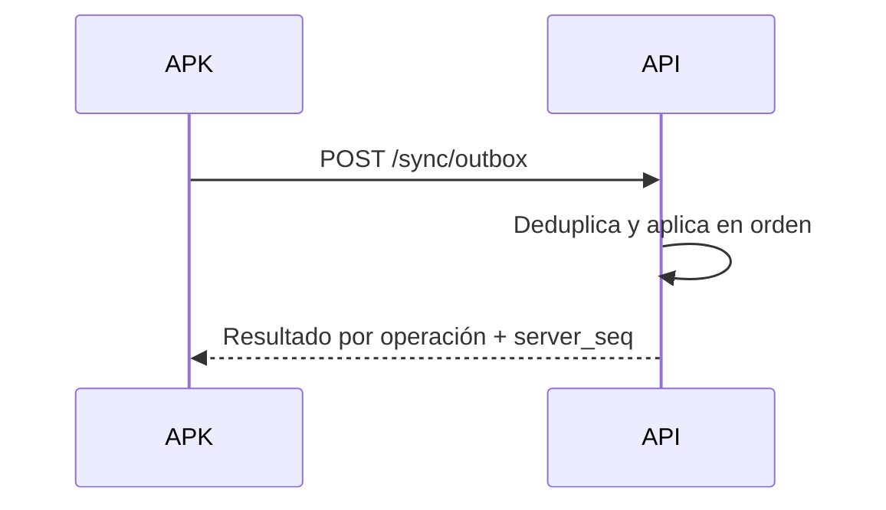

# 07 — API, eventos y seguridad

Contrato entre el API Core y sus clientes (web, APK, KDS, caja, print agent, backoffice).
La API es la única dueña de los datos y la única puerta de entrada; ningún cliente accede a
PostgreSQL (ADR-02, RN-30). Tablas y campos citados provienen de `04-modelo-de-datos.md`;
reglas, de `05-reglas-de-negocio.md`.

## 7.1 Principios y convenciones REST

| Tema | Convención |
|---|---|
| Base y versionado | `/api/v1`; cambio incompatible → `/api/v2` con aviso `Sunset` ≥ 6 meses [SUPUESTO] |
| Medios | JSON UTF-8 `snake_case`; fechas ISO 8601 UTC; dinero entero en unidad mínima (RN-19) |
| Autenticación | `Authorization: Bearer <jwt>`; dispositivos con token emitido en su vinculación |
| Paginación | Cursor opaco `?cursor=&limite=` (def. 25, máx. 100) → `{datos, siguiente_cursor, hay_mas}` |
| Filtros y orden | `?estado=&desde=&hasta=&q=&orden=-creado_en`; toda consulta se acota a la sucursal del token (RN-30) |
| Errores | RFC 7807 `application/problem+json` + `codigo` de negocio y `errores[]` |
| Idempotencia | `Idempotency-Key` obligatoria en POST de pedidos, pagos, facturas y sync (TTL 24 h [SUPUESTO]); repetir la clave devuelve la misma respuesta |
| Reintentos y límites | Reintentables 5xx/409/429 con la misma clave; 429 + `Retry-After` (login 10/min, API 600/min, sync 120/min) [SUPUESTO] |
| Semántica y correlación | POST crea/ejecuta, PATCH parcial, DELETE lógico, `202` en impresión y notificaciones; `X-Request-Id` en toda respuesta |
| Tiempo real | WebSocket con el mismo token (7.6) |

## 7.2 Catálogo de endpoints

Roles: `adm` administrador, `caj` cajero, `mes` mesero, `coc` cocina, `rep` repartidor,
`cli` cliente web, `disp` dispositivo, `púb` público. `púb` (sin sesión) y `disp` (token de
dispositivo) no pasan por la matriz RBAC de 7.5. El canal `kiosco` queda reservado a futuro y
no tiene cliente en MVP/V1 (`04`, §4.8).

| Recurso | Método | Ruta | Descripción | Roles |
|---|---|---|---|---|
| auth | POST | `/auth/login` · `/auth/mfa/verificar` | Email + contraseña; MFA TOTP opcional | púb |
| auth | POST | `/auth/refresh` · `/auth/logout` | Rota o revoca el refresh | sesión |
| auth | POST | `/auth/dispositivo/pin` · `.../refresh` | APK/KDS: PIN + vinculación, rota token | disp |
| auth | GET | `/auth/yo` | Usuario, roles, permisos y sucursales | sesión |
| clientes | POST | `/clientes` | Registro de cliente web (auth `cli`) | púb |
| clientes | GET/PATCH | `/clientes/{id}` · `/clientes/{id}/direcciones` | Datos y direcciones del cliente | cli (propio), adm |
| clientes | GET | `/mi-cuenta` · `/mi-cuenta/pedidos` · `/mi-cuenta/reservas` | Historial, direcciones y preferencias | cli |
| catálogo | GET/POST/PATCH | `/catalogo/categorias` · `/catalogo/productos` | CRUD; con histórico se desactiva, no se borra | GET púb; escritura adm |
| catálogo | PATCH | `/catalogo/productos/{id}/agotado` | Agotado (RN-32) | adm, caj |
| catálogo | GET/POST/PATCH | `/catalogo/modificadores` · `/catalogo/impuestos` | Modificadores, grupos e impuestos | adm |
| configuración | GET/PATCH | `/configuracion` | Propina sugerida, copias de comanda/factura, borrado de comanda y comportamiento offline (`configuracion_sucursal`, 04.2) | GET caj; PATCH adm |
| configuración | GET/PATCH | `/sucursales/{id}` | Datos, horarios, zona horaria | adm |
| configuración | GET/POST/PATCH | `/estaciones` · `/impresoras` | Alta/edición de estaciones, asignación de productos, SLA e impresoras | adm |
| salón | GET | `/salon/zonas` · `/salon/mesas` | Mapa y estado de mesas | mes, caj, adm |
| salón | POST/PATCH | `/salon/zonas[/{id}]` · `/salon/mesas[/{id}]` | Alta/edición de zonas y mesas (capacidad, `pos_x`/`pos_y`) | adm |
| salón | PATCH/POST | `/salon/mesas/{id}/estado` · `/unir` · `/trasladar` | `libre/ocupada/por_cobrar/reservada/fuera_servicio`; unión y traslado (RN-17) | mes, caj |
| pedidos | POST | `/pedidos` | Crea en cualquier canal; idempotente | púb/cli (web), mes, caj |
| pedidos | GET | `/pedidos` · `/pedidos/{id}` | Lista operativa y detalle | mes, caj, adm |
| pedidos | PATCH | `/pedidos/{id}` | Edita borrador | mes (propio), caj, adm |
| pedidos | POST/PATCH | `/pedidos/{id}/lineas[/{linea}]` | Líneas; anular exige motivo (RN-15) | mes, caj |
| pedidos | POST | `/pedidos/{id}/enviar` | Enruta pendientes a comandas (RN-01…RN-04) | mes, caj |
| pedidos | POST | `/pedidos/{id}/pre-cuenta` · `/cancelar` | Pre-cuenta; cancela antes de pago (RN-14) | cli (propio, sin preparar), mes (permiso), caj, adm |
| pedidos | POST | `/pedidos/{id}/descuentos` · `/cortesias` | Descuento o cortesía con motivo (RN-16, RN-29) | caj (sensible), mes (permiso), adm |
| pedidos | GET | `/pedidos/{id}/seguimiento` | Estado con `codigo` + token de seguimiento de corta vida; sin sesión | púb |
| comandas | GET | `/comandas` · `/comandas/{id}` | Tablero por estación y detalle con notas | coc, mes, adm |
| comandas | PATCH | `/comandas/{id}/estado` | `en_preparacion`/`lista` (cocina); `entregada` (mesero) | coc, mes |
| comandas | POST | `/comandas/{id}/anular` | Anula la comanda con motivo (RN-15) | mes (permiso), caj, adm |
| comandas | POST | `/comandas/{id}/reimprimir` | Reencola impresión (auditada) | coc, caj, mes (permiso), adm |
| comandas | POST | `/comandas/{id}/lineas/{linea}/agotado` | Línea sin disponibilidad: pasa a `anulada` con motivo y notifica al mesero (RN-33) | coc, caj, adm |
| pagos | GET | `/medios-pago` | Catálogo (equivale a `POSPAGO`) | caj, mes, adm |
| pagos | POST/PATCH | `/medios-pago[/{id}]` | Alta/edición de medios de pago | adm |
| pagos | POST | `/pedidos/{id}/pagos` | Registra pago (con asignación opcional a líneas, RN-18) o inicia pasarela; idempotente | cli (web), caj, mes (permiso) |
| pagos | POST | `/pagos/{id}/reembolso` | Reverso con motivo (V1) | caj (sensible), adm |
| caja | GET/POST | `/caja/turnos` · `/actual` · `/{id}/cerrar` · `/movimientos` | Turno, arqueo y cierre (RN-22), retiros y gastos | caj (cierre con permiso) |
| facturas | POST/GET | `/pedidos/{id}/factura` · `/facturas/{id}` | Emite (V1; D3); `estado_dian`, PDF/XML | caj, adm |
| facturas | POST | `/facturas/{id}/nota-credito` · `/reemitir` | Nota crédito; reintento ante la DIAN (V1) | caj (permiso), adm |
| reservas | GET | `/reservas/disponibilidad` | Franjas libres por fecha, personas y zona | púb |
| reservas | POST | `/reservas` | Solicita; valida disponibilidad de mesa/franja (RN-25) | púb, cli |
| reservas | GET/PATCH | `/reservas` · `/reservas/{id}` | Agenda; confirmar, sentar, `no_show`, cancelar | caj, adm |
| reservas | POST/PATCH | `/reservas/{id}/check-in` | Reserva → mesa ocupada | caj, mes |
| reservas | POST/PATCH | `/reservas/{id}/deposito` | Configura y registra el pago del depósito | caj, adm |
| reservas | GET/POST/PATCH | `/lista-espera[/{id}]` | Cola de espera y asignación de mesa | caj, mes |
| domicilio | GET | `/domicilio/cobertura` | Valida dirección (RN-26) | púb |
| domicilio | POST/PATCH | `/domicilio/cobertura` | Zonas de cobertura, tarifas y pedido mínimo | adm |
| domicilio | GET/POST/PATCH | `/repartidores` | Alta, estado y disponibilidad | adm |
| domicilio | POST/PATCH | `/pedidos/{id}/repartidor` · `/domicilio/asignaciones/{id}` | Asigna; `recogido_en`/`entregado_en` + evidencia (RN-27) | caj, adm / rep |
| usuarios | GET/POST/PATCH | `/usuarios` · `/roles` · `/roles/{id}/permisos` · `/permisos` | Usuarios, roles y matriz RBAC (7.5) | adm |
| dispositivos | GET/POST/DELETE | `/dispositivos` | Vincula, lista y revoca dispositivos | adm |
| reportes | GET | `/reportes/ventas` · `/tiempos` · `/cierre-caja` | Ventas, tiempos vs SLA y arqueo | adm, caj, coc (tiempos) |
| auditoría | GET | `/auditoria` | Consulta de eventos, solo lectura | adm |
| app | GET | `/app/version` | Versión mínima soportada por plataforma (13.11) | púb, disp |
| sync | GET | `/sync/catalogo` · `/sync/configuracion` | Delta para APK y KDS | disp |
| sync | POST | `/sync/outbox` | Lote de operaciones offline | disp |

## 7.3 Endpoints de sincronización

- **Pull**: `GET /sync/catalogo?desde_version=` y `GET /sync/configuracion?desde_version=`
  devuelven solo cambios (catálogo, estaciones y parámetros) con `version` monotónica; si el
  cliente está muy atrasado responden `resync_requerido` y pide todo. APK guarda en SQLite,
  KDS en almacenamiento del navegador [SUPUESTO].
- **Push**: `POST /sync/outbox` recibe hasta 100 operaciones [SUPUESTO]
  (`client_op_id`, `tipo`, `payload`, `ocurrido_en`); tipos MVP: `pedido.crear`,
  `pedido.linea.agregar`, `pedido.enviar`, `comanda.estado`. El servidor aplica en orden,
  deduplica por `client_op_id` (`UNIQUE` en `sync_operacion`, RN-28) y responde por operación
  `aplicada`, `duplicada` o `rechazada` + `error`; un rechazo de negocio (precio cambiado,
  producto agotado) se muestra al usuario (gana el servidor). La respuesta incluye `server_seq`.
- El print agent no usa outbox: consume la cola de impresión por evento (ver `08`).

## 7.4 Autenticación y sesiones

| Cliente | Credencial | Vigencia [SUPUESTO] | Revocación |
|---|---|---|---|
| Web cliente / backoffice | Email + contraseña (argon2id); MFA TOTP opcional | Access 15 min; refresh 30 días | Logout, cambio de contraseña, desactivar usuario, reuso de refresh |
| APK meseros | PIN 4–6 dígitos + vinculación de dispositivo | Access 15 min; refresh 90 días atado al `dispositivo_id` | Revocar dispositivo, bloqueo por intentos, logout |
| KDS | Token de dispositivo, sin usuario | Access 8 h; refresh 180 días | Revocar dispositivo |
| Print agent | Token de dispositivo | Larga duración, rotación al revincular | Revocar dispositivo |
| Web pública | Sin sesión; `codigo` + token de seguimiento de corta vida (7.6) | — | — |

- JWT RS256/EdDSA con `sub`, `tenant_id`, `sucursales[]`, `roles[]`, `dispositivo_id`, `jti`,
  `exp`. El refresh es **rotativo y de un solo uso**: reutilizar uno ya rotado revoca la
  familia completa (detección de robo).
- **Bloqueo por intentos**: 5 fallos → 15 min en PIN; en web, cuenta bloqueada hasta
  desbloqueo por administrador [SUPUESTO]. Todo intento fallido se audita.
- El PIN del APK no se guarda en el dispositivo y TLS es obligatorio. Los permisos del legado
  (`POSMENU`/`POSRUTA`) se migran como roles y permisos, no como menús binarios.

## 7.5 RBAC

Los permisos se evalúan siempre en el servidor; la UI solo oculta opciones.
`usuario_rol.sucursal_id` acota el alcance (nulo = todas) y `cli` solo accede a lo propio.
`púb` (sin sesión) y `disp` (token de dispositivo) no se evalúan por esta matriz (7.2).

| Permiso | adm | caj | mes | coc | rep | cli |
|---|---|---|---|---|---|---|
| `catalogo.editar`, `precio.editar` | X | — | — | — | — | — |
| `salon.ver`, `mesa.gestionar`, `mesa.trasladar` | X | X | X | — | — | — |
| `pedido.crear`, `pedido.ver` | X | X | X | — | — | X (propio) |
| `pedido.enviar`, `pedido.modificar` | X | X | X | — | — | — |
| `pedido.anular`, `pedido.cancelar` | X | X | X (permiso) | — | — | X (sin preparar) [SUPUESTO] |
| `descuento.aplicar`, `cortesia.aplicar` | X | X (sensible) | X (permiso) | — | — | — |
| `comanda.ver` | X | — | X | X | — | — |
| `comanda.marcar_estado`, `comanda.reimprimir`, `comanda.anular` | X | X (reimprimir) | X (entregar, anular) | X (marcar) | — | — |
| `cuenta.pre_cuenta`, `cuenta.cobrar` | X | X | X (pre-cuenta) | — | — | — |
| `pago.registrar`, `pago.reembolsar` | X | X (sensible) | X (registrar) | — | — | X (registrar, propio) |
| `factura.emitir`, `factura.nota_credito` | X | X (sensible) | — | — | — | — |
| `caja.abrir`, `caja.cerrar`, `caja.reabrir` | X | X (sensible) | — | — | — | — |
| `reserva.ver`, `reserva.gestionar` | X | X | — | — | — | X (ver, propio) |
| `domicilio.asignar` / `domicilio.entregar` | X / — | X / — | — | — | — / X | — |
| `usuario.gestionar`, `rol.gestionar`, `dispositivo.gestionar`, `config.editar`, `auditoria.ver` | X | — | — | — | — | — |
| `reporte.ver` | X | X | — | X (tiempos) | — | — |

Los roles son plantillas editables salvo los de sistema; la matriz vive en `rol_permiso`
(04.2) y todo cambio se audita. El rol `rep` opera con web móvil en V1 (una app nativa de
reparto queda fuera del alcance, D8).

## 7.6 WebSocket

Endpoint `wss://{host}/rt`; el access token viaja en el payload de autenticación del handshake
(nunca en la query string). Token inválido cierra con `4401` y el cliente refresca y reconecta.
Las suscripciones se autorizan por permiso y sucursal. Salas: `sucursal:{id}`, `estacion:{id}`,
`usuario:{id}`, `dispositivo:{id}`, `pedido:{id}` y `seguimiento:{codigo}` (token anónimo de
corta vida emitido por `GET /pedidos/{id}/seguimiento`).

Mapeo evento de dominio (`03`, §3.7) → canal WebSocket, con los mismos nombres:

| Evento | Payload (resumen) | Destinatarios |
|---|---|---|
| `pedido.creado` | `pedido_id`, canal, modalidad, mesa, estado | sucursal, caja |
| `pedido.actualizado` | `pedido_id`, estado, total | sala `pedido`, sucursal |
| `pedido.enviado` | `pedido_id`, comandas generadas por estación | estación, sucursal |
| `pedido.en_camino` | `pedido_id`, repartidor, tiempo estimado | sala `seguimiento`, caja |
| `pedido.entregado` | `pedido_id`, entregado_en | sala `pedido`, sucursal |
| `pedido.por_cobrar` | `pedido_id`, total | caja, usuario del pedido |
| `pedido.pagado` | `pedido_id`, pagos, total | sala `pedido`, caja |
| `pedido.cancelado` | `pedido_id`, motivo | estación, caja, sala `pedido` |
| `pago.aprobado` | `pago_id`, `pedido_id`, monto | sala `pedido`, caja |
| `pago.rechazado` | `pago_id`, `pedido_id`, motivo | sala `pedido`, cliente |
| `comanda.en_preparacion` | `comanda_id`, estación, ítems | estación, usuario del pedido |
| `comanda.lista` | `comanda_id`, mesa | usuario del pedido, estación |
| `comanda.entregada` | `comanda_id`, usuario | estación, métricas (sucursal) |
| `comanda.anulada` | `comanda_id`, motivo | estación, usuario del pedido, auditoría |
| `comanda.impresa` | `comanda_id`, impresora, ok, error | estación, auditoría |
| `alerta.sla` | `comanda_id`, segundos excedidos | estación |
| `item.agotado` | `producto_id`, `estacion_id` | sucursal, estación |
| `reserva.solicitada` | `reserva_id`, fecha, personas | backoffice |
| `reserva.actualizada` | `reserva_id`, estado | backoffice, cliente |
| `reserva.cancelada` | `reserva_id`, motivo | backoffice, cliente |
| `turno.cerrado` | `turno_id`, diferencia | backoffice, auditoría |
| `dispositivo.revocado` | `dispositivo_id` | dispositivo |
| `sync.completado` | `dispositivo_id`, `server_seq` | dispositivo |

- La creación de comandas no es un evento de dominio propio: la estación recibe la comanda
  nueva con `pedido.enviado` (payload con comandas generadas) y, tras un corte, con la
  resincronización.
- **Reconexión**: backoff exponencial con jitter (1 s → 30 s) y heartbeat ping/pong cada 25 s
  [SUPUESTO]. Entrega "al menos una vez": el cliente deduplica por `evento_id` y nunca usa el
  evento como fuente de verdad.
- **Resincronización**: al reconectar se refresca la vista (`GET /comandas?estacion_id=`,
  `GET /pedidos/{id}`); si el corte fue largo, el KDS recarga el tablero completo y no depende
  de memoria local (06.3). Una conexión por dispositivo: la nueva cierra la anterior [SUPUESTO].
- El aviso sonoro del KDS se dispara con `pedido.enviado` (comanda nueva en la estación) y
  `alerta.sla` (RN-11).

## 7.7 Webhooks salientes

| Aspecto | Definición |
|---|---|
| Uso | Integraciones del tenant: proveedor DIAN (D3), pasarela (D5), WhatsApp/SMS, BI, terceros de domicilio a futuro (D8) |
| Firma | HMAC-SHA256 sobre `timestamp.cuerpo`; cabeceras `X-Evento`, `X-Event-Id`, `X-Timestamp`, `X-Firma: v1=...` |
| Entrega | Al menos una vez; reintentos 1 m, 5 m, 30 m, 2 h y 12 h, luego cuarentena visible; timeout 5 s [SUPUESTO] |
| Seguridad | HTTPS obligatorio, verificación de firma con ventana de 5 min, allowlist de IP opcional |
| Observabilidad | Cada entrega (estado, intento, respuesta) queda registrada y es consultable en backoffice |

El funcionamiento interno (KDS, APK, impresión) no usa webhooks: usa WebSocket y colas.

## 7.8 Auditoría y trazabilidad

- `evento_auditoria` (04.7) es **append-only**, sin endpoints de edición ni borrado, y guarda
  `entidad`, `entidad_id`, `accion`, `motivo`, `datos_antes`, `datos_despues`, usuario,
  dispositivo, IP y `X-Request-Id`.
- Se auditan las acciones sensibles de RN-29: anulaciones y cancelaciones, descuentos, cambios
  de precio, reimpresiones, apertura/cierre de caja, reembolsos, gestión de usuarios, roles y
  dispositivos, cambios de configuración y accesos fallidos.
- Trazabilidad operativa pedido → líneas → comandas → impresión → estados, con marcas de
  tiempo, permite reconstruir los tiempos de cocina (`15-kpis-y-metricas.md`). Los logs
  técnicos no sustituyen la auditoría y no contienen PII ni tokens.

## 7.9 Seguridad de datos y cumplimiento

| Tema | Medida |
|---|---|
| Habeas data (Ley 1581, D4) [SUPUESTO] | Consentimiento explícito y trazable (`consentimiento_datos`), política publicada, derechos de conocer/actualizar/rectificar/suprimir, contrato de encargado con pasarela, mensajería y nube |
| Retención | Facturas y pedidos 5 años [SUPUESTO]; notificaciones 6 meses [SUPUESTO]; auditoría 5 años [SUPUESTO] |
| Anonimización | Al suprimir un cliente sin obligación legal se reemplaza la PII y se conservan métricas agregadas |
| PCI DSS (D5) | No se almacenan datos de tarjeta: la captura ocurre en pasarela o datáfono y solo se guarda referencia y estado (`pago.referencia`); nunca PAN/CVV en logs; alcance SAQ-A [SUPUESTO] |
| Cifrado en tránsito | TLS 1.2+ con HSTS y WSS; sin tráfico en claro |
| Cifrado en reposo | Disco/volumen de PostgreSQL y backups cifrados; contraseñas argon2id; PIN con hash y salt por dispositivo |
| Secretos | Gestor de secretos por ambiente, nunca en el repositorio; rotación de claves JWT y tokens de dispositivo; acceso a producción mínimo y auditado |
| Multi-tenant (D2) | Filtro obligatorio por `tenant_id`/`sucursal_id` con pruebas de aislamiento; en SaaS evaluar esquema por tenant [SUPUESTO] |
| Ambientes | Staging con copia anonimizada; producción no se copia en crudo (03.8) |

## 7.10 Amenazas y mitigaciones

| Amenaza | Escenario | Mitigación |
|---|---|---|
| Suplantación de mesero | PIN compartido o adivinado | PIN + vinculación de dispositivo, bloqueo por intentos, revocación, auditoría |
| Robo de token de dispositivo | APK o KDS comprometido | Token atado a `dispositivo_id`, vigencia corta + refresh rotativo, revocación, TLS |
| Manipulación de precios | Cliente altera el payload | El servidor recalcula precios, impuestos y propina; snapshot en la línea |
| Duplicación de pedidos o pagos | Reintento por red u offline | `Idempotency-Key`, `client_op_id` único y `UNIQUE` en BD (RN-28) |
| Interceptación en WiFi | Sniffing de credenciales | TLS/WSS con certificado válido; rechazo de tráfico en claro |
| Fuerza bruta | Login o PIN | Rate limit, bloqueo temporal, MFA opcional, argon2id |
| Inyección SQL o XSS | Campos libres (notas, nombres) | ORM parametrizado, validación de esquema, CSP y escape en web |
| Inyección de comandos ESC/POS | Notas con bytes de control a la impresora | Filtrar caracteres de control antes de encolar impresión |
| Acceso cruzado entre sucursales/tenants | ID ajeno en la URL | Autorización por recurso, filtro por sucursal/tenant, pruebas de aislamiento |
| Repudio | "No fui yo quien anuló" | Auditoría inmutable con usuario, dispositivo, IP y hora |
| DoS al WebSocket | Conexiones o suscripciones masivas | Límite por usuario/dispositivo, rate limit, backpressure |
| Fuga por logs o backups | PII expuesta o respaldo robado | Redacción de PII y tokens, backups cifrados, acceso restringido |
| Webhook falso | Tercero envía eventos | Firma HMAC, timestamp y allowlist de IP opcional |
| Fraude de repartidor | Entrega no realizada | Trazabilidad de estados, evidencia (`evidencia_url`), auditoría |
| Dispositivo compartido | Sesión abierta en APK | Logout limpia datos locales, PIN por usuario, expiración de sesión |

## 7.11 Supuestos y pendientes

Vigencias de tokens (access 15 min; refresh 30/90/180 días), TTL de 24 h de
`Idempotency-Key`, límites de rate, reintentos de webhook (5, hasta 12 h con timeout de 5 s),
retención (facturas 5 años, notificaciones 6 meses), alcance SAQ-A, esquema por tenant y lote
máximo de 100 operaciones. Dependen de D2–D5 y D7.

Complementos: print agent y hardware en `08-offline-impresion-hardware.md`, cobros y DIAN en
`09-pagos-impuestos-y-facturacion.md`, pruebas de seguridad y carga en `13-qa-devops-operacion.md`.
