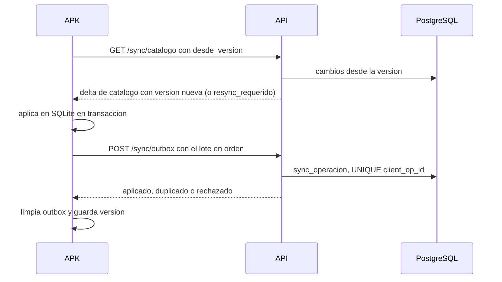
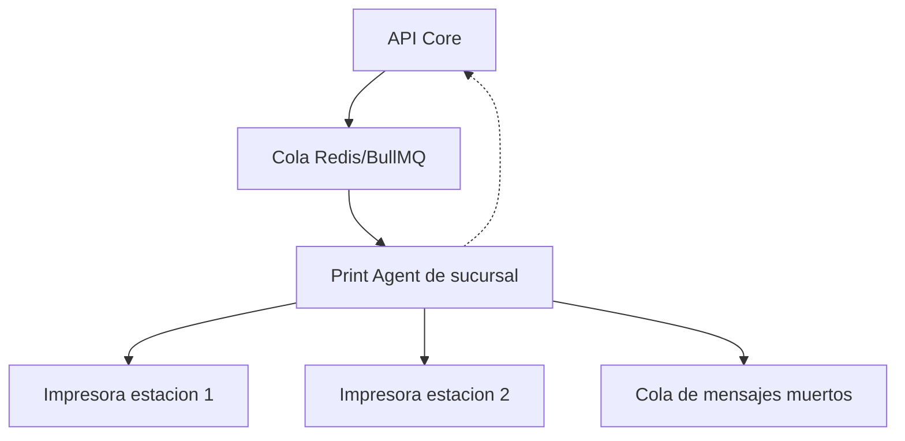

# 08 — Offline, impresión y hardware

Documenta el APK offline-first (ADR-06), el print agent (ADR-05) y el hardware base; D6 y D7 siguen abiertas. Reutiliza las reglas del legado descritas en `01` y `05`. Lo no verificado se marca como SUPUESTO.

## 8.1 Escenarios offline y expectativas de operación

| Escenario | Comportamiento | Expectativa |
|---|---|---|
| WiFi de salón caído | El APK captura local; KDS e impresión no reciben | No perder ni duplicar pedidos |
| Internet caído con LAN activa | Print agent sigue; API local solo si existe (SUPUESTO D2) | Aviso claro de "sin conexión" |
| Impresora apagada o sin papel | Pedido creado y comanda en cola (RN-09) | Alerta y reintento automático |
| Estación sin KDS | La comanda se imprime | Cocina informada igual |
| Corte de energía breve | UPS sostiene router, AP, agente y KDS | La cola drena y el APK sincroniza |

El servidor es la fuente de verdad; el KDS no es offline-first y recupera estado al reconectar.

## 8.2 Modelo local del APK (SQLite)

| Tabla | Contenido | Nota |
|---|---|---|
| `catalogo_*` | Espejo del catálogo visible | Agotado, precios y estación |
| `zona_local`, `mesa_local` | Zonas y mesas con estado | Puede quedar desactualizado |
| `pedido_local`, `linea_local`, `linea_modificador_local` | Pedidos del dispositivo | Snapshot de nombre y precio (ADR-08); `client_order_id` |
| `outbox_operacion` | Operaciones por enviar | `client_op_id` único, payload, intentos |
| `sync_meta` | Versión de esquema, último sync | Delta incremental por versión |
| `permiso_cache` | Permisos del usuario | Se revalidan al reconectar (SUPUESTO) |

El outbox es la única vía de escritura remota. SUPUESTO: SQLite cifrado y limpieza local al cerrar sesión.

## 8.3 Protocolo de sincronización

- **Delta por versión**: `GET /sync/catalogo?desde_version=` y `GET /sync/configuracion?desde_version=` devuelven solo altas, cambios y borrados con `version` monotónica; si el cliente está muy atrasado, la API responde `resync_requerido` y pide recargar todo (sin snapshot completo en la primera sincronización).
- **Envío del outbox**: `POST /sync/outbox` en orden causal; `client_op_id` por operación y `client_order_id` por pedido. `UNIQUE (client_op_id)` en `sync_operacion` hace el reenvío idempotente (RN-28); el outbox se limpia con ACK.
- **Orden**: catálogo y configuración antes de enviar; por pedido: crear, agregar, enviar, modificar, anular.

| Dato | Autoridad | Conflicto |
|---|---|---|
| Catálogo, precios, impuestos | Servidor | Reemplaza; la línea capturada conserva su snapshot |
| Mesas | Servidor | Mesa ocupada: se acepta la venta y se marca incidencia (SUPUESTO) |
| Pedidos creados offline | Dispositivo | Hora del dispositivo + `recibido_en`; desvío > 5 min se audita (SUPUESTO) |
| Estados de sala | Dispositivo | El servidor valida la transición (RN-13) |
| Estados KDS | Servidor | La cocina opera en línea |
| Anulaciones y descuentos | Servidor | Si rechaza, el APK revierte y avisa |
| Pagos, factura y cierre | No se sincronizan | Prohibidos offline (8.4) |

## 8.4 Límites y degradación

SUPUESTO inicial (D7): máximo 8 horas sin conexión. Aviso persistente a los 30 minutos, crítico a las 4 horas y bloqueo de pedidos nuevos a las 8, conservando el outbox.

| Operación | Offline | Condición |
|---|---|---|
| Login con PIN validado antes y consulta de la caché | Sí | SUPUESTO |
| Crear pedido, líneas, notas y fracción | Sí | Con `client_order_id` |
| Enviar a cocina | Sí, encolado | Llega al reconectar |
| Pre-cuenta | Sí | Réplica del mismo motor de cálculo validado (pruebas doradas); sin validez fiscal (SUPUESTO) |
| Trasladar o unir mesas cacheadas | Sí, con aviso | SUPUESTO |
| Anular línea | Encolado | El permiso se valida al reconectar |
| Cobro, pagos, factura, DIAN y cierre | No | Requieren conexión |
| Reservas, reportes y catálogo | No | Requieren conexión |

Avisos: banner "Sin conexión hace X minutos; N pendientes; no cierre sesión" y bandeja de incidencias al reconectar. La reimpresión offline solo es posible si el print agent es accesible en la LAN y la comanda está sincronizada.

## 8.5 Print agent

- **Token**: se registra como `dispositivo` tipo `print_agent` con token único y revocable; conexión saliente WSS/HTTPS, sin puertos abiertos.
- **Configuración por sucursal**: tabla `impresora` (estación, conexión, dirección, ancho, perfil, copias); los cambios llegan por heartbeat, sin reinstalar.
- **Cola**: un trabajo por comanda e impresora en Redis/BullMQ; si el agente cae, los trabajos se **retienen** en la cola (no pasan a mensajes muertos) y se alerta al backoffice.
- **Reintentos**: backoff exponencial (SUPUESTO): inmediato, +5 s, +30 s, +2 min y +10 min; al recuperar heartbeat de la impresora o del agente se adelanta el siguiente reintento; solo tras agotar el backoff el trabajo pasa a la cola de mensajes muertos, visible en backoffice con reimpresión auditada (RN-29).
- **Semántica**: sin ACK físico del papel, el diseño es at-least-once; la reimpresión se marca "REIMPRESION" [SUPUESTO — verificar en IMPCOMAN.PRG].
- **Monitoreo**: heartbeat cada 30 s (SUPUESTO) y métricas por impresora; actualización por imagen Docker firmada con rollback.

## 8.6 Formatos de impresión

| Documento | Campos |
|---|---|
| Comanda (legado `IMPCOMAN`) | Nombre del punto, cabecera "IMPRESION DE COMANDA" y cocina [SUPUESTO — verificar en IMPCOMAN.PRG]; pedido, numero, turno, mesa, mesero, fecha y hora; líneas "CANT. DESCRIPCION" [SUPUESTO — verificar en IMPCOMAN.PRG] con observaciones debajo (bloques de 35, hasta 105 caracteres), modificadores y fracción "N T"; "copia N de M" [SUPUESTO — verificar en IMPCOMAN.PRG] (`CTIMPCO`) |
| Pre-cuenta | Sucursal, pedido, mesa, mesero y fecha; líneas con precio; subtotal, impuestos (RN-20), propina (`CTPORPRO`), total y leyenda no fiscal (SUPUESTO). Calculada con el mismo motor de redondeo/impuestos validado que el servidor (pruebas doradas) |
| Factura (D3) | Emisor, resolución, prefijo y número, cliente, detalle, impuestos, total, medios de pago, CUFE/QR; copias `CTIMPFA`; layout según proveedor DIAN (SUPUESTO) |
| Cierre de caja (legado `FACIERRE`) | Turno, apertura/cierre, usuario, base, ventas por medio de pago, propinas, retiros, gastos, contado y diferencia |

Solo se imprimen líneas pendientes (RN-03); estación vacía o `99` no se imprime (RN-01); el borrado es opcional (`CTBORRACO`, RN-10) y el aviso sonoro del KDS reemplaza al de `CTRCOMAN` (RN-11).

## 8.7 ESC/POS

| Función | Bytes | Nota |
|---|---|---|
| Inicializar | `ESC @` (27,64) | Inicio de cada trabajo |
| Negrita on/off | `ESC E 1` (27,69,1) / `ESC E 0` (27,69,0) | Títulos |
| Doble altura/anchura | `ESC ! n` (27,33,n) / `GS ! n` (29,33,n) | Máscara según perfil |
| Alineación | `ESC a n` (27,97,n) | Izquierda, centro, derecha |
| Corte | `GS V 66 0` (29,86,66,0) | Validar por modelo |
| Gaveta | `ESC p 0 64 240` (27,112,0,64,240) | Secuencia de `cajon.prg` (Epson) |
| QR | `GS ( k` | SUPUESTO; requerido si D3 exige QR |

Perfiles: `escpos` (Epson, base de la tabla) y `star` (Star Line Mode/StarPRNT, con corte y gaveta propios, como adaptador). Anchos: 58 mm ≈ 32 columnas fuente A y 42 fuente B; 80 mm ≈ 48 y 64; referencial a validar con cada modelo (SUPUESTO). SUPUESTO: CP850/CP858 para tildes y eñe.

## 8.8 Compatibilidad de impresoras

| Conexión | Implementación | Nota |
|---|---|---|
| Red (Ethernet/WiFi) | TCP crudo 9100 desde el agente | Preferida; IP reservada en DHCP |
| USB | Agente local; raw o spooler | Sin raw, la salida es raster y pierde corte y gaveta |
| Bluetooth | SPP/BLE con pairing 1:1 | Pre-cuenta desde tablet (SUPUESTO); no para comandas |
| No ESC/POS | Spooler del sistema | Modo degradado; evaluar caso a caso o reemplazar |

Regla: preferir equipos que acepten ESC/POS crudo y validar cada modelo con la herramienta de prueba.

## 8.9 Hardware recomendado

| Componente | Recomendación | Nota |
|---|---|---|
| Celulares/tablets meseros | Android 8+, 4 GB RAM, WiFi 5 GHz, batería ≥ 8 h | D10 abierta; diseñar para celular y tablet |
| Impresoras | Térmicas 58/80 mm, autocorte, Ethernet | Familias Epson TM o Star TSP equivalentes, a validar |
| Router/AP | WiFi 5/6, SSID/VLAN separado para POS, PoE | Cubrir salón, cocina y caja |
| UPS | Router, AP, switch, agente y KDS | Autonomía 30–60 min (SUPUESTO) |
| Pantallas KDS | 21.5–24", 1080p, VESA, mini PC o Android TV | Sin touch; audio obligatorio (RN-11) |
| Servidor local opcional | Mini PC con Docker (agente y caché) | Solo si D2 o D7 lo exigen (SUPUESTO) |

## 8.10 Diagnóstico y soporte

- **Herramienta de prueba**: "Imprimir prueba" por impresora desde backoffice; imprime encabezado, perfil, ancho, tildes, corte y pulso de gaveta, con resultado visible.
- **Logs del agente**: JSON lines con `sucursal_id`, `impresora_id`, `trabajo_id`, intento, resultado y error; buffer local sin internet y paquete de diagnóstico descargable.

| Síntoma | Causa probable | Verificación |
|---|---|---|
| No imprime nada | Agente caído o token revocado | Heartbeat y estado; reiniciar el servicio |
| No imprime una estación | Producto sin estación o `99` (RN-01); impresora mal asignada | Revisar `estacion_id`; pedido de prueba |
| Texto ilegible o cortado | Perfil, codificación o ancho incorrectos | `escpos`/`star`, CP850/CP858, `ancho_mm` |
| Duplicados | Reintento at-least-once | Revisar `trabajo_id` y marca "REIMPRESION" [SUPUESTO — verificar en IMPCOMAN.PRG] |
| Gaveta no abre | Perfil o pin incorrectos | Pulso de prueba Epson/Star |
| Impresora de red no responde | IP cambiada | Ping y prueba TCP 9100; reservar IP |
| KDS no muestra, impresora sí | `kds_activo` desactivado | Configuración de la estación |

Si el Bluetooth se desconecta, revisar pairing y ahorro de energía; preferir red para comandas. Los incidentes se registran con `trabajo_id` (RN-29) y el paquete de diagnóstico se adjunta al soporte.
