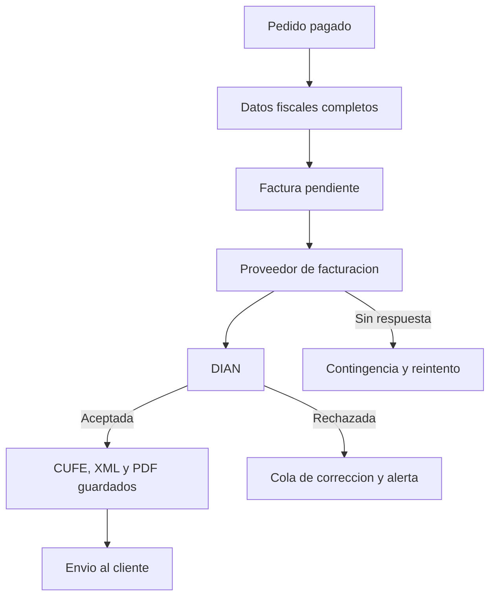

# 09 — Pagos, impuestos y facturación

Cobro, propina, impuestos, descuentos, redondeo, facturación electrónica, cierre de caja y conciliación. Modelo en `04-modelo-de-datos.md`; reglas RN-xx en `05-reglas-de-negocio.md`.

**Fases.** En el MVP (APK y caja) se cobra con medios configurables, propina y cierre de turno. La facturación electrónica DIAN y los reportes fiscales completos son V1 y dependen de D3, D4 y D5. Todo dato no verificado en el legado se marca **SUPUESTO**.

Principios heredados: dinero en enteros (ADR-07, RN-19; corrige los bugs de IVA 16%/19% y tipo `'E'`); impuesto por producto incluido o adicionado (RN-20); propina voluntaria sugerida (RN-21, `CTPORPRO`); división de cuenta con varios medios (RN-18); descuentos auditados (RN-16, RN-29); cierre inmutable salvo reapertura auditada con permiso (RN-22, `FACIERRE`).

## 9.1 Medios de pago y su configuración

Tabla `medio_pago`, equivalente a `POSPAGO` (`CODIGO`); se administra con permiso `config.editar`.

| Medio | Fase | Referencia | Notas |
|---|---|---|---|
| Efectivo | MVP | No | Abre gaveta ESC/POS `27,112,0,64,240`; calcula cambio |
| Tarjeta débito | MVP | Sí | Registro manual; integración con datáfono fuera del MVP (SUPUESTO) |
| Tarjeta crédito | MVP | Sí | Separada de débito para conciliar liquidaciones (SUPUESTO) |
| Transferencia | MVP | Sí | Nombres tipo Nequi, Daviplata o bancos (SUPUESTO) |
| Pago en línea | V1 solo si D5 ≠ Ninguna | Sí | Pasarela por definir; mientras, contra entrega o pago al recoger (SUPUESTO) |
| Otros | V1 | Según medio | Bonos y cortesías requieren autorización (SUPUESTO) |

Un medio inactivo no aparece en APK ni caja; los pagos en línea guardan `pasarela_payload` (campo en `04` §4.6).

## 9.2 Flujos de cobro

| Flujo | Comportamiento |
|---|---|
| Cuenta completa | Un pago por el total |
| División por líneas | Cada línea se asigna a un pagador y se suma por pagador; SUPUESTO: la línea no se parte y el plato compartido se asigna a uno |
| Partes iguales | Total ÷ n; el remanente en pesos se reparte entre los primeros pagos (SUPUESTO de política) |
| Pagos parciales | Varios pagos hasta completar el total (RN-18) |
| Múltiples medios | Un pagador puede usar varios medios (RN-18) |

El pedido pasa a `pagado` solo cuando los pagos `aprobado` igualan el total; nunca hay pago por encima y un `rechazado` no altera el saldo. La pre-cuenta no es documento fiscal (SUPUESTO sujeto a D3). La cuenta se bloquea al iniciar el cobro (SUPUESTO: bloqueo optimista).

## 9.3 Propina

| Aspecto | Comportamiento |
|---|---|
| Sugerencia | Porcentaje configurable por sucursal, equivalente a `CTPORPRO` (RN-21); base SUPUESTO: subtotal antes de impuestos, parametrizable |
| Voluntariedad | El cliente acepta, modifica o rechaza |
| Ajuste manual | Valor libre con tope configurable; auditado (RN-29) |
| Registro | `pago.propina`; reportes por turno y mesero |
| Fiscalidad y reparto | SUPUESTO: validar con el contador si integra base gravable (9.4); el reparto al personal usa el reporte y se paga fuera del sistema |

## 9.4 Impuestos

> **SUPUESTO — todo el apartado se valida con el contador del cliente (D4).** No se fijan tasas; el sistema solo las parametriza y calcula de forma auditable.

| Tratamiento | Modelado | Efecto |
|---|---|---|
| IVA incluido | `impuesto.incluido_en_precio = true` | El ticket discrimina base e impuesto (RN-20) |
| IVA adicionado | `incluido_en_precio = false` | Se suma al subtotal |
| INC | `impuesto.tipo = inc` | Aplicabilidad por producto o categoría, a definir |
| Exento / sin impuesto | `impuesto.tipo = ninguno` | Requiere motivo (SUPUESTO: campo por definir) |
| Tratamiento especial | Por producto | Alcohol, granel y similares por validar |

Pendientes bloqueantes: tarifas, coexistencia de INC con IVA, discriminación en la factura electrónica y qué productos lo incluyen. El legado ya tuvo errores de IVA 16%/19% y tipo `'E'`: el módulo nace parametrizable con pruebas doradas (RN-19).

## 9.5 Descuentos y autorizaciones

| Tipo | Alcance | Permiso | Nota |
|---|---|---|---|
| Porcentaje | Línea o pedido | `descuento.aplicar` (SUPUESTO) | Tope por rol (SUPUESTO) |
| Valor fijo | Línea o pedido | `descuento.aplicar` (SUPUESTO) | No puede dejar total negativo |
| Cortesía 100% | Línea o pedido | `cortesia.aplicar` (SUPUESTO) | Motivo obligatorio |

SUPUESTO: `descuento.aplicar` y `cortesia.aplicar` se incorporarán a la matriz RBAC de `07`.

Todo descuento exige motivo y usuario y queda auditado (RN-16, RN-29). SUPUESTO fiscal: se aplica antes de impuestos y en proporción si el precio los incluye. No aplica sobre pedidos `pagado` o `cancelado`; tras facturar, la vía es la nota crédito (9.7).

## 9.6 Redondeo y centavos

ADR-07: cálculo y almacenamiento en enteros de la unidad mínima; SUPUESTO (00): Colombia, peso sin decimales. Una única especificación de redondeo en el dominio; el APK offline replica esa misma función validada con pruebas doradas. Nunca se implementa en impresoras.

| Operación | Regla |
|---|---|
| Cantidad × precio | Exacta en enteros |
| Descuento porcentual | Redondeo comercial a la unidad, una sola vez |
| Precio con impuesto incluido | Base e impuesto con redondeo definido, por línea (SUPUESTO; validar 9.4) |
| Partes iguales | Cociente exacto + reparto del remanente |
| Redondeo de efectivo | Opcional y parametrizable; ajuste visible (SUPUESTO) |
| Multi-moneda | D4 pendiente; cada moneda define su unidad mínima |

Prueba obligatoria: pedidos de 1.000 líneas cuadran al peso y la suma de pagos iguala el total (RN-18, RN-19).

## 9.7 Facturación electrónica DIAN

**D3 pendiente.** Hasta cerrarla, el sistema emite documento interno no fiscal, tras una interfaz `ProveedorFacturacion` con proveedor externo (ADR-11).

| Aspecto | Definición propuesta |
|---|---|
| Resolución | Número, prefijo, rango y vigencia en `consecutivo (resolucion, vigencia_hasta)` |
| Numeración | Consecutivo por sucursal y prefijo, sin reutilización; saltos justificados y auditados |
| Emisor | NIT, razón social, régimen y responsabilidad por sucursal; el legado ya guarda datos de empresa (`CTCIA`, `CTDIR`) |
| CUFE | Devuelto por el proveedor; se guarda en `factura.cufe` con `estado_dian` |
| PDF / XML | `pdf_url` y `xml_url`, enviados al cliente por correo o WhatsApp |
| Nota crédito | Tras anulación, devolución o corrección; referencia el CUFE original (RN-14) |
| Contingencia | Si DIAN o el proveedor no responden, se emite en contingencia y se transmite al restablecerse (SUPUESTO) |
| Reintentos | Cola con backoff; estados propuestos `pendiente`, `aceptada`, `rechazada`, `contingencia` (SUPUESTO) |
| Copias | `CTIMPFA` define las copias de factura (RN-08) |

## 9.8 Cierre de caja y arqueo

Equivalente a `FACIERRE`; tabla `cierre_caja` (RN-22).

`esperado_efectivo = base_inicial + ventas_efectivo + propinas_cobradas_en_efectivo − retiros − gastos_pagados_en_efectivo` · `diferencia = contado − esperado_efectivo`

| Momento | Acción |
|---|---|
| Apertura | Base inicial, usuario y hora |
| Operación | Ventas por medio, propinas, retiros con motivo (abren gaveta) y gastos |
| Corte parcial | Consulta sin cerrar con totales del momento (SUPUESTO) |
| Cierre | Congela los pagos, recibe `contado`, calcula `diferencia` y exige observación si no es cero |
| Post-cierre | No se edita; solo reapertura auditada con permiso especial (`caja.reabrir`, `07` §7.5) |

Un turno cerrado no admite pagos (RN-22); con pedidos abiertos se advierte y pide confirmación (06). SUPUESTO: discriminar propinas por medio exige ampliar `cierre_caja`.

## 9.9 Conciliación de pagos en línea

Solo con pasarela definida (D5); webhooks idempotentes por identificador del proveedor y referencia.

| Caso | Detección | Acción |
|---|---|---|
| Aprobado sin pedido | Conciliación diaria | Reembolso o reasignación manual auditada |
| Pedido pendiente sin webhook | Timeout | Consulta activa por referencia |
| Monto distinto | Cuadre diario | Revisión manual; no se marca `pagado` |
| Webhook duplicado | Idempotencia | Se ignora el segundo |
| Propina dentro del pago | Desglose del payload | Se separa de la venta |
| Reembolso | Solicitud con permiso | Estado `reembolsado`; nota crédito si hay factura |
| Comisión de pasarela | Liquidación | Gasto informativo; no altera lo pagado |

## 9.10 Reportes fiscales y contables mínimos

| Reporte | Contenido | Frecuencia |
|---|---|---|
| Ventas | Día operativo, turno, canal y modalidad | Diaria |
| Medios de pago | Totales por medio y propinas | Cierre |
| Impuestos | Base e impuesto por producto y tarifa | Diaria / mensual |
| Descuentos y anulaciones | Valor, motivo y autorizador | Diaria |
| Numeración | Facturas, rangos y contingencias | Mensual |
| Cierres y diferencias | Por turno | Diaria |
| Exportación | CSV/XLSX para el contador (SUPUESTO) | Mensual |

La interfaz contable automática (equivalente a `INTERDSI`) queda fuera de alcance; la exportación es el sustituto.

## 9.11 Casos borde

| Caso | Comportamiento |
|---|---|
| Pago en efectivo mayor al total | Se registra por el total; el cambio solo se informa |
| Dos cajeros cobran la misma cuenta | El bloqueo rechaza el segundo intento |
| Timeout del datáfono | Pago `pendiente`; la cuenta no pasa a `pagado` |
| Pago parcial y cliente se retira | Queda `por_cobrar`; el cierre advierte pendientes |
| Descuento mayor al total | Bloqueado; sin totales negativos |
| Anulación con factura emitida | Nota crédito; la factura no se borra (RN-14) |
| Pedido en línea cancelado tras pagar | Reembolso y nota crédito si aplica |
| Diferencia en arqueo | Exige observación; no se cierra dos veces (RN-22) |
| Reimpresión de factura | Marcada como copia y auditada (RN-29) |
| Pago en turno cerrado | Rechazado; reapertura con permiso y auditoría |
