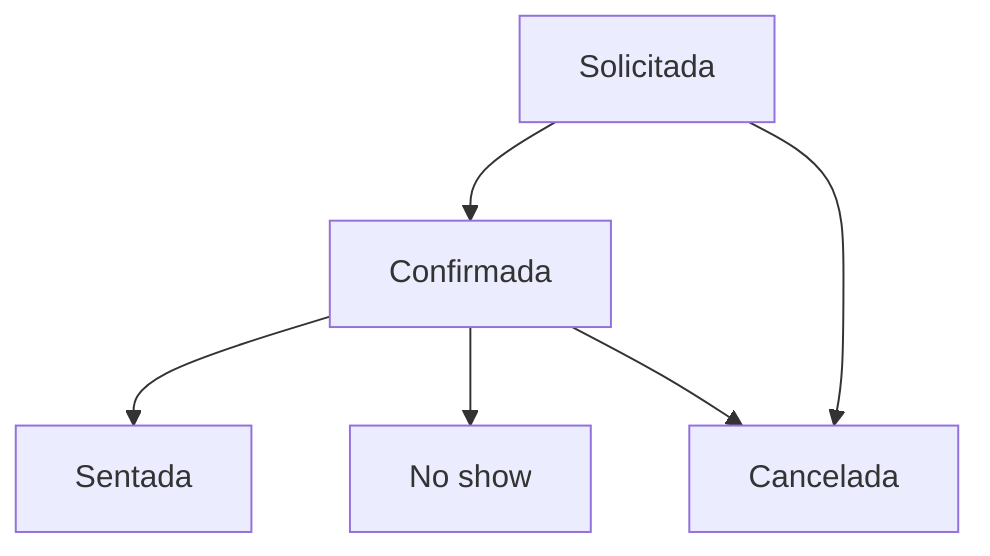
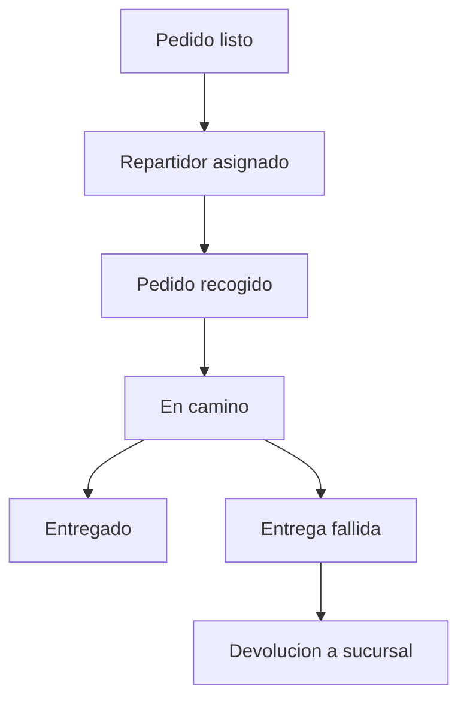

# 10 — Reservas, domicilio y notificaciones

Reglas de reserva, cobertura y reparto, y mensajería al cliente. Modelo en `04-modelo-de-datos.md`; reglas RN-23 a RN-27 en `05-reglas-de-negocio.md`.

**Fases.** El domicilio queda **sujeto al cierre de D8**; posición preliminar: reparto propio, con alcance **V1 (no MVP)**. El MVP no incluye domicilio ni web cliente: las reservas web son V1 según `00-resumen-ejecutivo.md`. En notificaciones, el sonido en KDS y los avisos operativos son MVP; WhatsApp, SMS y recordatorios son V1. Todo dato no verificado en el legado se marca **SUPUESTO**.

## 10.1 Reservas

| Parámetro | Definición | SUPUESTO a validar |
|---|---|---|
| Franjas | Intervalos reservables por día y horario | Granularidad, duración, última franja |
| Duración estándar | Tiempo que bloquea la mesa | 90 minutos |
| Capacidad por zona | Mesas habilitadas o aforo; cada reserva consume cupo de la franja | Cálculo del aforo |
| Tolerancia | Tiempo antes de liberar la mesa | 15 minutos |
| Depósito | Exigible para grupos grandes o fechas especiales | Umbrales y devolución |
| Recordatorios | Avisos con enlace de confirmación o cancelación | 24 h y 2 h antes |

Estados (enum `estado_reserva` en `04`):

| Estado | Significado | Transiciones |
|---|---|---|
| solicitada | Recibida sin confirmar | confirmada, cancelada |
| confirmada | Mesa o cupo bloqueado (RN-25) | sentada, no_show, cancelada |
| sentada | Llegó; se abre el pedido de mesa | Terminal |
| no_show | No llegó pasado el margen; libera la mesa | Terminal |
| cancelada | Anulada por el cliente o el local | Terminal |

- **Mesa**: asignación manual al confirmar o sugerida por capacidad y zona; la restricción de exclusión por rango (mesa × franja) de `04.10` evita la doble asignación. SUPUESTO: grupos mayores a una mesa se resuelven uniendo mesas.
- **Depósito**: `deposito_requerido` y `deposito_pagado`; sin pasarela (D5) se registra en caja (SUPUESTO). Se abona a la cuenta o se pierde por `no_show` según política a validar.
- **Lista de espera y walk-ins**: `lista_espera` con estados propuestos `en_espera`, `notificada`, `sentada` y `cancelada` (SUPUESTO). El walk-in compite por mesas libres; la mesa reservada solo se libera pasado el margen de tolerancia.
- **Recordatorios** con `reserva.codigo` y enlace de cancelación (canales en 10.3). El `no_show` es manual en V1; los recordatorios (job programado) también son V1 (SUPUESTO).

## 10.2 Domicilio

**Sujeto al cierre de D8** (posición preliminar: reparto propio); alcance **V1, no MVP**.

| Parámetro | Definición |
|---|---|
| Zona | Nombre y barrios o polígono; la dirección debe caer dentro (`zona_cobertura`) |
| Tarifa | Valor fijo por zona; SUPUESTO: gratis sobre umbral configurable |
| Pedido mínimo | Por debajo se bloquea el checkout y se sugiere recoger (RN-26) |
| Tiempo estimado | `tiempo_estimado_min` de desplazamiento; SUPUESTO: ETA = preparación + desplazamiento |
| Horario | SUPUESTO: horario por zona; extensión del modelo por definir |
| Geometría | V1 con barrios o polígonos simples; PostGIS pendiente (04.11, D8) |

- `repartidor` (`nombre`, `telefono`, `vehiculo`, `estado`); SUPUESTO estados `disponible`, `ocupado`, `inactivo`.
- Asignación manual desde caja en V1; automática por zona y carga en fase posterior (SUPUESTO).
- `domicilio_asignacion` guarda `asignado_en`, `recogido_en`, `entregado_en` y `evidencia_url` (foto opcional, SUPUESTO).
- El pedido sigue `listo` → `en_camino` → `entregado`; `en_camino` solo aplica a domicilio (README). Pago: pre-pago si hay pasarela (D5); si no, contra entrega (SUPUESTO).
- Seguimiento: página con token que muestra estado y ETA (SUPUESTO); GPS en vivo fuera de V1 (D8).
- **Liquidación de repartidores**: reporte por período con entregas, tarifa por entrega (SUPUESTO), propinas (SUPUESTO: según política) y bonos; el pago se hace fuera del sistema.

Estados de `domicilio_asignacion` (enum `estado_domicilio`, `04` §4.8):

| Estado | Significado |
|---|---|
| `asignado` | Repartidor asignado, pedido aún en sucursal |
| `recogido` | Pedido recogido por el repartidor |
| `en_camino` | En ruta al cliente |
| `entregado` | Entrega confirmada (con `evidencia_url` opcional) |
| `entrega_fallida` | No se pudo entregar |
| `devuelto` | Pedido devuelto a la sucursal |

## 10.3 Notificaciones

| Canal | Uso | Opt-in | Notas |
|---|---|---|---|
| Push | Cliente web/PWA, meseros y cocina | Sí | FCM; requiere permiso del dispositivo (SUPUESTO) |
| WhatsApp | Confirmaciones, recordatorios y seguimiento | Sí | Business API; SUPUESTO costo por conversación |
| SMS | Respaldo de WhatsApp | Sí | SUPUESTO costo por mensaje |
| Correo | Comprobantes, facturas y reservas | Transaccionales (SUPUESTO legal) | — |
| Sonido en KDS | Comanda nueva y SLA excedido | No | Hereda el aviso de `CTRCOMAN` (RN-11) |
| Webhooks | Integraciones del cliente | N/A | Firma y reintentos (SUPUESTO; ver `07`) |

| Evento | Canal | Plantilla | Destinatario |
|---|---|---|---|
| pedido.enviado | Sonido KDS | aviso_comanda | Estación |
| comanda.lista | Push | pedido_listo | Mesero |
| alerta.sla | Sonido KDS + push | sla_excedido | Estación y supervisor |
| pedido.en_camino | WhatsApp / SMS | pedido_en_camino | Cliente |
| pedido.entregado | Push / WhatsApp | pedido_entregado | Cliente (SUPUESTO: opcional) |
| pago.aprobado | Correo / WhatsApp | comprobante_pago | Cliente |
| pago.rechazado | Push / web | pago_rechazado | Cliente |
| pedido.cancelado | Push / WhatsApp | pedido_cancelado | Cliente |
| reserva.solicitada | Correo / panel | reserva_recibida | Local |
| reserva.actualizada (confirmada) | WhatsApp / SMS / correo | reserva_confirmada | Cliente |
| recordatorio programado (V1) | WhatsApp / SMS | recordatorio_reserva | Cliente |
| reserva.actualizada (no_show) | Correo (SUPUESTO) | reserva_no_show | Cliente |
| reserva.cancelada | WhatsApp / SMS / correo | reserva_cancelada | Cliente |
| turno.cerrado | Webhook / correo | cierre_turno | Administración (SUPUESTO) |

- **Opt-in**: `cliente.consentimiento_datos`; transaccionales y marketing separados, baja por canal con lista de supresión; SUPUESTO: validar el alcance legal.
- **Reintentos**: `notificacion.estado` propuesto `pendiente`, `enviada`, `fallida`, `cancelada` (SUPUESTO); backoff exponencial, máximo de intentos y cola de fallidos con alerta. Deduplicación por evento + destinatario + plantilla + referencia.
- **Respaldo e idioma**: cadena configurable (SUPUESTO: WhatsApp → SMS → correo) con prioridad a transaccionales; `plantilla_notificacion.idioma` con español por defecto y fallback.

## 10.4 Casos borde

| Caso | Comportamiento |
|---|---|
| Doble reserva de la misma mesa y franja | La exclusión por rango (mesa × franja) de `04.10` la rechaza (RN-25) |
| Cliente no llega | `no_show` manual en V1; libera la mesa pasado el margen |
| Walk-in pide una mesa reservada dentro del margen | Se ofrece otra mesa o lista de espera |
| Grupo mayor a la capacidad de una mesa | Unir mesas o asignar zona completa (SUPUESTO) |
| Depósito vencido sin pagar | Cancela la reserva al vencer el plazo (SUPUESTO) |
| Dirección en el límite de dos zonas | Prevalece geometría o barrio; override manual auditado (SUPUESTO) |
| Pedido mínimo no alcanzado | El checkout sugiere agregar productos o cambiar a recoger (RN-26) |
| Sin repartidores disponibles | El pedido espera `listo`, se alerta a caja y se notifica nueva ETA (SUPUESTO) |
| Cliente no contesta al repartidor | Espera y devolución; entrega fallida y política de cobro por definir (SUPUESTO) |
| Cancelación con pedido `en_camino` | Requiere autorización, registra el costo y audita (SUPUESTO) |
| WhatsApp no entregado | Fallback a SMS; si tampoco, alerta en el panel |
| Plantilla con variable faltante | No se envía; cae a la cola de fallidos con alerta |
| Proveedor de mensajería caído | Cola y reintento; transaccionales primero (SUPUESTO) |
| Evento disparado dos veces | Deduplicación: un mensaje por evento y destinatario |
