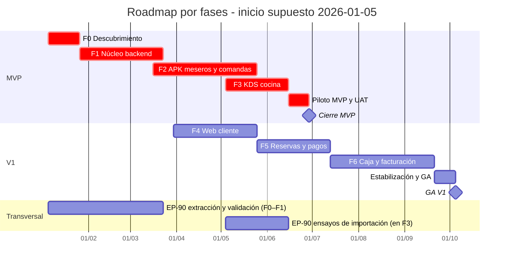

# 12 — Roadmap y estimación

## 12.1 Fases

| Fase | Contenido | Resultado |
|---|---|---|
| **0. Descubrimiento** | Cerrar D1–D10, validar reglas del legado, wireframes, modelo de datos, elección de stack | Especificación y backlog listos |
| **1. Núcleo backend** | Catálogo, estaciones, mesas, usuarios/roles, motor de pedidos, multi-sede, API + realtime | API y backoffice base |
| **2. APK meseros + comanda + impresión** | App meseros, enrutamiento a estaciones, print agent, comanda | Reemplaza `FADMESA`→`IMPCOMAN` |
| **3. KDS cocina** | Pantalla por estación, SLA, métricas, alertas | Reemplaza `CTRCOMAN` |
| **4. Web cliente (pedidos)** | Carta, carrito, domicilio/recoger/QR, seguimiento | Canal de venta directo |
| **5. Reservas + pagos + notificaciones** | Reservas, pasarela, WhatsApp/push | Experiencia completa cliente |
| **6. Caja, facturación, reportes, hardening** | Cobro, medios de pago, propina, cierre, DIAN, analítica, pruebas de carga | Producto comercializable |

**MVP recomendado:** Fases 1–3 (núcleo + meseros + cocina). Es el mayor dolor hoy y no depende
de pasarelas ni DIAN.

## 12.2 Estimación de orden de magnitud (a validar)

Supuesto: equipo base de 6–8 personas (backend, mobile, frontend, QA/PM parcial), dedicación completa. El escenario reducido de 3–4 FTE (§12.9) suma 40–60 % a estas duraciones (SUPUESTO; la relación no es lineal por las dependencias).

| Fase | Duración estimada |
|---|---|
| 0. Descubrimiento | 2–3 semanas |
| 1. Núcleo backend | 6–8 semanas |
| 2. APK meseros + impresión | 8–10 semanas |
| 3. KDS | 4–6 semanas |
| 4. Web cliente (pedidos) | 6–8 semanas |
| 5. Reservas + pagos + notificaciones | 5–7 semanas |
| 6. Caja + facturación + reportes | 8–10 semanas |

- **MVP (F1–F3 + piloto, con F0 como prerrequisito): ~4–5 meses.**
- **V1 completo (fases 0–6): ~9–12 meses.**

> Cifras de planeación; dependen fuertemente de D1–D10 y del tamaño real del equipo.

## 12.3 Cronograma (Gantt)

Fechas relativas sobre una fecha de inicio supuesta (ver 12.7). Se mantiene compacto: una barra por fase, sin sub-tareas.

Notas del cronograma:

- F4 se solapa con F2/F3 porque depende solo del núcleo (F1).
- El solape F1–F2 (1 semana) y F2–F3 (3 semanas) es deliberado para adelantar contratos e integración.
- El Gantt no incluye holgura; se recomienda reservar ~15% adicional (ver 12.8).
- Con el escenario reducido de 3–4 FTE (§12.9), las duraciones crecen 40–60 % (ver 12.6).

## 12.4 Hitos, entregables y criterios de salida

| Fase / hito | Entregables principales | Criterio de salida |
|---|---|---|
| **0. Descubrimiento** | D1–D10 firmadas; reglas RN-01…RN-32 validadas contra el legado; modelo de datos v1; backlog priorizado; prototipo API + WebSocket + print agent + KDS mínimo; plan de QA, UAT y despliegue | Acta de decisiones firmada; el prototipo demuestra comanda → KDS con p95 < 1 s; alcance del MVP congelado por escrito |
| **1. Núcleo backend** | API REST/WebSocket multi-sucursal; catálogo, estaciones, salón y RBAC; motor de pedidos con estados, idempotencia y auditoría; backoffice base; CI/CD y ambientes | Pipeline en verde con unitarias y pruebas de contrato; pedido demo creado y enviado vía API en staging (el cobro se registra en F5/F6); migraciones reproducibles |
| **2. APK meseros + comanda + impresión** | APK Flutter offline-first con outbox SQLite; enrutador de estaciones; comandas con consecutivos y copias; print agent ESC/POS con reintentos, perfiles y gaveta; pre-cuenta | En sitio: comanda impresa en la estación correcta; estación vacía o `99` no imprime; 30 minutos sin red sin pérdida ni duplicados; reimpresión auditada |
| **3. KDS cocina** | Tablero por estación con SLA y colores; alerta sonora silenciable; marcado de estados; historial del turno; métricas básicas; reimpresión | Comanda visible en el KDS en < 1 s; flujo mesa → cocina → entrega completo en UAT interno; reconexión recupera el estado |
| **EP-90 Migración del legado (carril transversal)** | Extracción y perfilado en F0–F1; mapeo y ensayos de importación (simulación, validación y reconciliación) antes del piloto; plan de convivencia y corte; detalle en `14-migracion-del-legado.md` (depende de D1) | Ensayo de importación sin escritura con rechazos justificados; diferencias de reconciliación listadas y justificadas; acta de corte firmada (H-903/H-904) |
| **MVP (piloto)** | Piloto en restaurante real; manuales; capacitación por rol; soporte en sitio; métricas de operación | Los 8 criterios de aceptación del MVP (`02` §2.5); cero incidentes P1 en los últimos 5 días; acta de aceptación del piloto |
| **4. Web cliente** | PWA Next.js: carta, carrito, checkout (domicilio, recoger, QR en mesa), seguimiento y cuenta; validación de cobertura y agotados | Pedido web completo hasta KDS/impresión (el pago contra entrega se registra en F5/F6); Lighthouse PWA ≥ 90 (SUPUESTO); E2E en CI |
| **5. Reservas + pagos + notificaciones** | Reservas con franjas, capacidad y no-show (depósito condicionado a la política de depósito, ver `16` §16.2); pasarela de pagos; propina; notificaciones WhatsApp/push; seguimiento de domicilio | Pago aprobado idempotente; la reserva no sobre-asigna mesa; el no-show libera; recordatorios entregados; conciliación de pagos |
| **6. Caja + facturación + reportes + hardening** | División de cuenta, cierre y arqueo (los medios de pago se configuran desde F1, H-161); facturación electrónica si D3; reportes; pruebas de carga; observabilidad; runbooks y DR | Cierre cuadra al peso; factura aceptada en habilitación DIAN; SLOs de carga cumplidos; restauración de respaldo probada; manuales completos |
| **GA V1** | Estabilización, correcciones de UAT y documentación comercial | Criterios de salida de calidad (`13` §13.6); aceptación del cliente; plan de soporte activo |

**EP-80 (Plataforma y DevOps, 31 puntos Must) por fase:** F1 concentra CI/CD, Docker y ambientes (H-801–H-803) e inicia las pruebas E2E de flujos críticos (H-805); F2–F3 añaden observabilidad de impresión y KDS (H-804); F6 completa observabilidad y hardening (los backups y el DR son de EP-62, H-622). No es una fase aparte: su esfuerzo se reparte en esas fases.

## 12.5 Dependencias entre fases y ruta crítica

| Fase | Depende de | Naturaleza | Holgura / solape | Ruta crítica |
|---|---|---|---|---|
| F1 | F0 | Decisiones, modelo de datos y prototipo | 0 | MVP y V1 |
| F2 | F1 | API de pedidos y catálogo con estaciones | Solape de 1 semana con F1 (fast-track) | MVP |
| F3 | F1 y contratos de F2 | Eventos de comanda y estados | Solape de 3 semanas con F2 (fast-track) | MVP |
| Piloto MVP | F2 y F3 | APK y KDS estabilizados | 0 | MVP |
| F4 | F1 | API de catálogo y pedidos | 1 semana | V1 |
| F5 | F4, F1 y D5 | Checkout web y motor de pagos | 0 | V1 |
| F6 | F5, F1/F2 y D3 | Pagos, turnos y proveedor DIAN | 0 | V1 |
| GA V1 | F6 | Estabilización y UAT | 0 | V1 |
| EP-90 Migración (transversal) | D1 y F1 | Extracción/validación en F0–F1; ensayos de importación y reconciliación antes del piloto | — | Enlaza con el corte (`14` §14.4) |

- Ruta crítica del **MVP**: `F0 → F1 → F2 → F3 → Piloto` (≈25 semanas con el calendario de 12.3).
- Ruta crítica del **programa V1**: `F0 → F1 → F4 → F5 → F6 → GA` (≈39 semanas).
- Un retraso en F1 corre ambas rutas. D3 solo afecta la parte DIAN de F6, que puede activarse después por feature flag.
- EP-90 (migración) depende de D1 y corre en carril transversal: extracción y validación en F0–F1, ensayos antes del piloto y enlace con el corte (`14` §14.4); no altera las rutas críticas del MVP ni del V1.
- F2 y F3 no tienen holgura frente a la fecha MVP (fast-track: solapan F1 y F2 una y tres semanas, respectivamente); su margen hasta GA V1 es de ≈19 semanas (F2) y ≈16 semanas (F3).
- Regla de decisión: si F1 se retrasa más de una semana, elegir entre recortar alcance de F2 o mover la fecha MVP (ver 12.9).

## 12.6 Equipo, roles y dedicación

Valores en FTE (1 = una persona a jornada completa durante toda la fase). Los perfiles con más de 1 FTE implican más de una persona.

| Rol | Perfil | F0 | F1 | F2 | F3 | F4 | F5 | F6 |
|---|---|---|---|---|---|---|---|---|
| PM/PO | Alcance, cliente, priorización | 1 | 1 | 1 | 1 | 1 | 1 | 1 |
| UX/UI | Research, prototipos, design system | 1 | 0,5 | 1 | 0,5 | 1 | 0,5 | 0,25 |
| Backend | NestJS, PostgreSQL, Redis, WebSocket (2 personas) | 0,5 | 2 | 1,5 | 1 | 0,5 | 1 | 1,5 |
| Frontend | Next.js, KDS React, backoffice (2 personas) | 0,25 | 1 | 0,5 | 1 | 2 | 1 | 1 |
| Mobile | Flutter + SQLite (2 personas) | 0,25 | 0 | 2 | 0,5 | 0 | 0,5 | 0,5 |
| QA | Automatización, manual, carga (1–2 personas) | 0,5 | 1 | 1 | 1 | 1 | 1 | 1,5 |
| DevOps | CI/CD, infraestructura, observabilidad (parcial) | 0,5 | 0,5 | 0,25 | 0,25 | 0,25 | 0,25 | 1 |
| Implementación/soporte | Onboarding, capacitación, soporte | 0 | 0 | 0,25 | 0,5 | 0,25 | 0,5 | 1 |

- Plantilla objetivo: 6–8 personas; el pico real de la tabla es F6 con 7,75 FTE (F2 alcanza 7,5 FTE con APK + impresión + backend). SUPUESTO.
- El escenario reducido de 3–4 FTE (§12.9) sigue siendo válido como presupuesto alterno: con esa plantilla, las duraciones crecen 40–60% (SUPUESTO; la relación no es lineal por las dependencias).
- Roles más difíciles de conseguir: Flutter senior, backend NestJS y QA de automatización. SUPUESTO.
- DevOps parcial (0,5 FTE) puede cubrirse con consultoría; sube a 1 FTE en F6 por el hardening.

## 12.7 Supuestos de calendario

1. Semana laboral de 5 días (~40 h) y sprints de 2 semanas con ceremonias incluidas.
2. La fecha 2026-01-05 es solo un ancla del Gantt; el día 0 real es la firma y el cierre de F0. SUPUESTO.
3. Festivos colombianos descontados; diciembre con 50–70% de capacidad. SUPUESTO.
4. Ventanas congeladas sin releases mayores: día de la madre, amor y amistad, fin de año y fechas del piloto. SUPUESTO.
5. Cliente y restaurante piloto disponibles: 1 sesión semanal en F0 y ventanas de UAT en F3 y F5. SUPUESTO.
6. D1–D10 cerradas al final de F0; cada semana de retraso corre proporcionalmente F1 y las rutas críticas.
7. Proveedor DIAN seleccionado en F0; su habilitación toma 4–8 semanas y no bloquea el MVP. SUPUESTO.
8. Hardware del piloto disponible al inicio de F2; si no, se desarrolla con equipos propios y se ajusta en UAT.
9. Equipo estable (rotación < 10%); vacaciones planificadas fuera del cierre de cada hito.
10. Una sola zona horaria para el equipo y proveedores disponibles en horario local.
11. El alcance del MVP está congelado; los cambios entran por comité y afectan fecha.
12. Las cifras de §12.2 son rangos de planeación, no compromisos; se recalibran al cerrar F0.

## 12.8 Riesgos de cronograma y mitigación

| Riesgo | Probabilidad | Impacto en fecha | Mitigación | Contingencia |
|---|---|---|---|---|
| Decisiones D1–D10 tardías | Alta | +1–2 semanas por semana de retraso | Timebox de 3 semanas en F0; decisiones por defecto documentadas | Congelar con supuestos y firmar adéndum |
| Habilitación DIAN demorada | Media | +2–6 semanas en F6; no afecta el MVP | Seleccionar proveedor en F0; sandbox temprano; activación por flag | Lanzar V1 sin DIAN y habilitarla después |
| Impresoras diversas o incompatibles | Alta | +1–3 semanas en F2/F3 | Matriz de perfiles ESC/POS; laboratorio con hardware real desde F2 | Perfil genérico y ajuste en sitio; KDS como respaldo |
| Red WiFi inestable en el piloto | Media | +1–2 semanas en UAT | APK offline-first; pruebas de caída; AP dedicado | Operar con KDS e impresión en LAN y sincronizar |
| Cambio de stack para el equipo actual | Alta | +2–4 semanas o más | Capacitación y contratación tempranas; pairing; prototipo en F0 | Contratar 1–2 seniors externos |
| Crecimiento de alcance | Alta | +10–30% de la duración | Congelar el MVP; comité de cambios con impacto en fecha | Negociar como fase F7 |
| Rotación o baja de una persona clave | Media | +2–6 semanas | Documentación, pares y evitar bus factor 1 | Consultoría de reemplazo |
| Hardware del piloto no llega | Media | +1–3 semanas | Compra o alquiler anticipado; desarrollo con emuladores | Piloto en otro sitio o posponer UAT |
| Sandbox de pasarela inestable | Media | +1–2 semanas en F5 | Mocks y evaluación de doble proveedor | Pago contra entrega como respaldo del piloto |
| SaaS multi-tenant comercializable (más allá del aislamiento base de ADR-09) | Media | +3–6 semanas si se exige en el MVP | `tenant` y `sucursal` desde F1 (ADR-09) | Separar como fase SaaS |
| Estimación optimista | Media | +15–25% | Recalibrar al cerrar F0 con velocidad real; reservar 15% de holgura | Priorizar alcance del MVP |
| Estacionalidad y festivos | Baja | +1–2 semanas | Calendario de congelación de releases | Planificar hitos fuera de picos |

## 12.9 Escenarios de alcance

Duraciones con el equipo de 12.6; con 3–4 FTE, sumar 40–60% (SUPUESTO).

| Escenario | Fases | Duración | Incluye | No incluye | Condiciones |
|---|---|---|---|---|---|
| **MVP operativo** (recomendado) | F1–F3 + piloto (F0 prerrequisito) | 5–6 meses | API, backoffice base, APK meseros, comandas e impresión, KDS | Web pública, reservas, pagos en línea, DIAN, reportes avanzados | D3/D4/D5 no bloquean; cierra D1, D2, D6, D7 y D10 |
| **V1 completo** | F0–F6 + GA | 9–12 meses | MVP + web cliente, reservas, pagos y notificaciones, caja, DIAN (si D3), reportes | Inventario y recetas, contabilidad, hotel, fidelización, domicilio de terceros | D3–D5 cerradas antes de F5 |
| **V1 + inventario/facturación** (fuera del plan base) | F0–F7 | 14–18 meses | V1 + inventario, recetas, compras, kardex e integración contable tipo `INTERDSI` | Hotelería, nómina y contabilidad plena | D9 afirmativa; aquí `facturación` se lee como contabilidad e inventario: la facturación electrónica DIAN ya está en F6 si D3 = Sí |

Notas:

- Si D3 = No, restar 2–4 semanas a F6. SUPUESTO.
- Si D2 = SaaS, la fecha no cambia, pero F1 y F6 deben incluir pruebas de aislamiento multi-tenant.
- Todos los escenarios asumen que los criterios de salida de calidad de `13` §13.6 se cumplen antes de liberar.
- `F7` no forma parte del plan base de §12.1/§12.2: es el escenario que se activaría según D9 (inventario/recetas).
- D8 se interpreta como reparto propio en V1, sujeto a confirmación; el MVP no incluye canal web ni domicilio.
- EP-90 (migración) corre como carril transversal con dependencia de D1 (§12.4 y §12.5); no altera la ruta crítica del MVP.

## 12.10 Supuestos de estimación y replanificación

- **Puntos ≠ fechas:** los puntos de `11` son una convención de priorización; las duraciones de §12.2 y §12.9 son rangos de planeación a recalibrar al cerrar F0 (§12.7).
- **Equipo:** el escenario base es de 6–8 FTE (§12.6); el escenario reducido de 3–4 FTE (§12.9) suma 40–60 % a las duraciones. El pico de la tabla es F6 con 7,75 FTE.
- **Holgura:** el Gantt no incluye holgura; se recomienda reservar ~15 % adicional (§12.3 y §12.8). F2 y F3 son fast-track: solapan F1 (1 semana) y F2 (3 semanas), respectivamente.
- **Decisiones:** cada semana de retraso de D1–D10 corre proporcionalmente F1 y las rutas críticas (§12.7); D3 solo afecta la parte DIAN de F6. Si F1 se retrasa más de una semana, la regla de decisión es recortar alcance de F2 o mover la fecha del MVP (§12.5).
- **MVP:** F1–F3 + piloto, con F0 como prerrequisito; los 227 puntos de `11` §11.12 no incluyen EP-00. Los escenarios de §12.9 no cambian la ruta crítica del MVP.
- **EP-90 (migración):** carril transversal con dependencia de D1; extracción/validación en F0–F1 y ensayos de importación antes del piloto; el detalle de fases y rollback está en `14-migracion-del-legado.md`.
- **Riesgos de cronograma:** ver §12.8; criterios de salida de calidad, `13` §13.6; preguntas abiertas al cliente, `16` §16.2.
