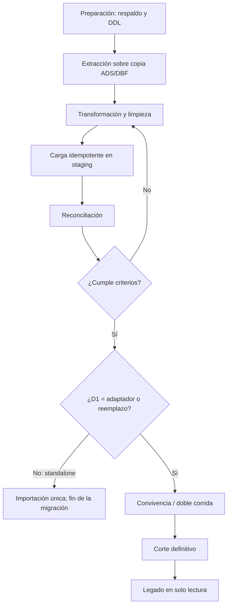

# 14 — Migración del legado

> Documento de planeación. La aplicabilidad y el alcance dependen de **D1**
> (ver `02-alcance-y-decisiones.md`). Todo dato sin fuente en el legado ni decisión cerrada
> va marcado como **supuesto**. Los campos citados son únicamente los verificados en
> `01-analisis-legado.md`.

## 14.1 Objetivo y alcance

La migración traslada **datos ya capturados** del legado `punto_c` (xHarbour + FiveWin sobre
DBF/ADS) al modelo nuevo (`04-modelo-de-datos.md`). **No** traslada código ni UI: las reglas del
legado se reimplementan según `05-reglas-de-negocio.md`.

| Escenario D1 | ¿Aplica? | Alcance |
|---|---|---|
| Standalone con importación (posición preliminar) | Base del plan, sujeta al cierre de D1 | Importación única de catálogo, salón, personas, configuración e históricos; sin convivencia ni corte |
| Integración (adaptador ADS/DBF) | Solo si D1 = adaptador | Migración inicial + convivencia con el legado |
| Migración / reemplazo total | Solo si D1 = reemplazo total | Corte definitivo; el legado queda en solo lectura |

La convivencia (§14.4) y el corte definitivo (§14.4 y §14.6) solo aplican si D1 se cierra como adaptador o reemplazo total; con standalone solo corre la importación (fases 0–3).

Fuera de alcance: hotelería (`HOTEL`), inventario (`TIDTAB`, `TIDSAL`, `TIDTIPOS`) y contabilidad
(`INTERDSI`), por estar fuera del MVP (`02`).

Las credenciales del legado **no se migran**: los únicos campos verificados de `POSOPER` son
`IINICIAL`, sin evidencia de contraseña almacenada. SUPUESTO: los usuarios se dan de alta de
nuevo con PIN o email y se fuerza cambio de credencial en el primer ingreso.

## 14.2 Inventario de datos a migrar

| Grupo | Origen legado | Qué se migra | Destino | Prioridad |
|---|---|---|---|---|
| Catálogo | Maestro de artículos no verificado en las fuentes analizadas (SUPUESTO: obtener DDL en Fase 0) | Productos, categorías, precios, impuestos, estación por producto (`IFCOCINA`) | `categoria`, `producto`, `impuesto`, `estacion` | Crítica |
| Salón | Mesas y zonas | Mesas, zonas y su nomenclatura | `zona`, `mesa` | Crítica |
| Personas | `VEDVEN`, `POSOPER`, `FADCLI` | Meseros, usuarios, clientes | `usuario` (+ rol), `cliente` | Alta |
| Configuración | `FADCON` | Propina, copias, datos de empresa | `sucursal`, `configuracion_sucursal` (`04` §4.2) | Alta |
| Auxiliares | `POSPAGO`, `ITEOBSER`, `ITEMRAP`, `FADCOMAN` | Medios de pago, observaciones predefinidas, códigos rápidos, consecutivos | `medio_pago`, observación predefinida (SUPUESTO), `producto.sku`, `consecutivo` | Media |
| Históricos | `FADDIA`, `FADITE`, `FAPAGO`, `FADLINEA`, `FACIERRE` | Ventas, pagos y cierres **solo para consulta** | Esquema histórico de solo lectura | Media |

No se migran como datos operativos: `TIDTAB`/`TIDSAL`/`TIDTIPOS` (inventario), `EMPLE`/`PCOSTO`
(se usan solo como referencia si se enlaza el empleado), `HOTEL` e `INTERDSI`.

## 14.3 Mapeo tabla del legado → entidad nueva

| Tabla legado (campos verificados) | Entidad nueva | Transformación y notas |
|---|---|---|
| `FADCON` (`CTPUNTO`, `CTCIA`, `CTDIR`, `CTNITCONT`) | `sucursal` | Punto, compañía, dirección y NIT del encabezado. `CTCOMANDA`/`CTTURNO` → semilla de `consecutivo` y `turno`; `CTPORPRO` → porcentaje de propina sugerida; `CTIMPCO`/`CTIMPFA` → `configuracion_sucursal.copias_comanda`/`copias_factura`; `CTBORRACO` → política de borrado de comandas impresas (RN-10); `CTTIMECO` → no aplica (el realtime reemplaza el sondeo); `CTICONSUMO` → semántica por confirmar en Fase 0 |
| `FACOCINA` (`IFCOCINA`, `NOMBRE`, `COLPT`) | `estacion` + `impresora` | `IFCOCINA` → `estacion.id` lógico; `NOMBRE` → `estacion.nombre`; `COLPT` → tipo/perfil de impresora. SUPUESTO: mapear `COLPT` a `impresora.tipo_conexion`/`perfil` según valores reales |
| `FADMESA` (`IFMESA`, `IFARTIC`, `IFNOMBRE`, `IFCANT`, `IFCANT2`, `IFCOCINA`, `IFCOMANDA`, `IFOPER`, `IFOBSER`, `IFHORAI`, `IFHORAF`, `IFESTADO`, `IFCLIENTE`) | `pedido_linea` (+ `comanda_linea` al enviarse) | `IFMESA` → `pedido.mesa_id`; `IFARTIC`/`IFNOMBRE` → referencia y `nombre_snapshot`; `IFCANT` → `cantidad`; `IFCANT2` → `cantidad_fraccion`/`es_fraccion` (venta por peso; ver `04` §4.5); `IFCOCINA` → `estacion_id` (vacío o `99` = sin comanda, RN-01); `IFCOMANDA = 'X'` → línea ya enviada; `IFOPER` → usuario; `IFOBSER` → `notas`; `IFHORAI`/`IFHORAF` → sellos de envío/entrega; `IFESTADO` → estado de línea; `IFCLIENTE` → `cliente_id` |
| `FACOMAN` (`IFMESA`, `IFFACTURA`, `IFARTIC`, `IFNOMBRE`, `IFCANT`, `IFHORAI`, `IFHORAF`, `IFESTADO`, `IFOPER`, `IFCLIENTE`, `IFOBSER1`) | `comanda` | Monitor de comandas. `IFESTADO` `'P'`/`'E'` → estados nuevos (mapeo por confirmar); `IFHORAI`/`IFHORAF` → `enviada_en`/`entregada_en`; `IFFACTURA` → vínculo con histórico de facturación; `IFOBSER1` → notas de la comanda |
| `FAESPERA` (`MESA`, `VENDED`, `NETO`, `PEDIDO`, `OBSER`, `NOMVEN`, `NOMBRE`) | `pedido` abierto | Cuenta abierta por mesa: `MESA` → `mesa_id`; `VENDED`/`NOMVEN` → `mesero_id`; `NETO` → total; `PEDIDO` → `numero` de referencia; `OBSER` → `observaciones`; `NOMBRE` → nombre del cliente |
| `FADCOMAN` (`CODIA`, `COINICIAL`, `COFINAL`) | `consecutivo` | Rango diario de comandas: semilla = `COFINAL` + 1. SUPUESTO: el nuevo consecutivo reinicia por día operativo y sucursal |
| `VEDVEN` (`VNOMBRE`) | `usuario` con rol mesero | Concepto "empleado". SUPUESTO: si se requiere entidad `empleado` separada, agregarla al modelo `04` antes de cargar |
| `POSOPER` (`IINICIAL`) | `usuario` | El legado trunca el usuario a 2 caracteres (deuda documentada en `01`); el login nuevo es email/PIN |
| `POSMENU`/`POSRUTA` (`OPCION`, `USUARIO`) | `rol`, `permiso`, `rol_permiso`, `usuario_rol` | `POSRUTA` es la matriz usuario × opción: convertir a permisos nuevos. Requiere inventario de opciones del legado |
| `POSPAGO` (`CODIGO`) | `medio_pago` | Mapear a tipos nuevos (efectivo, tarjeta, transferencia); sin colisión de nombres |
| `ITEOBSER` (`CODIGO`) | Observación predefinida (SUPUESTO: tabla nueva) | Solo se verificó `CODIGO`; el texto real se levanta en Fase 0 |
| `ITEMRAP` (`INEAN14`, `NUMERO`, `INARTIC`) | `producto.sku` / códigos alternos | SUPUESTO: `INEAN14` = código de barras, `NUMERO` = código rápido, `INARTIC` = artículo |
| `FADCLI` (`CNOMBRE`, `CTIPPAG`) | `cliente` | `CNOMBRE` → nombre; `CTIPPAG` → preferencia de pago (mapear a `medio_pago`) |
| `FADMECLI` (`CLMESA`, `CLCLIENTE`) | `pedido.cliente_id` (histórico) | Relación mesa–cliente: útil solo si existe pedido abierto al corte; si no, dato de consulta |
| `EMPLE`/`PCOSTO` (`CCODIGO`, `CNOMBRE`) | Empleado / centro de costo | Fuera del MVP; migrar solo como referencia para enlazar `usuario` |
| `FADDIA`, `FADITE`, `FAPAGO` (`IFFACT`, `IFARTIC`, `IFFECHA`, `FPFACT`, `FPCODI`, `FAUSU`, `FAFECHA`) | Histórico de facturación | **Solo lectura.** No se cargan a `factura`/`pago` operativos ni participan de reportes nuevos salvo consulta |
| `FADLINEA`, `FACIERRE` | Histórico de cierre | `FACIERRE` ≈ `cierre_caja`; solo consulta. Inventario (`TIDTAB`/`TIDSAL`/`TIDTIPOS`) queda fuera (D9) |

## 14.4 Estrategia por fases

| Fase | Fase roadmap (`12`) | Actividades | Legado en operación | Procesos del legado que se apagan |
|---|---|---|---|---|
| 0. Preparación | F0 | Respaldo íntegro, obtención de DDL real, inventario de tablas e índices, diccionario de datos, plan de limpieza | Todo | Ninguno |
| 1. Extracción | F0–F1 | Lectura **de una copia** ADS/DBF (nunca de producción en caliente); export a CSV/JSON; checksums | Todo | Ninguno |
| 2. Transformación y limpieza | F1 | Deduplicar clientes, normalizar codificación a UTF-8, validar `IFCOCINA` contra `FACOCINA`, normalizar precios/impuestos, filtrar registros borrados | Todo | Ninguno |
| 3. Carga y ensayos | F1–F2, antes del piloto | Carga idempotente por lotes en staging (catálogo, salón, personas, configuración); históricos al esquema de solo lectura; ensayos 1 y 2 sobre copia real (§14.8) | Todo | Ninguno |
| 4. Convivencia / doble corrida (solo si D1 = adaptador o reemplazo) | Desde el piloto MVP hasta el corte | El nuevo opera en paralelo por zona o turno; reconciliación diaria; retroalimentación al transformador | Todo | Se apaga `CTRCOMAN` y `IMPCOMAN` **solo** en las estaciones ya cubiertas por KDS/print agent; `POSHOT`/`PUNTOP`/`TABLET` siguen facturando |
| 5. Corte definitivo (solo si D1 = adaptador o reemplazo) | Tras el piloto MVP o al cierre de F6 | Congelar escritura del legado, apagar toma de pedidos, migrar cuentas abiertas (`FAESPERA`/`FADMESA` en curso), habilitar facturación nueva si D3 está resuelto | Solo lectura para consulta | `POSHOT`/`PUNTOP`/`TABLET`, `CTRCOMAN`, `IMPCOMAN`, `AUDITO`, `VTASMES`. `INTERDSI` se conserva si contabilidad sigue en el legado |

Con standalone con importación (posición preliminar de D1) solo aplican las fases 0–3; no hay convivencia ni corte.

## 14.5 Reconciliación

| Verificación | Método | Criterio de aceptación |
|---|---|---|
| Conteo de productos activos | `COUNT` legado vs. nuevo, por estado | Diferencia 0 en activos; inactivos reportados (SUPUESTO: "activo"/"estado" por confirmar en el DDL de Fase 0) |
| Estación por producto | Todo `IFCOCINA` distinto existe en `estacion`; vacío o `99` sin comanda | 100 % mapeado; excepciones documentadas |
| Mesas y zonas | Conteo y nombre por zona | Diferencia 0 |
| Usuarios y meseros | Conteo de `POSOPER`/`VEDVEN` activos vs. migrados | 100 % de activos; duplicados reportados (SUPUESTO: la marca de "activo" se confirma con el DDL en Fase 0) |
| Clientes | Conteo, duplicados por nombre + teléfono, teléfonos válidos | SUPUESTO: duplicados < 2 %; teléfonos válidos ≥ 90 % |
| Ventas por día | Suma `FADDIA`/`FADITE` por día vs. histórico cargado | Diferencia 0 (dinero entero, ADR-07) |
| Facturas vs. pagos | Suma de facturación vs. suma `FAPAGO` por día | Diferencia 0 por día |
| Consecutivos | Semilla = último `COFINAL` + 1; verificación de 3 días de rango | Sin huecos ni duplicados en el nuevo turno |
| Integridad referencial | Líneas huérfanas, pagos sin factura, comandas sin pedido | 0 registros huérfanos |

## 14.6 Plan de rollback y criterios para activarlo

Aplica solo si D1 = adaptador o reemplazo total; con standalone con importación no hay corte que revertir.

- **Antes del corte**: el rollback es trivial porque la extracción se hace sobre copia y el legado
  nunca se modifica. Se descarta el staging y se repite la carga.
- **Después del corte**: reactivar los ejecutables legado sobre su base original (intacta),
  reponer impresoras y `PRINTO.EXE`, congelar el sistema nuevo y trasladar los movimientos
  ocurridos en la ventana. SUPUESTO: ventana de rollback de 24–48 h, antes de que el nuevo
  emita documentos con numeración fiscal propia; desde ahí el rollback se restringe a corrección.
- **Criterios para activar**: diferencia de ventas distinta de 0 en la reconciliación, error
  bloqueante de cobro o facturación, pérdida o duplicación de comandas, fallos de impresión que
  impidan operar un turno, o imposibilidad de completar el corte en la ventana planeada.
- **Punto de no retorno**: documentado y firmado por el cliente antes del corte.

## 14.7 Riesgos específicos de migración

| Riesgo | Impacto | Mitigación |
|---|---|---|
| DDL real distinto a lo inferido (no hay DDL en las fuentes) | Alto | Obtener estructuras reales en Fase 0; validar con consultas antes de transformar |
| Catálogo sucio: duplicados, precios en 0, categorías inexistentes | Alto | Limpieza con negocio; bandeja de excepciones; no cargar sin decisión |
| `IFCOCINA` huérfano (código sin `FACOCINA`) | Medio | Reporte de códigos sin destino; estación por defecto documentada |
| Codificación DBF (CP850/CP1252) en nombres y observaciones | Medio | Normalizar a UTF-8; reporte de caracteres no convertibles |
| Registros borrados no empaquetados en DBF | Medio | Filtrar por bandera de borrado; reconciliar conteos con y sin filtro |
| Escritura concurrente durante la extracción | Alto | Extraer siempre de copia o réplica; bloquear ventana para el corte |
| Cuentas abiertas en el momento del corte (`FAESPERA`/`FADMESA`) | Alto | Regla de mesa seca; inventario de mesas abiertas la noche anterior |
| Inconsistencias fiscales del legado (IVA 19 % vs. 16 %, tipo `'E'`) | Alto | Corregir en transformación según contador; cuadrar por día |
| Dependencia de `INTERDSI` para contabilidad | Medio | Mantener exportador de históricos; no apagar hasta que contabilidad lo acepte |
| Downtime del corte mayor al planeado | Alto | Ventana nocturna; plan manual con comandas en papel; rollback listo |

## 14.8 Pruebas de migración

Mínimo **dos ensayos completos sobre copia real** antes del piloto MVP (y antes del corte si D1 = adaptador o reemplazo):

| Ensayo | Cuándo | Alcance | Resultado esperado |
|---|---|---|---|
| Ensayo 1 — carga completa | 2–3 semanas antes del piloto | Fases 1–3 sobre copia real, medición de tiempos | Informe de reconciliación y lista de excepciones |
| Ensayo 2 — ensayo general | 1 semana antes del piloto | Fases 1–3 + simulacro de corte y rollback cronometrados (solo si D1 = adaptador o reemplazo) | Go/no-go firmado |

Criterios de go: reconciliación con diferencia 0 en ventas, catálogo, mesas y usuarios; tiempos de
carga dentro de la ventana de corte; rollback probado; excepciones de limpieza resueltas o
aceptadas por escrito. Si un ensayo falla, se corrigen las reglas de transformación y se repite
antes de fijar el corte.
