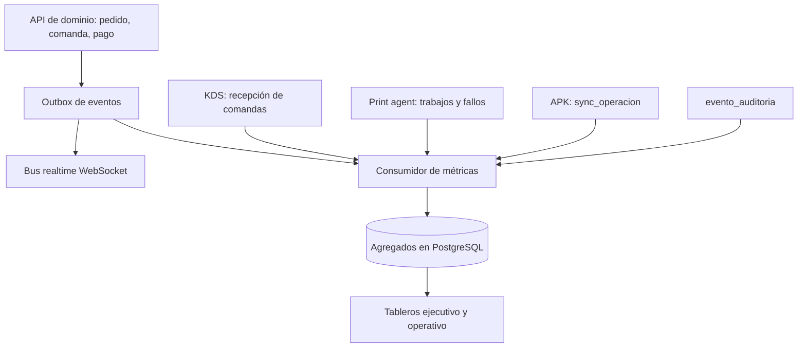

# 15 — KPIs y métricas

> Las **metas iniciales son supuestos**: no provienen del legado ni de una decisión cerrada y
> deben calibrarse con el restaurante piloto en Fase 0. La instrumentación se apoya en los eventos
> de dominio de `03-arquitectura.md`, en la tabla `evento_auditoria` de `04-modelo-de-datos.md` y
> en los sellos de tiempo de comanda.

## 15.1 KPIs de producto

| KPI | Pregunta que responde | Lectura inicial |
|---|---|---|
| Adopción por rol | ¿El personal usa las herramientas del rol que le corresponde? | Más relevante en meseros (APK) y cocina (KDS) |
| Porcentaje de pedidos por canal web | ¿Se está captando venta directa sin comisión de terceros? | Objetivo de negocio O1 |
| Retención de sucursales | ¿Los clientes que entran siguen operando con el producto? | Cohorte mensual de sucursales activas |
| NPS | ¿Recomendarían el producto? | SUPUESTO: encuesta post-entrega por web/WhatsApp; canal a definir |

## 15.2 KPIs de operación

| KPI | Pregunta que responde | Lectura inicial |
|---|---|---|
| Tiempo medio y p90 de preparación | ¿Cocina cumple sus tiempos en el caso típico y en el peor 10 %? | Por estación y por producto; O3 del resumen ejecutivo |
| Tiempo de entrega a domicilio | ¿El reparto cumple la promesa al cliente? | Separar preparación y tiempo de ruta |
| Rotación de mesas | ¿El salón se está usando con eficiencia? | Vueltas por mesa por día o duración media de ocupación |
| Ticket promedio | ¿El valor por pedido sube o baja? | Segmentar por canal y modalidad |
| Pedidos por hora pico | ¿La operación aguanta el pico? | Referencia de capacidad de `03` |
| Cumplimiento de SLA por estación | ¿Cada estación respeta su tiempo objetivo (RN-12)? | Base del semáforo del KDS |
| Pedidos anulados y motivo | ¿Dónde se pierde venta y con qué causa? | Requiere motivo obligatorio (RN-15) |
| Errores de despacho | ¿Se entrega lo correcto a la mesa o al cliente? | Objetivo de negocio O2; medición por definir (ver 15.4) |

## 15.3 KPIs técnicos

| KPI | Pregunta que responde | Lectura inicial |
|---|---|---|
| Disponibilidad | ¿El sistema está arriba cuando el restaurante opera? | API, WebSocket, KDS y print agent por separado |
| Latencia comanda a KDS | ¿La cocina recibe el pedido a tiempo (O4)? | Se mide de emisión a recepción en el dispositivo |
| Tasa de fallo de impresión | ¿El print agent cumple su función? | Incluye reintentos y tiempo de recuperación |
| Uso de modo offline | ¿Con qué frecuencia opera el APK sin red? | Indicador de contexto, no de éxito |
| Operaciones de sincronización rechazadas | ¿La cola offline genera pérdidas o duplicados? | Requiere estado y causa en `sync_operacion` |

## 15.4 Definición de cada KPI

| KPI | Fórmula | Fuente de datos | Frecuencia | Meta inicial (SUPUESTO) |
|---|---|---|---|---|
| Adopción de meseros | Usuarios con rol mesero con ≥ 1 pedido en la semana / usuarios mesero activos | `pedido.mesero_id`, `usuario_rol` | Semanal | ≥ 80 % |
| Adopción de cocina (KDS) | Comandas gestionadas desde KDS / comandas de estaciones con KDS activo | Eventos `comanda.*` con `dispositivo_id` | Semanal | ≥ 95 % en estaciones con KDS |
| Pedidos por canal web | Pedidos `canal = web` / pedidos totales (excluye cancelados) | `pedido.canal`, `pedido.estado` | Semanal y mensual | ≥ 15 % a 6 meses |
| Retención de sucursales | Sucursales con actividad en el mes / sucursales activas el mes anterior | `pedido.created_at` por sucursal | Mensual | ≥ 95 % (churn ≤ 5 %) |
| NPS | % promotores (9–10) − % detractores (0–6) | Encuesta post-entrega (SUPUESTO: web/WhatsApp; tabla `encuesta`, `04` §4.7) | Mensual | ≥ 40 |
| Tiempo medio de preparación | Media de (`comanda.lista_en` − `comanda.enviada_en`) por estación | Sellos de comanda (`enviada_en`, `lista_en`) y eventos `pedido.enviado`/`comanda.lista` | Diaria | ≤ 12 min |
| p90 de preparación | Percentil 90 de la misma serie | Igual que el anterior | Diaria | ≤ 20 min |
| Tiempo de entrega a domicilio | Media de (`domicilio_asignacion.entregado_en` − `pedido.created_at`) para modalidad domicilio, desglosada en preparación (hasta `domicilio_asignacion.asignado_en`) y ruta | `pedido`, `domicilio_asignacion` (`recogido_en`, `entregado_en`) | Diaria | ≤ 40 min total; ruta ≤ 20 min |
| Rotación de mesas | Pedidos pagados con modalidad mesa / mesas activas (`mesa.estado <> 'fuera_servicio'`, sin borrado lógico), por día | `pedido`, `mesa` | Diaria | ≥ 2 vueltas/mesa/día |
| Ticket promedio | Suma de `pedido.total` de pedidos pagados / número de pedidos pagados | `pedido` | Diaria y semanal | Base del piloto + 5 % a 6 meses |
| Pedidos por hora pico | Máximo y p95 de pedidos creados por hora, por sucursal | `pedido.created_at` | Horaria y diaria | p95 ≤ 80 % de la capacidad validada (referencia: 200 pedidos/h en `03`) |
| Cumplimiento de SLA por estación | Comandas con (`lista_en` − `enviada_en`) ≤ `estacion.sla_seg` / comandas cerradas, por estación | `comanda`, `estacion.sla_seg`, `producto.tiempo_objetivo_seg` | Diaria | ≥ 90 % |
| Pedidos anulados y motivo | Pedidos cancelados / pedidos totales; distribución por motivo | `pedido.estado = cancelado`, evento `comanda.anulada` y `evento_auditoria` (RN-15) | Diaria y semanal | ≤ 2 % |
| Errores de despacho | Pedidos con error reportado + líneas anuladas después de `entregada`, por 1.000 pedidos | SUPUESTO: marca operativa en backoffice; anulaciones posteriores a entrega | Semanal | ≤ 5 por 1.000 |
| Disponibilidad | Minutos disponibles / minutos del horario de operación, por servicio | Health checks y monitoreo (ver `13-qa-devops-operacion.md`) | Diaria y mensual | ≥ 99,5 % MVP / ≥ 99,9 % V1 en horario operativo (alineado con `13` §13.9) |
| Latencia comanda a KDS | p50 y p95 de (recepción en KDS − `comanda.enviada_en`) | Marca de recepción del KDS + evento `pedido.enviado` (comandas generadas) | Continua (agregada diaria) | p95 < 1 s (RNF de `02`) |
| Tasa de fallo de impresión | Trabajos fallidos / trabajos enviados; reintentos exitosos y tiempo de recuperación | Cola de impresión y evento `comanda.impresa`; tabla `trabajo_impresion`, `04` §4.5 | Diaria | < 0,5 % MVP / < 0,2 % V1 (alineado con `13` §13.9); reintento exitoso ≥ 99 % |
| Uso de modo offline | Operaciones aplicadas desde sync / total de operaciones APK; minutos offline estimados desde heartbeats (`dispositivo.ultima_conexion`) | `sync_operacion`, `dispositivo` (heartbeats; pendiente: marcas de sesión offline en `04`) | Diaria | Indicador de contexto; alerta si > 10 % de operaciones en un turno |
| Sync rechazadas | `sync_operacion` con estado de error / total; por causa | `sync_operacion` | Diaria | < 0,5 % y 0 duplicados |

## 15.5 Tableros sugeridos

| Tablero | Audiencia | Contenido | Frecuencia |
|---|---|---|---|
| Ejecutivo | Dirección y gerencia | Ventas por canal, ticket promedio, retención de sucursales, NPS, disponibilidad, adopción por rol | Semanal y mensual |
| Operativo diario | Jefe de piso, chef, caja | Comandas pendientes por estación, cumplimiento de SLA, tiempos de preparación, pedidos por hora, anulados con motivo, fallos de impresión, latencia KDS | Tiempo real y cierre de turno |

SUPUESTO: el tablero ejecutivo se publica como reporte programado (correo o enlace) y el operativo
vive en el KDS y en una vista del backoffice; la herramienta de BI se define en Fase 0.

## 15.6 Cómo se instrumentan

- **Eventos de dominio** (`03` §3.7): `pedido.creado`, `pedido.enviado`, `comanda.impresa`,
  `comanda.en_preparacion`, `comanda.lista`, `comanda.entregada`, `comanda.anulada`,
  `pedido.por_cobrar`, `pedido.pagado`, `pago.aprobado`/`pago.rechazado`,
  `reserva.solicitada`/`reserva.actualizada`/`reserva.cancelada`, `turno.cerrado`.
  Cada evento lleva `sucursal_id`, `usuario_id`, `dispositivo_id` y marca de tiempo.
- **Patrón outbox**: el dominio escribe el evento en la misma transacción del cambio y un
  consumidor lo publica al bus realtime y al almacén de métricas, para no perder eventos.
- **Sellos de comanda**: `comanda.enviada_en`, `lista_en` y `entregada_en` permiten calcular
  preparación y despacho sin reconstruir la historia.
- **`evento_auditoria`**: respalda anulaciones, descuentos, reimpresiones y cierres (RN-29), y es
  la fuente de los motivos de anulación.
- **Telemetría de dispositivos**: el KDS reporta la recepción de cada comanda (latencia), el APK
  reporta `sync_operacion` (offline y rechazos) y el print agent reporta trabajos y fallos.
- **Agregados**: las series se materializan en PostgreSQL; los tableros consultan agregados, no la
  base operativa, para no competir con la operación.
- **Pendiente en `04`**: marcas de sesión offline en `sync_operacion` (o derivarlas de los
  heartbeats de `dispositivo`); `encuesta` (`04` §4.7) y `trabajo_impresion` (`04` §4.5) ya
  están modeladas.

