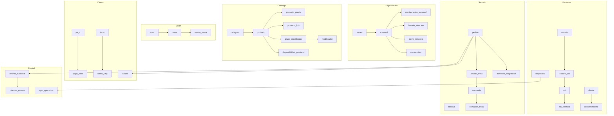
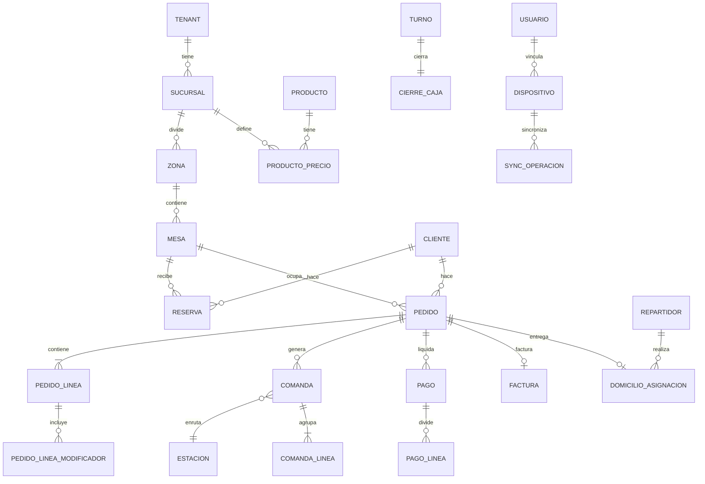

# 04 — Datos y persistencia

## 1. Objetivo y alcance

Consolidar en un solo modelo las secciones **"Datos implicados"** de los cinco documentos de
requerimientos (`requerimientos/01`–`05`): entidades, campos, enums, relaciones, restricciones y
reglas de consistencia.

Este documento es la **base del diseño de la base de datos** y de las decisiones de persistencia
de la arquitectura. El detalle físico columna a columna (DDL) está en
[`esquema/`](./esquema/README.md).

> **Supuesto de motor:** el motor propuesto es **PostgreSQL** (SUPUESTO, sujeto a las decisiones
> A2/A3 del `README`). Los tipos citados (`jsonb`, `tsrange`, índices GIN/GiST) asumen Postgres.

## 2. Principios del modelo

1. **Multi-tenant desde el inicio:** `tenant` → `sucursal`; toda tabla operativa lleva
   `tenant_id` y, cuando aplica, `sucursal_id`.
2. **Nombres** en español, singular y `snake_case` (`pedido`, `pedido_linea`); PK `id` (UUID);
   FK `<entidad>_id`; sellos `*_en` como `timestamptz` en UTC (hora del servidor).
3. **Dinero en enteros** (centavos) con sufijo `_centavos` y moneda por sucursal; nunca punto
   flotante.
4. **Snapshot en la línea:** nombre, precio, impuesto y modificadores se copian al crear la línea;
   los cambios de catálogo no alteran pedidos históricos.
5. **Estados explícitos** (enums) con máquina de estados validada; los cambios se sellan con hora.
6. **Nada se borra:** se cancela, anula o anonimiza; la auditoría y las bitácoras son inmutables.
7. **Idempotencia:** claves por operación (`client_op_id`) y por pedido (`client_order_id`).
8. **Una sola fuente de verdad del cobro:** los pagos aprobados de un pedido se concilian contra su
   total; un pedido se cobra una sola vez.
9. **Los reportes leen agregados**, no la base operativa en caliente.

## 3. Mapa de entidades

Nota: el diagrama omite tablas de soporte (promociones, notificaciones, reportes, alertas) para
mantenerlo legible; todas están en el diccionario (§4).

## 4. Diccionario de entidades

Origen: `R1`…`R5` = documentos de `requerimientos/`; `RN` = reglas de negocio citadas allí.

### 4.1 Organización y configuración

| Tabla | Campos clave | Notas | Origen |
|---|---|---|---|
| `tenant` | `id`, `nombre`, `activo` | Aislamiento multi-tenant | R5 |
| `sucursal` | `tenant_id`, `nombre`, `codigo`, `direccion`, `ciudad`, `telefono`, `coordenadas`, `zona_horaria`, `moneda`, `activa` | Cada sede con su operación | R1 R5 |
| `configuracion_sucursal` | `sucursal_id`, `propina_sugerida_pct`, `copias_comanda`, `copias_factura`, `borrado_comanda_impresa`, `comportamiento_offline`, `ventana_programacion_min`, `limite_pedidos_franja` | Parámetros operativos (equivale a `FADCON`) | R3 R4 R5 |
| `horario_atencion` | `sucursal_id`, `dia_semana`, `franja`, `hora_apertura`, `hora_cierre` | Franja: desayuno/comida/cena | R1 R2 |
| `cierre_temporal` | `sucursal_id`, `desde`, `hasta`, `motivo` | Festivos, mantenimiento, eventos | R1 R5 |
| `impuesto` | `tenant_id`, `nombre`, `tasa_bps`, `tipo` (`incluido`/`adicionado`/`inc`), `activo` | INC/IVA por definir (D3/D4) | R1 R5 |
| `consecutivo` | `sucursal_id`, `tipo` (`pedido`/`comanda`/`factura`), `prefijo`, `siguiente`, `resolucion`, `vigencia_hasta` | Numeración por sucursal y prefijo | R2 R5 |
| `medio_pago` | `sucursal_id`, `nombre`, `tipo`, `requiere_referencia`, `activo` | Equivale a `POSPAGO` | R2 R3 |
| `estacion` | `sucursal_id`, `nombre`, `tipo` (`preparacion`/`despacho`), `activa` | Clave del enrutamiento de comandas | R3 R4 R5 |
| `impresora` | `sucursal_id`, `nombre`, `tipo_conexion`, `direccion`, `perfil`, `activa` | Impresión por estación | R3 R4 R5 |
| `regla_sla` | `sucursal_id`, `estacion_id` o `producto_id`, `objetivo_seg` | Objetivo de preparación | R4 R5 |
| `regla_capacidad` | `sucursal_id`, `franja`, `maximo_pedidos` | Límite por cocina | R2 R5 |

### 4.2 Personas y acceso

| Tabla | Campos clave | Notas | Origen |
|---|---|---|---|
| `usuario` | `tenant_id`, `nombre`, `email`, `pin_hash`, `pin_salt`, `activo`, `ultimo_acceso_en` | Login web/backoffice y PIN del APK | R3 R5 |
| `rol` | `tenant_id`, `nombre`, `es_sistema` | Plantillas editables | R5 |
| `permiso` | `codigo`, `descripcion` | Catálogo de permisos | R5 |
| `rol_permiso` | `rol_id`, `permiso_codigo` | Matriz RBAC | R5 |
| `usuario_rol` | `usuario_id`, `rol_id`, `sucursal_id` | Alcance por sucursal (nulo = todas) | R5 |
| `dispositivo` | `usuario_id`, `sucursal_id`, `tipo` (`apk`/`kds`/`caja`), `token`, `estacion_id`, `version_app`, `ultima_conexion_en`, `estado` | Vinculación y revocación | R3 R4 R5 |
| `cliente` | `tenant_id`, `nombre`, `telefono`, `correo`, `fecha_nacimiento`, `preferencias`, `notas` | Puede existir sin cuenta | R1 R2 R5 |
| `consentimiento` | `cliente_id`, `tipo`, `canal`, `base_legal`, `otorgado_en`, `revocado_en` | Datos y marketing; opt-in por canal | R1 R5 |
| `repartidor` | `sucursal_id`, `nombre`, `telefono`, `vehiculo`, `estado` | Reparto propio (D8) | R2 R5 |
| `solicitud_evento` | `sucursal_id`, `contacto`, `tipo`, `fecha_tentativa`, `personas`, `mensaje`, `estado` | Grupos y eventos privados | R1 R5 |

### 4.3 Catálogo

| Tabla | Campos clave | Notas | Origen |
|---|---|---|---|
| `categoria` | `tenant_id`, `nombre`, `orden`, `activa` | Ordena la carta | R1 R2 |
| `producto` | `categoria_id`, `nombre`, `descripcion`, `impuesto_id`, `estacion_id`, `sku`/`codigo_barras`, `tiempo_objetivo_seg`, `etiquetas`, `activo`, `destacado` | `estacion_id` define el enrutamiento | R1 R2 R4 |
| `producto_precio` | `producto_id`, `sucursal_id`, `precio_centavos`, `vigente_desde` | Precio por sede con vigencia | R1 R2 |
| `producto_foto` | `producto_id`, `url`, `orden`, `texto_alt` | Carta visual | R1 |
| `alergeno` | `nombre` | Catálogo | R1 |
| `producto_alergeno` | `producto_id`, `alergeno_id` | Información dietética | R1 |
| `grupo_modificador` | `producto_id` o `categoria_id`, `nombre`, `minimo`, `maximo`, `obligatorio` | Opciones por producto | R1 R2 R3 |
| `modificador` | `grupo_id`, `nombre`, `precio_centavos`, `activo` | Con costo adicional | R1 R2 R3 |
| `disponibilidad_producto` | `producto_id`, `sucursal_id`, `franja`, `disponible`, `agotado`, `agotado_origen` | Agotados y horarios | R1 R2 R4 |
| `promocion` | `tenant_id`, `titulo`, `texto`, `imagen`, `tipo`, `desde`, `hasta`, `sucursal_id`, `activa` | Banners y campañas | R1 R5 |
| `cupon` | `codigo`, `tipo`, `valor`, `desde`, `hasta`, `usos_maximo`, `usos`, `sucursal_id` | Descuentos controlados | R1 R2 R5 |

### 4.4 Salón

| Tabla | Campos clave | Notas | Origen |
|---|---|---|---|
| `zona` | `sucursal_id`, `nombre`, `aforo`, `orden` | Zonas del salón | R1 R3 R5 |
| `mesa` | `sucursal_id`, `zona_id`, `numero`, `capacidad`, `estado`, `pos_x`, `pos_y`, `activa` | Estado: `libre`, `ocupada`, `por_cobrar`, `reservada`, `fuera_servicio` | R1 R3 R5 |
| `mesa_asignacion` | `turno_id`, `zona_id` o `mesa_id`, `usuario_id`, `desde`, `hasta` | Mesero responsable por turno | R3 R5 |
| `sesion_mesa` | `mesa_id`, `token`, `abierta_en`, `cerrada_en` | Token del QR de la mesa | R2 |

### 4.5 Reservas

| Tabla | Campos clave | Notas | Origen |
|---|---|---|---|
| `politica_reserva` | `sucursal_id`, `antelacion_min_horas`, `antelacion_max_dias`, `duracion_min`, `tolerancia_min`, `cancelacion_horas`, `maximo_personas`, `deposito_regla`, `no_show_regla` | Rige la web y el panel; se copia a la reserva | R1 R5 |
| `reserva` | `sucursal_id`, `cliente_id`, contacto, `fecha_hora`, `duracion_min`, `personas`, `zona_id`, `mesa_id`, `preferencia`, `estado`, `codigo`, `origen`, `ocasion`, `notas`, `politica_snapshot`, `deposito_requerido`, `deposito_pagado`, `sentada_en`, `finalizada_en`, `no_show_en` | Bloqueo por rango, no por instante | R1 R5 |
| `lista_espera` | `sucursal_id`, contacto, `personas`, `franja_deseada`, `estado`, `vigencia` | Promoción automática al liberar cupo | R1 R5 |

### 4.6 Pedidos y comandas

| Tabla | Campos clave | Notas | Origen |
|---|---|---|---|
| `pedido` | `sucursal_id`, `codigo`, `canal`, `modalidad`, `cliente_id` o contacto, `mesa_id`, `sesion_mesa_id`, `mesero_id`, `turno_id`, `hora_programada`, `estado`, `subtotal_centavos`, `descuentos_centavos`, `impuestos_centavos`, `propina_centavos`, `recargos_centavos`, `total_centavos`, `notas`, `origen_utm`, `client_order_id`, sellos (`creado_en`, `enviado_en`, `listo_en`, `entregado_en`, `por_cobrar_en`, `pagado_en`, `cancelado_en`) | Núcleo multi-canal; los sellos alimentan los tiempos (§9) | R2 R3 R5 |
| `pedido_linea` | `pedido_id`, `producto_id`, `nombre_snapshot`, `precio_snapshot_centavos`, `impuesto_snapshot`, `cantidad`, `es_fraccion`, `cantidad_fraccion`, `notas`, `comensal`, `estado` | Snapshot inmutable | R2 R3 |
| `pedido_linea_modificador` | `pedido_linea_id`, `modificador_id`, `nombre_snapshot`, `precio_snapshot_centavos` | Opciones de la línea | R2 R3 |
| `ajuste_pedido` | `pedido_id`, `pedido_linea_id`, `tipo` (`descuento`/`cortesia`/`recargo`), `valor_centavos` o `porcentaje`, `motivo`, `usuario_id` | Requiere permiso y auditoría | R3 R5 |
| `comanda` | `pedido_id`, `estacion_id`, `numero`, `turno_id`, `estado`, `enviada_en`, `lista_en`, `entregada_en` | Enrutamiento y SLA | R3 R4 |
| `comanda_linea` | `comanda_id`, `pedido_linea_id`, `estado` | Detalle por plato | R3 R4 |

### 4.7 Domicilio

| Tabla | Campos clave | Notas | Origen |
|---|---|---|---|
| `zona_cobertura` | `sucursal_id`, `nombre`, `tarifa_centavos`, `pedido_minimo_centavos`, `tiempo_estimado_min`, `geometria` | GeoJSON o lista de barrios (D8) | R2 R5 |
| `domicilio_asignacion` | `pedido_id`, `repartidor_id`, `asignado_en`, `recogido_en`, `entregado_en`, `estado`, `evidencia_url` | Estado: `asignado`, `recogido`, `en_camino`, `entregado`, `entrega_fallida`, `devuelto` | R2 R5 |
| `liquidacion_repartidor` | `repartidor_id`, `periodo`, `entregas`, `tarifas_centavos`, `propinas_centavos`, `total_centavos` | Reparto propio (D8) | R5 |

### 4.8 Pagos, caja y facturación

| Tabla | Campos clave | Notas | Origen |
|---|---|---|---|
| `pago` | `pedido_id` o `reserva_id`, `medio_pago_id`, `monto_centavos`, `propina_centavos`, `referencia`, `estado`, `pasarela_payload`, `usuario_id`, `creado_en` | Único para pedidos y depósitos de reserva | R1 R2 R3 R5 |
| `pago_linea` | `pago_id`, `pedido_linea_id`, `monto_centavos` | División de cuenta por líneas | R2 R3 |
| `turno` | `sucursal_id`, `numero`, `estado`, `abierto_en`, `cerrado_en`, `usuario_apertura_id`, `usuario_cierre_id` | Turno de caja y salón | R3 R5 |
| `cierre_caja` | `turno_id`, `base_inicial_centavos`, `ventas_efectivo_centavos`, `ventas_otros_centavos`, `propinas_centavos`, `retiros_centavos`, `gastos_centavos`, `contado_centavos`, `diferencia_centavos`, `observaciones`, `reabierto_por`, `reabierto_en` | Reapertura auditada | R3 R5 |
| `factura` | `pedido_id`, `numero`, `prefijo`, `resolucion`, `cufe`, `estado_dian`, `xml_url`, `pdf_url`, `total_centavos`, `impuestos_json`, `emitida_en` | DIAN condicional (D3) | R2 R5 |
| `factura_linea` | `factura_id`, `descripcion`, `cantidad`, `precio_centavos`, `impuesto_id`, `total_centavos` | Detalle fiscal | R5 |

### 4.9 Marketing y CRM

| Tabla | Campos clave | Notas | Origen |
|---|---|---|---|
| `suscriptor` | `correo`, `consentimiento_en`, `origen`, `activo` | Doble opt-in | R1 R5 |
| `resena` | `cliente_id`, `puntaje`, `comentario`, `fuente`, `fecha`, `publicada` | Reseñas mostradas y moderadas | R1 R5 |
| `encuesta` | `tipo` (`pedido`/`reserva`/`visita`), `referencia_id`, `cliente_id`, `puntaje`, `comentario`, `canal`, `creado_en` | Calificación post-venta y NPS | R1 R2 R5 |
| `segmento_cliente` | `nombre`, `criterio`, `actualizado_en` | Segmentos para campañas | R5 |
| `evento_analitica` | `tipo`, `origen_utm`, `consentimiento`, `creado_en` | Medición; puede vivir en la herramienta de analítica | R1 R5 |

### 4.10 Notificaciones

| Tabla | Campos clave | Notas | Origen |
|---|---|---|---|
| `plantilla_notificacion` | `tenant_id`, `evento`, `canal`, `idioma`, `asunto`, `cuerpo` | Plantillas por evento | R1 R5 |
| `notificacion` | `destinatario_tipo`, `destinatario_id`, `canal`, `plantilla_id`, `payload`, `estado`, `enviado_en`, `error` | Cola y resultado de envíos | R1 R2 R5 |
| `configuracion_notificacion` | `evento`, `canal`, `plantilla_id`, `activo` | Qué se envía y por dónde | R5 |

### 4.11 Operación, sincronización y trazabilidad

| Tabla | Campos clave | Notas | Origen |
|---|---|---|---|
| `sync_operacion` | `dispositivo_id`, `client_op_id`, `tipo`, `payload`, `estado`, `aplicado_en`, `error` | Idempotencia offline | R3 |
| `evento_auditoria` | `tenant_id`, `sucursal_id`, `usuario_id`, `dispositivo_id`, `entidad`, `entidad_id`, `accion`, `motivo`, `datos_antes`, `datos_despues`, `ip`, `request_id`, `creado_en` | Inmutable | R3 R4 R5 |
| `bitacora_evento` | `entidad_tipo`, `entidad_id`, `evento`, `actor`, `canal`, `dispositivo_id`, `datos`, `creado_en` | Línea de tiempo de reservas y pedidos; materializa eventos y sellos | R5 |
| `alerta_operativa` | `tipo`, `severidad`, `entidad`, `estado`, `atendida_por`, `atendida_en` | Impresoras, dispositivos, sync, SLA | R5 |
| `umbral_alerta` | `tipo`, `valor`, `rol_destinatario` | Descuentos altos, anulaciones, reaperturas | R5 |
| `reporte_guardado` | `usuario_id`, `nombre`, `tipo`, `filtros`, `visibilidad` | Vistas guardadas | R5 |
| `reporte_programado` | `tipo`, `filtros`, `periodicidad`, `destinatarios`, `activo` | Envío automático | R5 |
| `exportacion` | `usuario_id`, `tipo`, `filtros`, `formato`, `estado`, `creado_en` | Rastro de exportaciones | R5 |
| `trabajo_impresion` | `comanda_id` o `factura_id`, `impresora_id`, `tipo`, `estado`, `intentos`, `ultimo_error`, `creado_en`, `impreso_en` | Cola del print agent y fallos | R3 R4 R5 |

## 5. Enums

| Enum | Valores |
|---|---|
| `canal_pedido` | `web`, `mesero`, `caja`, `kiosco` (futuro) |
| `modalidad_pedido` | `mesa`, `domicilio`, `recoger` |
| `estado_pedido` | `borrador`, `enviado`, `en_preparacion`, `listo`, `en_camino`, `entregado`, `por_cobrar`, `pagado`, `cancelado` |
| `estado_linea` | `pendiente`, `enviada`, `en_preparacion`, `lista`, `entregada`, `anulada` |
| `estado_comanda` | `pendiente`, `impresa`, `en_preparacion`, `lista`, `entregada`, `anulada` |
| `estado_reserva` | `solicitada`, `confirmada`, `sentada`, `no_show`, `cancelada` |
| `estado_pago` | `pendiente`, `aprobado`, `rechazado`, `reembolsado` |
| `estado_domicilio` | `asignado`, `recogido`, `en_camino`, `entregado`, `entrega_fallida`, `devuelto` |
| `estado_mesa` | `libre`, `ocupada`, `por_cobrar`, `reservada`, `fuera_servicio` |
| `estado_turno` | `abierto`, `cerrado` |
| `estado_dispositivo` | `vinculado`, `revocado` |
| `estado_notificacion` | `pendiente`, `enviada`, `fallida`, `cancelada` |
| `estado_impresion` | `pendiente`, `enviado`, `impreso`, `reintentando`, `fallido` |
| `estado_alerta` | `abierta`, `atendida`, `descartada` |
| `estado_lista_espera` | `esperando`, `ofrecida`, `aceptada`, `expirada`, `cancelada` |
| `estado_solicitud_evento` | `nueva`, `en_revision`, `contactada`, `cerrada` |
| `tipo_ajuste` | `descuento`, `cortesia`, `recargo` |
| `tipo_consecutivo` | `pedido`, `comanda`, `factura` |

## 6. Relaciones principales

## 7. Índices y restricciones mínimas

- `UNIQUE (tenant_id, email)` en `usuario`; `UNIQUE (sucursal_id, numero)` en `mesa`.
- `UNIQUE (sucursal_id, tipo, prefijo, siguiente)` en `consecutivo` (una fila por tipo/prefijo).
- `UNIQUE (codigo)` en `pedido` y `reserva` (códigos públicos no adivinables).
- `UNIQUE (client_op_id)` en `sync_operacion`; `UNIQUE (client_order_id)` en `pedido` cuando exista.
- `UNIQUE (sucursal_id, prefijo, numero)` en `factura` (la numeración fiscal es por prefijo).
- Restricción de exclusión en `reserva` para impedir solapes de la misma mesa:
  `EXCLUDE USING gist (mesa_id WITH =, tsrange(fecha_hora, fecha_hora + duracion) WITH &&)`.
- `UNIQUE (pedido_id)` en `encuesta` por tipo, y `UNIQUE (mesa_id, token)` en `sesion_mesa`.
- Índices operativos: `pedido (sucursal_id, estado, creado_en)`, `comanda (estacion_id, estado)`,
  `pedido_linea (pedido_id)`, `comanda_linea (comanda_id)`.
- Índices de control: `evento_auditoria (entidad, entidad_id, creado_en)`,
  `bitacora_evento (entidad_tipo, entidad_id, creado_en)`, `sync_operacion (estado)`,
  `trabajo_impresion (estado, creado_en)`.
- Índice GIN en `zona_cobertura.geometria` si se adopta PostGIS.
- `pago.monto_centavos > 0`; `pedido.total_centavos >= 0`; porcentajes entre 0 y 100.

## 8. Reglas de consistencia

1. **Pago único por pedido:** la suma de pagos `aprobado` no puede superar el total; el estado
   `pagado` exige cubrir el total (RN-R2-17, RN-R3-07).
2. **Snapshot:** `pedido_linea` copia nombre, precio, impuesto y modificadores; el catálogo no
   reescribe líneas (RN-R5-04).
3. **Máquina de estados:** toda transición se valida; un estado terminal no retrocede sin permiso
   (RN-R3-03, RN-R4-02).
4. **Comandas por estación:** `comanda` siempre referencia `estacion`; los productos sin estación
   (vacío o `99`) no generan comanda (RN-R4-04).
5. **Idempotencia offline:** `sync_operacion.client_op_id` único y orden causal (RN-R3-13).
6. **Auditoría inmutable:** `evento_auditoria` y `bitacora_evento` solo insertan (RN-R5-02).
7. **Nada se borra:** cancelación por estado; anonimización de `cliente` sin romper `factura`
   (RN-R5-09).
8. **Sellos oficiales:** los tiempos se calculan con sellos del servidor (RN-R5-08).
9. **División de cuenta:** la suma de `pago_linea` de un pago no supera el monto del pago, y la
   suma de los pagos cubre el total (RN-R2-18/R3-43).
10. **Consecutivos:** pedido, comanda y factura usan `consecutivo` por sucursal y prefijo; el rango
    diario del legado (`FADCOMAN`) se representa con el turno y el consecutivo.

## 9. Trazabilidad de requisitos a entidades

| Documento | Requisitos | Entidades núcleo |
|---|---|---|
| `01` Web de reservas | RF-R1-01…14, 20…26, 30…32, 40…45, 50…61 | `reserva`, `politica_reserva`, `lista_espera`, `solicitud_evento`, `cliente`, `consentimiento`, `producto`, `producto_precio`, `disponibilidad_producto`, `promocion`, `cupon`, `suscriptor`, `resena`, `notificacion`, `pago` |
| `02` Web de pedidos | RF-R2-01…83 | `pedido`, `pedido_linea`, `pedido_linea_modificador`, `comanda`, `sesion_mesa`, `zona_cobertura`, `domicilio_asignacion`, `cupon`, `pago`, `factura`, `consecutivo`, `encuesta`, `regla_capacidad` |
| `03` APK del mesero | RF-R3-01…83 | `usuario`, `dispositivo`, `turno`, `mesa`, `mesa_asignacion`, `pedido`, `pedido_linea`, `ajuste_pedido`, `pago`, `sync_operacion`, `evento_auditoria` |
| `04` KDS de cocina | RF-R4-01…75 | `estacion`, `comanda`, `comanda_linea`, `regla_sla`, `disponibilidad_producto`, `dispositivo`, `trabajo_impresion` |
| `05` Panel de administración | RF-R5-01…164 | `bitacora_evento`, `evento_auditoria`, `alerta_operativa`, `umbral_alerta`, `reporte_guardado`, `reporte_programado`, `exportacion`, `liquidacion_repartidor`, `segmento_cliente`, `configuracion_notificacion` |

## 10. Histórico, bitácoras y reportes

- **Bitácora por entidad:** la línea de tiempo de una reserva o un pedido se compone de sus sellos
  más los eventos de `evento_auditoria`; `bitacora_evento` es la vista materializada que las
  interfaces consultan (RF-R5-47, RF-R5-52, RF-R5-131).
- **Agregados para reportes:** los tiempos (`05` §5) y las ventas se consolidan en tablas o
  vistas materializadas por período y sucursal, refrescadas con retardo máximo de un minuto
  (RNF-R5-02/03).
- **Retención:** auditoría y bitácoras con retención configurable (2 años por defecto, SUPUESTO);
  facturación conserva lo exigido por la ley.
- **Datos personales:** acceso auditado, enmascarado por rol y anonimización a solicitud.

## 11. Pendientes del modelo

1. Motor definitivo y hosting (decisiones A1–A3 del `README`).
2. Fiscalidad: INC vs IVA diferenciado y campos exactos de `impuesto` (D3/D4).
3. Zonas de cobertura: PostGIS vs lista de barrios (D8).
4. Observaciones predefinidas del legado (`ITEOBSER`) si entran al alcance.
5. `evento_analitica` en el OLTP vs en la herramienta de analítica.
6. Multi-moneda por sucursal (¿aplica al cliente?).
7. Política de depósito de reserva y su reembolso (pregunta abierta de `01`).
8. Marcas de sesión offline en `sync_operacion` o derivadas de heartbeats de `dispositivo`.

## 12. Fuera de alcance

- Inventario, recetas, compras y kardex (fase posterior, D9).
- Nómina y gestión de personal más allá de usuarios y roles.
- Contabilidad plena e integración tipo `INTERDSI` (V2).
- Hotelería y otros verticales del legado.
