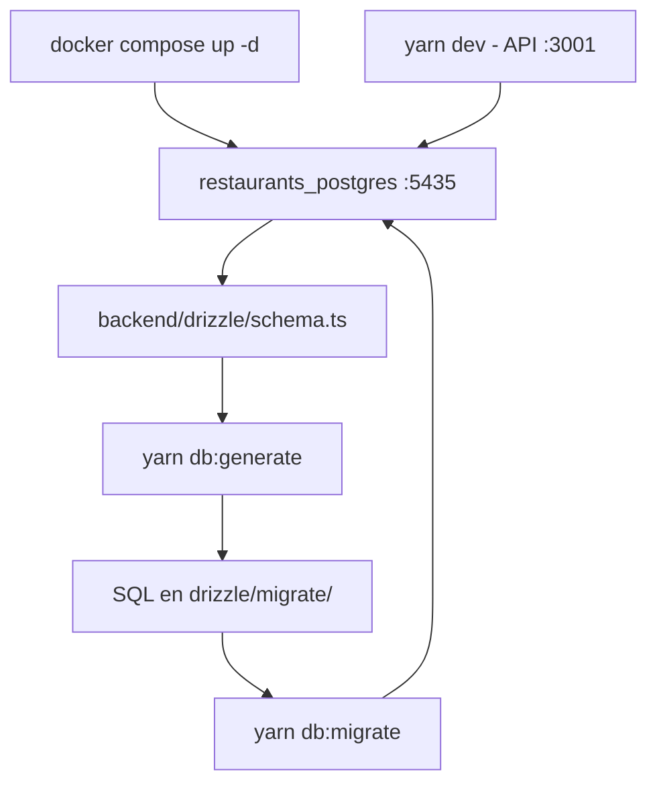

# 05 — Stack tecnológico y alineación con `ecommerce`

**Estado:** vigente (2026-10-02). Fija el stack del nuevo software y reconcilia el diseño de datos
con el stack ya probado en el proyecto hermano `ecommerce`. **Revisa** las decisiones D-BD-02,
D-BD-03 y D-BD-04 del [plan de base de datos](./plans/01-plan-implementacion-base-de-datos.md) y
añade D-BD-11…13.

## 1. Objetivo

El cliente pidió reaprovechar la experiencia tecnológica de `ecommerce` (monorepo en
`/home/jk/Proyectos/dsi/ecommerce`). Este documento mapea componente por componente qué se adopta,
qué se adapta y qué se descarta de forma consciente, para que el esquema físico
([`esquema/`](./esquema/README.md)) y su implementación (`backend/drizzle/schema.ts`) sean
coherentes con ese stack desde el primer día.

## 2. Stack objetivo

| Capa | Tecnología | Versión | Origen |
|---|---|---|---|
| Motor de BD | PostgreSQL + PostGIS (`postgis/postgis:16-3.4`) | 16 / PostGIS 3.4 | copiado de `ecommerce` |
| Extensiones | `postgis`, `citext`, `uuid-ossp`, `unaccent`, `pg_trgm`, **`btree_gist`** | — | copiado + `btree_gist` (exclusión de reservas) |
| ORM | Drizzle ORM (`drizzle-orm`) | 0.45.2 | copiado |
| Migraciones | `drizzle-kit` (`generate`, `migrate`, `push`, `studio`) | 0.31.10 | copiado |
| Driver | `pg` (node-postgres) con pool | 8.22.0 | copiado |
| Backend | NestJS + TypeScript | 11.1.28 / 5.9.3 | copiado |
| Gestor de paquetes | yarn (backend) · pnpm (web/móvil, por definir) | — | copiado (backend) |
| Entorno | `@dotenvx/dotenvx` (`dotenvx run -f .env.development.local`) | ^2.11.1 | copiado |
| Auth | `@nestjs/jwt`, `@nestjs/passport`, passport-jwt/local, `bcrypt`/`bcryptjs` | — | copiado |
| Realtime | `@nestjs/platform-socket.io` + `socket.io` | 4.8.3 | copiado (KDS y comandas) |
| Validación | `class-validator` + `class-transformer` + `ValidationPipe` global | — | copiado |
| Documentación API | `@nestjs/swagger` + `swagger-ui-express` | 11.4.5 | copiado |
| Logging | `winston` + `nest-winston` | — | copiado |
| Medios | `cloudinary` (fotos de carta) | 2.10.0 | copiado |
| Correo | `resend` (confirmaciones de reserva/pedido) | ^6.18.1 | copiado |
| Reportes | `exceljs` | ^4.4.0 | copiado |
| Utilidades | `uuid`, `slugify`, `@nestjs/schedule` | — | copiado |
| Contenedor local | `restaurants_postgres`, proyecto compose `restaurants`, host `5435` | — | adaptado (colisión: `ecommerce` usa `db`/5432) |
| API en desarrollo | puerto `3001` | — | adaptado (3000 ocupado por otro proyecto) |
| Hosting producción | Supabase + Render + Caddy (referencia) | — | por definir (A2); el diseño no depende |

## 3. Mapeo detallado `ecommerce` → `restaurants`

| Componente | En `ecommerce` | Decisión en `restaurants` |
|---|---|---|
| Imagen de BD | `postgis/postgis:16-3.4` | Idéntica |
| Compose | `ecommerce/db/docker/docker-compose.yml`, proyecto `db`, contenedor `ecommerce_postgres`, `5432:5432`, volumen `postgres_data`, healthcheck `pg_isready`, `init.sql` montado en `/docker-entrypoint-initdb.d/01_init.sql` | Mismo patrón en `db/docker/`, **proyecto `restaurants`** (evita compartir el volumen `db_postgres_data` de `ecommerce`), contenedor `restaurants_postgres`, `5435:5432`, volumen `restaurants_postgres_data` |
| `init.sql` | `postgis`, `citext`, `uuid-ossp`, `unaccent`, `pg_trgm` + `public.immutable_unaccent(text)` IMMUTABLE | Igual **+ `btree_gist`** (obligatoria para el `EXCLUDE` de reservas, D-BD-10) |
| `drizzle.config.ts` | `dialect: postgresql`; `schema: ./drizzle/schema.ts`; `out: ./drizzle/migrate`; `dbCredentials.url = DATABASE_URL`; SSL condicional con `DB_SSL=true`; `tablesFilter` excluye tablas espaciales; `verbose`, `strict` | Copiado casi literal (mismo archivo, mismas claves) |
| Scripts `db:*` | `db:generate`, `db:migrate`, `db:push`, `db:studio` | Iguales + `db:check` (verificación de conexión) |
| Capa de BD del backend | `src/database/`: `DrizzleService` (`@Global` vía `DrizzleModule`) con pool `pg`, SSL automático, `onModuleInit` con reintentos, `execute()` y `transaction()`; `schema` importado de `drizzle/schema.ts` | Igual patrón, mismas responsabilidades |
| Esquema | `drizzle/schema.ts` (~4,2k líneas) + `drizzle/relations.ts` | `backend/drizzle/schema.ts` + `relations.ts` (se implementan por etapas E1–E9 del plan) |
| Claves primarias | `bigserial` / `bigint` | **`uuid`** (`gen_random_uuid()` / UUIDv7 en aplicación) — ver §4, divergencia 1 |
| Estados | `pgEnum` (`mediaStatusEnum`, …) | **`pgEnum`** — D-BD-04 revisada |
| Aislamiento | Mono-negocio (`store` + `branches`) | **Multi-tenant** (`tenant_id` + `sucursal_id`, D-BD-06); no copiar el modelo de aislamiento |
| Scripts auxiliares | `scripts/sync-schema.js`, `migrate.js`, `install-extensions.js`, `seed.ts` (`seed:run`) | Se añaden por etapa: `seed.ts` (roles/permisos base) y `check-db.js`; `migrate` de producción según se defina el despliegue |
| Publicación de esquema | `db/sql/*.sql` y `db/scripts/*.mjs` son migraciones/backups históricos; el esquema vigente es Drizzle | Misma regla: la fuente de verdad es `backend/drizzle/schema.ts` |

## 4. Decisiones de alineación

### D-BD-02 (revisada) — Migraciones con `drizzle-kit`

Se reemplaza `node-pg-migrate` (SQL-first) por **`drizzle-kit generate` + `drizzle-kit migrate`**,
forward-only, alineado con `ecommerce`. El SQL generado vive en `backend/drizzle/migrate/`
(journal + archivos `NNNN_tag.sql`) y **puede editarse antes de aplicarlo** para añadir lo que el
toolkit no expresa (ver D-BD-13). Una vez aplicada, una migración no se edita: todo cambio va en
una migración nueva. El tag se elige al generar (`yarn db:generate --name organizacion`).

### D-BD-03 (revisada) — Drizzle ORM como capa de acceso y fuente del esquema

`backend/drizzle/schema.ts` es la **fuente única** del esquema y `relations.ts` declara las
relaciones. El DDL documentado en [`esquema/`](./esquema/README.md) pasa a ser la **especificación
de diseño** que `schema.ts` materializa. Las consultas usan el query builder de Drizzle; el SQL
crudo queda para reportes justificados (`DrizzleService.execute`).

### D-BD-04 (revisada) — Estados con `pgEnum`

Para dominios cerrados y controlados por el código (estados de `pedido`, `pedido_linea`,
`comanda`, `reserva`, `pago`, `trabajo_impresion`, `sync_operacion`, etc.) se usan **tipos enum
nativos** (`pgEnum`), igual que `ecommerce`. Los catálogos que el cliente configura por tenant
(categorías, tipos de producto, medios de pago, zonas, estaciones) permanecen como **tablas**.

Consecuencia documental: los DDL de `esquema/01–04` usan hoy `text` + `CHECK` como notación; se
convierten a `CREATE TYPE … AS ENUM` durante la implementación de `schema.ts` (pendiente §7).

### D-BD-11 — Entorno local de base de datos

`db/docker/docker-compose.yml` con **proyecto `restaurants`** (nunca `name: db`: ese proyecto ya
existe en `ecommerce` y su volumen `db_postgres_data` **no debe compartirse**), contenedor
`restaurants_postgres`, puerto host **5435** (5432 y 5433–5438 ya están ocupados por otros
proyectos), volumen `restaurants_postgres_data`, `init.sql` idempotente y healthcheck `pg_isready`.

### D-BD-12 — Estructura del backend

`backend/` con NestJS 11 + Drizzle + `pg`, **yarn** y **dotenvx**, siguiendo la estructura de
`ecommerce`: `src/database/` (DrizzleService global), `drizzle/` (schema, relations, migrate),
`scripts/` (seed, check-db). Dos archivos de entorno: `.env` (dotenv; lo lee `drizzle.config.ts`)
y `.env.development.local` (dotenvx; lo leen los scripts `dev`/`start`). API en `:3001`.

### D-BD-13 — SQL manual dentro de las migraciones de Drizzle

`drizzle-kit` no expresa (ni siempre diffea) estos objetos; se escriben **a mano** en la migración
generada antes de aplicarla y se protegen de regeneraciones accidentales:

| Objeto | Dónde aplica |
|---|---|
| `EXCLUDE USING gist` (solape de reservas por mesa y rango) | E3 (`reserva`) |
| Particionado declarativo por rango mensual | E8 (`evento_auditoria`, `bitacora_evento`) |
| Triggers de `actualizado_en` | todas las tablas mutables |
| `UNIQUE NULLS NOT DISTINCT` (PG16) | dónde aplique (p. ej. asignaciones activas) |
| Índices con `public.immutable_unaccent(...)` y `pg_trgm` | catálogo (buscador) |
| Función `public.immutable_unaccent` | `init.sql` del contenedor |
| Esquema `analytics`: 8 vistas materializadas + `fn_refrescar_analytics()` | E9 (`0008_analytics.sql`) |

> Nota (E9, 2026-10-02): `drizzle-kit` tampoco modela **vistas materializadas** ni conoce el
> esquema `analytics` (no existe en `schema.ts`). El snapshot `0008_snapshot.json` se elaboró a
> mano copiando el formato de `0007` (solo `id`/`prevId` nuevos, `schemas` vacío) para que
> `drizzle-kit generate` siga respondiendo «No schema changes». Si un `generate` futuro propone
> `DROP SCHEMA "analytics"` o `DROP MATERIALIZED VIEW`, debe descartarse: esa parte vive solo en
> SQL manual. El `migrate`, en cambio, no lee snapshots y aplica `0008` con normalidad.

### Divergencias conscientes frente a `ecommerce`

1. **Claves primarias `uuid` en lugar de `bigserial`** (mantiene D-BD-05). Motivo: el APK de
   meseros y el KDS operan con sincronización offline (`sync_operacion`), y los identificadores
   deben poder generarse en el dispositivo sin coordinación, además de no ser enumerables en las
   APIs públicas de la web. En Drizzle: `uuid().primaryKey().defaultRandom()`; la aplicación podrá
   generar UUIDv7 para mejorar la localidad de índice.
2. **Multi-tenant**: `ecommerce` es un solo negocio con sucursales; `restaurants` es multi-tenant
   (`tenant_id` + `sucursal_id`). El aislamiento es por aplicación (D-BD-06), no se copia el
   modelo de `ecommerce`.
3. **Operación física**: impresión ESC/POS, KDS, salón y turnos no existen en `ecommerce`; se
   diseñan aquí (print agent, `estacion`, `trabajo_impresion`), conservando las reglas verificadas
   del legado `punto_c`.

## 5. Arranque local

```bash
# 1. Contenedor de base de datos (puerto 5435)
cd db/docker && docker compose up -d

# 2. Verificar extensiones
docker exec restaurants_postgres psql -U postgres -d restaurants -c "\dx"

# 3. Backend
cd ../../backend && yarn install

# 4. Esquema → migración → aplicación
#    (tag por etapa; p. ej. `fundamentos` para E1)
yarn db:generate --name <etapa>   # genera SQL en drizzle/migrate/
yarn db:migrate                   # aplica contra localhost:5435

# 5. API en desarrollo (http://localhost:3001, Swagger en /api/docs)
yarn dev
```



## 6. Estado de implementación

| # | Entregable | Estado |
|---|---|---|
| 1 | `db/docker/docker-compose.yml` + `init.sql` (extensiones + `btree_gist`) | Hecho (2026-10-02) |
| 2 | Backend NestJS 11 + Drizzle (`backend/`, `DrizzleService`, health, `check-db`) | Hecho (2026-10-02) |
| 3 | `backend/drizzle/schema.ts` + `relations.ts` (72 tablas de `esquema/01–04`) | E1–E10 hechos (2026-10-02): módulos `schema/01`–`08` y `relations.ts` (72 tablas) + esquema `analytics` con 8 vistas materializadas en SQL manual (`0008_analytics.sql`) |
| 4 | Primera migración generada y aplicada | Hecho para E1–E10: `0000`–`0008` aplicadas el 2026-10-02 |
| 5 | Seeds base (tenant, sucursal, roles/permisos, carta demo, SLA) | Hecho (2026-10-02): `yarn db:seed` idempotente (`backend/scripts/seed.ts`) |
| 6 | Usuarios de BD `migrator`/`app`/`readonly` | Hecho (2026-10-02): `db/docker/roles.sql` (permisos verificados) |
| 7 | Suite de pruebas de BD + CI | Hecho (2026-10-02): `yarn db:test` (28/28) y `.github/workflows/ci.yml` |
| 8 | Benchmark y simulacro de restauración | Hecho (2026-10-02): `yarn db:bench` y `db/docker/restore-drill.sh`; registro en [`plans/02-e10-aceptacion.md`](./plans/02-e10-aceptacion.md) |

## 7. Pendientes de documentación

1. `pgEnum` (D-BD-04): aplicado en E1–E8 (`schema/01`–`08`: 48 dominios).
   Los DDL de [`esquema/01–04`](./esquema/README.md) se mantienen como especificación legible.
2. Plan de BD: nombres de migración documentados como tags de `drizzle-kit` y estructura de
   `drizzle/schema/` por módulos — hecho (2026-10-02).
3. `scripts/seed.ts` (roles/permisos y datos demo) — hecho (2026-10-02, `yarn db:seed`); el script
   de migración de producción sigue pendiente y depende del hosting (E0/A1–A3).
4. Registrar estas decisiones como ADR cuando el cliente cierre A1–A3 (E0 del plan).
