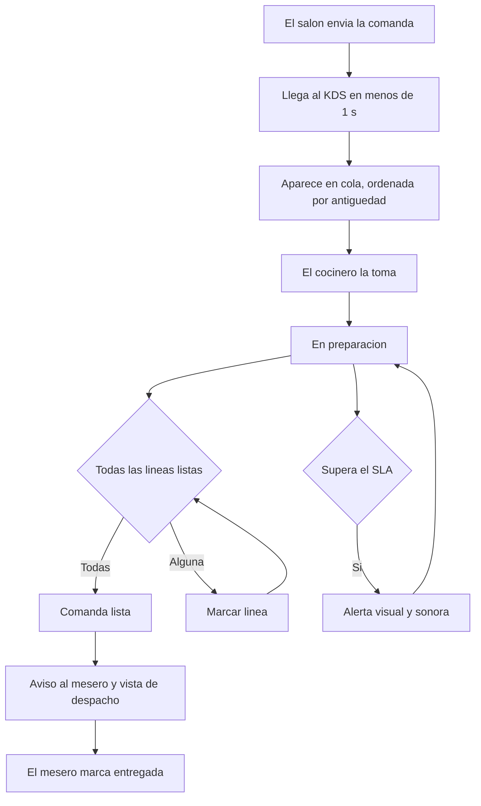

# 04 — Plan del front: KDS de cocina

**Entregable de este documento:** el brief de diseño y los **prompts listos para pegar en
Figma Make** que generan la interfaz completa del **KDS (Kitchen Display System)**: el tablero de
cocina por estación, el despacho, las alertas de SLA, las anulaciones y los agotados. La fuente de
requisitos es [`../../requerimientos/04-kds-cocina.md`](../../requerimientos/04-kds-cocina.md) (en
adelante «el documento R4»); este plan no cambia requisitos: los traduce a pantallas, componentes,
estados y textos.

**Serie:** es el plan `04` de la serie de front ([`README.md`](./README.md)). Reutiliza la
**identidad de marca** de [`01-plan-web-reservas.md`](./01-plan-web-reservas.md) §3, pero con una
**adaptación de operación** para cocina (alto contraste, tipografía grande, toque con guantes,
tiempo real). No repite tokens base: solo define lo propio del KDS.

**Estado:** propuesta v0.1 — sujeta a las decisiones abiertas de R4 §17 (hardware de cocina, SLA por
estación, quién marca «entregada», número y tipo de estaciones, paso a «lista» automático o
explícito) y a la marca (§3.1 del plan 01).

---

## 1. Cómo usar este documento

| Paso | Acción | Prompt |
|---|---|---|
| 1 | Crear el archivo «KDS Cocina — Punto C» (marco horizontal) y pegar el **prompt maestro** (fundaciones de cocina + componentes). | §13 |
| 2 | Generar **arranque y dispositivo** (selector de estación, emparejamiento, bloqueo) | §14.1–§14.3 |
| 3 | Generar **tablero** (tablero por estación, detalle de comanda, expedidor, despacho, historial) | §14.4–§14.8 |
| 4 | Generar **acciones** (tomar, listo, anular, reimprimir, agotados, aviso al mesero) | §14.9–§14.15 |
| 5 | Generar **alertas, resiliencia y ajustes** (SLA, silencio, sin conexión, ajustes, errores) | §14.16–§14.20 |
| 6 | Generar el **prototipo** con casos borde y revisar con la **lista de verificación** (§12.3) | §14.21 |

**Regla de oro:** un prompt por pantalla; conservar los tokens y componentes ya definidos. Si la
generación desvía el estilo, repetir «mantén los tokens y componentes de cocina ya definidos».

### 1.1 Figma Make para una pantalla de cocina (importante)

A diferencia del APK, el KDS **es una aplicación web**: el código que exporta Figma Make (React +
TypeScript) es una **base válida** para el proyecto real. Aquí Figma Make se usa para:

- Generar las **pantallas de cocina en horizontal**, no en vertical de móvil: marcos de
  **1920 × 1080** (TV/pantalla de pared), **1366 × 768** (monitor) y **1280 × 800** (tableta
  horizontal).
- Diseñar en **modo cocina** (superficie oscura de alto contraste) y su **variante clara**.
- Generar el **prototipo navegable** para validar el tablero con cocineros reales en hora pico.
- Servir de **base de código** para el proyecto `Interface web kds` (React + Vite + Tailwind v4,
  misma familia que las otras webs).

En los prompts se pide explícitamente «pantalla horizontal de cocina, legible a distancia, operada
con el dedo o con guantes».

### 1.2 Convenciones

- Copy **en español**, imperativo y brevísimo («Tomar», «Listo», «Anular»); sin frases largas.
- El tablero se lee **de pie y a metros**: número y mesa grandes, el resto secundario.
- Estado de **comanda** y de **línea** con color **y** texto **y** icono (nunca solo color).
- El **silencio de alertas** siempre deja registro; el **retroceso de estado** siempre pide permiso.
- Las horas y los tiempos los sella el **servidor**; la pantalla solo muestra (RN-R4-10).

| Estado (modelo) | Etiqueta en cocina | Tratamiento |
|---|---|---|
| `pendiente` / `enviada` | En cola | Superficie neutra, borde marcado |
| `en_preparacion` | En preparación | Ámbar; borde izquierdo de color |
| `lista` | Lista | Oliva; punto y texto «Recoger» |
| `entregada` | Entregada | Gris atenuado (solo en historial/despacho) |
| `anulada` | Anulada | Rojo, tachado (solo historial) |

| Estado de línea | Etiqueta | Tratamiento |
|---|---|---|
| `pendiente` | — | Casilla vacía grande, tocable |
| `listo` | ✓ | Casilla marcada oliva, texto atenuado |

| Estado de SLA | Etiqueta | Tratamiento |
|---|---|---|
| En tiempo | `{mm:ss}` | Neutro |
| Por vencer (< 25 % restante) | `{mm:ss}` | Ámbar + texto «Por vencer» |
| Excedido | `+{mm:ss}` | Rojo, fondo rojo tenue, pulso lento y **sonido** |
| Silenciado | 🔇 `{tiempo}` | Borde ámbar discontinuo + «Silenciado por {usuario}» |

| Prioridad | Etiqueta | Tratamiento |
|---|---|---|
| Programado | `Programado {hora}` | Badge azul info; fuera de la cola activa hasta su ventana |
| Con hora prometida | `Para las {hora}` | Badge dorado; ordena para cumplir |
| Urgente (manual) | `Urgente` | Bandera dorada en el borde superior |

---

## 2. Contexto del producto

### 2.1 Qué es

La **pantalla de cocina**: recibe en tiempo real las comandas que envían el salón (APK del mesero) y
la web de pedidos, las organiza **por estación**, mide sus **tiempos y SLA**, permite prepararlas y
marcarlas, **despacha** avisando al mesero, y gestiona **anulaciones y agotados**. Vive en una
pantalla de pared o tableta, **sin sesión individual por plato** (dispositivo vinculado).

### 2.2 Actores

| Actor | Uso principal |
|---|---|
| Cocinero | Ver las comandas de su estación, tomarlas y marcarlas listas (por línea o comanda) |
| Expeditor / jefe de cocina | Vista unificada de todas las estaciones; priorizar, despachar y autorizar |
| Mesero | Recoge y sirve; recibe el aviso de «listo» en su APK (no opera el KDS) |
| Administrador | Configura estaciones, SLA y pantallas desde el backoffice |

### 2.3 Objetivos medibles (R4 §15)

- Comanda visible en **menos de 1 s** desde el envío (RF-R4-01, RNF-R4-01); sin recargar la pantalla.
- **Legible a distancia** y operable con guantes: acciones principales a **un toque** (RF-R4-08).
- **Cumplimiento de SLA** por estación visible y accionable; alertas perceptibles en el ruido.
- **Cero ambigüedad** entre lo que falta preparar y lo que está listo (RF-R4-02, RN-R4-01).
- **Resiliencia**: si cae la red, no se pierde la vista ya recibida y al reconectar se recarga el
  estado real (RF-R4-72/73, RNF-R4-03/08).

### 2.4 Decisión de fases (supuesto por defecto de R4 §17)

- **MVP:** tablero por estación, estados (en cola / en preparación / lista), marcar líneas y comanda,
  tiempos + SLA visual, orden por antigüedad, pantalla completa, despacho con aviso al mesero,
  offline (mantener vista + recargar), impresión como respaldo, anular **línea**, seleccionar
  estación de la pantalla.
- **V1:** filtros por estación y tipo de pedido, resaltar prioridad, **vista de expedidor**,
  historial del turno, reflejar la entrega, devolver a pendiente (con permiso), alertas de SLA
  **sonoras** + silenciar/posponer con registro, pedidos programados aparte, vista de despacho,
  reimprimir, avisos de anulación/agotado al salón, **agotados desde cocina**, vincular/revocar
  pantallas, pausar categoría o producto del día.
- **V2:** deshacer la última acción inmediata, **reasignar** una comanda a otra estación, **mensaje
  rápido** al mesero.

### 2.5 Modelo de operación (resumen de R4 §3)

- **Estaciones:** la cocina se divide en estaciones (parrilla, fríos, barra, postres). Cada producto
  pertenece a una estación, que decide **dónde se prepara y dónde se imprime**.
- **Comandas por estación:** un envío del salón se divide en tantas comandas como estaciones
  intervengan, **sin perder la unidad del pedido**.
- **Sin comanda en estaciones vacías:** un producto sin estación (vacío o `99`) **no genera comanda
  ni impresión**.
- **SLA:** cada estación tiene un objetivo; del **envío** al paso a **lista**. Al superarlo se alerta.
- **Despacho:** cuando una comanda queda lista, se avisa al mesero; el mesero recoge y sirve.



---

## 3. Fundaciones visuales

Se heredan los colores de marca, tipografía (Fraunces + Inter) e iconografía (Lucide) del plan 01 §3,
pero la interfaz de cocina cambia de **contexto de uso**: no es un sitio cálido para leer, es un
**tablero de trabajo** que debe leerse a metros, con grasa y prisa. Estos son los ajustes.

### 3.1 Modo cocina (tema oscuro por defecto)

Se recomienda **superficie oscura** en pantallas de pared (menos reflejo/calor, más contraste), con
**variante clara** para tabletas junto a ventana.

| Token | Hex | Uso |
|---|---|---|
| `kds-bg` | `#0F0D0C` | Fondo del tablero (modo oscuro) |
| `kds-surface` | `#1C1917` | Tarjeta de comanda en cola |
| `kds-surface-2` | `#26221E` | Cabeceras de columna, barras |
| `kds-border` | `#443C36` | Bordes y separadores |
| `kds-text` | `#FAF7F2` | Texto principal (contraste AAA sobre `kds-bg`) |
| `kds-text-dim` | `#C7BEB4` | Metadatos (hora, mesero, turno) |

Variante clara: fondo `cream-50` `#FAF7F2`, superficie `#FFFFFF`, texto `ink-900`, bordes `ink-300`.

### 3.2 Colores de estado (con texto e icono, no solo color)

| Token | Hex | Uso |
|---|---|---|
| `state-queued-bg` / `state-queued-bd` | `#26221E` / `#6B6058` | En cola (neutro) |
| `state-preparing-bg` / `state-preparing-fg` | `#3A2A12` / `#F0A94A` | En preparación (ámbar) |
| `state-ready-bg` / `state-ready-fg` | `#22301C` / `#8FC76A` | Lista (oliva) |
| `state-done-fg` | `#8A8178` | Entregada (gris) |
| `state-void-bg` / `state-void-fg` | `#3A1714` / `#F26B62` | Anulada (rojo) |
| `sla-warn` | `#F0A94A` | SLA por vencer (ámbar) |
| `sla-over-bg` / `sla-over-fg` | `#4A1512` / `#FF7A70` | SLA excedido (rojo + pulso) |
| `prio-scheduled` | `#5BA7F7` | Programado (azul info) |
| `prio-promised` / `prio-urgent` | `#C99A2E` | Hora prometida / urgente (dorado) |

### 3.3 Tipografía de operación (escala ampliada)

- Números de comanda y mesa: **Fraunces** 40–56 px (cifras tabulares).
- Títulos y estados: Inter 600, 20–28 px.
- Líneas de producto: Inter 500, **20–24 px** (nombre) y 16–20 px (modificadores/notas).
- Tiempo/SLA: **cifras tabulares**, 24–32 px, siempre visible.
- Regla práctica: el producto debe leerse **desde 2–3 m**; nada por debajo de 16 px en el tablero.
- Densidad: **cómoda** por defecto (tarjetas amplias) y **compacta** opcional (más comandas por
  pantalla) para horas pico; ambas con objetivos táctiles ≥ 56 px.

### 3.4 Forma, espacio y movimiento

- Retícula de 8 pt para la tarjeta; radios `sm 8` / `md 12`.
- Tarjetas de borde izquierdo de 6–8 px que codifica el estado (refuerzo visual además del color de
  fondo).
- Zona táctil de acciones principales (Tomar/Listo) de **altura ≥ 72 px** y ancho completo de la
  tarjeta; nunca solo iconos pequeños.
- Movimiento **sobrio**: aparición de comanda con deslizamiento corto (180 ms); **pulso lento** solo
  en SLA excedido; `prefers-reduced-motion` deja el pulso por cambio de borde/opacidad.
- **Sin sombras duras**; la jerarquía se resuelve con color de fondo y borde.

### 3.5 Sonido

- **Dos sonidos distintos** y configurables: `nueva_comanda` (aviso de llegada) y `sla_excedido`
  (más urgente, repetible). Tercero opcional: `entregada`.
- Cada sonido con **volumen y activación independientes**; siempre **perceptible en cocina** y
  silenciable **con registro** (RF-R4-32, RN-R4-07).
- La pantalla ofrece un **botón de prueba** de sonido en los ajustes.

### 3.6 Fotografía e ilustraciones

- No hay fotografías de producto en el tablero: prima la **legibilidad del texto**. Opcionalmente,
  miniatura para productos compuestos, nunca como único identificador.

---

## 4. Arquitectura de información

### 4.1 Entradas a la pantalla

1. **Arranque de la pantalla** → elegir estación y vincular el dispositivo (una vez por pantalla).
2. **Evento en tiempo real** (WebSocket) → nueva comanda o cambio de estado de otra pantalla.
3. **Recarga al reconectar** → el servidor devuelve el estado real del turno (RN-R4-10).
4. **Acción del cocinero/expeditor** → tomar, marcar, anular, reimprimir, agotar.

### 4.2 Vistas

| # | Vista | Ruta conceptual | Objetivo | Prioridad |
|---|---|---|---|---|
| 1 | Seleccionar estación | `/arranque/estacion` | Ligar la pantalla a su estación | MVP |
| 2 | Emparejar pantalla | `/arranque/vincular` | Código de vinculación y estado | MVP |
| 3 | Bloqueo / reposo | overlay | Pantalla en reposo con reloj y resumen | V1 |
| 4 | **Tablero por estación** | `/tablero` | Vista principal: columnas En cola / En preparación / Listas | MVP |
| 5 | Detalle de comanda | `/tablero` (sheet) | Ficha completa y acciones por línea | MVP |
| 6 | Vista de expedidor | `/expedidor` | Todas las estaciones unificadas | V1 |
| 7 | Vista de despacho | `/despacho` | Comandas listas pendientes de recoger | V1 |
| 8 | Historial del turno | `/historial` | Listas, entregadas y anuladas del día | V1 |
| 9 | Anular línea | diálogo | Motivo y confirmación | MVP |
| 10 | Anular comanda | diálogo | Motivo + autorización si ya se preparó | V1 |
| 11 | Reimprimir comanda | acción | Reenvío a la impresora de la estación | V1 |
| 12 | Agotados / pausas | panel | Marcar producto agotado o pausar categoría | V1 |
| 13 | Mensaje rápido al mesero | sheet | Aviso corto («falta guarnición») | V2 |
| 14 | Alertas de SLA | banner | Bandeja de alertas y silencio con registro | V1 |
| 15 | Sin conexión / reconexión | banner | Estado de red y recarga del tablero | V1 |
| 16 | Ajustes de pantalla | panel | Estación, sonido, densidad, filtros, pantalla completa | MVP |
| 17 | Errores y vacíos | varias | Sin comandas, dispositivo revocado, error de servidor | MVP |

### 4.3 Navegación del tablero

- **Barra superior fija (`StationHeader`)**: nombre de estación · turno · reloj · `ConnectionPill`
  (en línea / reconectando / sin conexión) · contadores por estado · botones «Despacho», «Historial»,
  «Expedidor» (si tiene permiso), «Agotados» y «Ajustes».
- **Cuerpo**: tres **columnas** (En cola · En preparación · Listas) con desplazamiento independiente;
  en la variante compacta, una sola lista ordenada por antigüedad/SLA con encabezados de grupo.
- **Sin menús profundos**: todo lo frecuente es un botón grande en la propia tarjeta; lo secundario
  (anular, reimprimir, mensaje) vive en el detalle o en el menú contextual de la tarjeta.
- **Pantalla completa sin scroll de página**: solo las columnas se desplazan; la cabecera y el pie de
  alertas quedan fijos.

---

## 5. Inventario de componentes

Se reutilizan del plan 01: `Button`, `Modal`, `Drawer`, `Toast`, `Skeleton`, `EmptyState`,
`ErrorState`, `Badge`, `Chip`, `Card`, `IconButton`. A continuación, lo **nuevo** para cocina.

| Componente | Variantes | Dónde | Notas |
|---|---|---|---|
| `KitchenShell` | layout tablero / expedidor / despacho | todas | Cabecera fija + área de columnas + pie de alertas |
| `StationHeader` | estación / expedidor | global | Estación, turno, reloj, conexión, contadores, accesos |
| `ConnectionPill` | en línea / reconectando / sin conexión | cabecera | Con hora de última sincronización |
| `Clock` | reloj / turno | cabecera | Hora del servidor (no la del dispositivo) |
| `CounterChip` | en cola / preparación / listas | cabecera | Número grande; actúa como filtro |
| `BoardColumn` | cola / preparación / listas | tablero | Título, contador, orden, scroll propio |
| `OrderTicketCard` | cola / preparación / lista / anulada / programada; densidad cómoda/compacta | tablero | Número, mesa, antigüedad, SLA, líneas resumidas, acción principal |
| `TicketTimer` | normal / por vencer / excedido | tarjeta | Cifras tabulares; se actualiza en vivo |
| `SlaBanner` | por vencer / excedido | tarjeta | Borde/fondo y pulso; base de la alerta sonora |
| `TicketLine` | pendiente / listo; con modificadores, notas, fracción | tarjeta y detalle | Casilla grande tocable |
| `LineBadge` | modificador / nota / fracción «N T» | detalle | Texto claro, no solo icono |
| `PriorityFlag` | programado / hora prometida / urgente | tarjeta | En el borde superior |
| `BigActionButton` | Tomar / Listo / Todo listo | tarjeta | ≥ 72 px de alto, ancho completo |
| `TicketDetailSheet` | comanda simple / multi-estación | detalle | Ficha completa + acciones por línea |
| `StationBadge` | nombre de estación | detalle, expedidor | Para comandas divididas |
| `ExpeditorBoard` | kanban por estado + matriz por estación | expedidor | Estado global |
| `StationLane` | columna por estación | expedidor | Cabecera con contador y peor SLA |
| `DispatchList` | listas por recoger / entregadas | despacho | Destaca las listas no recogidas |
| `DispatchTimer` | desde «lista» | despacho | Tiempo de espera de recogida |
| `HistoryTable` | listas / entregadas / anuladas | historial | Filtros por estación y rango |
| `AlertTray` | alertas de SLA activas | pie/overlay | Lista de vencidas con acción «Silenciar» |
| `SilenceDialog` | silenciar / posponer | alerta | Motivo y minutos; deja registro |
| `CancelDialog` | línea / comanda; con/sin autorización | anular | Motivo obligatorio; pide PIN si ya se preparó |
| `SoldOutPanel` | agotar producto / pausar categoría | agotados | Vigencia y origen (cocina) |
| `ReprintAction` | normal / enviando / error | tarjeta, detalle | Estado de la impresora de la estación |
| `QuickMessageSheet` | plantillas + texto | V2 | «Falta guarnición», «Se acabó X» |
| `OfflineBanner` | sin conexión / reconectando / sincronizado | global | No bloquea el tablero |
| `SettingsDrawer` | estación / sonido / densidad / filtros | ajustes | Botón «Probar sonido» |
| `StationPicker` | tarjetas de estación | arranque | Estación, tipo, SLA objetivo |
| `PairingCode` | código de 6 dígitos + estado | arranque | Vinculación y revocación |
| `IdleLock` | reloj + resumen del turno | reposo | Reactivable con un toque |
| `SoundTestButton` | prueba de dos sonidos | ajustes | Distingue nueva vs. SLA |
| `Toasts` | éxito / error / aviso | acciones | Anunciado con `aria-live` |
| `FilterBar` | estación / tipo de pedido / prioridad | tablero (V1) | No oculta alertas de SLA |

---

## 6. Especificación pantalla por pantalla

Leyenda: **H** = horizontal (1920/1366/1280), **RF** = requisitos cubiertos, **RN** = reglas de
negocio. Todas las vistas usan modo cocina oscuro salvo que se indique.

### 6.1 Seleccionar estación (arranque) — RF-R4-70, RNF-R4-07

- Pantalla de configuración inicial, una vez por dispositivo: rejilla de `StationPicker` con las
  estaciones de la sucursal (nombre, tipo preparación/despacho, SLA objetivo, nº de productos).
- Selección única; botón «Usar esta estación». Aviso «Esta pantalla solo mostrará las comandas de
  {estación}».
- Enlace a «Vincular dispositivo» (§6.2) y a «¿No encuentras tu estación? Pídele al administrador
  que la cree en el backoffice» (fuera de alcance, R4 §1.2).
- Estado sin estaciones: `EmptyState` «Aún no hay estaciones configuradas».

### 6.2 Emparejar pantalla — RF-R4-71, RNF-R4-07

- `PairingCode`: código de 6 dígitos grande y un `QR` opcional para vincular; instrucción «Ingresa
  este código en Administración → Pantallas del KDS».
- Estados: esperando · vinculando · vinculado (nombre de dispositivo y estación) · código vencido
  (con «Generar otro código»).
- Advertencia de **dispositivo revocado**: pantalla bloqueada, «Esta pantalla fue desvinculada.
  Contacta al administrador», sin acceso al tablero (RF-R4-71).
- Nota: **no hay login por usuario** en el KDS; la identidad es el dispositivo (RNF-R4-07).

### 6.3 Bloqueo / reposo (V1)

- Tras inactividad, overlay con **reloj grande**, turno, resumen («12 listas · 2 en preparación ·
  1 excedida») y aviso «Toca para continuar».
- **No** oculta alertas de SLA activas: si hay una excedida, el reloj aparece con borde rojo y el
  sonido sigue sonando (RN-R4-07).

### 6.4 Tablero por estación (`/tablero`) — RF-R4-01, 02, 03, 08, 20, 21, 22, 30, 33; RN-R4-01/05

Vista principal. Cabecera `StationHeader` + tres `BoardColumn`.

- **En cola:** comandas `pendiente`, ordenadas por **antigüedad** (la más vieja primero); cada
  tarjeta con botón **«Tomar»**.
- **En preparación:** comandas tomadas; cada tarjeta con casillas de línea y botón **«Todo listo»**.
- **Listas:** comandas listas esperando recogida, con hora de listo y `DispatchTimer`.
- **`OrderTicketCard`** muestra: nº de comanda y de pedido, mesa o modalidad (recoger/domicilio),
  **turno**, mesero, hora de envío, **tiempo transcurrido/SLA** (`TicketTimer`), líneas con
  **cantidad + descripción**, modificadores, notas de preparación, fracción («N T») y
  `PriorityFlag` si aplica (RF-R4-03).
- Líneas de **otra estación** no aparecen aquí (RF-R4-20/22); si la comanda es multi-estación, la
  tarjeta muestra `StationBadge` con lo que le toca y un indicador «comparte con {otra estación}».
- **Paso a lista:** automático al marcar todas las líneas; si la configuración es explícita, aparece
  «Todo listo» habilitado (RN-R4-03). El botón indica qué falta («Faltan 3 de 5»).
- Máximo de información sin scroll dentro de la tarjeta; el detalle completo va en §6.5.
- Estado vacío (`EmptyBoard`): «Sin comandas en {estación}. Buen trabajo.» con reloj.

Comportamiento en vivo:

- Comanda nueva: **entra con deslizamiento** en «En cola», suena `nueva_comanda`, se resalta 2 s
  (RF-R4-01).
- Cambios de estado desde otra pantalla o desde el salón se reflejan sin recargar.
- El **`TicketTimer`** avanza en vivo; a < 25 % restante cambia a `sla-warn` (RF-R4-31).

### 6.5 Detalle de comanda (`TicketDetailSheet`) — RF-R4-03, 11, 14, 43; §7

- Panel lateral (o modal en tableta) con la ficha completa: pedido, mesa/modalidad, turno, mesero,
  sellos (`enviada_en`, `lista_en`), notas del salón, todas las líneas con su estación, y el detalle
  de modificadores/notas/fracción.
- Acciones por línea: marcar `listo`, **anular línea** (§6.9 con motivo), reimprimir (§6.11).
- Acciones de comanda: «Tomar», «Todo listo», **devolver a pendiente** (V1, con permiso y auditoría,
  RF-R4-14), reimprimir, mensaje al mesero (V2).
- Pie: `TicketTimer` y estado del SLA, siempre visible.

### 6.6 Vista de expedidor (`/expedidor`) — RF-R4-06, 04, 05, 41; §7

- Requiere permiso de expedidor/chef. Vista **unificada de todas las estaciones**.
- Dos modos conmutables: **kanban por estado** (una columna por estado con todas las estaciones) y
  **matriz por estación** (`StationLane` por estación, cada una con su contador y **peor SLA**).
- Filtros (`FilterBar`): estación y tipo de pedido (mesa/recoger/domicilio); **nunca ocultan**
  alertas de SLA (RF-R4-04).
- Destaca prioridades y las **listas pendientes de recoger** (RF-R4-05, RF-R4-41).
- Puede **despachar** (marcar entregada) y autorizar anulaciones.

### 6.7 Vista de despacho (`/despacho`) — RF-R4-40, 41, 42, 13; §9

- Lista de comandas **listas y no recogidas**, ordenadas por `DispatchTimer` (más espera arriba).
- Cada fila: nº comanda, mesa/modalidad, mesero, hora de listo, tiempo de espera, acción
  **«Entregar»** (marca `entregada`) y «Avisar de nuevo al mesero».
- Las que superan un umbral configurable se resaltan («Sin recoger hace {mm}:{ss}»).
- Refleja la anulación o el agotado que venga del salón (RF-R4-42).

### 6.8 Historial del turno (`/historial`) — RF-R4-07, 52; §7

- `HistoryTable` con pestañas **Listas · Entregadas · Anuladas** del turno/día.
- Columnas: comanda, pedido, mesa/modalidad, estación, mesero, enviada, lista, entregada, duración
  total, quién y por qué (anulaciones y devoluciones).
- Filtros por estación y rango horario; exportación opcional (V2).
- La cocina **no ve datos personales del cliente**: solo lo operativo (RN-R4-11).

### 6.9 Anular línea (`CancelDialog`) — RF-R4-50 (MVP línea); §10

- Desde la línea (`TicketLine` o detalle): «Anular» abre `CancelDialog` con **motivo obligatorio**
  (lista + texto): «Se acabó», «Error del salón», «Cambio de pedido», «Otro».
- Si la línea ya está en preparación, avisa «Esta línea ya se está preparando» y ofrece marcar
  agotado (§6.12) en lugar de anular.
- Al confirmar: la línea sale de la comanda activa y **se avisa al salón** (RF-R4-42); queda
  auditado con usuario y hora (RF-R4-50, §10).

### 6.10 Anular comanda (V1) — RF-R4-50, 52; RN-R4-08

- Acción «Anular comanda» desde el detalle; **motivo obligatorio**.
- Si la comanda **ya se preparó**, exige **autorización** (PIN de capitán/chef) (RN-R4-08); si no,
  basta el motivo.
- La comanda desaparece de la cola activa, entra a «Anuladas» del historial y el salón recibe el
  aviso (RF-R4-50/52).

### 6.11 Reimprimir comanda (V1) — RF-R4-43, 74

- Acción «Reimprimir» en tarjeta y detalle; envía de nuevo a la **impresora de la estación**.
- Estados: enviando · impresa · error («Impresora sin conexión; reintenta o usa la impresión normal»).
- La reimpresión **queda auditada** (RF-R4-43). Recuerda que la impresión es el **respaldo** del
  KDS (RF-R4-74).

### 6.12 Agotados y pausas (V1) — RF-R4-51, 75; RN-R4-09

- `SoldOutPanel` (o menú desde la línea): buscar producto y **marcar agotado**; la marca se propaga a
  **salón y web** (RN-R4-09, RF-R4-51).
- **Pausar** una categoría o un producto del día (RF-R4-75) con vigencia («hasta fin del turno» o
  «hasta que se reactive»).
- Estado de la marca: quién, cuándo y desde dónde («Cocina · parrilla»); puede reactivarse.
- Si un producto agotado ya está en preparación, aviso «{Producto} se agotó mientras se prepara.
  Acuerda con el salón» (R4 §16).

### 6.13 Mensaje rápido al mesero (V2) — RF-R4-44

- `QuickMessageSheet` con plantillas («Falta guarnición», «Se acabó un ingrediente», «Confirmar
  término») más texto libre.
- Envío al **mesero responsable** de la comanda; el mesero lo recibe como aviso en su APK; queda en
  el historial del turno (RF-R4-44, §9).

### 6.14 Alertas de SLA (V1) — RF-R4-31, 32, 33, 34; RN-R4-06/07

- **Aviso previo:** al acercarse al objetivo (p. ej. 80 % del SLA), la tarjeta pasa a `sla-warn`.
- **Alerta de excedido:** `SlaBanner` rojo con pulso, `AlertTray` con la lista de excedidas y
  **sonido** `sla_excedido` repetible (RF-R4-31).
- El **SLA se mide del envío al paso a lista** (RN-R4-06); se cuenta aunque la comanda aún esté en
  cola.
- Acciones: **abrir** la comanda, **silenciar** o **posponer** (§6.15).
- **Pedidos programados:** no entran a la cola activa hasta su ventana; se muestran en un carril
  «Programados» con su hora (RF-R4-34).

### 6.15 Silenciar/posponer alerta (V1) — RF-R4-32, RN-R4-07

- `SilenceDialog`: radio «Silenciar 5 / 10 / 15 min» o «Hasta que se marque listo», + **motivo**.
- Al confirmar, el KDS deja de sonar **pero la tarjeta queda marcada** «Silenciado por {usuario} ·
  {hh:mm}» con borde discontinuo; el aviso visual permanece.
- **Todo silencio queda registrado** (RN-R4-07); se ve en el historial del turno.

### 6.16 Sin conexión / reconexión (V1) — RF-R4-72, 73; RN-R4-10, RNF-R4-03/08

- `OfflineBanner` superior: «Sin conexión · mostrando lo último recibido ({hh:mm})». El tablero
  **sigue visible** y navegable (RF-R4-72).
- Las acciones hechas sin red se **encolan** y se envían al reconectar; cada acción es **idempotente**
  (no duplica).
- Al volver la red: banner «Reconectado · actualizando…» y **recarga completa del estado desde el
  servidor**, sin depender de la memoria local (RF-R4-73, RNF-R4-08).
- El KDS **no es la fuente de verdad**: la pantalla puede desincronizarse y se corrige al reconectar
  (RN-R4-10).

### 6.17 Ajustes de pantalla (MVP) — RF-R4-70, §8

- `SettingsDrawer` con: **estación** asignada (cambiar), **sonido** (activar/volumen/prueba de
  `nueva_comanda` y `sla_excedido`), **densidad** (cómoda/compacta), **filtros** por tipo de pedido,
  **pantalla completa** (sí/no), **tema** (oscuro/claro) y **umbral de despacho**.
- «Probar sonido» reproduce ambos para que el chef los distinga.
- Cambios que afectan al dispositivo (estación) piden confirmación y quedan auditados.

### 6.18 Errores y estados vacíos (MVP)

- **Dispositivo revocado:** bloqueo total, «Pantalla desvinculada» (§6.2).
- **Error de servidor persistente:** banner «Reintentando…»; el tablero sigue con lo último recibido
  y un botón «Reintentar ahora».
- **Impresora caída** (con KDS activo): banner discreto y el tablero sigue normal (R4 §16).
- **Reloj del dispositivo desfasado:** aviso «Hora del dispositivo distinta a la del servidor; se
  usa la del servidor» (R4 §16).
- **SLA mal configurado** (0 o negativo): aviso «SLA de {estación} sin configurar» con enlace a que
  el administrador lo corrija (R4 §16).
- **Vacío:** `EmptyBoard` por columna y global.

### 6.19 Pantalla completa y legibilidad (MVP) — RF-R4-08, RNF-R4-04

- Modo pantalla completa sin barras del navegador; bloqueo del guardado de pantalla opcional.
- Alto contraste verificado a 2–3 m; el producto y el tiempo son protagonistas.
- Sin gestos finos (sin pinch/hover obligatorios); todo con toque directo grande (R4 §11).

### 6.20 Multi-pantalla y multi-sucursal (V1) — RF-R4-71, RNF-R4-06

- **Dos pantallas con la misma estación** reciben los mismos eventos y estados (R4 §16).
- Cada estación pertenece a **una sucursal**; la pantalla muestra siempre la sucursal y el turno.
- El administrador vincula/revoca pantallas desde el backoffice (RF-R4-71).

### 6.21 Prototipo e interacciones (transversal)

- Caminos del prototipo:
  1. **Flujo normal:** llega comanda → Tomar → marcar líneas → Todo listo → entra a Despacho →
     Entregar.
  2. **SLA excedido:** comanda vieja → alerta sonora → abrir → Silenciar (con registro) → resolver.
  3. **Anulación:** anular línea con motivo → aviso al salón en el historial.
  4. **Agotado:** marcar producto agotado → aparece como no disponible (nota de propagación).
  5. **Sin conexión:** banner sin conexión → acciones encoladas → reconectar → recarga completa.
- Micro-interacciones: entrada de comanda, avance de línea, cambio a «Lista», pulso de SLA, sonido
  de prueba.

---

## 7. Casos borde y errores (R4 §16)

| Caso | Qué debe diseñarse |
|---|---|
| Comanda con líneas de varias estaciones | La tarjeta muestra solo lo suyo + indicador «comparte con {estación}» |
| Producto sin estación (vacío o `99`) | Nunca aparece en el KDS (RN-R4-04) |
| Se cae la red | `OfflineBanner`, tablero intacto, cola de acciones, recarga al reconectar |
| Impresora falla, KDS activo | Banner discreto; el tablero sigue; reintento de impresión |
| Agotado mientras se prepara | Aviso y decisión con el salón |
| Comanda anulada durante la preparación | Sale de la cola; entra a «Anuladas» con motivo |
| Pedido programado enviado temprano | Carril «Programados» aparte; no entra a la cola activa |
| Sobrecarga de comandas | Orden por antigüedad/SLA; las vencidas destacadas arriba |
| Dos pantallas con la misma estación | Reciben lo mismo; ninguna «posee» la comanda |
| Lista y el mesero no la recoge | Destacada en Despacho con tiempo de espera |
| Hora del dispositivo desfasada | Se usa la hora del servidor; aviso |
| SLA mal configurado | Aviso y corrección en backoffice |
| Dispositivo revocado | Bloqueo de la pantalla |

---

## 8. Resiliencia y tiempo real (experiencia)

- **Suscripción:** el tablero se conecta por WebSocket a los eventos de su estación/sucursal; los
  cambios llegan **sin recargar** (RF-R4-01).
- **Latencia objetivo:** comanda visible en **< 1 s p95** (RNF-R4-01); si un evento se pierde, la
  recarga periódica y la reconexión corrigen el estado.
- **Fuente de verdad = servidor** (RN-R4-10): la pantalla **nunca** decide estados por su cuenta más
  allá de la cola optimista de acciones.
- **Idempotencia:** cada acción (tomar, listo, anular) lleva un identificador para que reintentos no
  dupliquen (coherente con el APK del plan 03).
- **Recarga total** al reconectar (RF-R4-73), con indicador de «actualizando».
- **Sin pérdida de vista:** si el servidor no responde, el tablero conserva lo último recibido y
  muestra su antigüedad.

---

## 9. Accesibilidad, rendimiento y sonido (RNF-R4)

- **Accesibilidad visual:** contraste alto, tamaño grande, estado con **color + texto + icono**
  (daltonismo, R4 §11, RNF-R4-04); foco visible en la operación con teclado/control remoto.
- **Táctil:** objetivos ≥ 56 px (acciones principales ≥ 72 px); sin gestos finos; apto para guantes
  (R4 §11).
- **Sonido:** dos tonos distintos y configurables; perceptibles en ruido; silenciables **con
  registro** (RNF-R4-05, RN-R4-07).
- **Rendimiento:** el tablero debe mantenerse fluido con **decenas de comandas** (R4 §16 «sobrecarga»);
  virtualizar listas y evitar re-render de todas las tarjetas al llegar un evento.
- **Disponibilidad:** alta durante el horario de operación (RNF-R4-02); la impresión cubre la caída
  del KDS (RF-R4-74).
- **Multi-tenant/multi-sucursal:** la pantalla está acotada a una estación de una sucursal
  (RNF-R4-06).
- **Sin datos personales:** la cocina solo ve lo operativo (RN-R4-11).

---

## 10. Copy deck (textos base)

| Contexto | Texto |
|---|---|
| Encabezado de columna | «En cola · {n}» · «En preparación · {n}» · «Listas · {n}» |
| Acción principal | «Tomar» · «Todo listo» · «Entregar» |
| Falta para lista | «Faltan {k} de {n}» |
| Estado vacío | «Sin comandas en {estación}. Buen trabajo.» |
| SLA por vencer | «Por vencer · {mm:ss}» |
| SLA excedido | «Excedido +{mm:ss}» |
| Silencio | «Silenciar 10 min» · «Silenciado por {usuario} · {hh:mm}» |
| Anular línea | «Anular línea» / «Motivo (obligatorio)» |
| Anular comanda preparada | «Ya se preparó: se requiere autorización» |
| Agotado | «Marcar agotado» · «{Producto} agotado desde cocina» |
| Reimprimir | «Reimprimir comanda» · «Impresora sin conexión» |
| Programado | «Programado {hora}» · «No entra a la cola hasta {hora}» |
| Despacho | «Sin recoger hace {mm}:{ss}» · «Avisar de nuevo» |
| Sin conexión | «Sin conexión · mostrando lo último recibido ({hh:mm})» |
| Reconexión | «Reconectado · actualizando el tablero…» |
| Dispositivo revocado | «Pantalla desvinculada. Contacta al administrador» |
| Aviso al mesero | «Falta guarnición» · «Se acabó un ingrediente» · «Confirmar término» |

---

## 11. Datos de ejemplo para el prototipo

Consistente con el seed (`backend/scripts/seed.ts`) y con los planes 01–03.

```json
{
  "sucursal": "Punto C — Centro",
  "turno": "Comida",
  "estaciones": [
    { "id": "parrilla", "nombre": "Parrilla", "tipo": "preparacion", "slaSeg": 600 },
    { "id": "frios", "nombre": "Fríos", "tipo": "preparacion", "slaSeg": 300 },
    { "id": "barra", "nombre": "Barra", "tipo": "preparacion", "slaSeg": 240 },
    { "id": "postres", "nombre": "Postres", "tipo": "preparacion", "slaSeg": 180 },
    { "id": "despacho", "nombre": "Despacho", "tipo": "despacho", "slaSeg": 0 }
  ],
  "comandas": [
    {
      "numero": 1042, "pedido": 8831, "mesa": "Mesa 12", "modalidad": "mesa",
      "mesero": "Ana", "estacion": "parrilla", "estado": "en_preparacion",
      "enviada_en": "13:41:05", "slaSeg": 600, "transcurrido": "04:12",
      "lineas": [
        { "cant": 2, "producto": "Hamburguesa Punto C", "estado": "pendiente",
          "modificadores": ["Término: tres cuartos"], "notas": "Sin cebolla" },
        { "cant": 1, "producto": "Arrachera", "estado": "listo",
          "modificadores": ["Con guarnición de papas"], "notas": "" },
        { "cant": 1, "producto": "Corte del día", "estado": "pendiente",
          "fraccion": "1/2", "notas": "Salsa aparte" }
      ]
    },
    {
      "numero": 1043, "pedido": 8834, "mesa": "Para recoger · #20", "modalidad": "recoger",
      "mesero": "—", "estacion": "parrilla", "estado": "pendiente",
      "enviada_en": "13:44:50", "slaSeg": 600, "transcurrido": "00:27",
      "prioridad": "hora_prometida", "hora_prometida": "14:00",
      "lineas": [
        { "cant": 1, "producto": "Arrachera", "estado": "pendiente", "modificadores": [], "notas": "Empaque aparte" }
      ]
    },
    {
      "numero": 1044, "pedido": 8836, "mesa": "Mesa 4", "modalidad": "mesa",
      "mesero": "Luis", "estacion": "frios", "estado": "lista",
      "enviada_en": "13:38:00", "lista_en": "13:43:10", "transcurrido": "05:10",
      "slaSeg": 300, "slaEstado": "por_vencer",
      "lineas": [
        { "cant": 2, "producto": "Ensalada de la casa", "estado": "listo", "modificadores": ["Sin aderezo"], "notas": "" }
      ]
    },
    {
      "numero": 1045, "pedido": 8838, "mesa": "Domicilio · Col. Roma", "modalidad": "domicilio",
      "mesero": "—", "estacion": "barra", "estado": "pendiente",
      "enviada_en": "13:45:00", "slaSeg": 240, "transcurrido": "00:00",
      "programado": "14:15", "lineas": [
        { "cant": 2, "producto": "Limonada de la casa", "estado": "pendiente", "modificadores": [], "notas": "" }
      ]
    }
  ],
  "alertasSla": [
    { "comanda": 1038, "estacion": "parrilla", "excedido": "+02:35", "silenciada": false }
  ],
  "despacho": [
    { "comanda": 1044, "mesa": "Mesa 4", "mesero": "Luis", "lista_en": "13:43:10", "espera": "01:50" }
  ],
  "agotados": [
    { "producto": "Flan casero", "origen": "cocina", "desde": "12:30", "vigencia": "turno" }
  ]
}
```

---

## 12. Entregables esperados de Figma Make

### 12.1 Del archivo de Figma

| # | Entregable | Criterio |
|---|---|---|
| 1 | **Fundaciones de cocina** (§3): modo oscuro + claro, escala ampliada, tokens de estado/SLA | Variables de Figma |
| 2 | **Componentes nuevos** (§5) con variantes y estados | Reutilizan los del plan 01; nada duplicado |
| 3 | **Horizontal 1920 × 1080** (y 1366/1280): tablero, expedidor, despacho, historial | Legible a distancia |
| 4 | **Estados**: en cola, en preparación, lista, anulada, programada, SLA por vencer/excedido, silenciado | Como mínimo los de §6 y §7 |
| 5 | **Prototipo** clickable: flujo normal, SLA excedido, anulación, agotado, sin conexión | Enlaces internos reales |
| 6 | **Notas de diseño**: decisiones y pendientes (R4 §17) | — |

### 12.2 Del código (si se exporta)

React + TypeScript + Vite + Tailwind v4 + Radix/shadcn + lucide-react + react-router (familia de las
otras webs), más un cliente de **WebSocket** (socket.io-client, coherente con las apps de
`ecommerce`). El proyecto final se prevé como **`Interface web kds`** (o **pantalla** dentro de la
futura consola de operación). La exportación de Figma Make sirve como base; la lógica de tiempo real,
SLA e idempotencia se implementa contra el backend NestJS (3001).

### 12.3 Lista de verificación

- [ ] El tablero se lee **de pie a 2–3 m**; producto y tiempo son protagonistas.
- [ ] Comanda nueva entra sin recargar y con sonido; el `TicketTimer` avanza en vivo.
- [ ] Estados en cola / preparación / lista distinguibles por **color + texto + icono**.
- [ ] Tomar y «Todo listo» se hacen a **un toque**; marcar líneas es opcional.
- [ ] El paso a «lista» respeta la regla automática o explícita configurada.
- [ ] SLA: por vencer y excedido se ven; el excedido suena y pulsa; **silenciar deja registro**.
- [ ] Pedidos programados no entran a la cola activa hasta su ventana.
- [ ] Vista de expedidor unificada y vista de despacho con comandas sin recoger destacadas.
- [ ] Anulación de línea y de comanda con motivo; la preparada exige autorización; queda auditada.
- [ ] Agotado desde cocina con propagación y estado visible.
- [ ] Sin conexión: el tablero se mantiene y al reconectar **recarga completo** desde el servidor.
- [ ] Dispositivo revocado bloquea la pantalla; dos pantallas con la misma estación reciben lo mismo.
- [ ] Impresión como respaldo y reimpresión con estado de la impresora.
- [ ] Todo funciona con **toque grande**, sin gestos finos ni `hover` obligatorio.
- [ ] Prototipo enlaza: llegada → tomar → marcar → listo → despacho → entregar; y los 4 casos borde.

---

## 13. Prompt maestro para Figma Make

```text
Diseña el KDS (pantalla de cocina) de un restaurante llamado «Punto C». Es una aplicación web
horizontal, pensada para una pantalla de pared o una tableta en la cocina: recibe las comandas en
tiempo real, las organiza POR ESTACIÓN, mide tiempos y SLA, permite prepararlas, marcarlas listas,
despacharlas y avisar al mesero.

FORMATO: horizontal 1920×1080 (principal), 1366×768 y 1280×800. Legible a 2–3 m: producto y tiempo
grandes. Modo cocina oscuro por defecto, con variante clara.

FUNDACIONES (variables de Figma): fondo #0F0D0C; tarjeta #1C1917; superficie 2 #26221E; borde
#443C36; texto #FAF7F2; secundario #C7BEB4. Estados: en cola (neutro #26221E), en preparación
(ámbar #F0A94A sobre #3A2A12), lista (oliva #8FC76A sobre #22301C), entregada (gris #8A8178),
anulada (rojo #F26B62 sobre #3A1714). SLA: por vencer #F0A94A, excedido #FF7A70 sobre #4A1512.
Prioridad: programado #5BA7F7, hora prometida/urgente #C99A2E. Tipografía Fraunces (números/títulos,
40–56) + Inter (texto, 16–28). Radios 8/12, borde izquierdo de estado de 6–8 px, sin sombras duras.

COMPONENTES BASE: Button, IconButton, Badge, Chip, Card, Modal, Drawer, Toast, Skeleton, EmptyState,
ErrorState.

COMPONENTES DE COCINA: KitchenShell, StationHeader, ConnectionPill, Clock, CounterChip, BoardColumn,
OrderTicketCard (variantes cola/preparación/lista/anulada/programada; densidad cómoda/compacta),
TicketTimer, SlaBanner, TicketLine (pendiente/listo), LineBadge, PriorityFlag, BigActionButton
(Tomar/Todo listo, ≥72px), TicketDetailSheet, StationBadge, ExpeditorBoard, StationLane, DispatchList,
DispatchTimer, HistoryTable, AlertTray, SilenceDialog, CancelDialog, SoldOutPanel, ReprintAction,
QuickMessageSheet, OfflineBanner, SettingsDrawer, StationPicker, PairingCode, IdleLock,
SoundTestButton, FilterBar.

REGLAS: estados con color + texto + icono (nunca solo color); acciones principales a un toque y
≥56px (principales ≥72px), aptas para guantes; el tiempo/SLA usa cifras tabulares y avanza en vivo;
dos sonidos distintos (comanda nueva y SLA excedido), silenciables con registro; el tablero no debe
perder la vista si cae la red y al reconectar se recarga completo; la cocina NO ve datos personales
del cliente. Primero fundaciones y componentes; espera mi siguiente mensaje antes de generar
pantallas.
```

---

## 14. Prompts por pantalla

### 14.1 Seleccionar estación

```text
Diseña la pantalla de ARRANQUE «Selecciona la estación de esta pantalla» (horizontal, modo oscuro).
Rejilla de tarjetas de estación con nombre, tipo (Preparación/Despacho), SLA objetivo («10 min») y
número de productos; selección única con borde de marca; botón grande «Usar esta estación» y nota
«Esta pantalla solo mostrará las comandas de {estación}». Incluye enlace «Vincular dispositivo» y
estado vacío «Aún no hay estaciones configuradas» con indicación de pedir al administrador.
```

### 14.2 Emparejar pantalla

```text
Diseña «Vincular esta pantalla» con un código de 6 dígitos ENORME y un QR, e instrucción «Ingresa
este código en Administración → Pantallas del KDS». Muestra los estados: esperando, vinculando,
vinculado (nombre del dispositivo + estación) y código vencido (botón «Generar otro código»). Añade
la pantalla de DISPOSITIVO REVOCADO: bloqueo total, «Esta pantalla fue desvinculada. Contacta al
administrador», sin acceso al tablero. Recuerda: no hay login por usuario, la identidad es el
dispositivo.
```

### 14.3 Bloqueo / reposo

```text
Diseña el estado de REPOSO por inactividad: overlay con reloj grande, turno y resumen del día («12
listas · 2 en preparación · 1 excedida») y «Toca para continuar». Si hay una alerta de SLA activa,
el reloj lleva borde rojo y el sonido sigue; nunca ocultes una alerta excedida.
```

### 14.4 Tablero por estación (principal)

```text
Diseña el TABLERO POR ESTACIÓN (horizontal, modo oscuro): cabecera con nombre de estación, turno,
reloj, píldora de conexión (en línea/reconectando/sin conexión), contadores En cola / En
preparación / Listas y accesos a Despacho, Historial, Expedidor, Agotados y Ajustes. Cuerpo con TRES
COLUMNAS —En cola, En preparación, Listas— con scroll propio. Cada OrderTicketCard muestra número de
comanda y de pedido, mesa o modalidad (mesa/recoger/domicilio), turno, mesero, hora de envío, tiempo
transcurrido/SLA con cifras tabulares que avanzan, y las líneas con cantidad + producto +
modificadores + notas + fracción «N T». La columna «En cola» ordena por antigüedad (la más vieja
primero) y su botón es «Tomar»; «En preparación» tiene casillas de línea grandes y «Todo listo» con
el texto «Faltan k de n»; «Listas» muestra la hora de listo y el tiempo de espera. Borde izquierdo de
6–8 px con el color del estado; usa los datos de ejemplo del brief (Mesa 12, Para recoger #20,
Mesa 4, Domicilio Col. Roma). Estado vacío: «Sin comandas en {estación}. Buen trabajo.». Densidad
cómoda por defecto; incluye una tarjeta en densidad compacta.
```

### 14.5 Detalle de comanda

```text
Diseña el DETALLE DE COMANDA como panel lateral (o modal en tableta): cabecera con número de comanda
y pedido, mesa/modalidad, turno, mesero, sellos de hora (enviada/lista), notas del salón y estado
del SLA siempre visible. Lista todas las líneas con su estación y, por línea, modificadores, notas y
fracción; acciones por línea: marcar listo, anular línea (con motivo), reimprimir. Acciones de
comanda: Tomar, Todo listo, Devolver a pendiente (con permiso), Reimprimir y Mensaje al mesero (V2).
Si es multi-estación, muestra StationBadge con lo que le toca a esta estación e indica «comparte con
{otra estación}».
```

### 14.6 Vista de expedidor

```text
Diseña la VISTA DE EXPEDIDOR: unificación de TODAS las estaciones, con dos modos conmutables —
kanban por estado (columnas En cola / En preparación / Listas) y matriz por estación (una StationLane
por estación con su contador y su PEOR SLA). Barra de filtros por estación y por tipo de pedido
(mesa/recoger/domicilio) que NUNCA oculta alertas de SLA. Destaca prioridades (programado, hora
prometida) y las comandas listas pendientes de recoger. Permite despachar (Entregar) y autorizar
anulaciones. Cabecera con resumen global por estado.
```

### 14.7 Vista de despacho

```text
Diseña la VISTA DE DESPACHO: lista de comandas LISTAS y NO RECOGIDAS, ordenadas por tiempo de espera
(la de más espera arriba). Cada fila: número, mesa/modalidad, mesero, hora de listo, contador de
espera «01:50» con cifras tabulares y acciones «Entregar» y «Avisar de nuevo al mesero». Resalta las
que superan el umbral configurable («Sin recoger hace 03:20») y deja un grupo aparte para las ya
entregadas del turno.
```

### 14.8 Historial del turno

```text
Diseña el HISTORIAL DEL TURNO con pestañas Listas · Entregadas · Anuladas. Tabla con columnas:
comanda, pedido, mesa/modalidad, estación, mesero, enviada, lista, entregada, duración total y
quién/motivo (en anulaciones y devoluciones). Filtros por estación y rango horario. Sin datos
personales del cliente: solo lo operativo.
```

### 14.9 Tomar comanda y marcar líneas

```text
Diseña el flujo de AVANCE a un toque: en la tarjeta «En cola», el botón grande «Tomar» la pasa a «En
preparación» (cambia el color de fondo a ámbar y el borde izquierdo). En «En preparación», cada
TicketLine tiene una casilla grande tocable que alterna pendiente/listo (texto atenuado al marcar);
muestra el contador «Faltan k de n» y el botón «Todo listo». Incluye el estado en que TODAS las
líneas están listas y la comanda pasa automáticamente a «Listas», y la variante de configuración
explícita (botón habilitado cuando corresponde). Todo con objetivos de toque grandes.
```

### 14.10 Devolver a pendiente (V1)

```text
Diseña «DEVOLVER A PENDIENTE» una comanda: acción secundaria en el detalle que pide permiso (PIN de
capitán/chef) y motivo, con aviso «Esto reinicia el tiempo de preparación y queda auditado». Muestra
el resultado: la comanda vuelve a «En cola» con su sello de auditoría.
```

### 14.11 Reimprimir comanda (V1)

```text
Diseña la acción REIMPRIMIR en tarjeta y detalle, enviando de nuevo a la impresora de la estación.
Estados: enviando, impresa y error («Impresora sin conexión; reintenta o usa la impresión normal»).
Recuerda que la impresión es el respaldo del KDS y que la reimpresión queda auditada.
```

### 14.12 Anular línea y comanda

```text
Diseña los diálogos de ANULACIÓN. Para línea: motivo obligatorio (Se acabó, Error del salón, Cambio
de pedido, Otro + texto) y, si la línea ya se prepara, aviso «Esta línea ya se está preparando» con
opción «Marcar agotado» en lugar de anular. Para COMANDA completa: motivo obligatorio y, si ya se
preparó, autorización con PIN; si no, basta el motivo. Al confirmar, la comanda sale de la cola
activa y el salón recibe el aviso (queda en Anuladas del historial con usuario y hora).
```

### 14.13 Agotados y pausas (V1)

```text
Diseña el panel de AGOTADOS Y PAUSAS: buscar producto y «Marcar agotado», con propagación a salón y
web (nota visible «{Producto} agotado desde cocina»); pausar una categoría o un producto del día con
vigencia («hasta fin del turno» o «hasta reactivar»); estado con quién/cuándo/desde dónde («Cocina ·
parrilla») y acción «Reactivar». Incluye el caso «{Producto} se agotó mientras se prepara. Acuerda
con el salón».
```

### 14.14 Mensaje rápido al mesero (V2)

```text
Diseña MENSAJE RÁPIDO AL MESERO como sheet con plantillas («Falta guarnición», «Se acabó un
ingrediente», «Confirmar término») y texto libre, enviado al mesero responsable de la comanda. Muestra
la confirmación «Mensaje enviado a {mesero}» y que queda en el historial del turno.
```

### 14.15 Alertas de SLA

```text
Diseña las ALERTAS DE SLA. Aviso previo: cuando se acerca el objetivo (≈80 %), la tarjeta pasa a
ámbar con «Por vencer · {mm:ss}». Excedido: la tarjeta se pone roja, aparece un SlaBanner con pulso y
una AlertTray con la lista de comandas excedidas («Comanda 1038 · Mesa 9 · +02:35 · Parrilla»).
Incluye el carril PROGRAMADOS: las comandas con hora futura se muestran aparte («Programado 14:15 ·
no entra a la cola hasta 14:15») y no cuentan como activas.
```

### 14.16 Silenciar / posponer alerta

```text
Diseña el diálogo SILENCIAR/POSPONER alerta: radio «5 / 10 / 15 min» o «Hasta que se marque listo»,
motivo obligatorio y confirmación «El aviso visual se mantiene; se registra quién silenció y cuándo».
Muestra la tarjeta silenciada: borde ámbar discontinuo y etiqueta «Silenciado por {usuario} ·
{hh:mm}», con el sonido apagado pero el aviso visual visible.
```

### 14.17 Sin conexión / reconexión

```text
Diseña el MODO SIN CONEXIÓN: banner superior «Sin conexión · mostrando lo último recibido (hh:mm)»
sin bloquear el tablero; las acciones hechas siguen funcionando y se marcan como «pendientes de
enviar». Al volver la red, banner «Reconectado · actualizando el tablero…» con indicador de progreso
y luego el estado real recargado desde el servidor. Incluye el caso de error de servidor persistente:
«Reintentando…» con botón «Reintentar ahora», conservando la vista.
```

### 14.18 Ajustes de pantalla

```text
Diseña el panel de AJUSTES DE PANTALLA: estación asignada (con cambio y confirmación), sonido
(activar, volumen y «Probar sonido» que reproduce DOS tonos distintos: comanda nueva y SLA
excedido), densidad (cómoda/compacta), filtros por tipo de pedido, pantalla completa y tema
(oscuro/claro), y umbral de despacho. Recuerda que los cambios de estación quedan auditados.
```

### 14.19 Errores y estados vacíos

```text
Diseña los ESTADOS DE ERROR Y VACÍO: dispositivo revocado (bloqueo total), error de servidor
persistente (banner «Reintentando…» conservando la vista), impresora caída con KDS activo (banner
discreto, tablero normal), reloj desfasado («se usa la hora del servidor»), SLA sin configurar
(«SLA de {estación} sin configurar», enlace a administración) y columnas vacías («Sin comandas»).
Cada estado ofrece una acción clara.
```

### 14.20 Multi-pantalla y sucursal

```text
Diseña la experiencia MULTI-PANTALLA y MULTI-SUCURSAL: dos pantallas con la MISMA estación reciben
los mismos eventos (nota «Otra pantalla muestra esta estación»); cabecera con sucursal y turno
siempre visibles; y el estado «pantalla vinculada/revocada» desde administración. Deja claro que
ninguna pantalla «posee» la comanda.
```

### 14.21 Prototipo e interacciones

```text
Conecta un PROTOTIPO navegable del KDS con estos caminos: (1) flujo normal: llega comanda → Tomar →
marcar líneas → Todo listo → Despacho → Entregar; (2) SLA excedido: comanda vieja → alerta sonora →
abrir → Silenciar con registro → resolver; (3) anulación de línea con motivo → aparece en Historial →
Anuladas; (4) marcar un producto como agotado; (5) modo sin conexión → acciones encoladas →
reconectar → recarga completa. Añade micro-interacciones: entrada de comanda con deslizamiento, avance
de línea, cambio a «Lista», pulso de SLA y sonido de prueba. Mantén los tokens y componentes de
cocina ya definidos.
```

---

## 15. Trazabilidad RF → pantallas

| RF (R4) | Dónde se cubre |
|---|---|
| 01–03 tablero, orden y detalle | 4, 5 |
| 04–07 filtros, prioridad, expedidor, historial | 6, 8, 4 |
| 08 pantalla completa y legibilidad | 19, 4 |
| 10–12 estados y paso a lista | 9, 4 |
| 13–15 entrega, devolver, deshacer | 7, 10 (15 V2) |
| 20–23 enrutamiento por estación y reasignación | 4, 5, 6 (23 V2) |
| 30–34 tiempos, SLA, prioridad y programados | 15, 16, 4 |
| 40–44 despacho y avisos al salón | 7, 14 (44 V2) |
| 50–52 anulaciones y agotados | 12, 13, 8 |
| 70–75 configuración, pantallas y resiliencia | 1, 2, 17, 18, 20 |
| RN-R4-01/03/06/07 | 4, 9, 15, 16 |
| RN-R4-04/05/09/10/11 | 4, 5, 13, 17, 8 |
| RNF-R4-01/03/04/05/08 | 9, 15, 17, 19 |

---

## 16. Siguientes pasos

1. Confirmar con el cliente las decisiones de **R4 §17** (hardware, SLA por estación, quién marca
   «entregada», número de estaciones, paso a lista automático/explicito).
2. Validar el prototipo con **cocineros y expedidor reales** en hora pico (densidad, sonido y
   legibilidad a distancia).
3. Implementar como **web** (`Interface web kds`): tablero por estación, tiempo real por WebSocket,
   cola de acciones idempotente y recarga al reconectar, contra el backend NestJS (3001).
4. Después de este brief, el del **panel de administración**
   ([R5](../../requerimientos/05-panel-administracion.md)), que configura estaciones, SLA, pantallas y
   agotados, y donde se leen las métricas de cocina (R4 §15).
