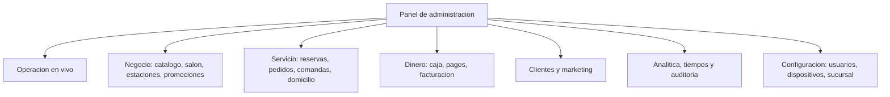

# 05 — Plan del front: panel de administración (backoffice)

**Entregable de este documento:** el brief de diseño y los **prompts listos para pegar en
Figma Make** que generan la interfaz completa del **panel de administración**: operación en vivo,
catálogo, salón, reservas, pedidos, comandas, caja, facturación, clientes, marketing, domicilio,
reportes, **trazabilidad y auditoría**, usuarios y configuración. La fuente de requisitos es
[`../../requerimientos/05-panel-administracion.md`](../../requerimientos/05-panel-administracion.md)
(en adelante «el documento R5»); este plan no cambia requisitos: los traduce a pantallas,
componentes, estados y textos.

**Serie:** es el plan `05` — cierra la serie de front ([`README.md`](./README.md)). Es el panel que
**consume lo que producen las otras cuatro interfaces** (`01`–`04`): reservas y pedidos web, APK del
mesero y KDS. Reutiliza la marca del plan `01` §3, adaptada a **consola de trabajo** (densidad,
tablas, datos en vivo).

**Estado:** propuesta v0.1 — sujeta a las decisiones abiertas de R5 §14 (dispositivos de uso,
segundo factor, retención de auditoría, reportes automáticos, quién cambia precios, contabilidad,
consolidado multi-sucursal).

---

## 1. Cómo usar este documento

| Paso | Acción | Prompt |
|---|---|---|
| 1 | Crear el archivo «Backoffice — Punto C» (escritorio) y pegar el **prompt maestro** (consola + componentes). | §13 |
| 2 | Generar **acceso y shell** (login/2FA, layout con sidebar, búsqueda global, sin permisos) | §14.1–§14.3 |
| 3 | Generar **operación y servicio** (en vivo, pedidos, reservas, comandas, salón) | §14.4–§14.10 |
| 4 | Generar **negocio** (catálogo, disponibilidad, estaciones/impresoras/SLA, promociones) | §14.11–§14.14 |
| 5 | Generar **dinero** (caja, pagos y propinas, facturación) + **clientes y marketing** + **domicilio** | §14.15–§14.19 |
| 6 | Generar **analítica y trazabilidad** (reportes, tiempos, auditoría) | §14.20–§14.22 |
| 7 | Generar **configuración** (usuarios y roles, dispositivos, sucursal) y el **prototipo** | §14.23–§14.26 |

**Regla de oro:** un prompt por módulo; conservar los tokens y componentes ya definidos. El panel es
grande: conviene generarlo **por bloques del sidebar** (Operación → Negocio → Servicio → Dinero →
Analítica → Configuración) para no perder consistencia de tablas y filtros.

### 1.1 Figma Make para un backoffice (importante)

El panel **es una aplicación web de escritorio**: el código que exporta Figma Make (React +
TypeScript) es **base válida** para el proyecto real.

- Marcos: **1440 × 900** (escritorio, principal), **1280 × 800** (portátil) y **1024 × 768**
  (tableta, consulta y aprobaciones). Móvil (390) **solo** para consulta y aprobaciones (R5 §8).
- La densidad es la seña de identidad: tablas con filtros combinables, no formularios gigantes.
- El **tablero en vivo es la pantalla de entrada** del panel (R5 §8): el resto de módulos cuelgan
  del sidebar.
- Prototipo navegable para validar con gerencia, capitanes y cajeros.

### 1.2 Convenciones

- Copy **en español**; tablas y filtros nombrados como los usa el negocio («Por cobrar», «No-show»,
  «Turno»), no como el modelo de datos.
- **La trazabilidad es visible:** desde cualquier pedido o reserva se llega a su **bitácora en un
  clic** (R5 §8). Todo detalle muestra acciones, actor, hora y canal.
- Los **tiempos** se muestran con la fórmula que los define (R5 §5.3) y con sellos del servidor
  (RN-R5-08). Un tramo sin evento de cierre aparece **«—»** y no promedia (R5 §5.3).
- Toda acción sensible pide **motivo**, muestra el **antes/después** y queda **auditada** (RN-R5-01).
- La auditoría y las bitácoras son **inmutables** (RN-R5-02): la UI nunca ofrece «editar» ni
  «borrar» un evento.
- Los datos personales se **enmascaran** para roles que no los necesitan (RN-R5-07).

| Estado del pedido (modelo) | Etiqueta en el panel | Tratamiento |
|---|---|---|
| `borrador` | Borrador | Gris claro |
| `enviado` | Recibido | Neutro |
| `en_preparacion` | En preparación | Ámbar |
| `listo` | Listo | Oliva |
| `en_camino` | En camino | Azul info |
| `entregado` | Entregado | Oliva suave |
| `por_cobrar` | Por cobrar | Ámbar |
| `pagado` | Pagado | Verde/oliva fuerte |
| `cancelado` | Cancelado | Rojo tenue |

| Estado de reserva | Etiqueta | Tratamiento |
|---|---|---|
| `solicitada` | Solicitada | Neutro |
| `confirmada` | Confirmada | Oliva |
| `sentada` | Sentada | Marca suave |
| `finalizada` | Finalizada | Gris |
| `cancelada` | Cancelada | Rojo tenue |
| `no_show` | No-show | Rojo con icono |

| Severidad de alerta | Uso |
|---|---|
| Crítica | SLA excedido grave, impresora caída, dispositivo revocado |
| Alta | Comanda por vencer, caja sin cerrar, pago pendiente |
| Media | Sincronización pendiente, reporte fallido |
| Baja | Avisos informativos |

---

## 2. Contexto del producto

### 2.1 Qué es

La herramienta desde la cual el negocio **configura, opera y rastrea todo** lo que pasa con
reservas, pedidos, comandas, pagos y usuarios, con sus **tiempos de atención y preparación**. Es la
vista de administración general que consume lo que producen las otras cuatro interfaces y la que
hace posible **operar, medir y auditar** (R5 §1).

### 2.2 Actores y roles

| Rol | Alcance | Uso típico del panel |
|---|---|---|
| Dueño / administrador global | Todas las sucursales | Todo, incluida configuración y usuarios |
| Gerente de sede | Su sucursal | Operar su sede, ver sus reportes, gestionar su personal |
| Capitán / jefe de piso | Su turno | Salón, reservas, excepciones de pedidos |
| Cajero | Su turno y caja | Caja, cobros, cierre |
| Jefe de cocina / chef | Cocina | Estaciones, SLA, agotados, comandas |
| Marketing | Configuración | Promociones, cupones, newsletter, reseñas |
| Contador / auditor | Lectura | Reportes, facturación, auditoría |

El **alcance por sucursal es parte del permiso** (R5 §2): el shell del panel siempre muestra la sede
activa y el rol.

### 2.3 Objetivos medibles (R5 §12)

- **Operar de un vistazo:** el tablero en vivo responde «¿qué está pasando ahora?» (RF-R5-01/02/03).
- **Rastrear todo:** el 100 % de pedidos y reservas con bitácora completa (R5 §12 «Trazabilidad»).
- **Medir tiempos:** atención, preparación, despacho, entrega y cobro por pedido, estación y mesero
  (RF-R5-122, §5.3).
- **Alertas que llevan a la acción:** tiempo medio entre alerta y acción medible (R5 §12).
- Operable desde computador y tableta; móvil solo consulta y aprobaciones (R5 §8).

### 2.4 Decisión de fases (supuesto por defecto de R5 §14)

- **MVP:** operación en vivo, catálogo (CRUD + disponibilidad), salón, estaciones/impresoras/SLA,
  reservas (listado, políticas, llegada, no-show, bitácora), pedidos (listado, detalle, bitácora,
  acciones básicas), comandas (monitor), caja (turnos, cierre, medios, reporte), clientes
  (consentimientos), reportes base (ventas, reservas, **tiempos**), auditoría, usuarios/roles y
  configuración de sucursal.
- **V1:** importación CSV, historial de precios, destacados, impresión diagnóstica, paso a lista
  configurable, depósitos, bloqueos/festivos, reembolsos, exportaciones, SLA/historial de cocina,
  reapertura de caja, propinas, facturación, clientes (ficha/ARCO), marketing completo, domicilio,
  reportes programados, multi-sucursal, 2FA, versiones mínimas, notificaciones, ventanas y alta de
  sucursal.
- **V2:** vigencia programada de cambios, forzar estado con autorización, reasignar comandas,
  segmentos, métricas UTM, liquidación de repartidores, tablero personalizable, alertas por umbral
  y permisos temporales.

### 2.5 Mapa de módulos (R5 §3)



---

## 3. Fundaciones visuales (reutilizadas + consola)

Se heredan la paleta de marca, tipografía (Fraunces + Inter), radios e iconografía del plan 01 §3.
El panel añade lo propio de una **consola de trabajo densa**:

### 3.1 Layout de consola

| Elemento | Medida | Notas |
|---|---|---|
| Sidebar | 260 px (colapsable a 72) | Agrupada por bloque; ítem activo con fondo `brand-50` y barra de marca |
| Barra superior | 56 px | Búsqueda global, sede, alertas, usuario |
| Contenedor | fluido, máx. 1600 px | Tablas a ancho completo; formularios en columna de 720 px |
| Altura de fila | 44 px cómoda / 36 px compacta | Selector de densidad por usuario |
| Cabecera de tabla | sticky | Con orden, filtro y selección |

### 3.2 Tokens de superficie y datos

| Token | Hex | Uso |
|---|---|---|
| `app-bg` | `#F6F3EF` | Fondo de la aplicación (crema más neutra) |
| `panel` | `#FFFFFF` | Tarjetas, tablas, formularios |
| `panel-alt` | `#FAF8F5` | Filas alternas, bloques secundarios |
| `border-subtle` | `rgba(214,208,201,.7)` | Líneas de tabla y divisores |
| `row-hover` | `#F7F2EC` | Fila bajo el cursor |
| `row-selected` | `#F6E3D9` | Fila seleccionada |
| `mono-id` | `ui-monospace` + `tabular-nums` | Códigos, folios, consecutivos |
| `chart-1…8` | `#B4451F` `#4A6B3F` `#C99A2E` `#3E6E8C` `#7A5C9E` `#A0522D` `#5C8A8A` `#8A8178` | Series de gráficos (seguras para daltonismo) |

**Semánticos** (reutilizados): éxito `leaf-600/100`, aviso `amber-600/100`, error `red-600/100`,
info nuevo `#1D4ED8` sobre `#E3EBFB`.

### 3.3 Tipografía de datos

- Inter para todo; **Fraunces** solo en títulos de módulo y en el login.
- Cuerpo 14/20; tabla 13/18; celdas numéricas y de dinero con **cifras tabulares**; formato de
  moneda, fecha y zona horaria **por sucursal** (RNF-R5-08).
- Los **tiempos** se muestran como duraciones (`04:12`, `1 h 12 m`) y las marcas de hora como
  `13:41 · 2 oct`; nunca fechas ambiguas.

### 3.4 Patrones transversales

- **Tabla como ciudadano de primera:** filtros combinables, orden, columnas configurables,
  selección múltiple, paginación, **vistas guardadas** (RF-R5-50, RF-R5-127) y exportación con
  registro (RN-R5-10).
- **Detalle en panel lateral** (`DetailDrawer`) para no perder el contexto de la lista; páginas
  completas solo para editores complejos (producto, rol, sucursal).
- **Acciones destructivas:** `ConfirmDialog` con motivo obligatorio y **diff antes/después**
  (RN-R5-01, RF-R5-132).
- **En vivo vs. analítico:** lo operativo se actualiza en tiempo real; lo analítico muestra
  «Actualizado hace {n} min» (máx. 1 min, RNF-R5-02) y nunca lee la base operativa en caliente
  (RN-R5-03).

---

## 4. Arquitectura de información

### 4.1 Navegación global (sidebar)

| Bloque | Módulos |
|---|---|
| **Operación** | En vivo · Pedidos · Reservas · Comandas · Salón |
| **Negocio** | Catálogo · Estaciones e impresoras · Promociones |
| **Servicio** | Domicilio y repartidores · Clientes |
| **Dinero** | Caja y turnos · Pagos y propinas · Facturación |
| **Analítica** | Reportes · Tiempos y SLA · Auditoría |
| **Configuración** | Usuarios y roles · Dispositivos · Sucursal y ajustes |

- **Barra superior:** búsqueda global (pedidos, reservas, clientes, productos, folios), selector de
  **sede** (recuerda la elección), campana de **alertas operativas** con contador por severidad,
  ayuda y menú de usuario (rol, sede, cerrar sesión).
- **Migaja** en páginas de detalle; el estado de filtros vive en la **URL** (compartible).
- **Atajos:** `/` enfoca la búsqueda, `g p` pedidos, `g r` reservas, `g t` tiempos (documentados en
  la ayuda).

### 4.2 Páginas

| # | Página | Ruta | Objetivo | Prioridad |
|---|---|---|---|---|
| 1 | Acceso | `/entrar` | Login, 2FA, recuperación | MVP |
| 2 | En vivo | `/en-vivo` | Tablero de entrada: pedidos, salón, comandas, alertas | MVP |
| 3 | Pedidos | `/pedidos`, `/pedidos/:id` | Lista en vivo/historial y detalle con bitácora | MVP |
| 4 | Reservas | `/reservas`, `/reservas/calendario`, `/reservas/:id` | Lista/calendario y detalle con bitácora | MVP |
| 5 | Comandas | `/comandas`, `/comandas/:id` | Monitor por estación, SLA e historial | MVP |
| 6 | Salón | `/salon` | Mapa, zonas y mesas | MVP |
| 7 | Catálogo | `/catalogo`, `/catalogo/:id` | Productos, categorías, modificadores | MVP |
| 8 | Disponibilidad | `/catalogo/disponibilidad` | Agotados, pausas y vigencia por sede/horario | MVP |
| 9 | Importación CSV | `/catalogo/importar` | Validación y carga masiva | V1 |
| 10 | Estaciones e impresoras | `/estaciones` | Estaciones, rutas de impresión, SLA, prueba | MVP |
| 11 | Promociones | `/promociones` | Banners, cupones y vigencias | V1 |
| 12 | Domicilio y repartidores | `/domicilio` | Zonas, repartidores, entregas, liquidación | V1 |
| 13 | Clientes | `/clientes`, `/clientes/:id` | Ficha, historial, consentimientos, ARCO | V1 |
| 14 | Caja y turnos | `/caja`, `/caja/:turnoId` | Turnos, arqueo, cierre, reapertura | MVP |
| 15 | Pagos y propinas | `/pagos` | Pagos por medio, propinas, descuentos | MVP |
| 16 | Facturación | `/facturacion` | Facturas, notas crédito, configuración fiscal | V1 |
| 17 | Reportes | `/reportes` | Ventas, reservas/ocupación, programados | MVP |
| 18 | Tiempos y SLA | `/tiempos` | El catálogo de tiempos de R5 §5.3 | MVP |
| 19 | Auditoría | `/auditoria`, `/auditoria/:entidad/:id` | Bitácora global y diffs antes/después | MVP |
| 20 | Usuarios y roles | `/usuarios`, `/roles` | CRUD, plantillas, matriz de permisos, 2FA | MVP |
| 21 | Dispositivos | `/dispositivos` | Inventario, vinculación/revocación, versiones | MVP |
| 22 | Sucursal y ajustes | `/ajustes` | Datos, horarios, parámetros, notificaciones | MVP |
| 23 | Sin permisos / errores | `*` | Explicación y salida | MVP |

### 4.3 Entradas frecuentes

1. **Alerta operativa** → clic lleva a la entidad con el filtro aplicado (RF-R5-04/05).
2. **Búsqueda global** → cualquier pedido, reserva, cliente, producto o folio.
3. **Bitácora** → desde cualquier fila o detalle, un clic (R5 §8).
4. **Reporte programado** → correo con enlace al reporte en el panel (RF-R5-125).

---

## 5. Inventario de componentes

Se reutilizan del plan 01: `Button`, `IconButton`, `Input`, `Select`, `Checkbox`, `Radio`, `Chip`,
`Badge`, `Card`, `Modal`, `Drawer`, `Toast`, `Skeleton`, `EmptyState`, `ErrorState`, `Tabs`,
`Accordion`, `DatePicker`, `HoursTable`, `Gallery`.

| Componente | Variantes | Dónde | Notas |
|---|---|---|---|
| `AppShell` | sidebar expandida/colapsada; 3 anchos | global | Barra superior + contenido |
| `SidebarNav` | con badges de alertas | global | Agrupada por bloque |
| `GlobalSearch` | overlay `⌘K` con resultados por tipo | global | Recientes y atajos |
| `SedeSelector` | dropdown con «Todas» para global | global | Cambia todo el ámbito |
| `AlertBell` | contador por severidad | global | Abre `AlertInbox` |
| `AlertInbox` | drawer con alertas agrupadas | global | «Atender» → entidad |
| `PageHeader` | título + acciones + migaja | todas | Acciones primarias a la derecha |
| `DataTable` | cómoda/compacta; con selección, orden, columnas configurables | todas las listas | Cifras tabulares, fila → detalle |
| `FilterBar` | filtros combinables + chips activos | listas | Estado en URL |
| `SavedViewChip` | vistas guardadas por usuario/rol | listas | RF-R5-50/127 |
| `BulkActionBar` | acciones sobre selección | listas | Con confirmación y auditoría |
| `Pagination` | páginas + «por página» | listas | — |
| `DetailDrawer` | entidad + pestañas | pedidos, reservas, comandas | Bitácora como pestaña fija |
| `EntityHeader` | folio, estado, total, acciones | detalles | Folio en mono |
| `StatusBadge` | por dominio (pedido, reserva, comanda, caja, factura) | todas | Color + texto + icono |
| `MoneyCell` | positivo/negativo/descuento | dinero | Moneda de la sede |
| `DurationCell` | duración + semáforo vs. SLA | tiempos | «—» si sin cierre |
| `KpiCard` | valor + delta + sparkline | en vivo, reportes | Con periodo comparado |
| `Chart` | línea, barras, dona, apiladas | reportes | Paleta `chart-1…8` |
| `Heatmap` | horas × días | ocupación y carga | Accesible con tabla alternativa |
| `Timeline` | bitácora de reserva / pedido / comanda | detalles y auditoría | Actor, canal, hora, resultado |
| `TimelineEvent` | con ícono por tipo; con diff | bitácoras | Eventos inmutables |
| `BeforeAfterDiff` | campos cambiados | auditoría | Valor anterior → nuevo |
| `ActorTag` | usuario / cliente / automatización / dispositivo | bitácoras | Con canal |
| `ConfirmDialog` | simple / con motivo / con autorización | acciones sensibles | Muestra impacto |
| `ApprovalDialog` | PIN o 2FA de autorizador | reembolsos, anulaciones, reapertura | RF-R5-54/72 |
| `ReasonSelect` | motivos por dominio + texto | acciones | Motivo obligatorio |
| `PermissionMatrix` | roles × permisos, con alcance por sede | roles | RF-R5-140/141 |
| `UserCard` | con rol, sedes y estado | usuarios | Altas/bajas/suspensión |
| `StationForm` | estación + productos asignados | estaciones | Origen de comandas |
| `SlaEditor` | por estación y por producto | estaciones, tiempos | Valida rangos |
| `PrinterRoutes` | matriz impresora × documento × copias | impresoras | Con prueba |
| `StationBoard` | mini-monitor por estación | en vivo, comandas | Reutiliza lenguaje del KDS |
| `MenuTree` | categorías y productos jerárquicos | catálogo | Drag para ordenar |
| `ProductForm` | pasos: datos, precios, modificadores, alérgenos, fotos | catálogo | Validación por paso |
| `AvailabilityGrid` | producto × sede/horario | disponibilidad | Agotado con origen y vigencia |
| `CsvImporter` | carga, mapeo, validación, resultado | catálogo | Rechaza con detalle por fila |
| `PriceHistoryTable` | quién, cuándo, antes → después | catálogo | RF-R5-13 |
| `ReservationCalendar` | día/semana/sede | reservas | Con lista de espera al lado |
| `FloorMapEditor` | zonas, mesas, capacidad, posición | salón | Estados de mesa |
| `WaitlistPanel` | lista de espera y asignación | reservas | No sobre-asigna |
| `OrderLinesTable` | líneas con modificadores y comandas | pedidos | Refleja lo cobrado/impreso |
| `PaymentPanel` | pagos, medios, propinas, descuentos | pedidos, caja | Con conciliación |
| `RefundDialog` | reembolso ≤ pago original | pedidos, pagos | Con autorización |
| `CashTurnPanel` | apertura, arqueo, diferencias, cierre | caja | Impide cerrar con abiertos |
| `TipLiquidation` | propinas por período y persona | pagos | Exportable |
| `InvoiceList` | facturas, estado, notas crédito | facturación | Enlaza pedido/pago |
| `FiscalSettings` | impuestos, resoluciones, prefijos | facturación | Consecutivos validados |
| `ClientProfile` | historial, preferencias, consentimientos | clientes | Datos enmascarados por rol |
| `ConsentList` | tipo, canal, base legal, vigencia | clientes | Opt-out respetado |
| `SegmentBuilder` | criterios simples | clientes (V2) | Vista previa del conteo |
| `CampaignList` | promociones y banners con vigencia | marketing | Lo vencido no se publica |
| `CouponForm` | reglas, usos, control de abuso | marketing | Un agotado no aplica |
| `NewsletterPanel` | suscriptores y envíos | marketing | Solo con consentimiento |
| `ReviewModeration` | cola de reseñas, publicar/ocultar | marketing | Motivo auditado |
| `CoverageMap` | geometría de zonas, tarifas, mínimos | domicilio | Valida contra la web |
| `CourierList` | repartidores, asignación, evidencia | domicilio | Notifica asignación |
| `ReportBuilder` | métrica, periodo, filtros, agrupación | reportes | Comparables y exportables |
| `ScheduledReports` | periodicidad y destinatarios | reportes | Registra entregas |
| `TimesExplorer` | tramos de tiempo por pedido/estación/mesero | tiempos | Las fórmulas de §5.3 |
| `AuditExplorer` | bitácora global con filtros | auditoría | Inmutable, exportable |
| `SessionGuard` | aviso de sesión y bloqueo | global | 2FA según política |
| `DeviceTable` | tipo, estación, versión, última conexión | dispositivos | Diagnóstico y revocación |
| `ConfigForm` | sucursal, horarios, parámetros | ajustes | Con vista previa del efecto |
| `StoreBranchWizard` | alta de sede y clonado | ajustes (V1) | Hereda base y ajusta |

---

## 6. Especificación pantalla por pantalla

Leyenda: **D** = escritorio (1440), **T** = tableta (1024), **RF** = requisitos cubiertos,
**RN** = reglas de negocio.

### 6.1 Acceso (`/entrar`) — RF-R5-140/142/143, RNF-R5-06

- D: tarjeta centrada sobre `app-bg`; logo, correo, contraseña, «Recordarme» y «¿Olvidaste tu
  contraseña?».
- **2FA** (V1): segundo paso con código de 6 dígitos y opción «usar otro método»; recordar
  dispositivo según política (RF-R5-143).
- Errores claros sin filtrar información; usuario **dado de baja no inicia sesión** (RF-R5-142).
- Mensaje de bienvenida con **sede y rol** tras entrar; si el usuario tiene varias sedes, elige la
  sede activa.
- `SessionGuard`: aviso a los 25 min y cierre a los 30 de inactividad (con RNF-R5-06).

### 6.2 Shell y búsqueda global — R5 §8, RNF-R5-07

- `AppShell`: sidebar por bloques (§4.1), colapsable; barra superior con `GlobalSearch` (`⌘K`),
  `SedeSelector`, `AlertBell` y menú de usuario.
- Búsqueda global: resultados agrupados por tipo (Pedidos, Reservas, Clientes, Productos, Folios)
  con teclado y recientes; abre el detalle directamente.
- **Sede activa** visible siempre; cambiarla refresca todo el ámbito (RNF-R5-01).
- Estados: sin permisos para un módulo → el ítem aparece deshabilitado con explicación, no oculto
  (R5 §8 «estados claros»).

### 6.3 En vivo (`/en-vivo`) — RF-R5-01, 02, 03, 04, 05

Pantalla de entrada y corazón del panel. Se actualiza **sin recargar** (RF-R5-01).

- **Fila de `KpiCard`** (hoy vs. ayer): ventas del día, pedidos activos, reservas de hoy, ticket
  promedio, **cumplimiento de SLA**.
- **Pedidos activos** por estado y modalidad (mesa/recoger/domicilio) y por canal (web, APK, QR),
  con filtro rápido; la fila abre `DetailDrawer`.
- **Salón:** mesas ocupadas/libres/por cobrar y **próximas llegadas** de reservas (RF-R5-02).
- **Comandas por estación:** mini `StationBoard` con las vencidas y por vencer destacadas
  (RF-R5-03), en el mismo lenguaje visual del KDS (plan 04 §3).
- **Alertas:** bandeja con severidad; cada una enlaza a su diagnóstico o entidad (RF-R5-04).
- **Accesos directos a excepciones** (RF-R5-05): reimprimir, reasignar, anular, reembolsar — cada
  acción respeta permisos y se audita.
- Auto-refresco con indicador «En vivo · actualizado {hh:mm:ss}»; pausable.

### 6.4 Pedidos — lista y detalle (`/pedidos`, `/pedidos/:id`) — RF-R5-50…56, 131/132

**Lista (D/T):**

- `DataTable` en vivo + historial con filtros combinables: sede, canal, modalidad, estado, mesero,
  fecha, «con incidencias», «con descuento», «con reembolso» (RF-R5-50).
- Columnas: folio (mono), hora, sede, modalidad/canal, mesa, cliente (enmascarado si aplica),
  mesero, estado, total, **tiempo total**, pago. Cifras tabulares.
- `SavedViewChip` («Por cobrar de hoy», «Domicilio en camino», «Con incidencias») y exportación con
  registro (RF-R5-56, RN-R5-10).

**Detalle (`DetailDrawer`, ancho amplio):**

- `EntityHeader`: folio, estado, modalidad, total y acciones; botón **«Bitácora»** siempre visible.
- Pestañas: **Resumen · Líneas · Comandas · Pagos · Bitácora**.
  - **Líneas** (`OrderLinesTable`): producto, modificadores, comanda/estación, estado, importe; es
    **exactamente** lo cobrado y lo impreso (RF-R5-51).
  - **Comandas:** por estación con tiempos y estado; enlaza al monitor (§6.7).
  - **Pagos:** medios, propina, descuentos y su conciliación (RF-R5-51).
  - **Bitácora:** línea de tiempo §6.4.1.
- **Acciones** (RF-R5-53): reasignar mesa/mesero, anular línea, anular pedido, reimprimir, reenviar;
  todas con `ConfirmDialog` + motivo y auditoría. **Reembolsos y notas crédito** (V1) con
  `RefundDialog` y autorización; **nunca mayor al pago** (R5 §13). Forzar estado (V2) con doble
  confirmación y autorización especial (RF-R5-55).

#### 6.4.1 Bitácora del pedido — RF-R5-52, §5.2, RN-R5-01/02

- `Timeline` con **todos los eventos del ciclo** en orden: `creado → enviado → comanda_enviada →
  comanda_en_preparacion → comanda_lista → listo → entregado / en_camino / recogido → por_cobrar →
  pagado`, más `cancelado`/`reembolsado` si aplica.
- Cada evento muestra **actor** (cliente, mesero, cocina, caja, administrador, automatización),
  **canal**, **dispositivo**, **hora del servidor** y **resultado**; los cambios de valor llevan
  `BeforeAfterDiff` (RF-R5-132).
- **Tiempos derivados visibles** entre hitos: atención, preparación (por estación), despacho,
  ruta/recogida, cobro y total (§5.3). Es la misma fuente que alimenta §6.13.3.
- Eventos **inmutables**: sin editar ni borrar (RN-R5-02); exportable con registro (RF-R5-130).

### 6.5 Reservas — calendario, lista y detalle (`/reservas`) — RF-R5-40…47

**Calendario (D/T):**

- `ReservationCalendar` por día/semana y por sede; cada reserva como bloque con hora, personas,
  mesa y estado; colores por estado (confirmada/sentada/no-show).
- Panel lateral con la **lista de espera** y las **próximas llegadas**; asignación de mesa sin
  sobre-asignar (RF-R5-42).

**Lista:**

- `DataTable` con filtros por sede, fecha, estado, canal, tamaño de grupo y «con depósito»
  (RF-R5-40); exportable.

**Detalle (`DetailDrawer`):**

- Datos: código, cliente, contacto, personas, fecha/hora, mesa, política aplicada, notas y origen
  (web/teléfono/mostrador).
- Acciones (RF-R5-41/43/44/45): crear/editar, **reubicar**, cancelar (con motivo), marcar
  **llegada (`sentada`)**, **finalizar**, **no-show**; depósitos, cobros y reembolsos (V1,
  conciliados con caja).
- **Bitácora de la reserva** (§6.5.1) como pestaña fija.
- Políticas de reserva (RF-R5-43): antelación, duración, tolerancia, máximo de personas, depósito y
  no-show; se editan aquí y **rigen la web** (plan 01).

#### 6.5.1 Bitácora de la reserva — RF-R5-47, §5.1

- `Timeline` con `solicitada → confirmada → recordatorio_enviado → (reagendada) → sentada →
  finalizada`, más `cancelada_cliente` / `cancelada_local` / `no_show`.
- Cada evento con actor, canal, hora y resultado; muestra los **tiempos clave**: espera hasta
  `sentada` y **duración de mesa** (`finalizada − sentada`) (§5.1/§5.3).
- Reagendamientos con `BeforeAfterDiff` (antes/después + motivo).

### 6.6 Bloqueos y festivos (V1) — RF-R5-46

- Calendario de **cierres temporales, festivos y eventos** por sede y zona; alta con rango,
  recurrencia y motivo.
- Muestra el **impacto**: reservas afectadas y acción «notificar y reubicar» (R5 §13).
- La web y el APK usan el horario vigente al momento de la acción (R5 §13).

### 6.7 Comandas y cocina (`/comandas`) — RF-R5-60…63

- **Monitor por estación** con estado y **tiempo transcurrido**, idéntico a lo que ve el KDS
  (RF-R5-60); selector de estación o vista unificada de expedidor.
- **Cumplimiento de SLA** por estación con semáforo y lista de vencidas (RF-R5-61); **historial del
  turno** exportable.
- **Excepciones** (RF-R5-63): anulaciones, reimpresiones y agotados con su **responsable**, con
  enlace directo a la auditoría correspondiente.
- **Reasignar comanda entre estaciones** (V2) con auditoría (RF-R5-62).
- Advertencia visible de que **el KDS es la interfaz de operación**: aquí se **observa** y se
  corrigen excepciones, no se cocina (R5 §1.2).

### 6.8 Salón (`/salon`) — RF-R5-20…23

- `FloorMapEditor`: zonas y mesas con capacidad y **posición en el mapa**; el mapa debe coincidir
  con el salón real (RF-R5-20).
- Estados de mesa y bloqueo por mantenimiento (`fuera_servicio`): una mesa bloqueada **no se
  ofrece** (RF-R5-21).
- **Unión y división de mesas** (V1) con configuraciones guardadas que se reflejan en el APK
  (RF-R5-22).
- **Franjas y aforo por zona** (V1) que limitan la disponibilidad de la web (RF-R5-23).
- Vista previa «así lo verá el mesero» (reutiliza los estados del plan 03 §3).

### 6.9 Catálogo y carta (`/catalogo`) — RF-R5-10…15

- `MenuTree` a la izquierda (categorías y productos, orden por drag) + tabla/detalle a la derecha.
- `ProductForm` por pasos: **datos** (nombre, descripción, categoría), **precios e impuestos**,
  **modificadores** (grupos, min/max, obligatorios), **alérgenos y dietas**, **fotos** (con guía de
  encuadre) y **estación** asignada (enlaza con §6.11).
- **Disponibilidad por sede y horario** + agotados y reactivación (RF-R5-11) en
  `/catalogo/disponibilidad` (`AvailabilityGrid`): el agotado se propaga a **web, APK y KDS** — se
  muestra el origen («Cocina · parrilla», «Panel») y la vigencia.
- **Destacados, recomendados y menú del día** (V1) controlados desde aquí (RF-R5-14).
- **Importación/exportación CSV** (V1, `CsvImporter`): mapeo de columnas, validación por fila y
  **rechazo con detalle** si el archivo es inválido (RF-R5-12); la exportación deja registro
  (RN-R5-10).
- **Historial de cambios de precio y catálogo** (V1): `PriceHistoryTable` con quién, cuándo y valor
  anterior (RF-R5-13). Un cambio **no altera** pedidos ni reservas creados (RN-R5-04).
- **Vigencia programada** de cambios (V2): el cambio entra en vigor sin intervención (RF-R5-15).

### 6.10 Estaciones, impresoras y SLA (`/estaciones`) — RF-R5-30…34

- **Estaciones** (`StationForm`): nombre, tipo (preparación/despacho), sucursal, **SLA objetivo** y
  **productos asignados** (RF-R5-30); un producto sin estación no genera comanda (aviso al guardar).
- **Impresoras y rutas** (`PrinterRoutes`): matriz impresora × documento (comanda, pre-cuenta,
  ticket, factura) × **copias** (RF-R5-31).
- **SLA** (`SlaEditor`): por estación y por producto (RF-R5-32); alimenta las alertas del KDS y los
  reportes de tiempos. Valida rangos y avisa de SLA mal configurados (R4 §16).
- **Prueba de impresión y diagnóstico** (V1): resultado visible para soporte (RF-R5-33).
- **Paso a «lista»** (V1): automático al marcar todas las líneas o explícito (RF-R5-34); se aplica
  en el KDS.

### 6.11 Promociones y marketing (`/promociones`) — RF-R5-100…104

- **Promociones y banners** con vigencia y sede (RF-R5-100); **lo vencido no se publica** (se marca
  «vencido» en la lista).
- **Cupones** (`CouponForm`): reglas, usos máximos y **control de abuso** (RF-R5-101); un cupón
  agotado no aplica (se explica por qué en el detalle).
- **Newsletter** (V1): suscriptores y envíos **solo a contactos con consentimiento** (RF-R5-102,
  RF-R5-91); bajas respetadas en todos los canales.
- **Reseñas** (`ReviewModeration`, V1): consulta, moderación y publicación; una reseña ofensiva no
  se publica (RF-R5-103) y la decisión queda auditada.
- **Métricas por UTM y origen** (V2): atribución de reservas y pedidos (RF-R5-104).

### 6.12 Domicilio y repartidores (`/domicilio`) — RF-R5-110…113

- **Zonas de cobertura** (`CoverageMap`): geometría, tarifas y **pedido mínimo**; la web valida
  contra esta configuración (RF-R5-110).
- **Repartidores** (`CourierList`, V1): alta y **asignación manual o sugerida** que notifica al
  repartidor (RF-R5-111).
- **Seguimiento de entregas** (V1): tiempos y **evidencia**; la entrega se cierra con marca de
  tiempo del servidor (RF-R5-112).
- **Liquidación por período** (V2): entregas, tarifas y propinas; exportable y conciliable
  (RF-R5-113).

### 6.13 Clientes (`/clientes`, `/clientes/:id`) — RF-R5-90…93

- **Ficha** (`ClientProfile`): datos, historial de reservas y pedidos, preferencias y notas; solo
  roles autorizados ven datos personales (**enmascarados** para el resto, RN-R5-07) y **toda
  consulta sensible deja registro de acceso** (RNF-R5-09).
- **Consentimientos** (`ConsentList`, MVP): tipo, canal, base legal, fecha y vigencia; **opt-out**
  respetado en todos los canales (RF-R5-91).
- **Segmentos** (V2): recurrentes, inactivos, cumpleaños (RF-R5-92) con vista previa del conteo.
- **Derechos ARCO** (V1): acceso, rectificación y **anonimización** que **no rompe los reportes
  fiscales** (RF-R5-93, RN-R5-09): se anonimiza al cliente y se conserva lo fiscal sin datos
  personales.

### 6.14 Caja y turnos (`/caja`) — RF-R5-70…75

- **Turnos** (`CashTurnPanel`): abrir/cerrar turno de caja; **arqueo y diferencias** que cuadran
  con los pagos del turno (RF-R5-70); **no se cierra con pedidos abiertos** — se impide o se
  advierte con el detalle de lo pendiente (R5 §13).
- **Reapertura** (V1): permiso + motivo + rastro completo (RF-R5-72); un turno cerrado no se
  modifica sin reapertura auditada (RN-R5-12).
- **Reporte de cierre** por turno y **consolidado del día** con propinas y descuentos (RF-R5-74);
  exportable.
- **Medios de pago por sede** (RF-R5-73): un medio deshabilitado no se ofrece en las interfaces.

### 6.15 Pagos y propinas (`/pagos`) — RF-R5-71, 75

- `DataTable` de pagos con filtros por turno, medio, cajero, fecha; detalle **por pedido y por
  medio** con propinas y descuentos (RF-R5-71).
- **Liquidación de propinas** (V1) por período: se exporta para el reparto que decida el local
  (RF-R5-75).
- Conciliación con reembolsos y notas crédito (§6.16).

### 6.16 Facturación (`/facturacion`) — RF-R5-80…82

- **Facturas emitidas** (`InvoiceList`, V1): estado y notas crédito; cada una **enlaza con el
  pedido y el pago** (RF-R5-80).
- **Configuración fiscal** (`FiscalSettings`): impuestos, resoluciones y **prefijos**; los
  consecutivos respetan la resolución (RF-R5-81).
- **Diagnóstico del proveedor**: reintentos y errores visibles **con su causa** (RF-R5-82).

### 6.17 Reportes y analítica (`/reportes`) — RF-R5-120…127

- `ReportBuilder`: métrica + periodo + filtros + agrupación; lecturas **desde agregados** (RN-R5-03)
  con sello «Actualizado hace {n} min» (RNF-R5-02).
- **Ventas** (RF-R5-120): por período, sede, canal, modalidad y producto; **coincide con caja y
  facturación**.
- **Reservas** (RF-R5-121): volumen, **ocupación**, **no-show** y lista de espera; filtrable por
  sede y fecha; `Heatmap` de horas × días.
- **Desempeño** (V1): por mesero, cajero y turno, **con anulaciones y descuentos asociados**
  (RF-R5-123).
- **Impuestos, propinas y descuentos** del período (RF-R5-124), listos para contabilidad.
- **Programados** (V1): por correo y exportación CSV/Excel; la entrega queda registrada
  (RF-R5-125).
- **Comparativo entre sucursales** (V1) con las mismas métricas y periodos (RF-R5-126).
- **Tablero personalizable** (V2) por rol (RF-R5-127).
- Exportaciones grandes: **se limitan, se procesan en segundo plano y se avisa** (RNF-R5-04,
  R5 §13).

### 6.18 Tiempos y SLA (`/tiempos`) — RF-R5-122, §5.3

La vista que convierte los sellos en las métricas de operación. `TimesExplorer` con:

| Pestaña | Qué muestra | Fuente |
|---|---|---|
| Atención | `enviado − creado`, por canal, mesero y mesa | §5.3 |
| Preparación | `comanda_lista − comanda_enviada` **por estación**; y del pedido (`listo − enviado`) | §5.3 |
| Despacho | `entregado − listo`, por mesero | §5.3 |
| Ruta y recogida | `entregado − recogido` (domicilio) y `recogido_en − listo` (recoger) | §5.3 |
| Cobro | `pagado − por_cobrar` | §5.3 |
| Total | `pagado/entregado − creado` | §5.3 |
| Reservas | espera hasta `sentada` y **duración de mesa** | §5.1/§5.3 |
| **Cumplimiento de SLA** | comandas dentro del objetivo / total por estación | §5.3 |

- Cada fila abre el pedido/comanda con su bitácora; los tramos se explican con su fórmula en un
  tooltip («= pagado − por_cobrar»).
- **Reglas visibles:** sellos del **servidor** (RN-R5-08); si falta el evento de cierre, la celda
  muestra **«—»** y no promedia (§5.3).
- Filtros por sede, estación, mesero, canal y rango; exportable (con registro).
- `SlaEditor` enlazado desde aquí para corregir objetivos (RF-R5-32).

### 6.19 Auditoría (`/auditoria`) — RF-R5-130…134, RN-R5-01/02

- `AuditExplorer`: **bitácora global** de acciones sensibles con filtros por actor, tipo, entidad,
  severidad, fecha y sede; exportable con registro (RF-R5-130).
- Cada evento: **quién, qué, cuándo, dónde y por qué** (actor + rol, acción, hora del servidor,
  canal/dispositivo y **motivo**) (RN-R5-01).
- **Antes y después** (`BeforeAfterDiff`) para precios, estados, pagos y descuentos (RF-R5-132).
- **Inmutable:** no se edita ni se borra; retención configurable visible (RF-R5-133, RN-R5-02).
- **Alertas por umbral** (V2): descuentos altos, anulación tras preparación, reaperturas
  (RF-R5-134) con notificación al responsable (`Alerta_operativa` / `Umbral_alerta`).
- Enlace bidireccional: desde aquí a la entidad; desde la entidad a su bitácora (R5 §8).

### 6.20 Usuarios y roles (`/usuarios`, `/roles`) — RF-R5-140…144

- **Usuarios** (`UserCard` + `DataTable`): CRUD con **alcance por sucursal**; altas, bajas y
  suspensión **con auditoría** (RF-R5-142). Un permiso retirado aplica **de inmediato**
  (RF-R5-140).
- **Roles y plantillas** (RF-R5-141): mesero, cajero, capitán, chef, marketing, contador —
  clonables y ajustables.
- **Matriz de permisos** (`PermissionMatrix`): roles × permisos con alcance (sede o global);
  distingue permisos **sensibles** (reabrir caja, reembolsar, anular tras preparación, cambiar
  precios — RN-R5-06).
- **2FA** (V1): obligatorio para administradores según la política del cliente (RF-R5-143).
- **Permisos temporales por turno** (V2): expiran solos y quedan auditados (RF-R5-144).

### 6.21 Dispositivos y versiones (`/dispositivos`) — RF-R5-150…152

- `DeviceTable`: inventario de dispositivos (APK mesero, KDS, print agent, cajas) con tipo,
  **estación asignada**, versión, **última conexión** y estado (RF-R5-150).
- **Vinculación/revocación**: un dispositivo revocado deja de operar (RF-R5-150) — enlaza con el
  bloqueo del KDS (plan 04 §6.2) y el APK (plan 03).
- **Versión mínima por tipo** (V1): fuerza la actualización (RF-R5-151).
- **Diagnóstico** (V1): última conexión, **operaciones pendientes** y errores; enlaza con la alerta
  correspondiente (RF-R5-152, R5 §13 «dispositivo offline no se oculta»).

### 6.22 Sucursal y ajustes (`/ajustes`) — RF-R5-160…164

- **Datos de la sucursal** (`ConfigForm`): horarios, **zona horaria**, moneda e impuestos
  (RF-R5-160); rigen la operación de esa sede y los formatos del panel (RNF-R5-08).
- **Parámetros de operación** (RF-R5-161): propina sugerida, copias, comportamiento offline y
  límites por franja; se reflejan en las interfaces (con vista previa del efecto).
- **Plantillas de notificación** (V1) por evento y canal (RF-R5-162); cada aviso usa la plantilla
  vigente.
- **Ventanas de programación** de pedidos y recogida (V1): la web las respeta (RF-R5-163).
- **Alta de sucursal** (V1, `StoreBranchWizard`): hereda la configuración base y se ajusta
  (RF-R5-164).
- Cambios con efecto global piden confirmación y quedan auditados; solo el administrador global
  gestiona configuración global (RN-R5-05).

### 6.23 Estados, errores y permisos (transversal) — R5 §8

- **Vacío:** cada lista explica qué es y ofrece la acción primaria (p. ej. «Aún no hay pedidos hoy»).
- **Cargando:** `Skeleton` por fila/tarjeta, sin saltos.
- **Error:** causa y «Reintentar»; si es persistente, enlace a estado del sistema.
- **Sin permisos:** por **módulo** (ítem deshabilitado con explicación) y por **acción** (botón
  ausente u deshabilitado con tooltip «Requiere permiso de {permiso}»), nunca un error críptico.
- **Conflictos** (R5 §13): dos administradores editando el mismo producto → aviso de conflicto y
  **gana lo confirmado por el servidor**; carrito con precio viejo se recalcula antes de confirmar,
  pero los pedidos creados **no cambian** (RN-R5-04).

### 6.24 Prototipo e interacciones

- Caminos del prototipo:
  1. **Operación:** En vivo → alerta de SLA → comanda → excepción → auditoría.
  2. **Pedido rastreado:** Pedidos → detalle → pestañas → **bitácora** con tiempos → exportar.
  3. **Reserva rastreada:** Reservas → calendario → detalle → `sentada` → finalizar → bitácora.
  4. **Cierre de caja:** Caja → arqueo → diferencia → cierre → reporte.
  5. **Gobierno:** Usuarios → rol → matriz de permisos → 2FA; y Auditoría → filtro → diff.
- Micro-interacciones: refresco en vivo, filtros que se guardan, `DetailDrawer` con foco
  gestionado, acciones con motivo y confirmación.

---

## 7. Casos borde y errores (R5 §13)

| Caso | Qué debe diseñarse |
|---|---|
| Dos administradores editan el mismo producto | Bloqueo o aviso de conflicto; gana lo confirmado por el servidor |
| Cierre de caja con pedidos abiertos | Se impide o advierte con el detalle pendiente |
| Reapertura de turno cerrado | Permiso + motivo + rastro completo |
| Reembolso mayor al pago | Se rechaza con el monto máximo visible |
| Anulación de pedido ya preparado | Autorización + motivo |
| Cambio de precio con carritos abiertos | Carritos se recalculan antes de confirmar; pedidos creados no cambian |
| Extensión de horario en caliente | La web/APK usan el horario vigente al momento |
| Cierre temporal con reservas futuras | Notificar y reubicar reservas afectadas |
| Exportación muy grande | Se limita, se procesa en segundo plano y se avisa |
| Cliente pide borrar sus datos | Anonimizar sin romper lo fiscal |
| Zona horaria de sede ≠ administrador | Todo se muestra en la zona de la sede |
| Dispositivo offline con operaciones pendientes | Se muestra en el diagnóstico, no se oculta |

---

## 8. Tiempos y trazabilidad (experiencia)

Esta sección es el corazón del panel según R5 §5.

- **Un solo lenguaje de tiempos:** cada tramo se muestra como duración + semáforo (contra SLA o
  contra promedio) y **siempre** puede abrirse para ver los dos sellos que lo componen.
- **Dónde vive cada tiempo:**
  - En la **lista de pedidos**: columna «Tiempo total» y, al expandir, los tramos.
  - En el **detalle**: pestaña **Bitácora** con hitos y tramos; pestaña **Comandas** con preparación
    por estación.
  - En **Tiempos y SLA**: el explorador con todas las fórmulas de §5.3 y su cumplimiento.
  - En **Reportes**: los agregados (media, p90) por periodo, sede, estación y mesero.
- **Reglas mostradas al usuario** (evitan malas lecturas): sellos del servidor; sin cierre no hay
  promedio; los promedios excluyen cancelados (salvo en «Excepciones»).
- **Trazabilidad en tres niveles**, todos enlazados:
  1. **Bitácora de la reserva** (§6.5.1).
  2. **Bitácora del pedido** (§6.4.1).
  3. **Auditoría global** (§6.19).
- **El hilo conductor:** hacer clic en cualquier hora, monto o cambio lleva al evento que lo
  produjo, con actor y canal (R5 §5.4).

---

## 9. Accesibilidad, rendimiento y seguridad (RNF-R5)

- **Accesibilidad AA** y **navegación por teclado** completa (RNF-R5-07): foco visible, tablas
  operables sin ratón, atajos documentados, contraste verificado en tablas densas.
- **Analítica que no estorba:** reportes leen **agregados** (RN-R5-03) y muestran su retardo
  (≤ 1 min, RNF-R5-02).
- **Exportaciones** con límites claros y aviso cuando el volumen es alto (RNF-R5-04); toda
  exportación deja registro (RN-R5-10).
- **Multi-tenant y por sucursal:** ningún rol ve datos fuera de su alcance (RNF-R5-01); la sede
  activa es visible en todo momento.
- **Auditoría inmutable** con retención configurable y respaldo (RNF-R5-05, RN-R5-02).
- **Sesiones robustas** y 2FA cuando el cliente lo exija (RNF-R5-06, RF-R5-143).
- **Consultas sensibles con registro de acceso** (RNF-R5-09) y datos personales enmascarados por
  rol (RN-R5-07).
- **Formatos por sucursal:** moneda, fecha y zona horaria (RNF-R5-08).

---

## 10. Copy deck (textos base)

| Contexto | Texto |
|---|---|
| Entrada | «Bienvenido, {nombre} · {sede} · {rol}» |
| En vivo | «En vivo · actualizado {hh:mm:ss}» · «Pausar» |
| Alertas | «{n} alertas · {n} críticas» · «Atender» |
| Sin permisos | «No tienes permiso para {acción}. Solicítalo a {rol}» |
| Acción sensible | «Esta acción requiere motivo y quedará registrada» |
| Reapertura | «Reabrir turno cerrado» · «Quedará registrado quién y por qué» |
| Cierre con abiertos | «Hay {n} pedidos abiertos. Cierra o reasigna antes de cerrar caja» |
| Bitácora | «Bitácora» · «Actor, canal, hora y resultado» |
| Tiempos | «= pagado − por cobrar» (fórmula en tooltip) · «Sin cierre: no promedia» |
| Conflicto | «Otro usuario modificó este producto. Revisa los cambios» |
| Exportación | «Tu exportación está en proceso; te avisaremos al terminar» |
| Anonimización | «Los datos personales se anonimizan; lo fiscal se conserva» |
| Auditoría | «Los eventos de auditoría no se editan ni se borran» |
| Dispositivo | «Última conexión {hh:mm} · {n} operaciones pendientes» |

---

## 11. Datos de ejemplo para el prototipo

Consistente con el seed (`backend/scripts/seed.ts`) y los planes 01–04.

```json
{
  "usuario": { "nombre": "María Gómez", "rol": "Gerente de sede", "sede": "Punto C — Centro" },
  "kpis": {
    "ventasHoy": 28450, "pedidosActivos": 14, "reservasHoy": 23,
    "ticketPromedio": 412, "cumplimientoSla": 0.92
  },
  "pedidos": [
    {
      "folio": "P-8831", "hora": "13:41", "sede": "Centro", "modalidad": "mesa",
      "mesa": "Mesa 12", "mesero": "Ana", "estado": "por_cobrar", "total": 845,
      "tiempoTotal": "38:12", "pago": "pendiente",
      "tramos": { "atencion": "02:10", "preparacion": "14:05", "despacho": "06:30", "cobro": "—" }
    },
    {
      "folio": "P-8834", "hora": "13:44", "sede": "Centro", "modalidad": "recoger",
      "mesa": "—", "cliente": "Cliente web", "estado": "listo", "total": 220,
      "tiempoTotal": "19:40", "pago": "pagado",
      "tramos": { "atencion": "01:05", "preparacion": "12:20", "despacho": "—", "cobro": "—" }
    }
  ],
  "reservas": [
    {
      "codigo": "R-1042", "hora": "14:00", "personas": 4, "mesa": "Mesa 8",
      "cliente": "Laura Pérez", "estado": "confirmada", "canal": "web",
      "bitacora": [
        { "evento": "solicitada", "hora": "2 oct 09:12", "actor": "Laura Pérez", "canal": "web" },
        { "evento": "confirmada", "hora": "2 oct 09:12", "actor": "Automatización", "canal": "web" },
        { "evento": "recordatorio_enviado", "hora": "2 oct 12:00", "actor": "Automatización", "canal": "WhatsApp" }
      ]
    }
  ],
  "comandas": [
    { "numero": 1042, "estacion": "Parrilla", "estado": "en_preparacion", "sla": "10:00",
      "transcurrido": "04:12", "pedido": "P-8831", "mesero": "Ana" },
    { "numero": 1038, "estacion": "Parrilla", "estado": "pendiente", "sla": "10:00",
      "transcurrido": "12:35", "excedida": true, "pedido": "P-8825", "mesero": "Luis" }
  ],
  "alertas": [
    { "severidad": "critica", "tipo": "sla_excedido", "texto": "Comanda 1038 · Parrilla · +02:35" },
    { "severidad": "alta", "tipo": "caja_sin_cerrar", "texto": "Turno del 1 oct sin cierre" },
    { "severidad": "media", "tipo": "sync_pendiente", "texto": "KDS Parrilla con 2 operaciones pendientes" }
  ],
  "auditoria": [
    {
      "hora": "2 oct 13:52", "actor": "María Gómez", "rol": "Gerente", "canal": "Backoffice",
      "accion": "Precio modificado", "entidad": "Hamburguesa Punto C",
      "antes": "$115", "despues": "$125", "motivo": "Ajuste de costos"
    }
  ]
}
```

---

## 12. Entregables esperados de Figma Make

### 12.1 Del archivo de Figma

| # | Entregable | Criterio |
|---|---|---|
| 1 | **Consola** (§3): sidebar, barra superior, densidad, tokens de tabla | Variables de Figma |
| 2 | **Componentes nuevos** (§5): `DataTable` completo, `FilterBar`, `Timeline`, `BeforeAfterDiff`, `PermissionMatrix`, `Chart`… | Reutilizan los del plan 01 |
| 3 | **Escritorio 1440**: las 23 páginas de §4.2 (las V1/V2 marcadas como tales) | Con `DetailDrawer` |
| 4 | **Tableta 1024**: en vivo, pedidos, reservas, aprobaciones | Consulta y aprobación |
| 5 | **Estados**: vacío, cargando, error, sin permisos, conflicto, acción con motivo | Como mínimo los de §6.23 y §7 |
| 6 | **Prototipo**: los 5 caminos de §6.24 + cierre de caja con pendientes | Enlaces internos reales |
| 7 | **Notas de diseño**: decisiones y pendientes (R5 §14) | — |

### 12.2 Del código (si se exporta)

React + TypeScript + Vite + Tailwind v4 + Radix/shadcn + lucide-react + react-hook-form +
react-router + **recharts** (o similar) para gráficos, con cliente de WebSocket para lo operativo.
El proyecto final se prevé como **`Interface web admin`**; consume la API NestJS (3001) y los
agregados de `analytics` (esquema ya existente en la base).

### 12.3 Lista de verificación

- [ ] El tablero **En vivo** responde «¿qué está pasando ahora?» y se actualiza sin recargar.
- [ ] Las alertas llevan a la entidad o al diagnóstico en un clic (RF-R5-04/05).
- [ ] Toda lista tiene filtros combinables, vistas guardadas y exportación con registro.
- [ ] **Bitácora en un clic** desde cualquier pedido y reserva; tiempos visibles entre hitos.
- [ ] **Tiempos y SLA** muestra las 8 fórmulas de §5.3 (incluida espera de reserva y duración de
      mesa) y marca «—» cuando falta el cierre.
- [ ] Los sellos son del **servidor**; la UI no permite editar ni borrar eventos (RN-R5-02/08).
- [ ] Acciones sensibles: permiso, motivo, **antes/después** y auditoría.
- [ ] Caja: no cierra con pedidos abiertos; reapertura con permiso y motivo.
- [ ] Reembolso nunca mayor al pago; anulación tras preparación exige autorización.
- [ ] Catálogo: el agotado se propaga a web, APK y KDS; los pedidos creados no cambian de precio.
- [ ] Auditoría global con filtros, diffs, inmutabilidad y retención visible.
- [ ] Roles con alcance por sede; datos personales enmascarados por rol; consulta sensible auditada.
- [ ] Dispositivos: revocación efectiva y diagnóstico de pendientes/errores.
- [ ] Accesibilidad AA, teclado completo y contraste en tablas densas.
- [ ] Prototipo: operación, pedido rastreado, reserva rastreada, cierre de caja y gobierno.

---

## 13. Prompt maestro para Figma Make

```text
Diseña el PANEL DE ADMINISTRACIÓN (backoffice) de un restaurante llamado «Punto C». Es una
aplicación web de escritorio, densa pero ordenada: tablero en vivo de la operación, gestión de
catálogo, salón, reservas, pedidos, comandas, caja, facturación, clientes, marketing, domicilio,
reportes, TRAZABILIDAD y configuración. El panel consume lo que producen las otras interfaces
(web de reservas, web de pedidos, APK del mesero y KDS).

FORMATO: escritorio 1440×900 principal; 1280×800 y tableta 1024×768 para consulta y aprobaciones.

FUNDACIONES (variables de Figma): fondo #F6F3EF; paneles #FFFFFF; alterno #FAF8F5; borde
rgba(214,208,201,.7); hover de fila #F7F2EC; selección #F6E3D9. Marca terracota #B4451F (hover
#8F3517), éxito #4A6B3F, aviso #B45309, error #B3261E, info #1D4ED8. Texto #1C1917/#3F3B38/#6B6560.
Tipografía Inter (14/20 cuerpo, 13/18 tabla), Fraunces solo en títulos de módulo. Paleta de gráficos
segura para daltonismo: #B4451F #4A6B3F #C99A2E #3E6E8C #7A5C9E #A0522D #5C8A8A #8A8178. Cifras
tabulares para dinero y tiempos; folios en monoespaciada. Radios 8/12, sombras suaves.

CONSOLA: sidebar de 260 px (colapsable a 72) agrupada en Operación (En vivo, Pedidos, Reservas,
Comandas, Salón), Negocio (Catálogo, Estaciones e impresoras, Promociones), Servicio (Domicilio y
repartidores, Clientes), Dinero (Caja y turnos, Pagos y propinas, Facturación), Analítica
(Reportes, Tiempos y SLA, Auditoría) y Configuración (Usuarios y roles, Dispositivos, Sucursal y
ajustes). Barra superior de 56 px con búsqueda global (⌘K), selector de sede, campana de alertas y
usuario. Filas de 44 px (cómoda) o 36 px (compacta).

COMPONENTES BASE: Button, Input, Select, Checkbox, Radio, Chip, Badge, Card, Modal, Drawer, Toast,
Skeleton, EmptyState, ErrorState, Tabs, DatePicker.

COMPONENTES DE BACKOFFICE: AppShell, SidebarNav, GlobalSearch, SedeSelector, AlertBell, AlertInbox,
PageHeader, DataTable (filtros combinables, orden, columnas configurables, selección, paginación),
FilterBar, SavedViewChip, BulkActionBar, DetailDrawer, EntityHeader, StatusBadge, MoneyCell,
DurationCell, KpiCard, Chart, Heatmap, Timeline + TimelineEvent, BeforeAfterDiff, ActorTag,
ConfirmDialog, ApprovalDialog, ReasonSelect, PermissionMatrix, UserCard, StationForm, SlaEditor,
PrinterRoutes, StationBoard, MenuTree, ProductForm, AvailabilityGrid, CsvImporter,
PriceHistoryTable, ReservationCalendar, FloorMapEditor, WaitlistPanel, OrderLinesTable,
PaymentPanel, RefundDialog, CashTurnPanel, TipLiquidation, InvoiceList, FiscalSettings,
ClientProfile, ConsentList, CampaignList, CouponForm, NewsletterPanel, ReviewModeration,
CoverageMap, CourierList, ReportBuilder, ScheduledReports, TimesExplorer, AuditExplorer,
DeviceTable, ConfigForm, StoreBranchWizard.

REGLAS: toda acción sensible pide motivo, muestra el antes/después y se audita; la auditoría y las
bitácoras son inmutables; los tiempos se calculan con sellos del servidor y sin evento de cierre
muestran «—» y no promedian; un cambio de catálogo no altera pedidos ya creados; el alcance por
sucursal es parte del permiso y la sede activa siempre está visible; los datos personales se
enmascaran por rol; lo operativo se actualiza en vivo y lo analítico llega con hasta 1 minuto de
retardo. Primero fundaciones y componentes; espera mi siguiente mensaje antes de generar pantallas.
```

---

## 14. Prompts por pantalla

### 14.1 Acceso, 2FA y sesión

```text
Diseña el ACCESO al panel: tarjeta centrada con logo, correo, contraseña, «Recordarme» y
«¿Olvidaste tu contraseña?». Añade el segundo paso de 2FA (código de 6 dígitos, «usar otro
método», recordar dispositivo) y el aviso de sesión por inactividad («Tu sesión está por expirar»,
con «Continuar»). Muestra el mensaje de bienvenida con nombre, sede y rol tras entrar, y el paso de
elegir sede activa cuando el usuario tiene varias.
```

### 14.2 Shell, sede y búsqueda global

```text
Diseña el SHELL del backoffice: sidebar agrupada por bloques (Operación, Negocio, Servicio,
Dinero, Analítica, Configuración) con ítem activo en fondo #F6E3D9 y barra de marca; barra superior
con búsqueda global (⌘K) que muestra resultados agrupados por tipo (Pedidos, Reservas, Clientes,
Productos, Folios) con recientes, selector de sede, campana de alertas con contador por severidad y
menú de usuario (rol, sede, cerrar sesión). Incluye el estado «sin permisos»: módulo visible pero
deshabilitado con explicación al pasar el cursor, y la migaja de página.
```

### 14.3 En vivo (tablero de entrada)

```text
Diseña el TABLERO EN VIVO (pantalla de entrada): fila de KPI (ventas de hoy vs. ayer, pedidos
activos, reservas de hoy, ticket promedio, cumplimiento de SLA) con sparklines; panel de PEDIDOS
ACTIVOS agrupados por estado y modalidad/canal (mesa, recoger, domicilio; web/APK/QR); panel de
SALÓN con mesas ocupadas/libres/por cobrar y PRÓXIMAS LLEGADAS de reservas; tira de COMANDAS POR
ESTACIÓN con vencidas y por vencer destacadas (mismo lenguaje visual del KDS: ámbar en preparación,
oliva listo, rojo excedido); bandeja de ALERTAS por severidad que enlazan a su diagnóstico; y
accesos directos a excepciones (reimprimir, reasignar, anular, reembolsar) que respetan permisos.
Cabecera «En vivo · actualizado hh:mm:ss» con botón Pausar. Usa los datos de ejemplo del brief.
```

### 14.4 Pedidos — lista

```text
Diseña la LISTA DE PEDIDOS con DataTable en vivo e historial: filtros combinables (sede, canal,
modalidad, estado, mesero, fecha, con incidencias, con descuento, con reembolso) como chips activos
y estado en la URL; columnas folio (monoespaciada), hora, sede, modalidad/canal, mesa, cliente
(enmascarado cuando aplique), mesero, estado con StatusBadge, total con cifras tabulares, tiempo
total y pago. Incluye vistas guardadas («Por cobrar de hoy», «Domicilio en camino», «Con
incidencias»), selección múltiple con BulkActionBar y exportación con aviso de registro. Al hacer
clic en una fila se abre el DetailDrawer.
```

### 14.5 Pedido — detalle y bitácora

```text
Diseña el DETALLE DEL PEDIDO como panel lateral ancho: cabecera con folio, estado, modalidad,
total y acciones; pestañas Resumen · Líneas · Comandas · Pagos · Bitácora, con el botón «Bitácora»
siempre visible. Líneas con producto, modificadores, comanda/estación, estado e importe (lo
exactamente cobrado e impreso); Comandas por estación con tiempos; Pagos con medios, propina,
descuentos y conciliación. Acciones: reasignar mesa/mesero, anular línea, anular pedido, reimprimir,
reenviar (con diálogo de motivo y antes/después), y reembolso/nota crédito con autorización y tope
del pago original. La pestaña BITÁCORA es una línea de tiempo con todos los eventos del ciclo
(creado, enviado, comanda enviada/en preparación/lista, listo, entregado, por cobrar, pagado,
cancelado/reembolsado), cada uno con actor, canal, dispositivo, hora y los TIEMPOS derivados
(atención, preparación por estación, despacho, cobro, total). Usa los datos de ejemplo.
```

### 14.6 Reservas — calendario, lista y detalle

```text
Diseña RESERVAS: (1) CALENDARIO por día/semana y sede, con bloques por estado (confirmada, sentada,
no-show) y panel lateral con lista de espera y próximas llegadas, y asignación de mesa sin
sobre-asignar; (2) LISTA con filtros por sede, fecha, estado, canal, tamaño de grupo y «con
depósito», exportable; (3) DETALLE en panel lateral con datos, política aplicada y origen, acciones
(editar, reubicar, cancelar con motivo, marcar SENTADA, finalizar, NO-SHOW, y depósitos/cobros) y
pestaña BITÁCORA con la línea de tiempo (solicitada, confirmada, recordatorio enviado, reagendada
con antes/después, sentada, finalizada, cancelada/no-show) mostrando el tiempo de espera hasta
sentada y la duración de mesa. Incluye el editor de POLÍTICAS (antelación, duración, tolerancia,
máximo de personas, depósito, no-show) con la nota «estas políticas rigen la web».
```

### 14.7 Bloqueos, festivos y cierres

```text
Diseña BLOQUEOS Y FESTIVOS: calendario de cierres temporales, festivos y eventos por sede y zona,
con alta de rango, recurrencia y motivo; muestra el IMPACTO (reservas afectadas) y la acción
«Notificar y reubicar»; aviso de que la web y el APK usan el horario vigente al momento de la
acción.
```

### 14.8 Comandas y cocina — monitor

```text
Diseña el MONITOR DE COMANDAS: vista por estación o unificada de expedidor, con estado y tiempo
transcurrido idéntico al KDS; cumplimiento de SLA por estación con semáforo y lista de vencidas;
historial del turno exportable; y panel de EXCEPCIONES (anulaciones, reimpresiones, agotados) con su
responsable y enlace a la auditoría. Añade la nota «el KDS es la interfaz de operación; aquí se
observa y se corrigen excepciones». Incluye la acción V2 de reasignar comanda entre estaciones con
auditoría.
```

### 14.9 Salón — mapa, zonas y mesas

```text
Diseña SALÓN: editor de mapa con zonas y mesas (capacidad y posición arrastrable), estados de mesa
(libre, ocupada, por cobrar, reservada, fuera de servicio) y bloqueo por mantenimiento que impide
ofrecerla; unión y división de mesas (V1) con configuraciones guardadas; y franjas y aforo por zona
(V1) que limitan la disponibilidad de la web. Incluye vista previa «así lo verá el mesero» con los
estados del APK.
```

### 14.10 Catálogo — productos y categorías

```text
Diseña CATÁLOGO: árbol de categorías y productos (orden por arrastre) a la izquierda y tabla/detalle
a la derecha; formulario de producto por pasos (datos; precios e impuestos; modificadores con
grupos, mínimo/máximo y obligatorios; alérgenos y dietas; fotos con guía de encuadre; estación
asignada con aviso «sin estación no genera comanda»). Incluye historial de cambios de precio (quién,
cuándo, antes → después) y la nota «un cambio no altera pedidos ni reservas ya creados».
```

### 14.11 Catálogo — disponibilidad, agotados e importación

```text
Diseña DISPONIBILIDAD: cuadrícula producto × sede/horario con estados disponible/agotado/pausado,
origen de la marca («Cocina · parrilla», «Panel»), vigencia y acción de reactivación; muestra la
propagación a web, APK y KDS. Añade el IMPORTADOR CSV: carga, mapeo de columnas, validación por
fila y resultado con rechazo detallado cuando el archivo es inválido; y el panel de DESTACADOS,
recomendados y menú del día (V1). Incluye la programación de vigencia de cambios (V2).
```

### 14.12 Estaciones, impresoras y SLA

```text
Diseña ESTACIONES E IMPRESORAS: formulario de estación (nombre, tipo preparación/despacho, sede,
SLA objetivo y productos asignados); matriz de rutas de impresión (impresora × documento —comanda,
pre-cuenta, ticket, factura— × copias); editor de SLA por estación y por producto con validación de
rangos; prueba de impresión y diagnóstico visible para soporte; y la configuración del paso a
«lista» (automático al completar líneas o explícito). Señala que el SLA alimenta las alertas del
KDS y los reportes de tiempos.
```

### 14.13 Promociones, cupones, newsletter y reseñas

```text
Diseña MARKETING: promociones y banners con vigencia y sede (lo vencido no se publica), cupones con
reglas, usos máximos y control de abuso (un cupón agotado no aplica y se explica por qué),
newsletter con suscriptores y envíos solo a contactos con consentimiento, y cola de moderación de
reseñas (publicar u ocultar con motivo auditado). Añade métricas por UTM y origen (V2).
```

### 14.14 Domicilio y repartidores

```text
Diseña DOMICILIO: mapa de zonas de cobertura con geometría, tarifas y pedido mínimo (la web valida
contra esta configuración); lista de repartidores con alta y asignación manual o sugerida que
notifica; seguimiento de entregas con tiempos y evidencia, cierre con marca de tiempo; y
liquidación por período (entregas, tarifas, propinas) exportable.
```

### 14.15 Clientes y consentimientos

```text
Diseña CLIENTES: ficha con datos, historial de reservas y pedidos, preferencias y notas; datos
personales ENMASCARADOS para roles no autorizados y aviso de que la consulta sensible deja registro.
Lista de consentimientos (tipo, canal, base legal, fecha, vigencia) con opt-out respetado en todos
los canales; acciones de derechos ARCO con ANONIMIZACIÓN que conserva lo fiscal sin datos
personales; y constructor de segmentos (V2) con vista previa del conteo.
```

### 14.16 Caja y turnos

```text
Diseña CAJA Y TURNOS: apertura y cierre de turno con arqueo y diferencias que cuadran con los pagos;
aviso e impedimento al cerrar con pedidos abiertos (detalle de lo pendiente); reapertura con
permiso, motivo y rastro; reporte de cierre por turno y consolidado del día con propinas y
descuentos; y configuración de medios de pago por sede (un medio deshabilitado no se ofrece).
```

### 14.17 Pagos y propinas

```text
Diseña PAGOS Y PROPINAS: tabla de pagos con filtros por turno, medio, cajero y fecha; detalle por
pedido y por medio con propinas y descuentos; conciliación con reembolsos y notas crédito; y
liquidación de propinas por período exportable para el reparto que decida el local.
```

### 14.18 Facturación

```text
Diseña FACTURACIÓN: lista de facturas emitidas con estado y notas crédito, cada una enlazando al
pedido y al pago; configuración fiscal con impuestos, resoluciones y prefijos (consecutivos
validados contra la resolución); y diagnóstico del proveedor con reintentos y errores visibles con
su causa.
```

### 14.19 Reportes y analítica

```text
Diseña REPORTES: constructor con métrica, periodo, filtros y agrupación, leyendo agregados con
sello «Actualizado hace n min». Incluye: ventas por período/sede/canal/modalidad/producto (coincide
con caja y facturación); reservas con volumen, ocupación, no-show y lista de espera más un heatmap
de horas × días; desempeño por mesero/cajero/turno con anulaciones y descuentos; impuestos,
propinas y descuentos del período listos para contabilidad; reportes programados por correo con
entrega registrada; comparativo entre sucursales; y exportaciones grandes que se procesan en
segundo plano con aviso.
```

### 14.20 Tiempos y SLA

```text
Diseña TIEMPOS Y SLA, el explorador del catálogo de tiempos: pestañas Atención (enviado − creado),
Preparación (comanda_lista − comanda_enviada por estación, y listo − enviado), Despacho (entregado
− listo), Ruta y recogida, Cobro (pagado − por_cobrar), Total (pagado/entregado − creado), Reservas
(espera hasta sentada y duración de mesa) y CUMPLIMIENTO DE SLA por estación. Cada fila abre el
pedido o comanda con su bitácora; los tooltips muestran la fórmula; las celdas sin evento de cierre
muestran «—» y no promedian; nota «sellos del servidor». Filtros por sede, estación, mesero, canal y
rango, con exportación y enlace al editor de SLA.
```

### 14.21 Auditoría

```text
Diseña AUDITORÍA: explorador de la bitácora global de acciones sensibles con filtros por actor,
tipo, entidad, severidad, fecha y sede; cada evento muestra quién, qué, cuándo, dónde y por qué
(actor y rol, acción, hora del servidor, canal/dispositivo y motivo); incluye el diff ANTES/DESPUÉS
para precios, estados, pagos y descuentos; nota visible de INMUTABILIDAD y retención configurable;
y alertas por umbral (V2) para descuentos altos, anulación tras preparación y reaperturas. Enlaza en
ambos sentidos con la entidad.
```

### 14.22 Usuarios y roles

```text
Diseña USUARIOS Y ROLES: tabla de usuarios con rol, sedes, estado y última sesión; altas, bajas y
suspensión con auditoría (un permiso retirado aplica de inmediato); plantillas de rol (mesero,
cajero, capitán, chef, marketing, contador) clonables; MATRIZ DE PERMISOS roles × permisos con
alcance por sede y marca de permisos sensibles (reabrir caja, reembolsar, anular tras preparación,
cambiar precios); 2FA obligatorio para administradores; y permisos temporales por turno (V2) que
expiran solos.
```

### 14.23 Dispositivos y versiones

```text
Diseña DISPOSITIVOS: inventario de dispositivos (APK mesero, KDS, print agent, cajas) con tipo,
estación asignada, versión, última conexión y estado; vinculación y revocación efectiva (un
dispositivo revocado deja de operar); versión mínima por tipo que fuerza actualización; y
diagnóstico con última conexión, operaciones pendientes y errores, enlazando con la alerta
correspondiente. Nota: un dispositivo offline con pendientes no se oculta.
```

### 14.24 Sucursal y ajustes

```text
Diseña SUCURSAL Y AJUSTES: datos de la sucursal (horarios, zona horaria, moneda e impuestos) que
rigen la operación y los formatos; parámetros de operación (propina sugerida, copias, comportamiento
offline, límites por franja) con vista previa del efecto; plantillas de notificación por evento y
canal; ventanas de programación de pedidos y recogida que la web respeta; y asistente de alta de
sucursal que hereda la configuración base y la ajusta.
```

### 14.25 Estados, errores y permisos

```text
Diseña los ESTADOS TRANSVERSALES: vacío por módulo con su acción primaria; carga con skeletons sin
saltos; error con causa y «Reintentar»; SIN PERMISOS por módulo (ítem deshabilitado con
explicación) y por acción (botón deshabilitado con «Requiere permiso de {permiso}»); conflicto de
edición (dos administradores en el mismo producto, gana lo confirmado por el servidor); y avisos de
casos borde: cierre de caja con abiertos, reembolso mayor al pago, anulación tras preparación,
exportación en proceso y anonimización que conserva lo fiscal.
```

### 14.26 Prototipo e interacciones

```text
Conecta el PROTOTIPO navegable del backoffice con cinco caminos: (1) Operación: En vivo → alerta de
SLA → comanda → excepción → Auditoría; (2) Pedido rastreado: Pedidos → detalle → pestañas →
Bitácora con tiempos → exportar; (3) Reserva rastreada: Reservas → calendario → detalle → sentada →
finalizar → bitácora; (4) Cierre de caja: Caja → arqueo → diferencia → cierre → reporte; (5)
Gobierno: Usuarios → rol → matriz de permisos → 2FA, y Auditoría → filtro → diff antes/después.
Añade micro-interacciones: refresco en vivo con indicador, filtros que se guardan como vista,
DetailDrawer con foco gestionado y toda acción sensible con motivo y confirmación. Mantén los
tokens y componentes de consola ya definidos.
```

---

## 15. Trazabilidad RF → pantallas

| RF (R5) | Dónde se cubre |
|---|---|
| 01–05 operación en vivo | 3 |
| 10–15 catálogo y carta | 10, 11 |
| 20–23 salón y mesas | 9 |
| 30–34 estaciones, impresoras y SLA | 12, 20 |
| 40–47 reservas y bitácora | 6, 7 |
| 50–56 pedidos y bitácora | 4, 5 |
| 60–63 comandas y cocina | 8 |
| 70–75 caja, cobros y propinas | 16, 17 |
| 80–82 facturación | 18 |
| 90–93 clientes | 15 |
| 100–104 marketing | 13 |
| 110–113 domicilio y repartidores | 14 |
| 120–127 reportes y analítica | 19 |
| 130–134 trazabilidad y auditoría | 5, 6, 20, 21 |
| 140–144 usuarios, roles y permisos | 22 |
| 150–152 dispositivos y versiones | 23 |
| 160–164 configuración | 24 |
| RN-R5-01/02/03/05/07 | 5, 6, 15, 19, 20, 21, 22, 25 |
| RNF-R5-01/02/07/09 | 2, 3, 15, 19, 21, 25 |

---

## 16. Siguientes pasos

1. Confirmar con el cliente las decisiones de **R5 §14** (dispositivos de uso, 2FA, retención de
   auditoría, reportes automáticos, quién cambia precios, contabilidad, consolidado multi-sucursal).
2. Validar el prototipo con **gerencia, capitanes y cajeros**: el tablero, la bitácora y el cierre
   de caja son las tres validaciones críticas.
3. Implementar como web (`Interface web admin`) contra la API NestJS (3001), leyendo los agregados
   del esquema `analytics` ya existente para reportes y tiempos (RN-R5-03).
4. Con este plan **cierra la serie de front** (`01`–`05`). Siguiente hito de arquitectura: el plan
   del **backend/API y eventos** que da servicio a las cinco interfaces.
