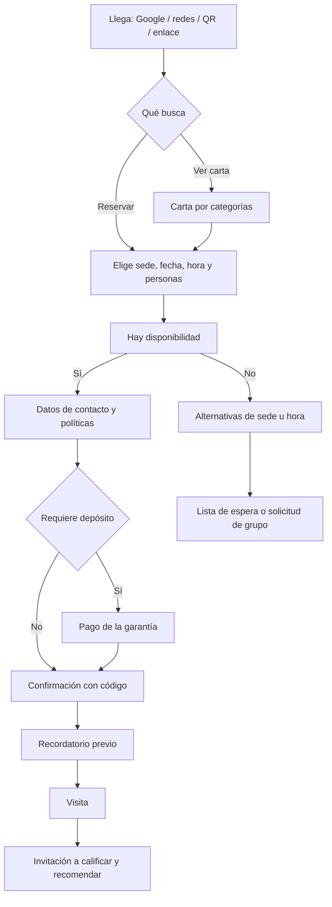

# 01 — Web de reservas del cliente

## 1. Objetivo y alcance

Definir los requerimientos de la **web pública orientada al cliente final**: reservar mesa,
consultar la **carta del restaurante** y las capacidades de **captación y marketing** que
convierten visitas en reservas y en clientes recurrentes.

Es la entrada principal para el diseño del modelo de datos de **salón, reservas, menú y cliente**
(ver §10) y para las vistas de arquitectura web.

### 1.1 Dentro de alcance

- Reserva de mesa en línea, multi-sucursal, con o sin registro.
- Carta digital pública (menú) navegable, con precios, fotos, alérgenos y disponibilidad.
- Cuenta de cliente para gestionar sus reservas.
- Páginas de contenido, SEO local, campañas y captación de leads.

### 1.2 Fuera de alcance (otros documentos)

| Tema | Dónde |
|---|---|
| Pedido y pago de comida en línea (mesa por QR, recoger, domicilio) | `02-web-pedidos-cliente.md` |
| Operación del salón: tomar pedidos, cuenta, cobro | `03-apk-mesero.md` |
| Preparación y despacho de comandas | `04-kds-cocina.md` |
| Administración interna (carta, salón, promociones, reportes) | Backoffice (documento propio) |

## 2. Actores

| Actor | Descripción | Puede |
|---|---|---|
| Visitante | Usuario sin sesión (SEO, redes, QR, Google) | Ver carta, ver disponibilidad, reservar sin registro, suscribirse |
| Cliente registrado | Tiene cuenta | Lo anterior + historial, modificar/repetir reservas, preferencias |
| Cliente invitado en una reserva | Persona que asiste pero no reservó | Recibir recordatorios lo hace quien reservó (contacto principal) |
| Administrador del restaurante | No usa esta web para operar | Recibe reservas y las gestiona desde el backoffice |

## 3. Flujo principal

El flujo debe completarse **sin registro** y en pocos pasos (objetivo: reserva en menos de 2
minutos). El registro se ofrece al final, nunca como barrera.

## 4. Requisitos funcionales (RF)

Prioridad: `MVP` para el piloto, `V1` producto completo, `V2` evolución.

### 4.1 Reserva

| ID | Requisito | Prioridad | Criterio de aceptación |
|---|---|---|---|
| RF-R1-01 | Consultar disponibilidad por sede, fecha, hora y número de personas | MVP | Se muestran las franjas disponibles; si no hay, se ofrecen sedes/horas alternativas |
| RF-R1-02 | Reservar sin registro (nombre, teléfono y/o correo + verificación) | MVP | La reserva se crea y confirma sin crear cuenta |
| RF-R1-03 | Reservar con cuenta para gestionar después | V1 | Al iniciar sesión, la reserva queda asociada al cliente |
| RF-R1-04 | Preferencia de ubicación (terraza, barra, junto a ventana) sujeta a disponibilidad | V1 | La preferencia viaja en la reserva y nunca bloquea una mesa por sí sola |
| RF-R1-05 | Depósito o garantía cuando la política lo exija | V1 | Sin pago aprobado la reserva queda en estado pendiente con expiración |
| RF-R1-06 | Confirmación con código de reserva y opción "añadir al calendario" (.ics) | MVP | El cliente recibe código y archivo de calendario |
| RF-R1-07 | Recordatorio previo con opciones confirmar / cancelar | V1 | El recordatorio se envía según la política y actualiza el estado |
| RF-R1-08 | Modificar o cancelar la reserva (enlace firmado o cuenta) | MVP (cancelar) / V1 (modificar) | La cancelación libera la mesa y notifica al restaurante |
| RF-R1-09 | Lista de espera cuando no hay disponibilidad | V1 | El cliente queda en lista y recibe oferta si se libera cupo |
| RF-R1-10 | Solicitud de eventos privados y grupos grandes | V1 | El formulario llega al backoffice como solicitud, no como reserva firme |
| RF-R1-11 | Mostrar y aceptar la política de reserva antes de confirmar | MVP | Sin aceptar la política no se puede confirmar |
| RF-R1-12 | Control anti-abuso (límite de reservas activas por contacto, verificación anti-bot) | MVP | No se pueden crear reservas masivas duplicadas |
| RF-R1-13 | Motivo de la visita y notas (ocasión, alergias, silla infantil, mascota) | V1 | Las notas quedan visibles para el salón |
| RF-R1-14 | Reubicación o cancelación por el restaurante (cierre, sobreventa, clima) | V1 | El cliente es notificado y puede aceptar alternativa o cancelar sin cargo |

### 4.2 Carta / menú

| ID | Requisito | Prioridad | Criterio de aceptación |
|---|---|---|---|
| RF-R1-20 | Carta pública por categorías con foto, descripción, precio e impuesto | MVP | Todo producto activo se muestra con precio correcto |
| RF-R1-21 | Alérgenos e información dietética por producto | V1 | Cada producto declara sus alérgenos según catálogo |
| RF-R1-22 | Disponibilidad por horario (desayuno/comida/cena) y por sede; agotados al día | V1 | Un producto fuera de su horario o agotado no se ofrece |
| RF-R1-23 | Búsqueda y filtros (categoría, sin gluten, vegetariano, rango de precio) | V1 | Los filtros devuelven solo productos que cumplen |
| RF-R1-24 | Destacados, recomendados y menú del día | V1 | El backoffice controla qué se destaca y cuándo |
| RF-R1-25 | Carta en varios idiomas | V2 | Cambio de idioma sin recargar datos del producto |
| RF-R1-26 | Compartir o descargar la carta (enlace y PDF) | V2 | El enlace siempre apunta a la versión vigente |

### 4.3 Cuenta de cliente

| ID | Requisito | Prioridad | Criterio de aceptación |
|---|---|---|---|
| RF-R1-30 | "Mi cuenta": próximas reservas e historial, cancelar y repetir | V1 | Solo se ven las reservas propias |
| RF-R1-31 | Datos de contacto, preferencias y consentimiento de datos | MVP (consentimiento) / V1 (preferencias) | El consentimiento se registra con fecha y canal |
| RF-R1-32 | Programa de puntos o beneficios de fidelidad | V2 | Se acredita y consulta el saldo del cliente |

### 4.4 Marketing y captación

| ID | Requisito | Prioridad | Criterio de aceptación |
|---|---|---|---|
| RF-R1-40 | Suscripción a novedades con doble opt-in | V1 | Solo se envía a suscriptores confirmados |
| RF-R1-41 | Promociones, banners y cupones vigentes | V1 | Una promoción vencida no se muestra |
| RF-R1-42 | Mostrar reseñas e invitar a calificar tras la visita | V1 | El enlace de reseña se envía después de la visita |
| RF-R1-43 | Analítica y píxeles con consentimiento de cookies | MVP | Sin consentimiento no se cargan cookies no esenciales |
| RF-R1-44 | Acciones directas: llamar, WhatsApp, cómo llegar, redes | MVP | Visibles y funcionales en móvil |
| RF-R1-45 | Agenda de eventos (música en vivo, catas, temporadas) | V2 | El calendario se actualiza sin despliegue |

### 4.5 Contenido, páginas y multi-sucursal

| ID | Requisito | Prioridad | Criterio de aceptación |
|---|---|---|---|
| RF-R1-50 | Páginas: Inicio, Carta, Reservas, Nosotros, Sedes, Eventos, Contacto, FAQ, Legales | MVP | Todas navegables y enlazadas desde el menú y el pie |
| RF-R1-51 | SEO técnico y datos estructurados (Restaurante, Menú, Reserva) | MVP | Rich results válidos y sitemap publicado |
| RF-R1-60 | Selector de sede con horario, dirección, mapa y teléfono | MVP | La sede elegida filtra carta y disponibilidad |
| RF-R1-61 | Horarios por sede y temporada; cierres temporales reflejados | MVP | Una sede cerrada no ofrece franjas |

## 5. Reglas de negocio de reserva (RN-R1)

| ID | Regla |
|---|---|
| RN-R1-01 | La reserva ocupa la mesa durante una **duración configurable** (p. ej. 90 min); el bloqueo es por rango, no por instante |
| RN-R1-02 | No hay **sobreventa**: la capacidad por zona y el aforo limitan las reservas de cada franja |
| RN-R1-03 | Hay **antelación mínima y máxima** configurables por sede y por tipo de día |
| RN-R1-04 | Existe una **tolerancia de llegada** (p. ej. 15 min); superada, la mesa puede liberarse |
| RN-R1-05 | La **política de cancelación y no-show** es explícita y puede implicar cargo al depósito |
| RN-R1-06 | Los **grupos grandes** y los eventos privados no se reservan en línea: derivan a solicitud |
| RN-R1-07 | El número de personas por reserva en línea tiene un **máximo** |
| RN-R1-08 | Las **fechas especiales** (festivos, 24 y 31 de diciembre) tienen política y franjas propias |
| RN-R1-09 | El restaurante puede exigir **confirmación del cliente** (doble opt-in de la reserva) para reducir no-show |
| RN-R1-10 | Si la política exige **depósito**, la reserva no se confirma sin pago aprobado (expira si no se paga) |
| RN-R1-11 | La **lista de espera** promociona automáticamente cuando se libera cupo, con ventana de respuesta |
| RN-R1-12 | Una misma persona no puede mantener un número ilimitado de reservas activas |

## 6. Menú / carta — detalle

- **Estructura:** categorías ordenables → productos. Carta distinta por sede, con productos
  comunes y locales.
- **Por producto:** nombre, descripción, precio (con impuesto discriminado cuando aplique),
  foto principal y secundarias, alérgenos, etiquetas dietéticas (vegetariano, vegano, picante,
  sin gluten), tiempo de preparación aproximado, disponibilidad y destacado.
- **Opciones y modificadores:** grupos de opciones (tamaño, término de cocción, adiciones) con
  reglas de mínimo/máximo y costo adicional. La web solo los **muestra**; pedirlos se detalla en
  `02-web-pedidos-cliente.md`.
- **Precios:** se muestran por sede; los cambios de precio no alteran reservas ni pedidos ya
  creados.
- **Disponibilidad:** por horario y por sede; un producto agotado se marca como no disponible en
  todas las interfaces al mismo tiempo.
- **Presentación:** fotografía de calidad, descripciones breves y apetitosas, secciones
  destacadas (recomendados del chef, menú del día, temporada).
- **Accesibilidad e idioma:** textos alternativos en imágenes, lectura clara; multi-idioma en V2.

## 7. Marketing y captación — detalle

### 7.1 Adquisición

- **SEO local** por sede y ciudad: páginas de sede con dirección, mapa, horarios y datos
  estructurados; título y meta descripción por página.
- **Datos estructurados** (`Restaurant`, `Menu`, `MenuItem`, `ReserveAction`) para rich results.
- **Campañas pagadas** y redes con parámetros UTM y eventos de conversión.
- **Perfil de Google Business** y enlace directo a reservar desde las fichas del local.

### 7.2 Conversión

- CTA de reserva siempre visible (cabecera, hero, menú, pie y ficha de cada sede).
- Refuerzos de confianza: política de cancelación clara, fotos reales, reseñas.
- Prueba social y urgencia honesta ("últimas mesas" solo si es cierto).
- Reserva sin registro y recuperación de un flujo abandonado (enlace retomable).

### 7.3 Retención y fidelización

- Recordatorios y confirmación para reducir no-show.
- Post-visita: agradecimiento, invitación a calificar y a reservar de nuevo.
- Preferencias del cliente (mesa, ocasiones) y nuevas oportunidades (cumpleaños).
- Newsletter segmentada y promociones para clientes recurrentes.

### 7.4 Medición y cumplimiento

- Analítica web (GA4 o equivalente) y píxeles de anuncios **solo con consentimiento**.
- Panel de métricas de la web (ver §13).
- Cumplimiento de datos personales y de cookies; consentimiento explícito y trazable.

## 8. Diseño UX/UI

### 8.1 Principios

- **Móvil primero**: la mayoría de las reservas se harán desde el teléfono.
- **Reservar rápido**: el objetivo primario (reservar) siempre a un toque; la carta acompaña.
- **Confianza**: fotos reales, política visible, contacto inmediato.
- **Sin fricción**: reserva sin cuenta y sin pasos innecesarios.

### 8.2 Arquitectura de información

- Inicio (hero con CTA de reserva, destacados, sede y horario).
- Carta (categorías, filtros, producto).
- Reservas (selector → disponibilidad → datos → confirmación).
- Sedes (lista y detalle por sede con mapa).
- Nosotros, Eventos/Privados, Contacto, FAQ, Legales.
- Cuenta (solo registrados).

### 8.3 Componentes clave

Selector de sede/fecha/personas; calendario de disponibilidad con franjas; tarjeta de producto;
galería; banner de promoción; bloque de reseñas; pie con contacto y legales; widget de
confirmación con código y "añadir al calendario".

### 8.4 Accesibilidad y rendimiento

- **WCAG 2.2 AA**: contraste, foco visible, navegación por teclado, etiquetas en formularios,
  texto alternativo.
- **Core Web Vitals**: LCP < 2,5 s, INP < 200 ms, CLS < 0,1 en móvil 4G.
- Contenido crítico renderizado en servidor para SEO y primera pintura.
- Estados claros: sin disponibilidad, error de pago, reserva expirada, sede cerrada.

### 8.5 Marca

Tono cercano y apetitoso; jerarquía tipográfica simple; fotografía como protagonista; coherencia
entre web, recordatorios y KDS en lo que el cliente ve (nombre del local, código de reserva).

## 9. Datos implicados (insumo para la base de datos)

Entidades y campos que estos requisitos obligan a modelar. La nomenclatura sigue la convención del
proyecto (español, singular).

| Entidad | Campos requeridos por este documento | Origen |
|---|---|---|
| `Sucursal` | nombre, dirección, ciudad, teléfono, coordenadas, zona horaria, activa | RF-R1-60, §7.1 |
| `Horario_atencion` | sucursal, día de la semana, hora de apertura y cierre, franja (desayuno/comida/cena) | RF-R1-61, RF-R1-22 |
| `Cierre_temporal` | sucursal, fecha desde/hasta, motivo | RF-R1-14, RF-R1-61 |
| `Politica_reserva` | antelación mínima/máxima, duración estándar, tolerancia de llegada, horas de cancelación, máximo de personas, regla de depósito, no-show | §5 |
| `Zona` | sucursal, nombre, aforo o capacidad, orden | RN-R1-02 |
| `Mesa` | sucursal, zona, número, capacidad, estado, posición en el mapa | §5, `03-apk-mesero.md` |
| `Cliente` | nombre, teléfono, correo, consentimiento de datos (fecha y canal), preferencias, fecha de nacimiento (opcional) | RF-R1-31, §7.3 |
| `Reserva` | sucursal, cliente o contacto, fecha y hora, duración, personas, zona/mesa, preferencia, estado, código, origen, ocasión, notas, política aplicada, depósito requerido/pagado | §4.1, §5 |
| `Lista_espera` | sucursal, contacto, personas, franja deseada, estado, vigencia | RF-R1-09, RN-R1-11 |
| `Solicitud_evento` | contacto, tipo de evento, fecha tentativa, personas, mensaje, estado | RF-R1-10 |
| `Categoria` | nombre, orden, activa, sede(s) | §6 |
| `Producto` | categoría, nombre, descripción, precio, impuesto, activo, destacado, etiquetas dietéticas, tiempo de preparación | §6, RF-R1-20 |
| `Producto_foto` | producto, url, orden, texto alternativo | §6 |
| `Alergeno` / `Producto_alergeno` | catálogo de alérgenos y su relación con productos | RF-R1-21 |
| `Grupo_modificador` / `Modificador` | nombre, mínimo, máximo, costo adicional, producto o categoría | §6 |
| `Disponibilidad_producto` | producto, sucursal, franja horaria, disponible | RF-R1-22 |
| `Promocion` | título, texto, imagen, vigencia desde/hasta, sede, tipo (banner/cupón), código | RF-R1-41 |
| `Suscriptor` | correo, consentimiento (doble opt-in), fecha, origen | RF-R1-40 |
| `Resena` | cliente, puntaje, comentario, fuente (web/Google), fecha, publicada | RF-R1-42 |
| `Notificacion` / `Plantilla_notificacion` | evento, canal, plantilla, estado, envío | RF-R1-06, RF-R1-07 |
| `Pago` (depósito) | reserva, monto, medio, estado, referencia | RF-R1-05, RN-R1-10 |
| `Evento_analitica` | tipo de evento, origen/UTM, consentimiento, fecha | RF-R1-43, §7.4 |

Notas para el modelo: el **bloqueo de mesa** debe ser por rango (fecha_hora + duración), no un
único instante; el `Cliente` puede existir sin cuenta (solo contacto); el `Código` de reserva debe
ser único y no adivinable; el consentimiento debe guardar base legal, fecha y canal.

## 10. Integraciones

| Integración | Uso | Prioridad |
|---|---|---|
| Correo transaccional | Confirmaciones, recordatorios, post-visita | MVP |
| WhatsApp / SMS | Recordatorios y avisos (alternativa o refuerzo del correo) | V1 |
| Pasarela de pagos | Depósito o garantía de la reserva | V1 |
| Google Business / "Reservar con Google" | Captar reservas desde la ficha del local | V1 |
| Mapas y geolocalización | Cómo llegar y zonas de sede | MVP |
| Analítica y anuncios | Medición y campañas con consentimiento | MVP |
| Reseñas externas | Mostrar y enlazar reseñas | V1 |
| Motor de disponibilidad del salón | Evitar sobreventa contra el estado real del salón | MVP |

## 11. Requisitos no funcionales (RNF-R1)

| ID | Requisito |
|---|---|
| RNF-R1-01 | La reserva se completa en menos de 2 minutos y en pocos pasos |
| RNF-R1-02 | Core Web Vitals en verde en móvil: LCP < 2,5 s, INP < 200 ms, CLS < 0,1 |
| RNF-R1-03 | Accesibilidad WCAG 2.2 AA |
| RNF-R1-04 | Disponibilidad alta en la franja horaria del restaurante; degradación elegante si el motor de reservas falla (mostrar contacto directo) |
| RNF-R1-05 | Multi-sucursal y multi-tenant desde el inicio; cada sede con su zona horaria y moneda |
| RNF-R1-06 | Privacidad y datos personales conforme a la normativa aplicable (p. ej. Ley 1581 de Colombia); consentimiento de cookies y de datos |
| RNF-R1-07 | SEO técnico: contenido crítico en servidor, URL legibles, sitemap y datos estructurados |
| RNF-R1-08 | Internacionalización preparada (textos y formatos), aunque los idiomas se activen en V2 |
| RNF-R1-09 | Sin registro obligatorio; la cuenta es opcional |
| RNF-R1-10 | Trazabilidad del origen de cada reserva (UTM/canal) para atribución de marketing |

## 12. Métricas de la web de reservas

| Métrica | Descripción |
|---|---|
| Tasa de conversión | Reservas confirmadas / sesiones con intención de reservar |
| Abandono del flujo | Reservas iniciadas y no confirmadas, por paso |
| Tasa de no-show | Reservas no atendidas / reservas confirmadas |
| Efecto del recordatorio | % de reservas confirmadas o canceladas tras el recordatorio |
| Ocupación | Mesas-porcentaje ocupadas por franja |
| Leads | Suscriptores y solicitudes de eventos por semana |
| Reseñas | Reseñas generadas tras la visita y puntaje promedio |
| Origen | Reservas por canal y campaña (UTM) |
| Tiempo de reserva | Duración media desde el inicio del flujo hasta la confirmación |

## 13. Casos borde

| Caso | Comportamiento esperado |
|---|---|
| No hay disponibilidad | Ofrecer sedes u horas alternativas y lista de espera |
| Doble clic o reintento | La reserva no se duplica (idempotencia por solicitud) |
| Pago del depósito falla o expira | La reserva queda pendiente con expiración y se puede reintentar |
| El restaurante cierra o reduce aforo | Reubicar o cancelar según RF-R1-14, notificando al cliente |
| Cliente llega tarde | Se aplica la tolerancia y se libera la mesa según la política |
| Zona horaria del visitante distinta | Fechas y horas se muestran en la zona del local, con aclaración |
| Usuario con muchas reservas activas | Se bloquean nuevas reservas según RN-R1-12 |
| Grupos grandes o evento privado | Deriva al formulario de solicitud, no a reserva inmediata |
| Alergias declaradas | La nota llega al salón; no se promete preparación sin riesgo |
| Sin JavaScript | Contenido y carta visibles; el flujo de reserva puede requerir JS |

## 14. Preguntas abiertas para el cliente

| # | Pregunta | Supuesto por defecto |
|---|---|---|
| 1 | ¿Se cobrará depósito o garantía por reservar? ¿En qué casos? | No al inicio; solo grupos y fechas especiales |
| 2 | ¿Cuál es la política de no-show y cancelación? | Cancelación libre hasta 2 h antes; no-show se registra |
| 3 | ¿Cuántos comensales permite reservar en línea? | Hasta 8; más, por solicitud |
| 4 | ¿Se integrará "Reservar con Google"? | Sí, en V1 |
| 5 | ¿La web será multi-idioma? | Español en MVP; inglés en V2 |
| 6 | ¿Habrá programa de fidelidad? | V2 |
| 7 | ¿El cliente podrá modificar su reserva sin contacto humano? | Sí, en V1 |
| 8 | ¿Se muestran precios con impuesto incluido? | Sí, con discriminación cuando aplique |

## 15. Fuera de alcance / pendientes

- Pago completo de la comida: pertenece a `02-web-pedidos-cliente.md`.
- Operación del salón y asignación fina de mesas: backoffice y `03-apk-mesero.md`.
- Contenido editorial extenso (blog) y tienda de productos: no contemplado en esta fase.
