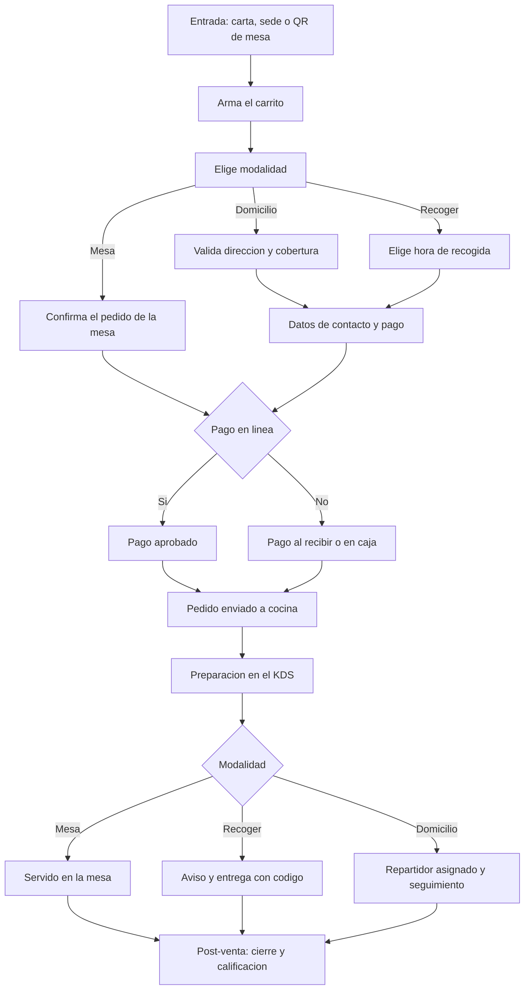

# 02 — Web de pedidos del cliente

## 1. Objetivo y alcance

Definir los requerimientos de la **web de pedidos** del cliente final: armar un pedido desde la
carta, pagarlo y seguirlo, en las tres modalidades de consumo: **mesa (QR), recoger y domicilio**.

Comparte la carta y el catálogo con la web de reservas (`01-web-reservas-cliente.md`), pero aquí el
resultado es un **pedido** que entra a cocina (KDS, `04-kds-cocina.md`) y es visible para el salón
(`03-apk-mesero.md`).

### 1.1 Dentro de alcance

- Carrito y checkout con validación de disponibilidad, precios, impuestos y promociones.
- Pago en línea (V1) y alternativas de pago contra entrega / en caja.
- Modalidad **mesa por QR**, **recoger** y **domicilio** con cobertura y reparto.
- Seguimiento del pedido y notificaciones al cliente.
- Retención: repetir pedido, cupones, recompra y calificación.

### 1.2 Fuera de alcance (otros documentos)

| Tema | Dónde |
|---|---|
| Reserva de mesa y carta pública/marketing del sitio | `01-web-reservas-cliente.md` |
| Operación del salón, mesas, cuenta y cobro presencial | `03-apk-mesero.md` |
| Preparación y despacho en cocina | `04-kds-cocina.md` |
| Administración de carta, zonas, promociones y pedidos | Backoffice (documento propio) |

## 2. Actores

| Actor | Descripción | Puede |
|---|---|---|
| Cliente final | Compra para sí o su grupo | Pedir, pagar, seguir, cancelar según política, repetir y calificar |
| Comensal en mesa | Escanea el QR del local | Pedir a la mesa y pedir la cuenta |
| Mesero | Atiende la mesa | Ve el pedido web en su APK y lo asume o lo complementa |
| Cocina | Prepara | Recibe la comanda por estación en el KDS |
| Repartidor | Entrega a domicilio | Recibe asignación y confirma entrega |

## 3. Modalidades de pedido

| Modalidad | Quién la usa | Se asocia a | Particularidades |
|---|---|---|---|
| **Mesa (QR)** | Comensal sentado | `Mesa` y `Pedido` del salón | Va directo a cocina; el cobro puede hacerse en caja o en línea |
| **Recoger** | Cliente que pasa por el pedido | `Sucursal` | Hora de recogida y código de retiro |
| **Domicilio** | Cliente que pide a su dirección | `Zona_cobertura` + `Repartidor` | Cobertura, tarifa, mínimo y seguimiento |

## 4. Flujo principal

El pedido debe poder completarse **sin registro** y con la menor cantidad de pasos posible.

## 5. Requisitos funcionales (RF)

Prioridad referida a esta interfaz: `MVP` = imprescindible al lanzar la web de pedidos;
`V1` = versión completa; `V2` = evolución posterior.

### 5.1 Carta, carrito y totales

| ID | Requisito | Prioridad | Criterio de aceptación |
|---|---|---|---|
| RF-R2-01 | Agregar productos con cantidad y modificadores (tamaño, término, adiciones) | MVP | Se validan mínimos, máximos y costo adicional de cada grupo |
| RF-R2-02 | Notas por ítem (alergias, "sin cebolla") | MVP | La nota viaja a cocina y al KDS |
| RF-R2-03 | Cálculo en tiempo real de subtotal, impuestos, propina y total | MVP | El total coincide con el calculado por el servidor |
| RF-R2-04 | Carrito persistente (recuperar tras recargar o cambiar de dispositivo) | V1 | El carrito se recupera con el mismo contacto o sesión |
| RF-R2-05 | Promociones y combos aplicados automáticamente | V1 | Solo se aplican promociones vigentes y no acumulables mal |
| RF-R2-06 | Cupón o código de descuento | V1 | Un cupón inválido o vencido no descuenta y explica por qué |
| RF-R2-07 | Productos agotados o fuera de horario se deshabilitan y se avisan | MVP | No se puede pedir un agotado; si se agota estando en el carrito, se avisa |
| RF-R2-08 | Precio y disponibilidad por sede y por franja horaria | MVP | El catálogo respeta sede y horario vigentes |
| RF-R2-09 | Recargos por empaque, domicilio y pedido mínimo | V1 | El recargo se muestra discriminado antes de pagar |
| RF-R2-10 | Venta por peso o fracción (expresada como en el legado, "N T") | V2 | El subtotal se calcula en enteros y se imprime con la misma convención |
| RF-R2-11 | Sugerencias de upselling y complementos | V2 | Nunca bloquean ni retrasan el checkout |

### 5.2 Identificación y checkout

| ID | Requisito | Prioridad | Criterio de aceptación |
|---|---|---|---|
| RF-R2-20 | Pedir sin registro (nombre, teléfono y/o correo con verificación) | MVP | El pedido se crea y confirma sin cuenta |
| RF-R2-21 | Pedir con cuenta, ver historial y repetir un pedido | V1 | El pedido queda asociado al cliente registrado |
| RF-R2-22 | Dirección de entrega con validación de cobertura | V1 | Una dirección fuera de zona no permite domicilio |
| RF-R2-23 | Programar hora de recogida o de entrega | V1 | Solo dentro de la ventana permitida por la sede |
| RF-R2-24 | Datos de facturación cuando el cliente la requiera | V1 | Solicita los datos fiscales mínimos |
| RF-R2-25 | Consentimiento de datos y aceptación de términos | MVP | Sin consentimiento no se confirma el pedido |

### 5.3 Pago

| ID | Requisito | Prioridad | Criterio de aceptación |
|---|---|---|---|
| RF-R2-30 | Pago en línea con los medios habilitados por sede | V1 | El resultado del pago se confirma con la pasarela, no en el navegador |
| RF-R2-31 | Pago contra entrega, al recoger o en caja (mesa) | MVP | El pedido confirma con pago pendiente y no se cobra dos veces |
| RF-R2-32 | Propina opcional (porcentaje, monto o sin propina) | V1 | La propina se registra separada del total de productos |
| RF-R2-33 | Comprobante del pedido y factura electrónica cuando aplique | V1 | El comprobante queda disponible para el cliente |
| RF-R2-34 | Reintento de pago e idempotencia | V1 | Reintentar no duplica pedidos ni cobros |
| RF-R2-35 | Solo se ofrecen los medios de pago habilitados | MVP | Un medio deshabilitado no aparece |

### 5.4 Mesa por QR

| ID | Requisito | Prioridad | Criterio de aceptación |
|---|---|---|---|
| RF-R2-40 | Abrir el pedido desde el QR de la mesa (sede y mesa identificadas) | MVP | El pedido queda ligado a esa mesa |
| RF-R2-41 | Enviar el pedido a cocina y reflejarlo en el KDS | MVP | La comanda aparece en la estación correcta |
| RF-R2-42 | Pedir la cuenta o pagar la mesa desde el QR | V1 | El salón ve la solicitud y el cobro se concilia |
| RF-R2-43 | División de cuenta entre comensales (partes iguales) | V2 | Cada pago se concilia con el pedido |
| RF-R2-44 | Evitar pedidos duplicados por doble escaneo o doble envío | MVP | Un mismo envío no genera dos comandas |

### 5.5 Recoger

| ID | Requisito | Prioridad | Criterio de aceptación |
|---|---|---|---|
| RF-R2-50 | Elegir "lo antes posible" o una hora programada | V1 | Solo se ofrecen horas dentro del horario |
| RF-R2-51 | Aviso cuando el pedido está listo para recoger | V1 | El aviso sale al pasar a `listo` |
| RF-R2-52 | Código o QR de retiro | V1 | La entrega valida el código del pedido |

### 5.6 Domicilio

| ID | Requisito | Prioridad | Criterio de aceptación |
|---|---|---|---|
| RF-R2-60 | Validar cobertura y calcular tarifa por zona | V1 | Fuera de cobertura se ofrece recoger |
| RF-R2-61 | Aplicar el pedido mínimo por zona | V1 | Por debajo del mínimo no permite confirmar |
| RF-R2-62 | Asignar repartidor y asignar seguimiento | V1 | El cliente ve el estado y el tiempo estimado |
| RF-R2-63 | Avisos de "en camino" y "entregado" | V1 | Cada cambio de estado notifica al cliente |
| RF-R2-64 | Entrega sin contacto con evidencia opcional | V2 | Se registra la evidencia de entrega |
| RF-R2-65 | Cancelación con cargo si el pedido ya salió | V1 | La política explica el cargo antes de cancelar |

### 5.7 Seguimiento, notificaciones y retención

| ID | Requisito | Prioridad | Criterio de aceptación |
|---|---|---|---|
| RF-R2-70 | Seguimiento del pedido en tiempo real con código público | V1 | Un enlace con token permite seguir sin iniciar sesión |
| RF-R2-71 | Notificaciones por correo, WhatsApp, SMS o push | V1 | El cliente recibe confirmación, "listo" y "en camino" |
| RF-R2-72 | Calificación del pedido tras la entrega | V1 | El puntaje queda asociado al pedido |
| RF-R2-73 | Repetir un pedido anterior en un clic | V1 | Se rearman las líneas vigentes y se avisa lo que ya no está |

### 5.8 Operación por sede

| ID | Requisito | Prioridad | Criterio de aceptación |
|---|---|---|---|
| RF-R2-80 | Aceptar pedidos solo dentro del horario de atención | MVP | Fuera de horario no se puede confirmar |
| RF-R2-81 | Pausar la recepción de pedidos (cierre temporal o sobrecarga) | V1 | La web avisa y ofrece programar o recoger en otra sede |
| RF-R2-82 | Límite de pedidos por franja según capacidad de cocina | V1 | Al alcanzarlo, la web ofrece programar el pedido |
| RF-R2-83 | Selector de sede con su carta, precios, horario y modalidades | MVP | Cada sede respeta su configuración |

## 6. Reglas de negocio (RN-R2)

| ID | Regla |
|---|---|
| RN-R2-01 | El pedido nace `borrador` y pasa a `enviado` al confirmarse (pago aprobado o pago contra entrega aceptado) |
| RN-R2-02 | Nombre y precio se guardan como **snapshot** en la línea; cambios posteriores no alteran el pedido |
| RN-R2-03 | El precio del producto es el de la sede; no hay precios distintos por canal salvo promociones declaradas |
| RN-R2-04 | Impuestos, descuentos y redondeo se calculan **en el servidor**; el cliente solo los muestra |
| RN-R2-05 | El pago en línea es **idempotente**: reintentar no duplica pedidos ni cobros |
| RN-R2-06 | Domicilio solo dentro de zonas de cobertura; fuera de zona se ofrece recoger |
| RN-R2-07 | Cada zona tiene **tarifa** y **pedido mínimo** propios |
| RN-R2-08 | No se aceptan pedidos fuera del horario; los programados deben caer en la ventana permitida |
| RN-R2-09 | Hay un **límite de pedidos por franja**; al alcanzarlo se ofrece programar o cambiar de sede |
| RN-R2-10 | Un producto agotado no se puede pedir; si se agota con el carrito armado, se avisa y se ajusta |
| RN-R2-11 | Los modificadores se validan por grupo (mínimo, máximo y costo adicional) |
| RN-R2-12 | Cancelación: sin cargo si la cocina no inició; con gestión o cargo si ya se preparó o salió |
| RN-R2-13 | La propina es opcional y se registra separada del total de productos |
| RN-R2-14 | El pedido de mesa por QR se asocia a esa mesa y no sustituye al mesero; el mesero lo ve en su APK |
| RN-R2-15 | El código de pedido es único y no adivinable; sirve para el seguimiento público |
| RN-R2-16 | El pedido sigue los estados del modelo: `borrador → enviado → en_preparacion → listo → entregado → por_cobrar → pagado`, más `en_camino` en domicilio y `cancelado` como terminal alterno |
| RN-R2-17 | Un pedido se cobra **una sola vez**: no puede pagarse en web y además en caja o con el mesero |
| RN-R2-18 | La venta por peso o fracción se expresa e imprime como en el legado ("N T") |

## 7. Carrito y modificadores — detalle

- **Modificadores:** grupos por producto o categoría con mínimo/máximo y costo; obligatorios
  cuando el grupo lo exige. La web valida antes de permitir agregar.
- **Cantidades:** enteras por defecto; la fracción/peso es V2 y usa la convención del legado.
- **Recálculo:** al cambiar cantidad, sede, modalidad o promoción, se recalculan impuestos, recargos
  y total; un cambio de precio o agotado se avisa antes de confirmar.
- **Promociones:** no acumulables salvo indicación; se aplica la mejor para el cliente o la regla
  declarada; una promoción vencida no se aplica.
- **Persistencia:** el carrito sobrevive recargas y permite recuperarlo por contacto o enlace.

## 8. Pago y propina — detalle

- **Pago en línea (V1):** tarjeta, transferencia/QR bancario y demás medios que habilite la sede
  (decisión pendiente con el cliente). El resultado siempre se confirma contra la pasarela
  (webhook) y nunca solo con la respuesta del navegador.
- **Pago alternativo (MVP sin pasarela):** contra entrega (domicilio), al recoger (recoger) o en
  caja (mesa).
- **Propina:** porcentajes sugeridos, monto libre o ninguna; se guarda aparte para su distribución.
- **Comprobante y factura:** comprobante siempre; factura electrónica cuando aplique (según país).
- **Conciliación:** el pedido no se marca pagado hasta que el pago esté aprobado; los reintentos y
  las notificaciones repetidas no generan doble cobro.

## 9. Domicilio — detalle

- **Cobertura:** validada por dirección (geocodificación contra las zonas de la sede). Fuera de
  cobertura se ofrece recoger.
- **Tarifa y mínimo:** por zona; se muestran antes de pagar.
- **Tiempo estimado:** preparación + ruta; se informa al cliente y se actualiza con los estados.
- **Reparto:** propio (asignación manual o sugerida) o de terceros, según la decisión del cliente.
- **Seguimiento:** el cliente ve los estados (`enviado`, `en_preparacion`, `listo`, `en_camino`,
  `entregado`) y recibe avisos.
- **Cierre:** confirmación de entrega con marca de tiempo; evidencia opcional (foto) en V2.

## 10. Retención y marketing del pedido

- **Carrito abandonado:** recordatorio por correo o WhatsApp con enlace para retomar (si hay
  consentimiento).
- **Upselling:** sugerencias de complementos y "lo que piden con esto", sin bloquear el checkout.
- **Cupones:** de bienvenida, de temporada o por recompra; con vigencia y reglas claras.
- **Recompra:** "repetir pedido" y recordatorio de favoritos.
- **Fidelización:** puntos o beneficios por pedido (V2).
- **Medición:** conversión, ticket promedio, abandono de carrito y recompra (§15).

## 11. Diseño UX/UI

- **Pocos pasos:** carrito accesible siempre; checkout en una sola pantalla cuando sea posible.
- **Transparencia:** totales, recargos, tiempos y política de cancelación visibles antes de pagar.
- **Móvil primero:** pensado para el teléfono; el QR obliga a una experiencia móvil impecable.
- **Confianza:** estado del pago claro, código de pedido visible, seguimiento sin ambigüedad.
- **Accesibilidad:** WCAG 2.2 AA; contraste, foco y formularios etiquetados.
- **Estados claros:** sin cobertura, fuera de horario, agotado, pago rechazado, cocina saturada,
  pedido cancelado.

## 12. Datos implicados (insumo para la base de datos)

Además de las entidades compartidas con la web de reservas (`Sucursal`, `Zona`, `Mesa`, `Cliente`,
`Producto`, `Categoria`, `Grupo_modificador`, `Promocion`, `Notificacion`, `Pago`), este documento
obliga a modelar:

| Entidad | Campos requeridos por este documento | Origen |
|---|---|---|
| `Pedido` | sucursal, canal (`web`), modalidad (`mesa`/`domicilio`/`recoger`), cliente o contacto, mesa, código, hora programada, estado, subtotal, descuentos, impuestos, propina, recargos, total, notas, origen/UTM | §5, §6 |
| `Pedido_linea` | producto, nombre_snapshot, precio_snapshot, cantidad, es_fraccion, notas, estado, impuesto | RF-R2-01, RN-R2-02 |
| `Pedido_linea_modificador` | línea, modificador, costo adicional | RF-R2-01, RN-R2-11 |
| `Comanda` / `Comanda_linea` | pedido, estación, número, estado, enviada/lista/entregada | RF-R2-41, `04-kds-cocina.md` |
| `Estacion` | sucursal, nombre, productos asignados, impresora | RF-R2-41 |
| `Zona_cobertura` | sucursal, zona, tarifa, pedido_minimo, tiempo_estimado, geometría | RF-R2-60, RN-R2-07 |
| `Repartidor` | sucursal, nombre, teléfono, vehículo, estado | RF-R2-62 |
| `Domicilio_asignacion` | pedido, repartidor, asignado_en, recogido_en, entregado_en, estado, evidencia | RF-R2-62, RF-R2-64 |
| `Cupon` | código, tipo, valor, vigencia, sede, usos máximos, usos | RF-R2-06 |
| `Sesion_mesa` | mesa, token de QR, abierta_en, cerrada_en | RF-R2-40, RF-R2-44 |
| `Pago` | pedido, medio, monto, propina, estado, referencia, pasarela_payload, usuario | §8 |
| `Factura` | pedido, número, prefijo, estado, cufe, xml, pdf | RF-R2-33 |
| `Consecutivo` | sucursal, tipo (`pedido`/`comanda`/`factura`), prefijo, siguiente | RN-R2-15 |
| `Calificacion_pedido` | pedido, puntaje, comentario, fecha | RF-R2-72 |
| `Regla_capacidad` | sucursal, franja, máximo de pedidos | RF-R2-82, RN-R2-09 |

Notas para el modelo: el pedido debe soportar **mesa, recoger y domicilio** sin duplicar tablas; el
cobro único (RN-R2-17) exige una única fuente de verdad del pago por pedido; el catálogo y sus
precios son los mismos de la web de reservas (`01`), sin precios por canal salvo promoción.

## 13. Integraciones

| Integración | Uso | Prioridad |
|---|---|---|
| Pasarela de pagos | Cobro en línea e idempotencia (webhook) | V1 |
| Impresión / KDS | Enviar comandas a las estaciones | MVP |
| Notificaciones | Confirmación, listo, en camino, calificación | V1 |
| Geocodificación y mapas | Validar cobertura y calcular ruta | V1 |
| Facturación electrónica | Comprobante fiscal cuando aplique | V1 |
| Mensajería (WhatsApp/SMS) | Avisos y carrito abandonado | V1 |
| Reparto de terceros | Alternativa al reparto propio de domicilio | V2 |

## 14. Requisitos no funcionales (RNF-R2)

| ID | Requisito |
|---|---|
| RNF-R2-01 | El cobro en línea es seguro y conforme al estándar de la industria de tarjetas (la web nunca almacena datos de tarjeta) |
| RNF-R2-02 | Todo envío de pedido y de pago es idempotente, con clave por solicitud |
| RNF-R2-03 | El checkout es accesible (WCAG 2.2 AA) y rendimiento en verde en móvil (LCP < 2,5 s) |
| RNF-R2-04 | Los totales mostrados coinciden exactamente con los calculados por el servidor |
| RNF-R2-05 | Multi-sucursal y multi-tenant; cada sede con su horario, moneda y medios de pago |
| RNF-R2-06 | El seguimiento público usa un código con token; no expone datos personales de terceros |
| RNF-R2-07 | Privacidad y tratamiento de datos conforme a la normativa aplicable, con consentimiento |
| RNF-R2-08 | Degradación elegante si la pasarela falla: se ofrece pago alternativo sin perder el carrito |
| RNF-R2-09 | El sistema soporta picos de pedidos por franja sin perder ni duplicar pedidos |

## 15. Métricas de la web de pedidos

| Métrica | Descripción |
|---|---|
| Conversión | Pedidos confirmados / sesiones con carrito iniciado |
| Ticket promedio | Valor medio por pedido, por modalidad |
| Abandono de carrito | Carritos iniciados y no confirmados |
| Mezcla de modalidad | Reparto de pedidos entre mesa, recoger y domicilio |
| Tiempo de entrega | Tiempo total y tiempo de ruta (domicilio) |
| Tiempo de recogida | Desde "listo" hasta la recogida |
| Cancelación | Pedidos cancelados / confirmados y su motivo |
| Uso de cupones y upselling | Pedidos con promoción y unidades añadidas por sugerencia |
| Recompra | Clientes que repiten en 30 días |
| Calificación | Puntaje promedio del pedido |

## 16. Casos borde

| Caso | Comportamiento esperado |
|---|---|
| Doble clic en "pagar" | Un solo pedido y un solo cobro (idempotencia) |
| Pago aprobado y la web se cae | El pedido se confirma por conciliación del webhook, no se pierde |
| Se agota un producto con el carrito armado | Se avisa y se ofrece quitarlo o sustituirlo antes de pagar |
| Cambia el precio con el carrito abierto | Se avisa y se recalcula el total antes de confirmar |
| Dirección fuera de cobertura | No permite domicilio y ofrece recoger |
| QR de mesa ya cerrado o mesa reasignada | El pedido se bloquea y se pide ayuda al mesero |
| Cocina saturada (límite de franja alcanzado) | Se ofrece programar el pedido o cambiar de sede |
| Repartidor no disponible (reparto propio) | Se ofrece recoger o programar |
| Cliente no contesta en la entrega | Se aplica la política del local (reintento, devolución) |
| Cancelación después de iniciar preparación | Se informa el cargo o gestión según la política |
| Productos de varias estaciones en un pedido | Se generan comandas por estación sin perder la unidad del pedido |
| Pago rechazado | Se ofrece reintentar u otro medio; el carrito se conserva |
| Promociones no acumulables | Se aplica la regla declarada y se explica al cliente |

## 17. Preguntas abiertas para el cliente

| # | Pregunta | Supuesto por defecto |
|---|---|---|
| 1 | ¿Habrá pago en línea o solo contra entrega/al recoger? | Contra entrega en MVP; en línea en V1 |
| 2 | ¿Qué medios de pago se habilitan por sede? | Efectivo, tarjeta y transferencia |
| 3 | ¿La propina se ofrece en la web? | Sí, opcional, en V1 |
| 4 | ¿El reparto a domicilio es propio o de terceros? | Propio, en V1 |
| 5 | ¿Cobertura y tarifas por zona? | Definidas por el cliente antes del piloto |
| 6 | ¿Hay pedido mínimo? | Sí, por zona |
| 7 | ¿Se cobra el empaque? | Según decisión del local |
| 8 | ¿El pago en mesa por QR se permite desde el MVP? | Se pide; el cobro, en caja al inicio |
| 9 | ¿Se emite factura electrónica al pedido web? | Cuando aplique, en V1 |
| 10 | ¿Se permite venta por peso en la web? | Solo en V2 |

## 18. Fuera de alcance / pendientes

- Programa de fidelidad por puntos: V2.
- Integración con apps de domicilio de terceros: V2 (depende de la decisión del cliente).
- Kiosco de autoservicio en el local: canal futuro reservado, no contemplado aquí.
