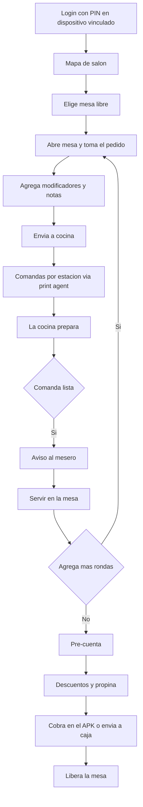

# 03 — APK del mesero

## 1. Objetivo y alcance

Definir los requerimientos de la **aplicación del mesero**: atender el salón, tomar y enviar
pedidos a cocina, gestionar la cuenta y cobrar, con capacidad de **operar sin conexión**.

Es la interfaz que conecta el salón con la cocina (`04-kds-cocina.md`) y con los pedidos web de
mesa (`02-web-pedidos-cliente.md`), y la que alimenta los datos de servicio del pedido.

### 1.1 Dentro de alcance

- Sesión con **PIN** en dispositivo vinculado y modo offline tras el primer acceso.
- **Mapa de salón**: zonas, mesas, estados, apertura, traslado y unión.
- **Toma de pedido** desde la carta, con modificadores, notas y fracción/peso.
- **Envío a cocina** generando comandas por estación; reimpresión y anulación.
- **Cuenta y cobro**: pre-cuenta, descuentos, propina, división y medios de pago.
- **Offline**: operar sin red, sincronizar y resolver conflictos.
- **Impresión** vía print agent (comandas y pre-cuentas).

### 1.2 Fuera de alcance (otros documentos)

| Tema | Dónde |
|---|---|
| Carta y reservas públicas, pedidos web | `01-web-reservas-cliente.md`, `02-web-pedidos-cliente.md` |
| Preparación y tablero de cocina | `04-kds-cocina.md` |
| Administración de carta, salón, usuarios y reportes | Backoffice (documento propio) |
| Cobro y arqueo de caja como módulo | Caja (documento propio; aquí solo el cobro de mesa) |

## 2. Actores y roles

| Actor | Descripción | Puede |
|---|---|---|
| Mesero | Atiende mesas | Abrir mesa, tomar y enviar pedido, servir, pre-cuenta, cobrar (según permiso) |
| Capitán / supervisor | Coordina el salón | Todo lo del mesero + transferir mesas, autorizar anulaciones y descuentos |
| Cajero | Cobra en caja | Recibir pedidos enviados a caja y cobrar |
| Cocina | Prepara | Recibe comandas (en el KDS) y marca estados |

## 3. Modelo de operación

- **Zonas y mesas:** el salón se divide en zonas; cada mesa tiene número, capacidad y estado
  (`libre`, `ocupada`, `por_cobrar`, `reservada`, `fuera_servicio`).
- **Asignación:** en cada turno se asignan zonas o mesas a los meseros; el mesero ve las suyas y
  puede consultar todo el salón.
- **Propiedad de la cuenta:** cada mesa abierta tiene un mesero responsable; otro mesero solo
  interviene por **traspaso** autorizado, que queda auditado.
- **Rondas:** un pedido puede crecer por rondas; cada envío a cocina es independiente y no reimprime
  lo ya enviado.
- **Pedidos web de mesa:** un pedido hecho por QR entra al mismo pedido de la mesa y el mesero lo ve
  para complementarlo o atenderlo.

## 4. Flujo principal

## 5. Requisitos funcionales (RF)

Prioridad referida a esta interfaz: `MVP` = imprescindible al lanzar el APK; `V1` = versión
completa; `V2` = evolución posterior.

### 5.1 Sesión y dispositivo

| ID | Requisito | Prioridad | Criterio de aceptación |
|---|---|---|---|
| RF-R3-01 | Iniciar sesión con PIN en un dispositivo vinculado | MVP | Sin vinculación válida no se opera |
| RF-R3-02 | Vincular y revocar dispositivos; al revocar se borran datos locales sensibles | MVP | Un dispositivo revocado no vuelve a operar |
| RF-R3-03 | Bloqueo temporal por intentos fallidos y expiración de sesión | MVP | Tras varios intentos, la cuenta se bloquea |
| RF-R3-04 | Operar sin conexión tras el primer inicio de sesión válido | MVP | Se puede tomar pedido sin red (ver §10) |
| RF-R3-05 | Cambiar de mesero en un dispositivo sin re-vincularlo | V1 | El cambio queda auditado |
| RF-R3-06 | Aviso y actualización obligatoria cuando la versión es menor a la mínima soportada | V1 | La app no opera con versión obsoleta |

### 5.2 Mapa de salón y mesas

| ID | Requisito | Prioridad | Criterio de aceptación |
|---|---|---|---|
| RF-R3-10 | Ver zonas y mesas con su estado en tiempo real | MVP | El estado se actualiza con lo que ocurre en otras interfaces |
| RF-R3-11 | Abrir mesa (sentar comensales) | MVP | La mesa pasa a `ocupada` y se crea el pedido |
| RF-R3-12 | Trasladar o unir mesas | V1 | Las líneas se conservan y queda auditado |
| RF-R3-13 | Ver la reserva próxima de una mesa y el estado de no-show | V1 | El mesero ve la reserva y puede sentar o liberar |
| RF-R3-14 | Filtrar por zona y ver "mis mesas" | V1 | El filtro no oculta alertas críticas |
| RF-R3-15 | Alerta de mesa con ocupación prolongada | V2 | Se muestran mesas que superan el umbral |

### 5.3 Toma de pedido

| ID | Requisito | Prioridad | Criterio de aceptación |
|---|---|---|---|
| RF-R3-20 | Buscar productos por categoría, nombre o código rápido | MVP | Se encuentra el producto en pocos toques |
| RF-R3-21 | Agregar cantidad, modificadores y notas por línea | MVP | Se validan mínimos, máximos y costo adicional |
| RF-R3-22 | Registrar fracción o peso ("N T") | V1 | El subtotal se calcula en enteros |
| RF-R3-23 | Ver productos agotados en tiempo real y no poder pedirlos | MVP | Un agotado queda deshabilitado |
| RF-R3-24 | Agregar rondas a una mesa ya abierta | MVP | Las nuevas líneas quedan pendientes de enviar |
| RF-R3-25 | Marcar qué comensal pidió cada línea | V1 | Permite cobrar por persona |
| RF-R3-26 | Mover líneas entre cuentas o mesas unidas | V2 | El total de cada cuenta se recalcula |

### 5.4 Envío a cocina y comandas

| ID | Requisito | Prioridad | Criterio de aceptación |
|---|---|---|---|
| RF-R3-30 | Enviar a cocina solo las líneas nuevas, generando comandas por estación | MVP | Cada estación recibe solo lo suyo |
| RF-R3-31 | No reimprimir lo ya enviado; la reimpresión es explícita | MVP | Un segundo envío no duplica comandas |
| RF-R3-32 | Reimprimir una comanda de una ronda anterior (con permiso y auditoría) | V1 | La reimpresión queda auditada |
| RF-R3-33 | Ver el estado de cada comanda (enviada, en preparación, lista, entregada) | V1 | El estado refleja lo que marca la cocina |
| RF-R3-34 | Anular una línea o comanda con motivo | MVP (línea) / V1 (comanda) | Se audita y se recalcula el total |
| RF-R3-35 | Recibir aviso sonoro o vibración cuando una comanda está lista | V1 | El aviso distingue "listo" de "SLA excedido" |
| RF-R3-36 | Marcar un producto como agotado desde el salón | V2 | El agotado se refleja en todas las interfaces |

### 5.5 Cuenta, descuentos y cobro

| ID | Requisito | Prioridad | Criterio de aceptación |
|---|---|---|---|
| RF-R3-40 | Ver y generar la pre-cuenta (impresa o en pantalla) | MVP | La pre-cuenta no es documento fiscal |
| RF-R3-41 | Aplicar descuento o cortesía con permiso y motivo | V1 | Sin permiso se rechaza; queda auditado |
| RF-R3-42 | Registrar propina (porcentaje, monto o ninguna) | V1 | Se guarda separada del total de productos |
| RF-R3-43 | Dividir la cuenta (partes iguales o por ítems/personas) | V1 | Cada parte suma el total del pedido |
| RF-R3-44 | Cobrar en el APK: efectivo (con cálculo de cambio), tarjeta y transferencia; aceptar pagos parciales | V1 | El cobro se concilia y el pedido pasa a pagado al completarse |
| RF-R3-45 | Enviar el pedido a caja para que se cobre allí | MVP | La caja lo ve y lo cobra; no hay doble cobro |
| RF-R3-46 | Abrir la gaveta e imprimir el recibo de pago | MVP | Se emite el comprobante correspondiente |
| RF-R3-47 | Ver y atender el pedido web de la mesa (QR) | V1 | El mesero puede complementarlo y servir |
| RF-R3-48 | Solicitar la cuenta desde el QR y verlo en el APK | V2 | El aviso llega al mesero responsable |

### 5.6 Offline y sincronización

| ID | Requisito | Prioridad | Criterio de aceptación |
|---|---|---|---|
| RF-R3-60 | Operar sin red: abrir mesa, tomar pedido y encolar envíos | MVP | Nada se pierde mientras no hay conexión |
| RF-R3-61 | Enviar las operaciones encoladas en orden y sin duplicar al recuperar la red | MVP | Idempotencia por operación (`client_op_id`) |
| RF-R3-62 | Reimprimir comandas sin conexión | V1 | La impresión sale por el print agent local |
| RF-R3-63 | Resolver conflictos cuando dos meseros tocan la misma mesa | V1 | Se avisa y prevalece la operación confirmada por el servidor |
| RF-R3-64 | Indicar el estado de conexión y lo pendiente de sincronizar | MVP | El mesero sabe si su operación ya llegó |
| RF-R3-65 | Recalcular totales offline con las mismas reglas del servidor | V1 | El total offline coincide con el del servidor |

### 5.7 Impresión

| ID | Requisito | Prioridad | Criterio de aceptación |
|---|---|---|---|
| RF-R3-70 | Imprimir comandas por estación mediante el print agent | MVP | La comanda llega a la impresora correcta |
| RF-R3-71 | No imprimir en estaciones vacías o marcadas como 99 | MVP | Esa estación no produce comanda |
| RF-R3-72 | Imprimir la pre-cuenta y el recibo de pago | MVP | El documento sale con el formato del local |
| RF-R3-73 | Copias configurables por tipo de documento | MVP | El número de copias respeta la configuración |

### 5.8 Turno y supervisión

| ID | Requisito | Prioridad | Criterio de aceptación |
|---|---|---|---|
| RF-R3-80 | Apertura y cierre de turno del salón | V1 | El turno queda registrado con su responsable |
| RF-R3-81 | Asignar y transferir mesas entre meseros | V1 | El traspaso queda auditado |
| RF-R3-82 | Supervisar todas las mesas y comandas del salón | V2 | El capitán ve el estado global |
| RF-R3-83 | Consultar el resumen del turno (ventas, mesas, propinas) | V2 | El resumen cuadra con la caja |

## 6. Reglas de negocio (RN-R3)

| ID | Regla |
|---|---|
| RN-R3-01 | Solo se envían a cocina las líneas **pendientes**; al enviar se sellan la hora y el estado, y eso ya no se reimprime salvo reimpresión explícita |
| RN-R3-02 | El enrutamiento es por **estación del producto**; una estación vacía o marcada `99` no imprime |
| RN-R3-03 | Una línea ya enviada **no se edita**: se anula y se agrega de nuevo |
| RN-R3-04 | Anular antes de preparar no tiene cargo; anular después de preparar requiere autorización |
| RN-R3-05 | Los descuentos y cortesías requieren permiso y quedan auditados con motivo |
| RN-R3-06 | Cada mesa abierta tiene **un mesero responsable**; el traspaso queda auditado |
| RN-R3-07 | Un pedido se cobra **una sola vez**, sea en el APK, en caja o en la web (RN compartida) |
| RN-R3-08 | La pre-cuenta **no** es documento fiscal |
| RN-R3-09 | La fracción/peso se expresa "N T" y se calcula en enteros |
| RN-R3-10 | El APK no inventa precios: usa el catálogo de la sede; sin red usa el último catálogo sincronizado |
| RN-R3-11 | Un pedido web de mesa entra al **mismo pedido** de la mesa; el mesero lo ve y puede complementarlo |
| RN-R3-12 | Los intentos de PIN fallidos bloquean; la revocación del dispositivo borra datos locales sensibles |
| RN-R3-13 | Al recuperar la conexión, las operaciones encoladas se aplican en orden causal y sin duplicar |
| RN-R3-14 | Si un producto se agota con líneas pendientes de enviar, se avisa antes de enviar |

## 7. Toma de pedido — detalle

- **Búsqueda rápida:** por categoría, nombre o código (equivalente a los códigos rápidos del
  legado); pensada para pocos toques.
- **Línea:** producto, cantidad, modificadores (por grupo, con mínimo/máximo y costo), notas y
  fracción/peso cuando aplique.
- **Disponibilidad:** los agotados y los productos fuera de horario se deshabilitan al instante.
- **Rondas:** la mesa abierta acumula líneas; cada envío toma solo lo nuevo.
- **Comensal:** opcionalmente se marca a quién pertenece cada línea para cobrar por persona.
- **Errores:** toda línea se puede editar o quitar mientras esté **pendiente**; una vez enviada,
  solo se anula (con motivo).

## 8. Comandas y enrutamiento — detalle

- **Estaciones:** cada producto tiene estación; un pedido con productos de varias estaciones genera
  comandas separadas sin perder la unidad del pedido.
- **Sellos:** cada envío deja hora y estado; el ciclo es `enviada → en_preparacion → lista →
  entregada` (lo marca la cocina, salvo `entregada`, que marca el mesero).
- **Reimpresión:** explícita, con permiso y auditoría; sirve para recuperar un ticket perdido.
- **Anulación:** de línea (antes o después de preparar, con distinto permiso) o de comanda
  completa.
- **Avisos:** cuando una comanda pasa a `lista` o excede su SLA, el mesero recibe aviso sonoro o
  vibración.
- **Offline:** las comandas se imprimen por el print agent local; el estado se sincroniza al
  recuperar la red.

## 9. Cuenta y cobro — detalle

- **Pre-cuenta:** consulta e impresión; no es documento fiscal.
- **Ajustes:** descuentos, cortesías y propina, con sus permisos y auditoría.
- **División:** partes iguales o por ítems/comensal; la suma de las partes debe cuadrar con el total.
- **Cobro en el APK:** efectivo con cálculo de cambio, tarjeta (datáfono) y transferencia; se
  admiten pagos parciales hasta completar.
- **Cobro en caja:** el mesero puede enviar el pedido a caja; la caja lo cobra y el pedido se cierra.
- **Comprobante:** recibo de pago y apertura de gaveta; factura electrónica cuando aplique.
- **Cierre de mesa:** al cobrar y liberar, la mesa vuelve a `libre` y queda disponible.

## 10. Offline — detalle

- **Qué funciona offline:** login con el PIN ya validado, mapa de salón con el último estado,
  toma de pedido con el catálogo sincronizado, impresión de comandas y pre-cuenta, y encolado de
  todos los cambios.
- **Sincronización:** las operaciones se guardan en una cola local y se envían en orden, con clave
  de idempotencia por operación para no duplicar.
- **Conflictos:** si dos meseros modifican la misma mesa, se detecta al sincronizar y se avisa; gana
  lo confirmado por el servidor y el mesero decide cómo reconciliar.
- **Catálogo y configuración:** se actualizan por sincronización por versión, no por sondeo
  periódico.
- **Señalización:** el APK muestra si está en línea, si hay operaciones pendientes y si algo no
  sincronizó.

## 11. Diseño UX/UI

- **Rápido y de una mano:** operaciones frecuentes a un toque; botones grandes; uso con el teléfono
  en movimiento.
- **Tolerancia a errores:** confirmaciones en acciones destructivas (anular, cobrar, transferir).
- **Estados visibles:** color y texto por estado de mesa y de comanda, contraste alto en el salón.
- **Sin ambigüedad:** el mesero ve qué líneas están enviadas y cuáles pendientes.
- **Accesibilidad:** tamaños táctiles mínimos, contraste, uso con guantes/brillo del local.
- **Bloqueo de pantalla:** se mantiene la sesión para no perder tiempo, con expiración segura.

## 12. Datos implicados (insumo para la base de datos)

Además de las entidades compartidas (`Sucursal`, `Zona`, `Mesa`, `Producto`, `Categoria`,
`Grupo_modificador`, `Pedido`, `Pedido_linea`, `Pedido_linea_modificador`, `Comanda`,
`Comanda_linea`, `Estacion`, `Impresora`, `Pago`, `Notificacion`), este documento obliga a modelar:

| Entidad | Campos requeridos por este documento | Origen |
|---|---|---|
| `Usuario` | identificación, PIN, rol, sucursales, activo | RF-R3-01, §5.1 |
| `Dispositivo` | usuario, tipo, identificador de token, versión de app, última conexión, estado (vinculado/revocado) | RF-R3-02, RF-R3-06 |
| `Turno` | sucursal, número, estado, abierto/cerrado, usuario de apertura y cierre | RF-R3-80 |
| `Mesa` | estado, mesero responsable, ocupación desde, reserva asociada | §3, RF-R3-10 |
| `Mesa_asignacion` | turno, zona o mesa, mesero, vigencia | §3, RF-R3-81 |
| `Pedido` | mesa, mesero, turno, estado, totales, comensal/etiquetas | §3, §5.3 |
| `Pedido_linea` | producto, snapshot de precio y nombre, cantidad, es_fraccion, notas, comensal, estado | §7 |
| `Comanda` | pedido, estación, estado, sellos de tiempo, impresa | §8 |
| `Ajuste_pedido` | tipo (descuento, cortesía, propina), valor, permiso, motivo, usuario | RF-R3-41, RN-R3-05 |
| `Pago` | pedido, medio, monto, propina, estado, usuario, referencia | §9 |
| `Sync_operacion` | dispositivo, `client_op_id`, tipo, payload, estado, aplicado_en, error | §10 |
| `Evento_auditoria` | usuario, dispositivo, entidad, acción, motivo, antes/después | RN-R3-06, RN-R3-05 |

Notas para el modelo: el estado de la **mesa** y la **propiedad del mesero** son datos de primera
clase; la **idempotencia** por operación es obligatoria para el modo offline; una mesa puede tener
un `Pedido` abierto que crece por rondas, con comandas generadas por envío.

## 13. Integraciones

| Integración | Uso | Prioridad |
|---|---|---|
| Print agent local | Comandas, pre-cuenta, recibos y gaveta | MVP |
| KDS | Estados de comanda y avisos de "listo" | V1 |
| Caja | Pedidos enviados a cobro y cierre de mesa | MVP |
| Web de pedidos | Pedidos de mesa por QR en el mismo salón | V1 |
| Reservas | Reservas del día y no-show en el mapa de salón | V1 |
| Pasarela / datáfono | Cobro con tarjeta | V1 |

## 14. Requisitos no funcionales (RNF-R3)

| ID | Requisito |
|---|---|
| RNF-R3-01 | Operación offline fiable: al menos 30 minutos sin red sin pérdida ni duplicados |
| RNF-R3-02 | Respuesta de la interfaz inmediata (< 100 ms percibidos) en las acciones frecuentes |
| RNF-R3-03 | La app no almacena datos de tarjeta; los datos sensibles locales se pueden borrar de forma remota |
| RNF-R3-04 | Consumo de batería y de datos controlado para un turno completo |
| RNF-R3-05 | Arranque rápido y funcionamiento en teléfonos y tabletas de gama media |
| RNF-R3-06 | Control de versión mínima con actualización obligatoria |
| RNF-R3-07 | Multi-sucursal y multi-tenant; el dispositivo pertenece a una sucursal |
| RNF-R3-08 | Auditoría de acciones sensibles (anulación, descuento, traspaso, cobro) |
| RNF-R3-09 | Accesibilidad táctil y de contraste adecuada para uso en el local |

## 15. Métricas del APK

| Métrica | Descripción |
|---|---|
| Adopción | Meseros que operan todos sus pedidos desde el APK |
| Tiempo por pedido | Tiempo medio para tomar y enviar una ronda |
| Errores | Anulaciones y correcciones por 1.000 líneas |
| Reimpresiones | Reimpresiones por 1.000 comandas |
| Uso offline | Operaciones y minutos operados sin conexión |
| Incidentes de sincronización | Operaciones rechazadas o conflictos por 1.000 |
| Rotación | Tiempo medio de ocupación de mesa y vueltas por turno |
| Adopción de cobro | Cobros hechos desde el APK vs caja |

## 16. Casos borde

| Caso | Comportamiento esperado |
|---|---|
| Dos meseros abren la misma mesa | Se avisa; gana la operación confirmada por el servidor y se reconcilia |
| Se pierde la red al enviar | La operación se encola y se envía al reconectar, sin duplicar |
| La impresora no responde | La comanda queda en cola y se reintenta; se avisa al mesero |
| Producto agotado justo al enviar | Se bloquea el envío de esa línea y se avisa |
| Sesión expirada sin conexión | Se permite terminar la operación en curso y se pide PIN al reconectar |
| Dispositivo revocado estando offline | Al reconectar, se borran datos locales y se exige vinculación |
| Hora del dispositivo desfasada | El servidor sella los tiempos oficiales |
| La mesa se une o se traslada con cuenta abierta | Las líneas se conservan y el total se recalcula |
| Cobro parcial | El pedido permanece `por_cobrar` hasta completar el total |
| Descuento sin permiso | Se rechaza y se registra el intento |
| Llega un pedido web mientras el mesero edita la mesa | Se muestra y se evita la doble captura |
| Reimpresión de una comanda ya entregada | Requiere permiso y queda auditada |

## 17. Preguntas abiertas para el cliente

| # | Pregunta | Supuesto por defecto |
|---|---|---|
| 1 | ¿Qué equipo usa el mesero: teléfono o tableta? | Teléfono Android y tableta (decisión de hardware pendiente) |
| 2 | ¿El mesero cobra o todo pasa por caja? | Ambos; cobro en APK en V1 |
| 3 | ¿Cada mesa tiene un mesero dueño o se comparten? | Un responsable por mesa |
| 4 | ¿Se exige PIN por persona o por dispositivo? | PIN por persona en dispositivo vinculado |
| 5 | ¿Cuánto tiempo debe operar sin conexión? | Al menos 30 minutos |
| 6 | ¿Qué impresoras se usan (red o Bluetooth)? | Impresoras de red en cocina; a definir en salón |
| 7 | ¿La propina se registra en el APK? | Sí, en V1 |
| 8 | ¿Se permite venta por peso desde el APK? | Sí, en V1 |

## 18. Fuera de alcance / pendientes

- Comandas de kiosco de autoservicio: canal futuro reservado.
- Reportes y administración del salón: backoffice.
- Arqueo y cierre de caja como módulo contable: caja / backoffice.
