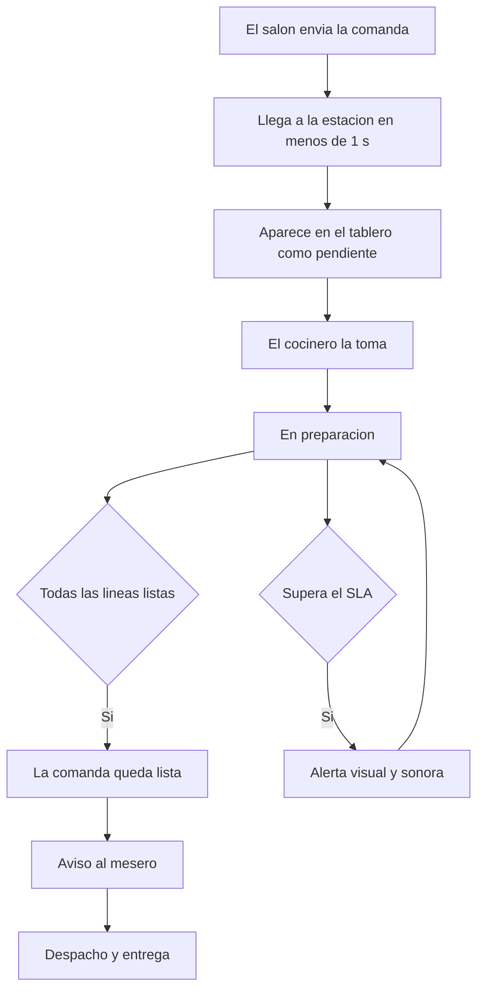

# 04 — KDS de cocina

## 1. Objetivo y alcance

Definir los requerimientos del **KDS (Kitchen Display System)**: la pantalla de cocina que recibe
las comandas por estación, permite prepararlas, marcarlas y despacharlas, y avisa al salón.

Es el destino de los envíos generados por el APK del mesero (`03-apk-mesero.md`) y por la web de
pedidos (`02-web-pedidos-cliente.md`).

### 1.1 Dentro de alcance

- **Tablero por estación** con las comandas entrantes en tiempo real.
- **Estados** de la comanda y de sus líneas (pendiente, en preparación, lista, entregada).
- **Tiempos y SLA** por estación, con alertas.
- **Despacho** de comandas listas y aviso al mesero.
- **Anulaciones y agotados** desde cocina.
- **Resiliencia**: seguir viendo el tablero si cae la red y recargarlo al reconectar.

### 1.2 Fuera de alcance (otros documentos)

| Tema | Dónde |
|---|---|
| Toma de pedido, salón y cobro | `03-apk-mesero.md` |
| Pedidos del cliente (mesa, recoger, domicilio) | `02-web-pedidos-cliente.md` |
| Carta, reservas y marketing del sitio | `01-web-reservas-cliente.md` |
| Administración de estaciones, productos y usuarios | Backoffice (documento propio) |

## 2. Actores

| Actor | Descripción | Puede |
|---|---|---|
| Cocinero | Prepara en una estación | Ver sus comandas, marcarlas en preparación y listas |
| Expeditor / jefe de cocina | Coordina el despacho | Ver todas las estaciones, priorizar y despachar |
| Mesero | Recoge y sirve | Recibe el aviso de "listo" en su APK |
| Administrador | Configura | Define estaciones, SLA y pantallas |

## 3. Modelo de operación

- **Estaciones:** la cocina se divide en estaciones (parrilla, fríos, barra, postres…). Cada producto
  pertenece a una estación, que determina dónde se prepara y dónde se imprime.
- **Comandas:** cada envío del salón genera comandas por estación; una comanda agrupa las líneas que
  esa estación debe preparar, siempre con referencia al pedido, la mesa y el mesero.
- **Una comanda por estación:** un pedido con productos de varias estaciones se divide en tantas
  comandas como estaciones intervengan, sin perder la unidad del pedido.
- **Sin comanda en estaciones vacías:** si un producto no tiene estación (vacío o `99`), no genera
  comanda ni impresión.
- **SLA:** cada estación tiene un objetivo de tiempo; al superarlo se alerta visual y sonoramente.
- **Despacho:** cuando una comanda está lista, se avisa al mesero; el mesero la recoge y sirve.

## 4. Flujo principal

## 5. Requisitos funcionales (RF)

Prioridad referida a esta interfaz: `MVP` = imprescindible al lanzar el KDS; `V1` = versión
completa; `V2` = evolución posterior.

### 5.1 Tablero y visualización

| ID | Requisito | Prioridad | Criterio de aceptación |
|---|---|---|---|
| RF-R4-01 | Recibir y mostrar la comanda en menos de 1 segundo desde el envío | MVP | La comanda aparece sin recargar la pantalla |
| RF-R4-02 | Tablero con comandas ordenadas por antigüedad y color por estado | MVP | Se distinguen pendiente, en preparación y lista |
| RF-R4-03 | Ver el detalle de la comanda: mesa, pedido, número, turno, mesero, hora, líneas, notas, modificadores y fracción | MVP | Toda la información necesaria está en la tarjeta |
| RF-R4-04 | Filtrar por estación y por tipo de pedido (mesa, recoger, domicilio) | V1 | El filtro no oculta alertas de SLA |
| RF-R4-05 | Resaltar prioridad: pedidos programados, web con hora y pedidos marcados | V1 | Lo prioritario se ve primero |
| RF-R4-06 | Vista de expedidor unificada con todas las estaciones | V1 | El expedidor ve el estado global |
| RF-R4-07 | Historial del turno: comandas listas, entregadas y anuladas | V1 | Se puede consultar lo del día |
| RF-R4-08 | Pantalla completa con tipografía grande y legible a distancia | MVP | Se lee de pie, con la pantalla a varios metros |

### 5.2 Estados y avance

| ID | Requisito | Prioridad | Criterio de aceptación |
|---|---|---|---|
| RF-R4-10 | Marcar la comanda en preparación | MVP | El estado se refleja en el salón |
| RF-R4-11 | Marcar líneas o platos como listos | MVP | Se puede marcar por línea |
| RF-R4-12 | Marcar la comanda lista (automático al estar todas las líneas, o explícito) | MVP | La regla de paso a lista es la configurada |
| RF-R4-13 | Reflejar la entrega que marca el mesero | V1 | El estado final queda sellado |
| RF-R4-14 | Devolver una comanda a pendiente por error | V1 | Requiere permiso y queda auditado |
| RF-R4-15 | Deshacer la última acción inmediata | V2 | Solo si no compromete el estado confirmado |

### 5.3 Enrutamiento y estaciones

| ID | Requisito | Prioridad | Criterio de aceptación |
|---|---|---|---|
| RF-R4-20 | Cada pantalla recibe solo las comandas de su estación | MVP | No se mezclan estaciones salvo en la vista de expedidor |
| RF-R4-21 | Las estaciones vacías o marcadas `99` no generan comanda ni impresión | MVP | Esa estación no recibe nada |
| RF-R4-22 | Dividir una comanda con líneas de varias estaciones por estación | MVP | Cada estación recibe solo lo suyo |
| RF-R4-23 | Reasignar una comanda a otra estación (supervisor) | V2 | Queda auditado |

### 5.4 Tiempos, SLA y prioridad

| ID | Requisito | Prioridad | Criterio de aceptación |
|---|---|---|---|
| RF-R4-30 | Mostrar el tiempo transcurrido y el objetivo (SLA) de la estación | MVP | El tiempo se cuenta desde el envío |
| RF-R4-31 | Alertar visual y sonoramente al superar el SLA | V1 | La alerta es perceptible en cocina |
| RF-R4-32 | Silenciar o posponer la alerta con registro | V1 | El silencio queda registrado |
| RF-R4-33 | Ordenar por antigüedad y por urgencia del SLA | MVP | El pedido más antiguo va primero |
| RF-R4-34 | Distinguir los pedidos programados para no prepararlos antes de tiempo | V1 | No entran a la cola activa antes de su ventana |

### 5.5 Despacho y comunicación con el salón

| ID | Requisito | Prioridad | Criterio de aceptación |
|---|---|---|---|
| RF-R4-40 | Al quedar lista, avisar al mesero responsable | MVP | El aviso llega al APK del mesero |
| RF-R4-41 | Ver las comandas listas pendientes de recoger | V1 | El expedidor ve qué falta despachar |
| RF-R4-42 | Avisar al salón de una comanda anulada o de un agotado | V1 | El mesero lo ve en su APK |
| RF-R4-43 | Reimprimir una comanda desde el KDS | V1 | Queda auditado |
| RF-R4-44 | Enviar un mensaje rápido al mesero (p. ej. "falta guarnición") | V2 | El mesero lo recibe como aviso |

### 5.6 Anulaciones y agotados

| ID | Requisito | Prioridad | Criterio de aceptación |
|---|---|---|---|
| RF-R4-50 | Anular una línea o una comanda con motivo | MVP (línea) / V1 (comanda) | Queda auditado y el salón lo ve |
| RF-R4-51 | Marcar un producto como agotado desde cocina | V1 | El agotado se refleja en salón y web |
| RF-R4-52 | Ver las cancelaciones hechas por el salón y quién las hizo | V1 | La cocina sabe qué ya no debe preparar |

### 5.7 Configuración, pantallas y resiliencia

| ID | Requisito | Prioridad | Criterio de aceptación |
|---|---|---|---|
| RF-R4-70 | Seleccionar la estación de una pantalla | MVP | Cada pantalla queda ligada a su estación |
| RF-R4-71 | Vincular y revocar pantallas del KDS | V1 | Un dispositivo revocado no opera |
| RF-R4-72 | Seguir mostrando el tablero si se cae la conexión al servidor | V1 | No se pierde la vista de lo ya recibido |
| RF-R4-73 | Recargar el tablero completo al reconectar, sin depender de la memoria local | MVP | El estado se restaura desde el servidor |
| RF-R4-74 | Funcionar con la impresión como respaldo si el KDS no está disponible | MVP | La comanda igual llega impresa a la estación |
| RF-R4-75 | Pausar la preparación de una categoría o producto del día | V1 | Se refleja como no disponible |

## 6. Reglas de negocio (RN-R4)

| ID | Regla |
|---|---|
| RN-R4-01 | El tablero activo muestra solo lo **pendiente** de la estación; lo entregado sale de la vista activa |
| RN-R4-02 | Los estados avanzan en un solo sentido; retroceder requiere permiso y queda auditado |
| RN-R4-03 | Una comanda pasa a **lista** cuando todas sus líneas lo están, o por marcado explícito según la configuración |
| RN-R4-04 | Una estación vacía o marcada `99` no genera comanda ni impresión |
| RN-R4-05 | La comanda nunca pierde su referencia al pedido, a la mesa y al mesero |
| RN-R4-06 | El SLA se mide desde el envío de la comanda hasta que queda lista |
| RN-R4-07 | La alerta de SLA no se silencia sin dejar registro |
| RN-R4-08 | Anular una comanda ya preparada requiere autorización |
| RN-R4-09 | Un agotado marcado en cocina se refleja en el salón y en la web |
| RN-R4-10 | El KDS no es la fuente de verdad: puede seguir mostrando el tablero sin red, pero los estados se confirman en el servidor y al reconectar se recarga el estado real |
| RN-R4-11 | La cocina no ve datos personales del cliente: solo lo operativo (mesa, pedido, notas de preparación) |

## 7. Tablero — detalle

- **Tarjeta de comanda:** número de comanda y de pedido, mesa o modalidad (recoger/domicilio),
  turno, mesero, hora de envío, tiempo transcurrido, líneas con cantidad, descripción,
  modificadores, notas y fracción ("N T").
- **Organización:** por estado (pendiente, en preparación, lista) y ordenada por antigüedad/SLA;
  el color distingue el estado y el borde o fondo resalta cuando el SLA se excede.
- **Vista por estación:** cada pantalla muestra su estación; el **expeditor** tiene una vista
  unificada.
- **Historial:** pestaña o vista con lo listo/entregado/anulado del turno.
- **Pantallas múltiples:** más de una pantalla puede mostrar la misma estación (todas reciben los
  mismos eventos).

## 8. Tiempos y SLA — detalle

- **Objetivo por estación** configurable (segundos o minutos) y, opcionalmente, por producto.
- **Medición:** del envío de la comanda (sello de hora) a su paso a lista.
- **Alertas:** cambio de color al acercarse al objetivo y alerta visual + sonora al superarlo;
  silencio registrado.
- **Pedidos programados:** no entran a la cola activa hasta su ventana; se muestran aparte.
- **Prioridad:** los programados y los pedidos con hora prometida se ordenan para cumplir.

## 9. Despacho — detalle

- Cuando la comanda queda **lista**, se avisa al mesero responsable y aparece en la vista de
  despacho del expedidor.
- El **mesero** recoge y sirve; al hacerlo se marca **entregada** (desde su APK o desde el KDS).
- Las comandas listas y no recogidas se destacan para no dejar platos esperando.
- Los avisos son visibles tanto en cocina como en el salón y quedan en el historial del turno.

## 10. Agotados y anulaciones — detalle

- **Agotado desde cocina:** marca un producto como no disponible; se propaga al salón y a la web.
- **Anulación desde salón:** la comanda anulada desaparece de la cola activa y la cocina ve el
  motivo y el responsable.
- **Anulación desde cocina:** una línea o toda la comanda, con motivo; si ya se preparó, requiere
  autorización.
- **Auditoría:** toda anulación y reasignación queda registrada.

## 11. Diseño UX/UI

- **Legible a distancia:** texto grande, alto contraste, pensado para pantallas de pared.
- **Toque rápido:** acciones principales (tomar, listo) a un toque, sin menús profundos.
- **Colores por estado** con apoyo de texto e iconos (no solo color, por daltonismo).
- **Sonido configurable:** distinto para comanda nueva y para SLA excedido; silenciable con registro.
- **Resistencia a dedos sucios/guantes:** botones amplios, sin gestos finos.
- **Sin saturación:** en horas pico la lista debe seguir siendo escaneable (agrupación y filtros).

## 12. Datos implicados (insumo para la base de datos)

Además de las entidades compartidas (`Pedido`, `Pedido_linea`, `Comanda`, `Comanda_linea`,
`Estacion`, `Impresora`, `Producto`, `Disponibilidad`), este documento obliga a modelar:

| Entidad | Campos requeridos por este documento | Origen |
|---|---|---|
| `Estacion` | sucursal, nombre, tipo (preparación/despacho), SLA objetivo, impresora asociada | RF-R4-20, §8 |
| `Producto` | estación, tiempo objetivo de preparación | §8, RF-R4-30 |
| `Comanda` | estación, estado, sellos (`enviada_en`, `lista_en`, `entregada_en`), número, turno | §5.2 |
| `Comanda_linea` | comanda, pedido_linea, estado, notas | §7 |
| `Dispositivo` | tipo (KDS), estación asignada, versión, última conexión, estado | RF-R4-70, RF-R4-71 |
| `Ajuste_pedido` / `Evento_auditoria` | anulaciones, reasignaciones y silencios de alerta con motivo y usuario | RN-R4-07, §10 |
| `Disponibilidad_producto` | agotado y su origen (cocina/salón), vigencia | RF-R4-51, RN-R4-09 |
| `Regla_sla` | sucursal, estación (o producto), objetivo en segundos | §8 |

Notas para el modelo: la **estación** es la clave del enrutamiento (equivale a `IFCOCINA` del
legado); la comanda debe guardar sus **sellos de tiempo**; el KDS es un **dispositivo vinculado a una
estación**; y el **agotado** debe poder originarse en cocina con propagación inmediata.

## 13. Integraciones

| Integración | Uso | Prioridad |
|---|---|---|
| Salón (APK del mesero) | Estados de comanda, avisos de "listo" y de anulación | MVP |
| Print agent local | Comandas impresas como respaldo y reimpresión | MVP |
| Web de pedidos | Comandas de pedidos web y agotados | V1 |
| Catálogo / backoffice | Estaciones, productos, SLA y disponibilidad | MVP |
| Tiempo real | Recepción de comandas y estados por WebSocket | MVP |

## 14. Requisitos no funcionales (RNF-R4)

| ID | Requisito |
|---|---|
| RNF-R4-01 | Latencia de recepción de la comanda en el KDS menor a 1 segundo (p95) |
| RNF-R4-02 | Disponibilidad alta durante el horario de operación |
| RNF-R4-03 | Resiliencia de red local: si se pierde el enlace, no se pierde la vista ya recibida y se recarga al reconectar |
| RNF-R4-04 | Legibilidad y accesibilidad visual (contraste y tamaño) para pantallas de cocina |
| RNF-R4-05 | Sonido configurable y perceptible en el ruido de la cocina |
| RNF-R4-06 | Multi-sucursal y multi-tenant; cada estación pertenece a una sucursal |
| RNF-R4-07 | Seguridad por dispositivo vinculado; la pantalla no requiere sesión individual por plato |
| RNF-R4-08 | Recarga completa del tablero al reconectar sin depender del estado local |

## 15. Métricas del KDS

| Métrica | Descripción |
|---|---|
| Tiempo de preparación | Media y p90 por estación, desde el envío hasta "lista" |
| Cumplimiento de SLA | Comandas dentro del objetivo / total, por estación |
| Comandas fuera de tiempo | Alertas de SLA excedido por turno |
| Latencia comanda → KDS | p50 y p95 de recepción |
| Despacho | Tiempo entre "lista" y "entregada" |
| Errores | Anulaciones y devoluciones a pendiente por 1.000 comandas |
| Agotados | Marcas de agotado por turno y su duración |
| Carga | Comandas por hora y por estación (para dimensionar) |

## 16. Casos borde

| Caso | Comportamiento esperado |
|---|---|
| Comanda con líneas de varias estaciones | Se divide y cada estación recibe solo lo suyo |
| Producto sin estación (vacío o `99`) | No genera comanda ni impresión |
| Se cae la red del KDS | Se mantiene la vista recibida y se recarga al reconectar |
| La impresora falla pero el KDS está activo | El KDS sigue mostrando la comanda; la impresión se reintenta |
| Producto agotado mientras se prepara | Se avisa; si ya está en preparación, se decide con el salón |
| Comanda anulada durante la preparación | Desaparece de la cola y se registra el motivo |
| Pedido programado enviado temprano | No entra a la cola activa hasta su ventana |
| Sobrecarga de comandas | Se ordena por antigüedad/SLA y se destacan las vencidas |
| Dos pantallas con la misma estación | Ambas reciben los mismos eventos y estados |
| Comanda lista pero el mesero no la recoge | Se destaca en la vista de despacho |
| Hora del dispositivo desfasada | El servidor sella los tiempos oficiales |
| SLA mal configurado | Se avisa y se permite corregir en el backoffice |

## 17. Preguntas abiertas para el cliente

| # | Pregunta | Supuesto por defecto |
|---|---|---|
| 1 | ¿Qué hardware usa el KDS: pantalla grande, tableta o TV? | Pantalla o tableta de pared por estación |
| 2 | ¿Habrá KDS además de impresión, o solo uno de los dos? | Ambos: KDS como principal e impresión como respaldo |
| 3 | ¿Cuál es el SLA objetivo por estación? | Por definir con el chef antes del piloto |
| 4 | ¿Quién marca "entregada": el mesero o la cocina? | El mesero |
| 5 | ¿Cuántas estaciones hay y cuáles? | Parrilla, fríos, barra y postres (ajustable) |
| 6 | ¿El paso a "lista" es automático o explícito? | Automático al marcar todas las líneas |
| 7 | ¿Quién puede anular una comanda ya preparada? | El capitán o el chef |
| 8 | ¿La cocina marca agotados, o solo el backoffice? | Ambos |

## 18. Fuera de alcance / pendientes

- Recetas, consumo de insumos e inventario: fase posterior (no modelado aquí).
- Pantallas de cliente o "vitrina de pedidos listos": no contempladas.
- Analítica avanzada de cocina: se apoya en las métricas del §15.
