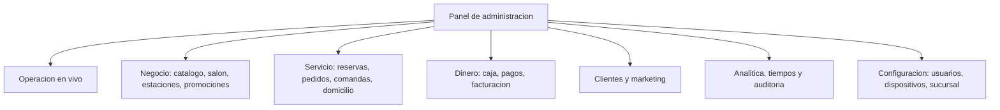

# 05 — Panel de administración (backoffice)

## 1. Objetivo y alcance

Definir los requerimientos del **panel de administración** del producto: la herramienta desde la
cual el negocio configura, opera y **rastrea todo lo que pasa** con reservas, pedidos, comandas,
pagos y usuarios, con sus **tiempos de atención y preparación**.

Es la vista de administración general que consume lo que producen las otras cuatro interfaces
(`01`–`04`) y la que hace posible operar, medir y auditar.

### 1.1 Dentro de alcance

- **Operación en vivo:** tablero con pedidos, reservas, mesas, comandas y alertas.
- **Módulos de negocio:** catálogo y carta, salón, estaciones/impresoras/SLA, promociones.
- **Servicio:** reservas, pedidos, comandas, domicilio y repartidores.
- **Dinero:** caja y turnos, pagos, propinas, descuentos y facturación.
- **Clientes y marketing:** base de clientes, consentimientos, reseñas, newsletter.
- **Analítica:** reportes de ventas, reservas, ocupación y **tiempos**.
- **Trazabilidad:** bitácora por reserva y por pedido, y auditoría global de acciones.
- **Configuración:** usuarios, roles, dispositivos, sucursal, notificaciones e integraciones.

### 1.2 Fuera de alcance (otros documentos)

| Tema | Dónde |
|---|---|
| Interfaz y flujos del cliente final | `01-web-reservas-cliente.md`, `02-web-pedidos-cliente.md` |
| Interfaz del mesero | `03-apk-mesero.md` |
| Tablero de cocina | `04-kds-cocina.md` |
| Arquitectura técnica y modelo de datos | `../` (vistas de arquitectura) |

## 2. Actores y roles

| Rol | Alcance | Puede |
|---|---|---|
| Dueño / administrador global | Todas las sucursales | Todo, incluida configuración y usuarios |
| Gerente de sede | Su sucursal | Operar su sede, ver sus reportes, gestionar su personal |
| Capitán / jefe de piso | Su turno | Salón, reservas, excepciones de pedidos |
| Cajero | Su turno y caja | Caja, cobros, cierre |
| Jefe de cocina / chef | Cocina | Estaciones, SLA, agotados, comandas |
| Marketing | Configuración | Promociones, cupones, newsletter, reseñas |
| Contador / auditor | Lectura | Reportes, facturación, auditoría |

El **alcance por sucursal** es parte del permiso: un rol puede existir en varias sedes o en una sola.

## 3. Mapa de módulos

## 4. Requisitos funcionales (RF)

Prioridad referida a este panel: `MVP` = imprescindible para operar el piloto; `V1` = versión
completa; `V2` = evolución posterior.

### 4.1 Operación en vivo

| ID | Requisito | Prioridad | Criterio de aceptación |
|---|---|---|---|
| RF-R5-01 | Tablero en vivo con pedidos activos por estado, modalidad y canal | MVP | Se actualiza sin recargar la página |
| RF-R5-02 | Estado del salón: mesas ocupadas, reservas del día y próximas llegadas | MVP | El gerente ve la operación de un vistazo |
| RF-R5-03 | Comandas vencidas o próximas a vencer su SLA, por estación | MVP | Se destacan las que superan el objetivo |
| RF-R5-04 | Alertas de infraestructura: impresoras, dispositivos y sincronización pendiente | V1 | Cada alerta enlaza al diagnóstico |
| RF-R5-05 | Accesos directos a las excepciones (reimprimir, reasignar, anular, reembolsar) | V1 | La acción respeta permisos y se audita |

### 4.2 Catálogo y carta

| ID | Requisito | Prioridad | Criterio de aceptación |
|---|---|---|---|
| RF-R5-10 | CRUD de categorías y productos: precios, impuestos, fotos, alérgenos y modificadores | MVP | Un cambio se refleja en las interfaces según vigencia |
| RF-R5-11 | Disponibilidad por sede y por horario; agotados y reactivación | MVP | El agotado se propaga a web, APK y KDS |
| RF-R5-12 | Importación y exportación masiva del catálogo (CSV) | V1 | Un archivo inválido se rechaza con detalle |
| RF-R5-13 | Historial de cambios de precio y de catálogo | V1 | Queda quién, cuándo y el valor anterior |
| RF-R5-14 | Destacados, recomendados y menú del día | V1 | Se controla desde el panel |
| RF-R5-15 | Programación de vigencia de cambios (precio y disponibilidad) | V2 | El cambio entra en vigor sin intervención manual |

### 4.3 Salón y mesas

| ID | Requisito | Prioridad | Criterio de aceptación |
|---|---|---|---|
| RF-R5-20 | CRUD de zonas y mesas con capacidad y posición en el mapa | MVP | El mapa coincide con el salón real |
| RF-R5-21 | Estados de mesa y bloqueo por mantenimiento (`fuera_servicio`) | MVP | Una mesa bloqueada no se ofrece |
| RF-R5-22 | Unión y división de mesas | V1 | Las configuraciones se guardan y se reflejan en el APK |
| RF-R5-23 | Franjas y aforo por zona para reservas | V1 | Limita la disponibilidad de la web |

### 4.4 Estaciones, impresoras y SLA

| ID | Requisito | Prioridad | Criterio de aceptación |
|---|---|---|---|
| RF-R5-30 | CRUD de estaciones y asignación de productos | MVP | Cada producto tiene estación o queda sin comanda |
| RF-R5-31 | CRUD de impresoras, rutas y copias por documento | MVP | Las copias respetan la configuración |
| RF-R5-32 | SLA por estación y por producto | MVP | Se usa para alertas y reportes de tiempos |
| RF-R5-33 | Prueba de impresión y diagnóstico desde el panel | V1 | El resultado es visible para soporte |
| RF-R5-34 | Configurar el paso a "lista" (automático o explícito) | V1 | La regla se aplica en el KDS |

### 4.5 Reservas

| ID | Requisito | Prioridad | Criterio de aceptación |
|---|---|---|---|
| RF-R5-40 | Listado y calendario de reservas por sede, fecha y estado | MVP | Filtros combinables y exportables |
| RF-R5-41 | Crear, editar, reubicar y cancelar reservas manualmente | MVP | Toda acción manual queda registrada |
| RF-R5-42 | Asignación de mesa y gestión de la lista de espera | MVP | No se sobre-asigna una mesa |
| RF-R5-43 | Políticas de reserva: antelación, duración, tolerancia, máximo de personas, depósito y no-show | MVP | Las políticas rigen la web y el panel |
| RF-R5-44 | Marcar llegada (`sentada`), finalización y `no_show` | MVP | El estado actualiza la ocupación y los reportes |
| RF-R5-45 | Registro de depósitos, cobros y reembolsos de reserva | V1 | Se concilia con caja |
| RF-R5-46 | Bloqueos por festivos, cierres temporales y eventos | V1 | La web no ofrece esas franjas |
| RF-R5-47 | **Bitácora de la reserva**: línea de tiempo con todas las acciones | MVP | Cada evento muestra actor, canal, hora y resultado (§6.1) |

### 4.6 Pedidos

| ID | Requisito | Prioridad | Criterio de aceptación |
|---|---|---|---|
| RF-R5-50 | Listado en vivo e historial con filtros (sede, canal, modalidad, estado, mesero, fecha) | MVP | Los filtros se combinan y se guardan |
| RF-R5-51 | Detalle del pedido: líneas, modificadores, comandas, pagos y descuentos | MVP | Refleja exactamente lo cobrado y lo impreso |
| RF-R5-52 | **Bitácora del pedido**: línea de tiempo con todas las acciones y sus tiempos | MVP | Incluye creación, envío, comandas, pagos y cancelaciones (§6.2) |
| RF-R5-53 | Acciones sobre el pedido: reasignar mesa o mesero, anular línea o pedido, reimprimir y reenviar | MVP (básicas) / V1 (todas) | Cada acción pide motivo y queda auditada |
| RF-R5-54 | Reembolsos y notas crédito con permiso | V1 | Se concilia con el pago original |
| RF-R5-55 | Forzar un estado con autorización especial | V2 | Queda auditado con motivo y doble confirmación |
| RF-R5-56 | Exportación de pedidos del período | V1 | La exportación respeta el permiso y deja registro |

### 4.7 Comandas y cocina

| ID | Requisito | Prioridad | Criterio de aceptación |
|---|---|---|---|
| RF-R5-60 | Monitor de comandas por estación con estado y tiempo transcurrido | MVP | Coincide con lo que ve el KDS |
| RF-R5-61 | Cumplimiento de SLA y alertas; historial del turno | V1 | El reporte se puede exportar |
| RF-R5-62 | Reasignar comandas entre estaciones | V2 | Queda auditado |
| RF-R5-63 | Ver anulaciones, reimpresiones y agotados con su responsable | V1 | Enlaza con la auditoría |

### 4.8 Caja, cobros y propinas

| ID | Requisito | Prioridad | Criterio de aceptación |
|---|---|---|---|
| RF-R5-70 | Abrir y cerrar turnos de caja; arqueo y diferencias | MVP | El cierre cuadra con los pagos del turno |
| RF-R5-71 | Ver pagos, medios, propinas y descuentos del turno | MVP | Detalle por pedido y por medio |
| RF-R5-72 | Reapertura de caja con permiso y auditoría | V1 | La reapertura queda registrada con motivo |
| RF-R5-73 | Configurar los medios de pago por sede | MVP | Un medio deshabilitado no se ofrece |
| RF-R5-74 | Reporte de cierre por turno y consolidado del día | MVP | Incluye propinas y descuentos |
| RF-R5-75 | Liquidación de propinas por período | V1 | Se exporta para el reparto que decida el local |

### 4.9 Facturación

| ID | Requisito | Prioridad | Criterio de aceptación |
|---|---|---|---|
| RF-R5-80 | Consultar facturas emitidas, su estado y sus notas crédito | V1 | Enlaza con el pedido y el pago |
| RF-R5-81 | Configurar impuestos, resoluciones y prefijos | V1 | Los consecutivos respetan la resolución |
| RF-R5-82 | Reintentos y diagnóstico del proveedor de facturación | V1 | Un error queda visible con su causa |

### 4.10 Clientes

| ID | Requisito | Prioridad | Criterio de aceptación |
|---|---|---|---|
| RF-R5-90 | Ficha del cliente con su historial de reservas y pedidos | V1 | Solo roles autorizados ven sus datos |
| RF-R5-91 | Consentimientos, preferencias y bajas (opt-out) | MVP | La baja se respeta en todos los canales |
| RF-R5-92 | Segmentos básicos (recurrentes, inactivos, cumpleaños) | V2 | Se usan para campañas |
| RF-R5-93 | Derecho de acceso, rectificación y anonimización | V1 | La anonimización no rompe los reportes fiscales |

### 4.11 Marketing

| ID | Requisito | Prioridad | Criterio de aceptación |
|---|---|---|---|
| RF-R5-100 | Promociones y banners con vigencia y sede | V1 | Lo vencido no se publica |
| RF-R5-101 | Cupones con reglas, usos máximos y control de abuso | V1 | Un cupón agotado no aplica |
| RF-R5-102 | Suscriptores y envíos de newsletter | V1 | Solo a contactos con consentimiento |
| RF-R5-103 | Reseñas y encuestas: consulta, moderación y publicación | V1 | Una reseña ofensiva no se publica |
| RF-R5-104 | Métricas de campañas por UTM y origen | V2 | Atribución de reservas y pedidos |

### 4.12 Domicilio y repartidores

| ID | Requisito | Prioridad | Criterio de aceptación |
|---|---|---|---|
| RF-R5-110 | Zonas de cobertura (geometría), tarifas y pedido mínimo | V1 | La web valida contra esta configuración |
| RF-R5-111 | Alta de repartidores y asignación manual o sugerida | V1 | La asignación notifica al repartidor |
| RF-R5-112 | Seguimiento de entregas, tiempos y evidencia | V1 | La entrega se cierra con marca de tiempo |
| RF-R5-113 | Liquidación por período (entregas, tarifas, propinas) | V2 | Se exporta y se concilia |

### 4.13 Reportes y analítica

| ID | Requisito | Prioridad | Criterio de aceptación |
|---|---|---|---|
| RF-R5-120 | Ventas por período, sede, canal, modalidad y producto | MVP | Coincide con caja y facturación |
| RF-R5-121 | Reservas: volumen, ocupación, no-show y lista de espera | MVP | Se puede filtrar por sede y fecha |
| RF-R5-122 | **Tiempos**: atención, preparación, despacho, entrega y cobro (§6.3) | MVP | Por pedido, por estación y por mesero |
| RF-R5-123 | Desempeño por mesero, cajero y turno | V1 | Con anulaciones y descuentos asociados |
| RF-R5-124 | Impuestos, propinas y descuentos del período | V1 | Listo para contabilidad |
| RF-R5-125 | Reportes programados por correo y exportación CSV/Excel | V1 | La entrega programada queda registrada |
| RF-R5-126 | Comparativo entre sucursales | V1 | Mismas métricas y períodos |
| RF-R5-127 | Tablero personalizable por rol | V2 | Cada usuario arma su vista |

### 4.14 Trazabilidad y auditoría

| ID | Requisito | Prioridad | Criterio de aceptación |
|---|---|---|---|
| RF-R5-130 | Bitácora global de acciones sensibles con filtros y exportación | MVP | Quién, qué, cuándo, dónde y por qué |
| RF-R5-131 | Línea de tiempo de cada reserva y cada pedido (§6) | MVP | Todos los eventos del ciclo, en orden |
| RF-R5-132 | Ver el antes y el después de cada cambio | MVP | Aplica a precios, estados, pagos y descuentos |
| RF-R5-133 | Inmutabilidad y retención configurable de la auditoría | MVP | Nadie edita ni borra un evento |
| RF-R5-134 | Alertas por umbral (descuentos altos, anulación tras preparación, reaperturas) | V2 | Se notifica al responsable |

### 4.15 Usuarios, roles y permisos

| ID | Requisito | Prioridad | Criterio de aceptación |
|---|---|---|---|
| RF-R5-140 | CRUD de usuarios, roles y permisos con alcance por sucursal | MVP | Un permiso retirado aplica de inmediato |
| RF-R5-141 | Plantillas de rol (mesero, cajero, capitán, chef, marketing, contador) | MVP | Se pueden clonar y ajustar |
| RF-R5-142 | Altas, bajas y suspensión con auditoría | MVP | Un usuario dado de baja no puede iniciar sesión |
| RF-R5-143 | Segundo factor para administradores | V1 | Obligatorio según la política del cliente |
| RF-R5-144 | Permisos temporales por turno | V2 | Expiran automáticamente y quedan auditados |

### 4.16 Dispositivos y versiones

| ID | Requisito | Prioridad | Criterio de aceptación |
|---|---|---|---|
| RF-R5-150 | Inventario de dispositivos y vinculación/revocación | MVP | Un dispositivo revocado deja de operar |
| RF-R5-151 | Control de versión mínima por tipo de dispositivo | V1 | Fuerza la actualización |
| RF-R5-152 | Diagnóstico: última conexión, operaciones pendientes y errores | V1 | Enlaza con la alerta correspondiente |

### 4.17 Configuración

| ID | Requisito | Prioridad | Criterio de aceptación |
|---|---|---|---|
| RF-R5-160 | Datos de la sucursal, horarios, zona horaria, moneda e impuestos | MVP | Rige la operación de esa sede |
| RF-R5-161 | Parámetros de operación: propina sugerida, copias, comportamiento offline, límites por franja | MVP | Se reflejan en las interfaces |
| RF-R5-162 | Plantillas de notificación por evento y canal | V1 | Cada aviso usa la plantilla vigente |
| RF-R5-163 | Ventanas de programación de pedidos y recogida | V1 | La web respeta la ventana |
| RF-R5-164 | Alta de sucursal y clonado de configuración | V1 | Una sede nueva hereda la base y se ajusta |

## 5. Catálogo de tiempos y trazabilidad

### 5.1 Eventos de la reserva (bitácora)

| Evento | Se registra con | Alimenta |
|---|---|---|
| `solicitada` | canal, fecha y hora | Embudo de reservas |
| `confirmada` | usuario/automatización, hora | Tasa de confirmación |
| `recordatorio_enviado` | canal, hora | Efecto del recordatorio |
| `reagendada` | antes/después, motivo | Cambios de la demanda |
| `cancelada_cliente` / `cancelada_local` | motivo, actor | Motivos y cargos |
| `sentada` | hora real, mesa asignada | **Tiempo de espera** y ocupación |
| `no_show` | hora de marcado, actor | Tasa de no-show |
| `finalizada` | hora | **Duración de la mesa** |

### 5.2 Eventos del pedido (bitácora)

| Evento | Se registra con | Alimenta |
|---|---|---|
| `creado` | canal, modalidad, sede, usuario/cliente | Volumen y embudo |
| `enviado` | hora, mesero | **Tiempo de atención** |
| `comanda_enviada` | comanda, estación, hora | **Tiempo de preparación** (inicio) |
| `comanda_en_preparacion` | hora, usuario | SLA por estación |
| `comanda_lista` | hora | **Tiempo de preparación** (fin) |
| `listo` | hora | **Tiempo de despacho** (inicio) |
| `entregado` | hora, usuario | **Tiempo de despacho** (fin) |
| `en_camino` / `recogido` | hora, repartidor | **Tiempo de ruta / recogida** |
| `por_cobrar` | hora | **Tiempo de cobro** (inicio) |
| `pagado` | medio, monto, propina, hora | **Tiempo de cobro** (fin), ventas |
| `cancelado` / `reembolsado` | motivo, actor | Excepciones y calidad |

### 5.3 Definición de tiempos

| Tiempo | Fórmula | Uso |
|---|---|---|
| **Tiempo de atención** | `enviado` − `creado` | Rapidez del salón y de la mesa por QR |
| **Tiempo de preparación** | `comanda_lista` − `comanda_enviada`, por estación | Desempeño de cocina y SLA |
| **Tiempo de preparación del pedido** | `listo` − `enviado` (todas las comandas) | Promesa al cliente |
| **Tiempo de despacho** | `entregado` − `listo` | Eficiencia de meseros |
| **Tiempo de ruta** | `entregado` − `recogido` (domicilio) | Desempeño de reparto |
| **Tiempo de recogida** | `recogido_en` − `listo` (recoger) | Experiencia de recogida |
| **Tiempo de cobro** | `pagado` − `por_cobrar` | Caja y cierre de mesa |
| **Tiempo total del pedido** | `pagado`/`entregado` − `creado` | Indicador integral |
| **Tiempo de espera de reserva** | `sentada` − `fecha_hora` | Cumplimiento de la reserva |
| **Duración de mesa** | `cierre` − `apertura` | Rotación y ocupación |
| **Cumplimiento de SLA** | comandas dentro del objetivo / total, por estación | Calidad de cocina |

Reglas de los tiempos: todos se calculan con **sellos del servidor** (no del dispositivo), se
guardan por evento y se agregan para reportes; un pedido o comanda sin evento de cierre no entra en
los promedios de ese tramo.

### 5.4 Trazabilidad de acciones

Cada acción (de cliente, mesero, cocina, caja o administrador) queda registrada con **actor, canal,
dispositivo, fecha y hora, valor anterior y valor nuevo**, y es consultable desde la bitácora del
pedido, la bitácora de la reserva o la bitácora global de auditoría.

## 6. Trazabilidad con los requerimientos anteriores

| Módulo del panel | Requisitos que atiende |
|---|---|
| Catálogo y carta | `01` §6 (RF-R1-20…) · `02` RF-R2-01/05/06/10 |
| Promociones y cupones | `01` RF-R1-41 · `02` RF-R2-05/06 |
| Reservas y políticas | `01` §4.1 y §5 (RF-R1-01…14) |
| Salón y mesas | `01` RF-R1-60/61 · `03` §5.2 |
| Estaciones, impresoras y SLA | `03` §5.7 · `04` §5.3 y §5.4 |
| Pedidos y comandas | `02` §5 (RF-R2-40…) · `03` §5.4 · `04` §5.1/5.2/5.5 |
| Caja, pagos y propinas | `02` §5.3 · `03` §5.5 |
| Facturación | `02` RF-R2-33 |
| Clientes y consentimientos | `01` RF-R1-30/31 · `02` RF-R2-21/25 |
| Marketing | `01` §4.4 y §7 |
| Domicilio y repartidores | `02` §5.6 |
| Notificaciones | `01` RF-R1-06/07 · `02` RF-R2-71 · `03` RF-R3-35 · `04` RF-R4-40 |
| Dispositivos y versiones | `03` RF-R3-02/06 · `04` RF-R4-70/71 |
| Trazabilidad y auditoría | `03` RN-R3-05/08 · `04` §10 · todos los RF con permisos |
| Tiempos y SLA | `04` §8 · `03` §15 · `02` §15 |

## 7. Reglas de negocio (RN-R5)

| ID | Regla |
|---|---|
| RN-R5-01 | Toda acción sensible queda auditada: actor, hora, dispositivo, motivo y antes/después |
| RN-R5-02 | La auditoría y las bitácoras son **inmutables**; se conservan según la retención configurada |
| RN-R5-03 | Los reportes leen agregados, nunca la base operativa en caliente |
| RN-R5-04 | Un cambio de catálogo o precio **no altera** pedidos ni reservas ya creados (snapshot) |
| RN-R5-05 | Solo el administrador global gestiona usuarios y configuración global; el gerente, su sede |
| RN-R5-06 | Reabrir caja, reembolsar, anular tras preparación y cambiar precios exigen permisos específicos |
| RN-R5-07 | Los datos personales se enmascaran para los roles que no los necesitan |
| RN-R5-08 | Los tiempos se calculan con sellos del servidor, no del dispositivo |
| RN-R5-09 | Una reserva o un pedido no se borra: se cancela; el cliente se puede anonimizar sin romper lo fiscal |
| RN-R5-10 | Toda exportación respeta permisos y deja registro de quién la hizo |
| RN-R5-11 | Festivos, cierres y bloqueos afectan la disponibilidad y se reflejan en los reportes |
| RN-R5-12 | Un turno cerrado no se modifica sin reapertura auditada |

## 8. Diseño UX/UI

- **Densa pero ordenada:** tablas con filtros combinables, búsqueda global y guardado de vistas.
- **Operación primero:** el tablero en vivo es la pantalla de entrada; las alertas llevan a la acción.
- **Responsive:** operable desde computador y tableta; móvil solo para consulta y aprobaciones.
- **Sin sorpresas:** toda acción destructiva pide confirmación, motivo y muestra el impacto.
- **Estados claros:** vacío, cargando, error y sin permisos, siempre explicados.
- **Accesibilidad:** contraste, foco y navegación por teclado; exportaciones legibles.
- **Trazabilidad visible:** desde cualquier pedido o reserva se llega a su bitácora en un clic.

## 9. Datos implicados (insumo para la base de datos)

Además de las entidades ya identificadas en `01`–`04` (`Sucursal`, `Zona`, `Mesa`, `Producto`,
`Categoria`, `Politica_reserva`, `Horario_atencion`, `Cierre_temporal`, `Reserva`, `Lista_espera`,
`Pedido`, `Pedido_linea`, `Comanda`, `Comanda_linea`, `Estacion`, `Impresora`, `Pago`,
`Pago_linea`, `Ajuste_pedido`, `Factura`, `Medio_pago`, `Turno`, `Cierre_caja`, `Cliente`,
`Promocion`, `Cupon`, `Suscriptor`, `Resena`, `Notificacion`, `Plantilla_notificacion`,
`Zona_cobertura`, `Repartidor`, `Domicilio_asignacion`, `Dispositivo`, `Usuario`, `Rol`,
`Permiso`, `Sync_operacion`, `Evento_auditoria`, `Regla_sla`, `Regla_capacidad`,
`Disponibilidad_producto`), este documento obliga a modelar:

| Entidad | Campos requeridos por este documento | Origen |
|---|---|---|
| `Bitacora_evento` | entidad tipo (reserva/pedido/comanda), entidad_id, evento, actor, canal, dispositivo, hora, datos antes/después | §5, RF-R5-47/52/131 |
| `Reporte_guardado` | usuario, nombre, tipo, filtros, visibilidad | RF-R5-50, RF-R5-127 |
| `Exportacion` | usuario, tipo, filtros, formato, creado_en, estado | RN-R5-10, RF-R5-56/125 |
| `Reporte_programado` | tipo, filtros, periodicidad, destinatarios, activo | RF-R5-125 |
| `Alerta_operativa` | tipo, severidad, entidad, estado, atendida_por, atendida_en | RF-R5-04, RF-R5-134 |
| `Liquidacion_repartidor` | repartidor, período, entregas, tarifas, propinas, total | RF-R5-113 |
| `Segmento_cliente` | nombre, criterio, actualizado_en | RF-R5-92 |
| `Consentimiento` | cliente, tipo, canal, base legal, fecha, vigencia | RF-R5-91 |
| `Umbral_alerta` | tipo, valor, rol destinatario | RF-R5-134 |
| `Configuracion_notificacion` | evento, canal, plantilla, activo | RF-R5-162 |

Notas para el modelo: la **bitácora** puede materializarse a partir de `Evento_auditoria` más los
sellos de las entidades; los **tiempos** se derivan de los sellos (§5.3) y se agregan por período;
los **reportes** deben poder reconstruirse desde datos históricos, incluso si el catálogo cambió.

## 10. Integraciones

| Integración | Uso | Prioridad |
|---|---|---|
| Web de reservas y de pedidos | Consulta y corrección de reservas y pedidos | MVP |
| APK del mesero y KDS | Monitor en vivo, alertas y excepciones | MVP |
| Print agent | Pruebas de impresión y reimpresiones | MVP |
| Caja | Cierres, arqueos y conciliación | MVP |
| Facturación electrónica | Facturas y notas crédito | V1 |
| Pasarela de pagos | Reembolsos y conciliación | V1 |
| Correo / WhatsApp / SMS | Notificaciones y reportes programados | V1 |
| Contabilidad / BI externo | Exportación e integración | V2 |

## 11. Requisitos no funcionales (RNF-R5)

| ID | Requisito |
|---|---|
| RNF-R5-01 | Aislamiento estricto multi-tenant y por sucursal: ningún rol ve datos fuera de su alcance |
| RNF-R5-02 | Frescura: lo operativo (pedidos, comandas, mesas) en tiempo real; lo analítico, con retardo máximo de 1 minuto |
| RNF-R5-03 | Los reportes no degradan la operación (leen agregados) |
| RNF-R5-04 | Exportaciones con límites claros y aviso cuando el volumen es alto |
| RNF-R5-05 | Auditoría inmutable con retención configurable y respaldo |
| RNF-R5-06 | Seguridad de administración: sesiones robustas y segundo factor cuando el cliente lo exija |
| RNF-R5-07 | Accesibilidad AA y navegación por teclado |
| RNF-R5-08 | Español como idioma base; formatos de moneda, fecha y zona horaria por sucursal |
| RNF-R5-09 | Toda consulta sensible (datos personales) deja registro de acceso |

## 12. Métricas del panel

| Métrica | Descripción |
|---|---|
| Uso por rol | Usuarios activos del panel y módulos que usan |
| Alertas atendidas | Tiempo medio entre alerta y acción |
| Excepciones | Anulaciones, descuentos y reembolsos por período |
| Trazabilidad | Porcentaje de pedidos con bitácora completa |
| Reportes | Reportes consultados, programados y exportados |
| Adopción de configuración | Sedes con catálogo, horarios y SLA configurados |

## 13. Casos borde

| Caso | Comportamiento esperado |
|---|---|
| Dos administradores editan el mismo producto | Se bloquea o se avisa el conflicto; gana lo confirmado por el servidor |
| Cierre de caja con pedidos abiertos | Se impide o se advierte con el detalle de lo pendiente |
| Reapertura de un turno ya cerrado | Requiere permiso, motivo y deja rastro completo |
| Reembolso mayor al pago | Se rechaza |
| Anulación de un pedido ya preparado | Requiere autorización y motivo |
| Cambio de precio con carritos abiertos | Los carritos se recalculan antes de confirmar; los pedidos ya creados no cambian |
| Extensión de horario en caliente | La web y el APK usan el horario vigente al momento de la acción |
| Cierre temporal con reservas futuras | Las reservas afectadas se notifican y reubican |
| Exportación muy grande | Se limita, se procesa en segundo plano y se avisa al solicitante |
| Cliente pide borrar sus datos | Se anonimiza al cliente y se conserva lo fiscal sin datos personales |
| Zona horaria de sede distinta a la del administrador | Fechas y horas se muestran en la zona de la sede |
| Dispositivo offline con operaciones pendientes | El panel lo muestra en el diagnóstico, no lo oculta |

## 14. Preguntas abiertas para el cliente

| # | Pregunta | Supuesto por defecto |
|---|---|---|
| 1 | ¿Quién usa el panel y desde qué dispositivo? | Gerencia en computador; capitanes desde tableta |
| 2 | ¿Se exige segundo factor para administradores? | Sí, en V1 |
| 3 | ¿Cuánto tiempo se conserva la auditoría? | 2 años configurable |
| 4 | ¿Qué reportes se envían automáticamente y a quién? | Cierre diario por correo a gerencia |
| 5 | ¿Se permite que el gerente cambie precios? | No; solo solicita o requiere aprobación |
| 6 | ¿Se integra con contabilidad existente? | Exportación; integración en V2 |
| 7 | ¿Habrá consolidado multi-sucursal? | Sí, en V1 |
| 8 | ¿El cliente administra su propia sucursal (rol dueño)? | Sí, con alcance por sucursal |

## 15. Fuera de alcance / pendientes

- Nómina y gestión de personal más allá de usuarios y roles.
- Inventario, recetas y compras: fase posterior.
- Integración contable automática (tipo `INTERDSI` del legado): V2.
- Aplicación móvil propia para administración: no contemplada; el panel será responsive.
